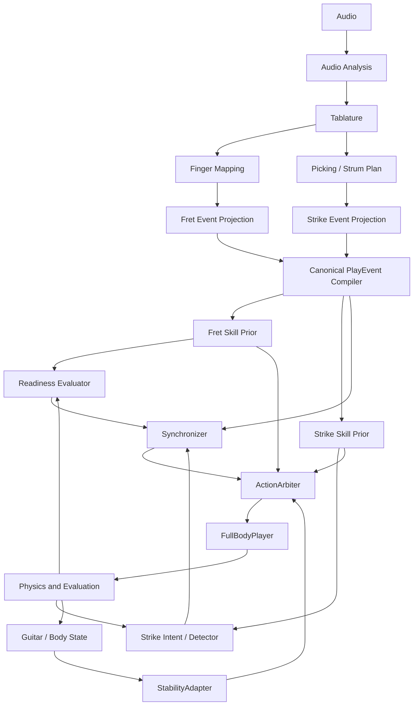

# 전체 연구 메인 계획 — Master Plan

> 상태: **현재 연구 구조의 설계 정본 — 구현 상태는 모듈별로 구분**
>
> 이 디렉터리는 오디오 입력부터 최종 기타 연주까지의 기준 흐름과 모듈 계약을 정리한다.
> 설계 계약의 기준 문서이며, 구현 완료 여부는 아래 상태표와 각 모듈 문서에서 별도로 기록한다.

## 기준 문서의 우선순위

계약이 아직 봉인되지 않은 동안에는 실제 코드와 자동 검증 결과를 현재 상태의 근거로 사용하고, `master_plan/`은 목표 구조로 사용한다. 계약이 승인되면 이 디렉터리의 공통 계약과 결정 기록을 새 기준으로 삼는다.

기존 `full/`은 병합 설계와 residual prototype을 보관하는 참고 영역이다. `master_plan/`과 내용이 다르면 어느 쪽을 채택할지 결정 기록에 남긴 뒤 계약을 갱신한다.

## 현재 연구 방향과 실행 우선순위

2026-10-10 사용자 승인 반영. 이 README가 **전체 연구 메인 계획의 진입점**이다. 아래 방향은 설계 기준이며, 단계별 성능은 실제 검증 뒤에만 완료로 기록한다.

**오디오에서 얻은 연주 계획을, 자유롭게 움직이는 기타를 지지하는 휴머노이드의 정확하고 자연스러운 연주로 구현한다.** 핵심 연구 질문은 고정 기타에서 배운 곡별 Fret·Strike 기술을 움직이는 자유 기타에서도 보존하면서, 기타를 연주 가능한 허용 범위에 유지할 수 있는가이다. 정지 안정성은 중간 성과이며 실제 압현·타현과 함께 달성해야 한다.

### 문서 역할과 현재 실험 조건

- 전체 목표·우선순위·검증 순서: 이 문서. 파트별 계약은 아래 문서 순서를 따른다.
- 자유 기타의 현재 실행·구현 계획: [StabilityAdapter 2 메인 계획](/home/ajou/yigyu/3/stability_adapter_2/PLAN.md:1). 새 초기 자세·제어 실험은 `stability_adapter_2/`에서 진행한다.
- 해당 실험 결과·로그·이미지·영상: [결과 모음](/home/ajou/yigyu/3/docs/2026-10-12/stability_adapter_2/README.md:1). 실행 전 원문과 결과는 보존한다.
- [과거 논문 계획](/home/ajou/yigyu/3/docs/PAPER_PLAN.md:1)은 폐기된 환경 기준의 기록이다. 그 문서와 이전 StabilityAdapter 계획의 WAIT/복귀 목표/action 차원을 현재 실험 조건으로 승계하지 않는다. 기존 `stability_adapter/`와 관련 계획·산출물은 보존한다.
- 현재 초기 검증은 humanoid root·하체 고정, Torso·Spine·Chest 9관절 PD 목표 유지, Thorax부터 양손 손가락까지 66관절을 주요 제어 범위로 한다. 실제 움직임은 기록하며 제어 가능 관절 수와 학습 action 차원은 구분한다. 아래 105D ABI/97D 설명은 전체 named 계약이며 이 실험의 가동 관절 수와 같지 않다.
- 기타는 자유 물리 상태다. 기타 고정·강제 손 부착·지속 pose 덮어쓰기·기타 pose servo는 사용하지 않는다. 고정 기타 비교군은 별도 원본 태스크에서 평가한다.
- 사용자 지정 허용 범위 안에서는 초기 p/q의 정확한 복귀를 요구하지 않고 작은 흔들림을 허용한다. WAIT → REACH → GRIP → TRANSPORT를 연주의 필수 과정으로 두지 않는다. 현재 체크포인트 실험의 2초 준비는 전환 관찰 조건이며, 완전 정지나 지속 손바닥 접촉을 연주 조건으로 만들지 않는다.
- 스트랩은 ON/OFF 비교 변수다. 현재 고정 길이 비교 결과로 모든 스트랩의 유효성이나 무스트랩 성공을 일반화하지 않는다. 길이·자세·제어 변경은 분리해서 평가한다.

### 모델 현실성의 우선순위

연주 결과에 영향을 주는 접촉 형상과 물리 설정부터 확인한다. 기타 넥 단면·두께, 손바닥·엄지·손가락 접촉면, 허벅지 지지면, 실제 적용된 질량·질량중심·관성·마찰을 점검한다. 시각 mesh와 충돌 형상은 구분하여 표시하고, 원본 형상 검사와 실제 PhysX 접촉·관통 진단도 구분한다.

공용 자산과 기존 체크포인트는 보존한다. 형상·물리 보정이 필요하면 별도 자산 버전을 만들고 관절 이름·순서·좌표계·checkpoint 계약의 영향을 기록한다. 변경 전후 고정 기타 기준 성능을 다시 확인한다. 사실적인 피부·의복·목재 표현은 자세 판단과 결과 전달을 위한 별도 개선으로 진행하며, 외형 개선만으로 제어 성능 개선을 주장하지 않는다.

실제 줄 변형·pick-string 반력·음향 합성은 현재 메인 범위에서 제외한다. 가상 줄 crossing은 음악 이벤트만 생성하며 기타에 충격을 가하지 않는다. 따라서 실제 타현 반력 대응을 성과로 주장하지 않는다. 기존 MP-027/028 계약을 유지한다.

### 단계별 계획과 통과 조건

| 단계 | 실행 내용 | 다음 단계로 넘어갈 검증 기준 |
|---|---|---|
| 1. 기준 성능·계약 확인 | 기존 체크포인트를 원래 고정 기타 태스크에서 평가하고 새 환경의 관측·action·좌표·속도·PD·판정 차이를 확인 | 원래 기술의 실패와 환경 이전 실패를 구분하고 차이를 재현 가능한 기록으로 남김. 원본 환경을 확보하지 못하면 수정 환경 결과를 원본 재현으로 표시하지 않음 |
| 2. 필요한 형상·물리 점검 | 초기 관통과 손–넥 접근을 진단하고 연주에 영향을 주는 접촉면·물리 설정만 필요한 만큼 보정 | 시작 관통·비정상 접촉의 원인과 대책 확인, 초기 운지·타현 공간 확보, 자산 변경 후 기준 성능 영향 확인 |
| 3. 자유 기타의 단일 동작 | 현재 기타 좌표 기준 손목 접근을 제한적으로 보정하여 한 음 압현·유지와 한 번의 타현을 각각 평가 | 원래 음악 판정으로 동작 성공을 확인하고 같은 구간의 기타 허용 범위·관절·접촉 상태를 함께 검증 |
| 4. 안정화 보정 학습 | 기존 기술 prior를 바탕으로 관절별 제한된 residual을 소규모 학습. 학습 전 최종 목표 합성과 history 계약 검증 | 동일 입력 비교에서 음악 성능을 보존하면서 범위 이탈·미끄러짐 개선. 수치 기준·표본·학습 자원은 소단계 계획에 먼저 명시 |
| 5. 양손·곡 통합 | 이벤트 전환 → 짧은 구절 → 곡 순서로 공통 PlayEvent·Synchronizer에 연결 | 양손 음악 정확도·타이밍과 허용 범위 유지를 동시에 확인하고 여러 초기 조건에서 반복 평가 |

단계별 문제는 작은 진단으로 분리하되, 초기 배치만 반복 개선하며 음악 동작 평가를 미루지 않는다. 새 단일 이벤트 진단과 전체 체크포인트 실행은 구별한다. 체크포인트 실행은 현재 2초 준비 후 원본 첫 done까지 시작부터 녹화하고 정상 완료·실패·시간 초과·안전 중단을 분리한다.

### 제어권과 학습 구조

Fret·Strike는 음악 목표를 만들고, 기타 상대 접근·안정화 제어는 허용된 관절의 제한 보정을 제안한다. 최종 목표는 `ActionArbiter`가 관절별 소유권·우선순위·크기·변화율·모델 한계를 적용해 한 번만 제출한다. 최종 적용 목표를 관측 history에 반영하며 보정의 단순 합산이나 중복 평활화를 피한다.

준비 팔 목표 유지와 손가락 21축 분리는 원인 진단이다. 최종 연주에서 팔을 계속 준비 자세에 묶거나 손바닥·모든 손가락의 지속 접촉을 강제하지 않는다. 66관절의 사용 권한을 유지하면서 필요성이 확인된 관절부터 학습 보정 권한을 연다. 보정 범위와 기술 보존을 검증한 뒤 학습 구조를 결정한다.

### 평가와 비교군

- **음악:** 올바른 압현·오압현·유지, 타현 줄·방향·순서·타이밍, 이벤트 및 곡 완료. 기타 안정화 보상으로 음악 실패를 상쇄하지 않는다.
- **안정성:** 사용자 허용 범위 내 시간, 최대 범위 이탈·지속시간·복귀 시간, 미끄러짐·낙하. 초기 p/q 대비 변화는 진단값이며 단독 성공/실패 기준이 아니다. 회전 범위는 Euler 한 표현이 아닌 허용 회전 집합으로 평가한다.
- **자세·물리:** 관절 한계·속도·가속도·불필요한 동작, 보정량·포화, 접촉·관통과 실제 확보된 힘/토크 지표. 자연스러움은 영상 평가와 함께 보고하고 사람 자료와의 비교 없이 human-like 성능을 주장하지 않는다.
- **비교:** 원본 고정 기타 기준선, 자유 기타+동결 기술, 기타 상대 접근 보정, 학습 보정. 자유 기타 비교군끼리는 초기 상태·이벤트·seed·자산·물리 설정을 맞춘다. 스트랩 ON/OFF와 형상 변경은 별도 요인으로 비교하며 서로 다른 종료시각의 전체 최대값은 같은 길이 성능으로 비교하지 않는다.
- **반복 검증:** 여러 허용 초기 자세와 작은 교란에서 성공률·분산·실패 원인을 기록한다. 후보 탐색 조건과 최종 평가 조건을 구분한다. 곡별 학습·평가 원칙은 유지하며 미학습 곡 일반화나 실제 로봇 이전 성능을 주장하지 않는다.

### 현재 근거와 다음 소단계

[준비 팔 목표 유지·Fret 손가락 시험](/home/ajou/yigyu/3/docs/2026-10-12/stability_adapter_2/results/fret_fingers_arm_hold_v1/README.md:1)은 같은 시각의 초기 기타 이탈을 줄였으나 압현 성공률은 0%였다. [기존 길이 스트랩 ON 비교](/home/ajou/yigyu/3/docs/2026-10-12/stability_adapter_2/results/fret_fingers_strap_v1/README.md:1) 역시 압현 성공률 0%였고 PLAY 동안 계산 장력은 0 N이었다. 두 결과는 원본 학습환경 재현이 아닌 차이를 기록한 전이 진단이다.

현재 우선 가설은 움직이는 기타에 대한 손 접근과 연주·지지 관절의 제어권 충돌이다. 다음은 **현재 기타 기준 왼손 손목·목표 프렛 오차와 접촉면을 시각화하고, 손가락 정책을 보존하는 제한된 팔 보정으로 한 음의 압현·유지를 검증**한다. 형상 원인이 확인되면 해당 부위만 별도 버전으로 보정한다.

- [x] 전체 연구 방향·형상 개선 우선순위·단계별 검증·평가 기준을 메인 계획에 기록.
- [ ] 원본 고정 기타 성능·전이 계약 차이 확인과 필요한 접촉·물리 점검.
- [ ] 현재 기타 기준 접근 오차 시각화 및 자유 기타 단일 압현·타현 검증.
- [ ] 제어 합성 검증 후 소규모 residual 비교 학습.
- [ ] 공통 시간축의 짧은 구절·곡 통합과 반복 평가.

## 1. 한 줄 정의

```text
Audio
  → Tablature
  → Finger Mapping / Picking Plan
  → Canonical PlayEvent
  → Fret Skill Prior + Strike Skill Prior
  → Synchronizer
  → StabilityAdapter
  → ActionArbiter
  → FullBodyPlayer
```

최종 목표는 같은 모듈 구조와 학습 절차를 여러 곡에 적용할 수 있는 시스템이다. 다만
Fret·Strike 가중치와 FullBody bundle은 곡별로 독립 학습·저장하며, 한 곡 checkpoint를
다른 곡의 완성 정책으로 직접 사용하지 않는다.
Song bundle은 train-song/test-song으로 분할하지 않고 각 곡의 학습과 평가에 모두 사용한다.
따라서 결과는 unseen-song generalization이 아니라 song-specific performance로 보고한다.
각 곡의 주 학습은 fresh initialization에서 시작하며 다른 곡 actor를 warm-start하지 않는다.

## 2. 전체 흐름



## 3. 모듈별 기준 책임

| 모듈 | 책임 | 직접 하지 않는 일 |
|---|---|---|
| Audio Analysis | 오디오에서 음표·onset·duration·박자 후보 추출 | 관절 제어, 최종 운지 확정 |
| Tablature | 음을 기타 줄·프렛 이벤트로 표현 | 손가락 번호와 실제 관절 action 생성 |
| Finger Mapping | 왼손의 줄·프렛·손가락·압현 순서 결정 | 오른손 pick 궤적 제어 |
| Picking / Strum Plan | 오른손의 줄·방향·순서·sweep timing 결정 | 왼손 readiness 판정 |
| Canonical PlayEvent | Fret과 Strike가 공유하는 event, 시간, deadline 생성 | policy action 생성 |
| Fret | 왼손 압현 기술 prior | 기타를 안정화하거나 오른손 timing 결정 |
| Strike | 오른손 pick/strum 기술 prior | Fret-ready 판정이나 기타 지지 |
| Synchronizer | 공통 음악 시간축, readiness, event permission 관리 | 기타 지지용 관절 torque |
| StabilityAdapter | 움직이는 기타의 자세·접촉·미끄러짐 보정 | score clock 변경, 손가락 압현 대체 |
| ActionArbiter | action 소유권·mask·cap·우선순위 적용 | 새로운 음악 의미 생성 |
| FullBodyPlayer | 위 모듈의 runtime 결합 | 학습 중 계약 우회 |

## 4. 공통 원칙

- raw audio는 우선 offline 전처리 입력으로 사용한다. 물리 actor가 waveform을 직접 읽는 end-to-end 구조는 별도 연구로 분리한다.
- Fret과 Strike는 최종 정책이 아니라 해당 곡의 G0→G2 전 단계에서 재사용하는
  song-specific 기술 prior다. 재사용 단위는 곡 사이의 동일 weight가 아니라 모듈 구조와
  학습 절차다.
- FullBody runtime에서는 Fret과 Strike가 별도 event cursor를 진행하지 않고 하나의 `Canonical PlayEvent`를 공유한다. 독립 학습 환경의 task-local cursor는 학습용으로만 사용한다.
- 오른손과 왼손이 실제로 성공했는지는 policy의 의도가 아니라 physics event detector와 readiness evaluator가 판정한다.
- Synchronizer는 timing supervisor이며 일반 관절 제어기가 아니다.
- StabilityAdapter의 출력은 반드시 `ActionArbiter`를 거친다. residual을 단순 합산하지 않는다.
- 기타 안정화 보상이 압현·타현 실패를 상쇄하지 않도록 음악·안정성·안전성 지표를 분리한다.
- 관측·행동·좌표계·단위·checkpoint 계약을 먼저 고정하고 장기 학습을 시작한다.

## 5. 현재 코드와의 관계

현재 실행 코드는 다음 위치에 있다.

| 단계 | 현재 위치 | Master Plan에서의 역할 |
|---|---|---|
| 오디오→탭 | `tab2fingermapping/` | Audio Analysis, Tablature 후보 |
| 곡별 데이터 | `data/song_bundles/` | 검수된 입력·중간 산출물·학습 artifact |
| Fret physics | `tab2body/env/tasks/task_fret.py` | Fret-v2 기본 환경 + Fret-v1 호환 baseline |
| Strike physics | `tab2body/env/tasks/task_strike.py` | Strike-v1 호환 모드 + Strike-v2 기본 환경 |
| Full 계약 | `tab2body/full/` | canonical event, rule Synchronizer, source loader, 105D named action bridge (실질 가동 97D) |
| Full 연결 | `tab2body/env/tasks/task_full.py` | one-step backend 계약; 단일 Isaac Gym FullG0Task는 미구현 |
| 자유 기타 전이 진단 | `stability_adapter_2/` | 고정 하체·자유 기타에서 Fret/Strike 연결·제어권·기록 진단. 양손 음악·안정화 통합 성능과 보정 학습은 미검증 |

현재 기본 계약은 Fret-v2 30 action/420 observation과 Strike-v2 30 action/303
observation이다. Fret-v1 425D와 Strike-v1 327D는 명시적으로 선택하는 호환 baseline이다.
기존 `full/`의 75D/81D, Fret 428D, Strike 321D 문서는 역사적 prototype이며 현재
105D FullBody 계약에 적용하지 않는다.

FullBody의 `105D`는 관절 이름과 순서를 보존하는 named ABI 슬롯 수다. 실제로 독립적인
제어 자유도로 사용하는 관절은 zero-range인 무릎·발가락 보조축 8개를 제외한 `97D`이며,
이 8개는 초기 자세 hold 슬롯으로 남긴다.

## 6. 문서 순서

1. [범위와 설계 원칙](00_scope_and_principles.md)
2. [오디오→Tablature](01_audio_to_tablature.md)
3. [Tablature→Finger Mapping](02_tablature_to_finger_mapping.md)
4. [Fret](03_fret.md)
5. [Strike](04_strike.md)
6. [Synchronizer](05_synchronizer.md)
7. [StabilityAdapter](06_stability_adapter.md)
8. [FullBodyPlayer](07_full_body_player.md)
9. [공통 계약](08_shared_contracts.md)
10. [학습·평가·승급](09_curriculum_and_evaluation.md)
11. [과거 결정 기록과 남은 미결정 사항](10_open_decisions.md)
