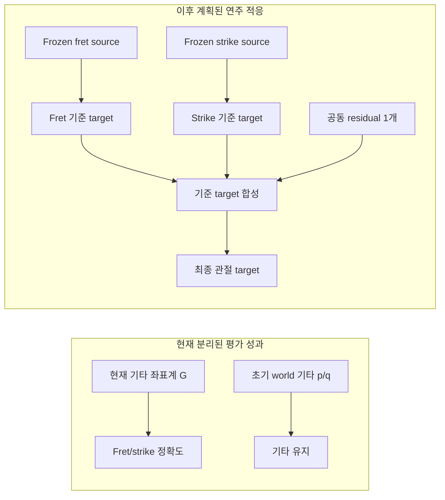

# Coupled support source screen v3

2026-10-08. v3는 저장된 Isaac 인체/기타 자세와 CPU source shape를 이용해 4개 시점의 기준 자세와 12개 임시 지지 제안을 검사했다. 네 기준 배치의 fraction은 0이고, 각 시점의 제안 fraction은 1, 0.5, 0.25다. 총 16개 결과를 모두 그림과 표에 남겼다.

## 검증 범위와 결과

| 항목 | 저장 결과 |
|---|---|
| 제안 모델 held-out 검증 | pose prediction 264/264 통과 (`24 × 11`); 최대 위치 오차 0.000263 mm, 최대 회전 오차 7.5881e−7 rad |
| Identity / derivative | delta 0인 자세 4개 모두 identity; derivative column 18개 모두 finite·nonzero, central half-step 일치 검사 통과 |
| Source screen | 배치 16개, 배치별 같은 왼손 비인접 pair 110개; 각 배치에서 human–guitar, native 허용 self, cross-hand pair도 검사 |
| Native / physics / inference / training | 0 / 0 / 0 / 0 |

임시 proposal vector는 왼팔 scalar 좌표 12개와 single-hinge 6개로 이루어진 18D다. 이는 source geometry 후보를 검사하는 범위이며 기존 final 66-control authority를 대체하지 않는다. 네 시점은 이전 실제 trial에서 저장한 physics step 0, 24, 120, 1200의 자세, 즉 0, 0.1, 0.5, 5초다. 아래 source shape 재배치는 CPU 후처리이며 새 native 초기화나 물리 재생이 아니다.

### 모든 16개 배치

| 저장 시점 (s) | fraction | LH:palm 최소 patch-distance 상한 (mm) | source 방향 screen |
|---:|---:|---:|---|
| 0 | 0 | 0.4216695221 | fail |
| 0 | 0.25 | 1.0368167770 | fail |
| 0 | 0.5 | 1.6187194174 | fail |
| 0 | 1 | 2.7861234738 | fail |
| 0.1 | 0 | 5.2595893608 | fail |
| 0.1 | 0.25 | 5.3059437574 | fail |
| 0.1 | 0.5 | 5.3579604435 | fail |
| 0.1 | 1 | 5.4869564349 | fail |
| 0.5 | 0 | 9.9941448508 | fail |
| 0.5 | 0.25 | 9.9729016694 | **only pass** |
| 0.5 | 0.5 | 10.0163619705 | fail |
| 0.5 | 1 | 9.8077179664 | fail |
| 5 | 0 | 8.9129227534 | fail |
| 5 | 0.25 | 9.1830876446 | fail |
| 5 | 0.5 | 9.5434226979 | fail |
| 5 | 1 | 9.9194933577 | fail |

통과한 유일 행은 0.5초 / fraction 0.25의 source screen이다. 표시한 palm patch-distance 상한은 9.9729016694 mm로, 0.5초 기준 상한 9.9941448508 mm보다 0.0212431814 mm(21.243 µm) 낮다. 이 작은 source geometry 변화는 유효한 물리 보정 효과를 입증하지 않는다. 제안 target을 사용한 물리 PD trial은 실행하거나 채택하지 않았다.

### 그림 1 — 이산 palm-patch source 거리

가로축 범주는 저장 시점 0, 0.1, 0.5, 5.0초이고 세로축은 `min(patch_distance_intervals['LH:palm'].distance_m) × 1000`을 mm로 표시한다. 범주 간격은 시각적 구분을 위해 균등하며 연속 시간축은 아니다. 표식의 모양/색은 fraction을 구분한다. 점은 서로 연결하지 않은 이산 snapshot이다. 세로축 범위 0.17–10.566362 mm는 저장된 모든 값을 포함하며, 별 표식은 source 방향 screen의 유일한 통과 행이다.

기준 배치는 저장된 world 인체 자세와 기타 자세를 사용한다. 제안 배치는 측정 snapshot에 18D delta를 적용해 인체 source shape만 가상 재배치하고, 기타는 저장 pose로 유지한다. `distance_m`은 이 배치에서 계산한 유한 기타 patch와 손 hull 사이의 source convex-distance witness 상한이다. 이에 대응하는 support-plane 하한과 primal-dual 간격이 거리 certificate를 이룬다. 별도의 LP common-radius self-screen은 source pair의 교차를 검사하며 finite-patch 거리와 다른 측정이다. 둘 다 cooked 관통·접촉 또는 이후 PD 응답을 인증하지 않는다. 유일한 source-screen 통과는 물리 지지 결과가 아니다.

## Source geometry와 이후 연주 적응

Source model은 저장된 Isaac state 자세와 MuJoCo flattened source mesh를 사용하며 환경을 렌더하지 않는다. v3 탐색은 human–guitar pair, native 허용 self pair, cross-hand pair, 배치별 같은 왼손 비인접 pair 110개를 검사한다. `common_radius_m` pair screen은 source pair 교차 검사이고 finite-patch 거리 상한은 별도의 source 거리 certificate다.

사용자가 정한 연주 목표는 다음 두 성과를 구분한다.

| 성과 | 기준 좌표계 | 측정 내용 |
|---|---|---|
| Fret/strike 정확도 | 현재 기타 좌표계 G | 손가락과 pick이 올바른 이벤트/시점에 현재 현·프렛에 도달하는지 |
| 기타 유지 | 초기 world 위치·자세 | 자유 기타가 초기 world p/q 근처에 머무는지 |

이 source screen은 연주 정확도와 기타 유지 성과 어느 쪽도 측정하지 않는다. 이후 평가 계획은 기존 fret/strike 정책을 frozen 상태로 두고 하나의 shared residual로 최종 관절 target을 만들도록 제안한다. 여기서는 residual을 구현하지 않았고 model inference나 학습 update도 실행하지 않았다.

이후 순서는 [playing residual 평가 계획](</home/ajou/yigyu/3/stability_adapter_2/PLAYING_RESIDUAL_EVALUATION.md>)에 있다. 물리 시각자료로는 이전 [LA −2 mm 실제 Isaac Gym 손목 시험 영상](</home/ajou/yigyu/3/docs/2026-10-12/stability_adapter_2/videos/body9_strap_minus2mm_v1__native__hands.mp4>)만 참고로 연결한다. 이 영상은 v3 proposal의 렌더나 물리 결과가 아니다.

## Provenance

v1/v2 실패 산출물은 보존했고 이 README와 그림은 승인된 v3 파일만 사용한다. Source search 기록은 exit code 0, native 초기화 0, physics step 0이다. 산출물 명령은 `/home/ajou/miniconda3/envs/rl38/bin/python /home/ajou/yigyu/3/stability_adapter_2/make_coupled_support_artifacts.py --out-dir /home/ajou/yigyu/3/docs/2026-10-12/stability_adapter_2/results/coupled_support_source_v1/artifacts`이며 exit code 0, elapsed 0.9381727980216965 s다. Native·physics·inference·training 호출은 모두 0이다.

- [v3 model validation](</home/ajou/yigyu/3/docs/2026-10-12/stability_adapter_2/results/coupled_support_source_v1/model.json>) · [v3 16-placement search](</home/ajou/yigyu/3/docs/2026-10-12/stability_adapter_2/results/coupled_support_source_v1/search_v3.json>)
- [v3 search execution record](</home/ajou/yigyu/3/docs/2026-10-12/stability_adapter_2/results/coupled_support_source_v1/search_execution_v3.json>) · [search log](</home/ajou/yigyu/3/docs/2026-10-12/stability_adapter_2/results/coupled_support_source_v1/search_v3.log>)
- [Artifact input/output manifest](</home/ajou/yigyu/3/docs/2026-10-12/stability_adapter_2/results/coupled_support_source_v1/artifacts/artifact_manifest.json>) · [artifact command, log, and exit record](</home/ajou/yigyu/3/docs/2026-10-12/stability_adapter_2/results/coupled_support_source_v1/artifacts/artifact_execution.json>)
- Earlier [preserved v1 result](</home/ajou/yigyu/3/docs/2026-10-12/stability_adapter_2/results/coupled_support_source_v1/search_v1_preserved/search.json>) and [preserved v2 result](</home/ajou/yigyu/3/docs/2026-10-12/stability_adapter_2/results/coupled_support_source_v1/search_v2_preserved/search_v2.json>).
- Root-owned [verification notes](</home/ajou/yigyu/3/docs/2026-10-12/stability_adapter_2/results/coupled_support_source_v1/ROOT_VERIFICATION_NOTES.md>) and [changed-files supplement](</home/ajou/yigyu/3/docs/2026-10-12/stability_adapter_2/results/coupled_support_source_v1/CHANGED_FILES_SUPPLEMENT.md>) are maintained separately.
