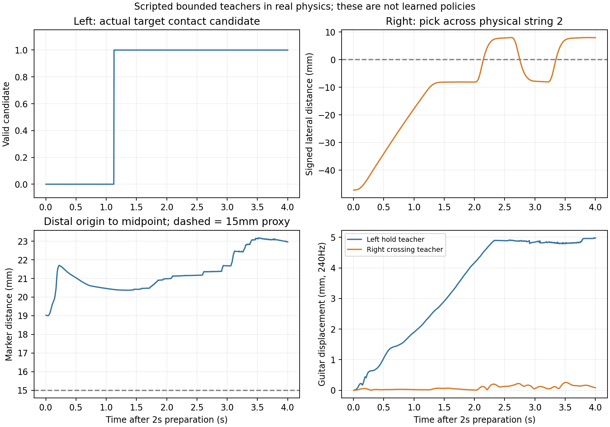
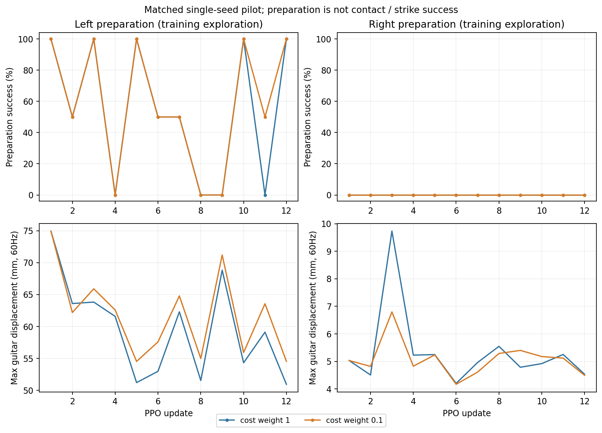

# 손 내부 커리큘럼·실제 궤적·안정성 비용 비교

단계 학습을 구현하고 양손의 현재 행동 범위 내 실제 성공 궤적을 확보했다. 비용1/0.1의 제한 학습4회는 모두 완료했지만, 마지막 정책의 결정적 평가에서는 준비 성취도0/2였다. **scripted 동작의 성공과 학습 정책의 성공을 구분한다. 비용만 낮추는 것을 주된 해결책으로 채택할 근거는 확보하지 못했다.**

## 구현과 조건

현재 진입점은 `guitar_learning.train_skills_v2`. [환경·입력·보상·단계 전달·실행 설명](/home/ajou/yigyu/3/guitar_learning/SKILL_CURRICULUM.md), [승인 범위·계획](/home/ajou/yigyu/3/docs/plans/guitar_learning_skill_curriculum_20261018.md).

- LH reach/contact/hold/timed, RH ready/cross/timed를 별도 실행한다. 모든 단계4초·원 악보 시간 유지·음악 판정 보존.
- 상태468+목적 상대 이력37=505, 이벤트64×24/우선2×24, 행동39(LH33/RH6), medium 전체 모델2,920,528파라미터. 기존 손별 Actor/PPO와 공유 reward/cost Critic 유지.
- Root고정·하체유한제어·105/97/8·기타자유/중력ON/스트랩OFF·기존gain/충돌/의자·2초준비·39codec 범위/평활화/속도 유지. 기타직접힘·부착·연속상태덮어쓰기 없음.
- 목표는 기존 첫 단음 물리2번줄·7프렛·약지·down. 다른 음/손가락 성공으로 대체하지 않았다. 원래 native접촉/기하타현 조건과 물리 실패 기준은 유지했다.

v1 검수에서 단계 보상 이력이 관측에 없는 문제를 발견하여 막 시작한3실행을 PPO업데이트0에서 중단·보존했다. v2는 이력 입력·reset시 이력 제거·같은tick 말 이력 반환을 구현했다. 중단 실행은 학습 비교에 포함하지 않았다. 기존코드·문서는 `guitar_learning/archive/20261018_before_skill_curriculum/`, v1 byte보관본은 `archive/20261018_before_skill_history_v2/`에 있다. 후자는 v2 작성 뒤 복사했지만 이미 봉인한 v1 SHA와 일치를 확인했다. v1 공용모듈은 v2의 활성 의존성이므로 원 경로도 유지한다.

## 실제 성공 궤적

| 항목 | LH 접촉 유지 | RH 기하 타현 |
| --- | --- | --- |
| 원 실행 | `left_servo_v3` | `right_grid_native_v2` |
| 현행505차원 재생 | `left_demonstration_v1` | `right_demonstration_v1` |
| 실험 길이 | 준비2초 + 평가4초 | 준비2초 + 평가4초 |
| 목표 성취 | 약지/2번줄/7프렛 후보690표본, 연속689구간=2.870833초 | 2번줄 down2/up1회; down속도약0.084858/0.085190m/s |
| 기타 최대 변위240Hz | 4.981620mm | 0.257666mm |
| 전체 지지·양발 접촉240Hz | 각각100% | 각각100% |
| 삼중 동시 지지240Hz | 6.5625% | 100% |
| 재현 | 별도fresh 실행과505차원 행동 재생에서도 동일 성취 | 505차원 행동 재생에서도 동일 성취 |

LH는 초기 원점 목표를 직접 누르는 후보에서 다른 줄 접촉이 생겼고, 실제 body-local 접촉 feature를 후보 marker로 사용하여 프렛선 부근을 겨냥한 v3에서 올바른 접촉 후보를 얻었다. 원래 접촉 판정을 완화하지 않았다. valid 증거의 최대 현 횡방향 오차2.915121mm, 최대 body-pair witness 차이약0.000013322mm였다. 이 값은 실제 현 압력이나 cooked 침투 깊이가 아니다.

LH 성공에서도 distal 원점–프렛중간점 거리는 최소19.003020mm였다. 따라서 기존15mm reach는 **실제 압현의 필요조건이 아니며 필수 승격 gate로 사용하면 안 된다.** 삼중 동시 지지가 낮고, 왼손이 기타 하중에 기여하지 않는다는 직접 검증도 없다. 현재는 원래 학습 실패 기준 안의 접촉 유지 후보이며, 초기 자세 V3의 모든 정밀 요구·하중 독립을 인증하지 않는다.

RH의 과거 v14 성공 명령은 wrist±0.25rad를 넘어 현재 codec으로 그대로 가져올 수 없었다. clipped 재생과 기존 y−.32m/depth8mm 경로 후보는 목표2번줄 성공을 얻지 못했다. 원래 허용 strike zone 내 다른 y/depth에 대한 bounded FK 후보를 만들고 native에서 검사했다. y≈−.36m/depth4mm/앞뒤8mm 경로가 성공했다. 좁은 앞뒤4mm 후보는 속도약0.0426m/s로 원래0.05m/s 기준에 미달하여 실패 기록으로 남겼다. 새 성공은 범위 확대나 속도 gate 완화의 결과가 아니다.

두505차원 데이터셋은 `demonstration.npz`에 **행동 직전 상태240×505, 이벤트/마스크/우선이벤트, 정규화 행동240×39**를 저장했다. 행동은 교사 실행과 exact였고 별도 native 재생에서도 성공했다. 이는 향후 초기화용 scripted 데이터이며 사람 motion 데이터나 이미 학습한 전문가 모델이 아니다. 원래 양손 음악 매칭은 두 경우 모두0이다. RH 첫 성공은 악보 onset1.12초보다 늦은2.15초다.

## 동일 비용 비교

각각fresh seed7/N2/H240/12 PPO업데이트/5,760전이/24완료episode, 합계23,040전이다. 단음과 단계·시작 모델·RNG·수집예산을 맞추고 `cost_weight`만1/.1로 바꿨다. 각 쌍의 초기모델·CPU/NumPy/Python/CUDA RNG와 첫 rollout17개 필드가 모두 exact였다. 모든 실행 입력 SHA와 persistent lifecycle 감사가 통과했다.

기존 작은 움직임 문제를 확인하기 위해 모든 파일럿의 초기 Gaussian std는 동일하게.25로 했다(이전약.05와다름). 이번 비교는 원래 guide/원점 shaping을 사용했고 위 성공 경로로 초기화하지 않았다. 이전 학습 대비 커리큘럼 단독 효과 또는 교사 경로 기반 학습 효과로 해석하지 않는다. 이전 actor_lr3e-5/critic_lr3e-4/epoch2 등은 유지했다. 장기 최적 파라미터를 확정한 실험도 아니다.

| 손/비용 가중치 | 탐색 중 준비 성공 | 실제 후보 획득·50ms유지 episode | 평균episode 비용 | 최대기타mm60Hz | 결정적 준비성공 | 결정적 최대기타mm60Hz |
| --- | --- | --- | --- | --- | --- | --- |
| left/1 | 13/24 | 7/24 · 2/24 | 13.893384 | 74.952 | 0/2 | 0.221 |
| left/0.1 | 14/24 | 9/24 · 1/24 | 14.751259 | 74.952 | 0/2 | 0.106 |
| right/1 | 0/24 | 0/24 · 0/24 | 0.086295 | 9.732 | 0/2 | 0.141 |
| right/0.1 | 0/24 | 0/24 · 0/24 | 0.086109 | 6.798 | 0/2 | 0.051 |

각 실행 물리 실패0회, 원래 음악매칭0회다. RH 학습에서는 유효 기하 통과0이었다. LH 탐색 중 후보를 획득한 episode와50ms 유지 episode는 준비 성공과 별도로 표시했다. 결정적 평가는 모델당 같은 준비 시작 상태에서2회, 총8회이며, 모두 물리 실패 없이4초 완주했다. 접촉·기하 타현의 결정적 정책 성공도 확인하지 못했다. 새로운 음·곡 일반화나 충분한 학습 예산을 검증한 결과는 아니다.

왼손 비용.1의 준비성공은13→14/24로 차이가 작고, 평균 비용은13.893384→14.751259로 증가했다. 실제50ms 유지 episode도2→1이었다. 오른손은두조건준비0/24이고결정적준비도0/2다. 단일seed의 작은 파일럿에서 비용 감소의 일반적 우열이나 통계적 유의성을 주장하지 않는다. 현재는 비용1을 보존하고, 성공 궤적과 실제 접촉 목표의 연결을 우선하는 편이 근거가 강하다.

첫 rollout의 정규화 전 GAE 표준편차에서 cost/reward 비는 LH3.294454/RH1.186758이었다(가중치.1이면 각각.329445/.118676). 이는 실제 PPO 입력 신호 크기 진단이며 Actor gradient 점유율이 아니다. 큰 탐색으로 기타가 최대약75mm 움직이면 비용이 커지는 것은 관측됐다. **안정성을 일괄 약화하기보다 적절한 성공 경로를 탐색하도록 만드는 것이 우선**이다.

## 남은 작업과 현재 권장 방향

1. LH는 원점–중간점15mm gate를 요구하지 말고 실제 접촉/유지를 기준으로 진행한다. RH는 검증한 허용영역 경로를 guide에 반영하는 별도 학습 설정이 필요하다. 현행 API의 `guide_config`로 설정할 수 있으며 파일럿 도중 기본값은 바꾸지 않았다.
2. 저장한 실제505차원 입력/행동으로 Actor 초기화·모방학습 또는 경로 주변 residual 탐색을 설계한다. **이번 작업에서 모방학습/교사 초기화 자체는 구현·실행하지 않았다.** 기존단계checkpoint전달과 scripted데이터초기화는다르다.
3. LH 하중 비의존·상완지지 회복/분담과 재현성·강건성을 확인한다. 이번4초 개별 skill 시험을83초 연속 초기 자세 검증으로 바꾸지 않는다.
4. 결정적 단일 손 성공을 얻은 뒤 악보 타이밍, 여러 목표, 전문가 결합을 진행한다. 이번 결과로 양손 결합 학습을 시작하지 않았다.

현 단계에서는 네트워크를 더 크게 만드는 것보다 목표 proxy·교사 경로·초기화를 먼저 다루는 것이 합리적이다. 모델 용량이 원인인지, 장기 학습만으로 해결되는지는 이 작은 비교로 판정하지 않았다. Root자유 균형·보행, 현 압력·진동·음향·사람 motion 유사성은 검증 범위 밖이다.

## 정본 파일과 재현

- [코드·실행법](/home/ajou/yigyu/3/guitar_learning/SKILL_CURRICULUM.md), `left/right_cost1p0/0p1_settings_v1.json`: 실제 고정 설정.
- `left/right_cost1p0/0p1_run_v2/`: initial/final/주기 checkpoint,설정/계약,실제transition·PPO·자원·수명감사.
- `left/right_cost1p0/0p1_eval_v1/`: strict 자체checkpoint를 불러온 실제 결정적2episode평가. `evaluate_v2.py` 사용.
- `left/right_demonstration_v1/`:505관측/39행동 데이터셋과 native재생. LH는 capture_demo_v1, RH는 pin을 확대한v2사용.
- `trajectory_analysis_v1.json`:12개의 scripted실행240Hz 원자료 요약,모든 실패 포함.
- `learning_comparison_v1.json`, `evaluation_comparison_v1.json`, `setup_comparison_v1.json`, `advantage_diagnostic_v1.json`:집계/초기동일성/신호크기 정본.
- `cpu_tests_v2.log`:전체189개통과. `review_implementation_v1/v2.md`, `review_experiments_v1.md`, `review_results_v1.md`:별도 검수.
- 그림v1은초기출력으로보존, v2는범례를데이터밖으로옮긴후처리수정이며native재실행이아니다. 각producer/입력SHA를보존했다.
- `final_verification_v1.json`, `source_final_v1.json`, `artifact_inventory_v1.json`:최종 보존 감사(마지막 작성).

helper의 `source_unchanged`는 각 inputs목록의 무변경을 뜻한다. 초기probe는 reset전 import된 코드와명시 입력 중심이며 모든native/음악 입력을 단독으로 봉인한 것은 아니다. 학습4회의 전체 입력 봉인과prepared reset의 원본검증, 확장된평가pin을 별도로 대조한다. 전부를 같은 범위의 감사라고 설명하지 않는다.
