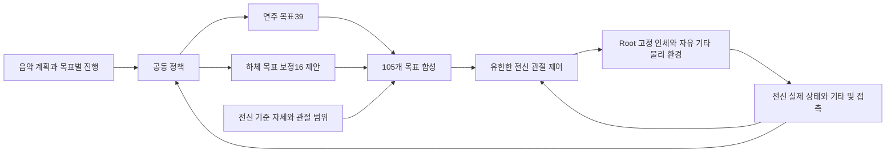

# 기타 연주를 위한 전신 관절 역할과 제어 원칙

이 연구는 오디오에서 얻은 연주 계획에 맞춰 humanoid가 자유롭게 움직이는 기타를 지지하고, 왼손으로 압현하며 오른손으로 타현하도록 하는 것을 목표로 한다. 압현은 손가락으로 줄을 프렛에 누르는 동작이고, 타현은 피크가 목표 줄을 지나가며 연주하는 동작이다. 기타가 고정되어 있지 않으므로 한 손의 움직임이 기타의 위치와 다른 손의 목표까지 바꿀 수 있다.

관절별 역할은 이 상호작용을 제어 문제로 풀어 설명하기 위한 설계 기준이다. **연주 관절은 음악 목표를 수행하고, 지지 관절은 연주를 허용하는 자세와 접촉을 유지하며, 그립·머리 관절은 불필요한 변화를 줄인다.** 모든 역할은 음악 수행과 기타 안정성이라는 공통 목표 아래에서 평가한다. 역할을 나누더라도 각 부위가 물리적으로 독립적으로 움직이는 것은 아니다.

이 문서는 관절 역할에 관한 사용자 합의와 하체 자세 유지 학습 방향을 정리한다. 코드로 확인된 현재 상태, 앞으로 적용할 설계, 실험으로 정해야 할 값을 구분한다. 비전문 독자를 위한 설명 뒤에 구현에 필요한 관절 이름·관측·보상·검증 조건을 제시한다.

## 현재 구현과 앞으로의 설계

| 구분 | 확인된 상태 또는 설계 |
|---|---|
| 현재 native 초기 자세 연구 | Root와 하체가 고정된 기존 자산 조건. 새 전신 환경의 결과로 재해석하지 않는다. |
| 구현된 전신 CPU 계약 |105개 목표/명령 채널 중39개는 정책 목표,66개는 기준 목표를 유지한다. CPU 검사5개를 통과했다. |
| 원본 관절 범위 |105개 scalar 채널 중97개는 비영 가동 범위,8개는 원래 범위가0인 하체 축이다. |
| 하체 학습의 권고 시작안 | 기존 연주39개에 가동 하체16개를 더한55개 정책 출력. 나머지50개 목표 유지. 아직 구현·학습되지 않았다. |
| 이번 문서 작업 | 역할과 설계 원칙을 기록한다. 환경·보상·모델·gain·체크포인트를 변경하지 않는다. |

여기서 **scalar 채널**은 하나의 관절 좌표다. 어깨처럼 여러 축을 가진 관절은 모델에서3개 채널로 표현된다.105개 채널을105개의 생체 관절 또는 모두 자유롭게 움직이는105개 축이라고 부르지 않는다. Root는 인체 전체의 기준 위치·방향이며 위105개에 포함되지 않는다.

현재 코드와 검증은 [전신 제어 계약](/home/ajou/yigyu/3/docs/2026-10-12/stability_adapter_2/results/wholebody_control_v1/README.md), 음악 관측과 PPO는 [음악 파이프라인](/home/ajou/yigyu/3/docs/2026-10-12/stability_adapter_2/results/music_pipeline_v2/README.md)에 있다. 본문에서 ‘허용한다’, ‘평가한다’로 기술한 설계 항목은 새 물리 환경에 연결할 기준이다.

## 역할을 부여하는 기본 원칙

### 주 역할과 보조 역할을 함께 둔다

주 역할은 해당 관절이 우선 기여할 기능이고, 보조 역할은 다른 기능을 방해하지 않도록 고려할 사항이다. 예를 들어 오른쪽 팔꿈치의 주 역할은 피크 이동이지만, 팔꿈치 움직임의 반작용은 상완과 기타의 접촉에 영향을 줄 수 있다. 타현 보상만으로 그 관절을 평가하면 기타 지지를 무너뜨리는 해법도 유리해질 수 있다. 타현 정확도와 전체 기타 안정성을 함께 평가한다.

역할은 보상·관측·행동 범위의 근거이며 별도 정책을 관절마다 만들라는 지시는 아니다. 우선 하나의 공동 정책이 연주 목표와 하체 조정을 함께 결정하도록 설계한다. 최종 목표를 쓰는 주체는 관절마다 하나로 정하고, 두 제어기가 같은 관절의 목표를 덮어쓰지 않게 한다.

### 접촉 분담은 움직임에 따라 달라질 수 있다

가슴·오른쪽 상완·허벅지를 주요 지지 부위로 설정하되 세 부위의 접촉을 매 순간 동일하게 강제하지 않는다. 타현 중 가슴 접촉이 줄어도 상완과 허벅지가 기타를 안정적으로 지지할 수 있다. 반대로 세 부위의 접촉이 모두 존재해도 기타가 미끄러지거나 목표 줄에 도달할 수 없으면 연주 가능한 상태가 아니다.

접촉의 존재·시간·미끄러짐·가능하면 힘을 진단하고, 지지 성공은 기타의 허용 위치·회전·속도와 연주 가능성으로 판정한다. 접촉력이나 접촉 수가 클수록 무조건 좋은 보상은 사용하지 않는다. 과도한 압박이나 끼임을 유도할 수 있기 때문이다.

### 자세 유지도 실제 상태에 대한 제어로 수행한다

목표각이 일정해도 실제 각도·속도가 변하면 복원 명령이 달라져야 한다. 유한한 관절 제어기가 기준 자세를 추종하고 물리 반작용에 따라 오차가 생길 수 있게 한다. 매 단계 실제 각도를 초기값으로 덮어쓰거나 하체 관절을 제거하는 것은 이 자세 유지 제어와 다른 조건이다.

Root만 전역 고정하는 최종 방향은 유지한다. 이때 root가 외부 반력을 제공하므로 전체 문제를 자유 보행이나 부유 root의 균형 제어로 확대하지 않는다. 지면 접촉·다리 자세는 연구 대상이지만 독립적인 기립 균형 성과를 주장하는 것은 아니다.

### 왼손의 압현 반력과 기타 무게 지지를 구분한다

왼손이 줄을 누르면 기타와 힘을 주고받는다. 이 접촉을 없애는 것은 압현 과제와 맞지 않는다. 왼손에는 목표 줄·프렛의 압현·유지·해제를 요구하고, 기타 무게를 떠받치는 역할을 필수로 부과하지 않는다. 엄지의 보조 접촉도 필요한 운지를 만드는 조건으로 검토한다. 엄지 접촉이 반드시 필요하거나 실제 반력이 검증됐다고 미리 가정하지 않는다.

왼손 지지 의존성은 별도 정적/전이 시험에서 진단한다. 압현 중 손가락 접촉을 강제로 제거한 결과와 정상 압현 결과를 같은 과제의 성능으로 비교하지 않는다.

### 역할에 따라 움직임의 허용 정도를 다르게 한다

연주 관절에는 음악 목표를 달성하는 이동을 허용한다. 지지 관절에는 기준 자세에서 크게 벗어나지 않는 조정을 허용하는 방향을 검토한다. 피크 그립·목·머리는 기준 목표 유지에 높은 우선순위를 둔다. 이 차이는 역할에 따른 상대적 원칙이며 아직 정해지지 않은 gain·보상 계수·각도 범위를 숫자로 확정한 것이 아니다.

특히 지지부에 ‘조정 역할’을 부여했다고 현재 코드가 목표각 변경 권한을 갖는 것은 아니다. 현재와55출력 시작안에서 몸통·오른쪽 근위부15개는 기준 목표 유지다. 이 부위의 능동 목표 보정은 하체16개 추가와 별개의 후속 설계로 다룬다.

## 몸통과 머리의 역할

다음 표의3채널은 해당 이름의 `_x`, `_y`, `_z`를 뜻한다. suffix는 모델의 관절 좌표 식별자이며 world 회전축이나 해부학적 굽힘·비틀림 방향으로 바로 해석하지 않는다.

| 관절군 | 채널 | 주 역할 | 보조 역할과 평가 관점 |
|---|---:|---|---|
| Root / Pelvis |105개에 미포함 | 인체의 기준 위치·방향 유지 | 고정 조건과 외부 반력의 영향을 명시 |
| Torso |3| 상체의 전체 기준 자세 유지 | 팔 동작 중 큰 몸통 자세 변화·과도한 추종 오차 억제 |
| Spine |3| 몸통과 기타의 상대 배치 유지 | 가슴 지지 위치와 팔의 작업 공간 유지 |
| Chest |3| 가슴을 통한 기타 몸통 지지에 기여 | 과도한 기울어짐·압박·간섭을 함께 점검 |
| Neck |3| 목의 기준 자세 유지 | 몸통 동작에서 불필요한 목 회전·진동 억제 |
| Head |3| 머리의 기준 자세 유지 | 추종 오차와 불필요한 흔들림 진단 |

몸통 관절을 어떤 방향으로 바꾸면 가슴의 어느 부위가 기타와 접촉하는지는 실제 좌표계와 접촉 형상에서 확인한다. ‘Chest 관절을 제어한다’와 ‘가슴 접촉력을 직접 지정한다’는 다른 의미다. 목·머리에 시선 추적이나 표현 동작을 새로 부과하지 않는다.

## 오른팔과 오른손의 역할

| 관절군 | 채널 | 주 역할 | 보조 역할과 평가 관점 |
|---|---:|---|---|
| R_Thorax |3| 오른팔의 지지 위치 설정·유지 | 상완 접촉 배치와 타현 작업 공간 확보 |
| R_Shoulder |3| 상완을 통한 기타 지지에 기여 | 팔꿈치·손목이 타현할 수 있는 배치 유지 |
| R_Elbow |3| 피크의 큰 이동과 줄 접근 | 상완 지지를 지나치게 방해하지 않는 궤적 |
| R_Wrist |3| 피크의 세밀한 위치·방향·줄 교차 조절 | 타현 시각·방향, 불필요한 줄 접촉과 재타현 억제 |
| RH:thumb |5| 피크를 잡는 엄지 목표 자세 유지 | 실제 손모양·접촉이 그립을 유지하는지 진단 |
| RH:index |4| 피크 그립의 검지 목표 자세 유지 | 엄지와의 상대 배치 유지 |
| RH:middle |4| 초기 그립의 나머지 손모양 유지 | 피크·줄·기타와 불필요한 간섭 억제 |
| RH:ring |4| 초기 그립의 나머지 손모양 유지 | 불필요한 손가락 변화 억제 |
| RH:pinky |4| 초기 그립의 나머지 손모양 유지 | 불필요한 접촉·자세 변화 억제 |

`R_Shoulder` 강체는 어깨에서 팔꿈치까지 이어지는 상완 구간이다. 현재 타현 목표 변경은 `R_Elbow`와 `R_Wrist`의6개 채널이 담당한다. 팔꿈치와 손목의 ‘큰 이동’·‘세밀한 조절’은 주 역할의 구분이며, 궤적에서 각각의 기여가 완전히 분리된다고 가정하지 않는다.

오른손21개 채널의 목표를 유지하는 것만으로 피크 파지가 물리적으로 검증되는 것은 아니다. 사용하는 피크 표현이 가상 marker인지 충돌 물체인지 명시하고, 그 표현에서 확인 가능한 위치·방향·접촉을 검사한다. 모든 오른손 손가락이 실제로 피크를 눌러야 한다는 조건은 부과하지 않는다.

## 왼팔과 왼손의 역할

| 관절군 | 채널 | 주 역할 | 보조 역할과 평가 관점 |
|---|---:|---|---|
| L_Thorax |3| 왼팔의 전체 작업 위치 설정 | 연주 구간의 프렛 도달 범위 확보 |
| L_Shoulder |3| 손을 목표 프렛 부근으로 이동 | 팔꿈치·손목의 관절 한계 여유 확보 |
| L_Elbow |3| 손과 넥 사이 거리·접근 자세 조절 | 프렛 이동과 손목 배치 보조 |
| L_Wrist |3| 압현 방향과 손바닥 배치 조절 | 손가락 접근, 운지 전환과 간섭 억제 |
| LH:thumb |5| 압현에 적합한 손모양·엄지 배치 | 필요하고 유효한 경우 압현 반력 보조 |
| LH:index |4| 할당된 줄·프렛의 압현·유지·해제 | 다음 운지 준비 |
| LH:middle |4| 할당된 줄·프렛의 압현·유지·해제 | 다음 운지 준비 |
| LH:ring |4| 할당된 줄·프렛의 압현·유지·해제 | 다음 운지 준비 |
| LH:pinky |4| 할당된 줄·프렛의 압현·유지·해제 | 다음 운지 준비 |

손가락 역할은 고정된 줄 번호와 연결하지 않는다. 입력 운지 계획이 각 음에 손가락을 할당한다. 원래 계획의 운지를 바꾸는 학습은 별도 문제이며 현재 역할 정의에 자동 포함하지 않는다. 개방현은 불필요한 압현을 요구하지 않는다.

현재 유지 중인 음과 다음 음의 준비는 별도 목표로 표현한다. 같은 줄의 다음 운지를 준비하더라도 현재 음의 유효 압현을 덮어쓰지 않는다. 다음 목표에 먼저 도달했더라도 현재 음을 일찍 끊으면 유지 성과가 낮아져야 한다. 동시에 눌린 프렛의 실제 유효성은 새로운 환경의 기하·접촉 판정에서 검증한다.

## 하체의 역할과 기준 자세 유지 학습

| 관절군 | 전체 채널 | 비영 가동 채널 | 주 역할 | 보조 역할과 평가 관점 |
|---|---:|---:|---|---|
| L_Hip, R_Hip |6|6| 허벅지의 기타 지지 배치 유지·조정 | 과도한 기타 이동 없이 지지면 위치·기울기 조정 |
| L_Knee, R_Knee |6|2| 하체 기준 자세 유지 | Hip 조정에 따른 다리·발 배치와 접촉 조건 보완 |
| L_Ankle, R_Ankle |6|6| 발 자세와 의도한 지면 접촉 안정화 | 접촉 중 발의 미끄러짐·회전 억제 |
| L_Toe, R_Toe |6|2| 발 앞부분의 기준 자세 유지 | 의도한 접촉에서 과도한 꺾임·진동 억제 |

Hip는 허벅지 강체의 위치·방향에 직접적인 영향을 주지만, Knee가 같은 방식으로 허벅지를 회전시키는 것은 아니다. Knee와 발목·발가락은 다리의 연결 구조와 지면 접촉을 통해 전체 조건에 영향을 준다. 이 역할이 실제 지지 성능에 기여하는지는 실험으로 확인한다.

하체 학습에서는 ‘초기 자세에서 움직이지 않기’보다 **‘연주에 필요하지 않은 자세 변화를 줄이기’**를 목표로 한다. 정책은 기준각 주변의 제한된 목표 변경을 출력하고, 유한한 관절 제어기가 이를 추종한다. 하체의 조정으로 기타 지지가 개선된다면 작은 자세 편차를 허용할 수 있어야 한다.

지면 접촉을 반드시 양발 전체에 요구할지는 유효한 초기 배치에서 결정한다. 원래 들려 있는 발이나 접촉하지 않는 발가락에 큰 접촉 보상을 주지 않는다. 접촉한 구간의 미끄러짐과 비접촉 구간의 이동도 구분한다. 기준 자세의 충돌·지면 관통을 그대로 보존하는 보상을 만들지 않도록 새 reset을 먼저 검사한다.

## 목표 소유권과 정책 출력

| 역할 집합 | 채널 수 | 현재105채널 CPU 계약 | 하체 학습55출력 시작안 |
|---|---:|---|---|
| 왼팔·왼손 |33| 정책 목표 | 정책 목표 |
| 오른쪽 팔꿈치·손목 |6| 정책 목표 | 정책 목표 |
| 하체의 비영 가동 축 |16| 기준 목표 | 제한된 정책 목표 변경 |
| 몸통·오른쪽 Thorax/Shoulder |15| 기준 목표 | 기준 목표 |
| 오른손 손가락 |21| 기준 목표 | 기준 목표 |
| 목·머리 |6| 기준 목표 | 기준 목표 |
| 하체의 원래0 범위 축 |8| 한계가 같은 기준 목표 | 같은 기준 목표 |
| 합계 |105|39 정책 +66 기준 |55 정책 +50 기준 |

이 표는 **제어되는 채널 수, 정책 출력 수, 실제 가동 범위를 별도로 관리**하기 위한 것이다. 원래0 범위인8축을 학습 출력에 추가하지 않는다. 몸통과 상완의 목표 변경까지 학습하려면55출력 시작안과 다른 행동 계약이 되므로 별도로 비교해야 한다.

역할에 따른 제어 흐름은 다음과 같다.

실제55출력 구현에서는 action 순서·범위·관측 차원·체크포인트 형식을 새로 정의해야 한다. 현재39출력 actor/PPO와 전신 계약에 보상 항만 추가하면55출력이 되는 것이 아니다. 이전 가중치는 새 정책에 이식하지 않는 기존 결정을 유지한다.

## 역할을 판단하기 위해 필요한 관측

| 관측 묶음 | 필요한 정보 | 필요한 이유 |
|---|---|---|
| 전신 상태 | 실제 관절각·속도, 기준각, 직전 최종 목표, 관절 한계 여유 | 자세 오차와 움직임의 원인, 목표 제한의 영향을 판단 |
| 제어 상태 | 적용한 명령, effort 한계·포화 여부, 실제 구동 방식 | 목표 추종이 어려운 상황과 제어권 부족을 구분 |
| 기타 상태 | 기준 좌표계의 위치·회전·선속도·각속도, 허용 범위 여유 | 자세가 비슷해도 기타가 불안정한 상황을 식별 |
| 지지 관계 | 가슴·상완·허벅지와 기타의 상대 배치, 접촉·미끄러짐 | 지지 분담의 변화와 연주 반작용을 관측 |
| 압현 관계 | 할당 손가락과 목표점의 상대 위치·속도, 유효 압현 상태 | 목표 접근과 실제 압현 성립을 구분 |
| 타현 관계 | 피크와 목표 줄의 상대 위치·방향·속도, 교차·재진입 상태 | 올바른 줄·방향·시각의 타현과 오타현을 구분 |
| 발과 지면 | 의도한 접촉 영역, 접촉 여부, 접촉 구간의 발 속도 | 자세 조정과 미끄러짐을 구분 |
| 음악 이력 | 현재/미래 목표 시각, 매칭 여부, 준비 접촉시간, 유지율·해제 | 이미 수행한 목표와 남은 과제를 구분 |

손가락·피크의 상대 기하는 기타 좌표계로 일관되게 정의하고, 중력·발과 지면의 관계는 world/root 기준 정보를 함께 유지한다. 좌표계, m·rad·s 단위, 관측 시점과 적용 명령의 시점을 명시한다. 측정되지 않은 접촉력·실제 음향·토크를 관측값으로 만들어 넣지 않는다. 명령 토크와 측정 토크는 서로 다른 필드다.

현재 음악 모듈의 목표별24개 특징과 전역8개 진행 정보는 재사용 가능한 출발점이다. 새 전신 물리 관측의 최종 차원과 접촉 표현은 아직 정하지 않았다. 기존 통합 테스트의 합성 상태 차원을 그대로 실제 환경 차원으로 채택하지 않는다.

## 보상과 비용 설계

### 공통 성과와 역할별 보조 항

음악 수행과 기타 안정성은 모든 연주·하체 행동에 공통으로 영향을 주는 목표다. 역할별 항은 이 목표를 달성하는 과정에서 불필요한 움직임을 줄이거나 학습을 돕는다. 다음은 구성을 설명하는 설계식이며 실제 가중치나 실행된 보상을 뜻하지 않는다.

`J_step = r_music − λ_g C_guitar − λ_p C_posture − λ_v C_velocity − λ_a C_action − λ_τ C_effort`

| 항 | 의미 | 설계 주의점 |
|---|---|---|
| r_music | 적절한 줄·프렛·운지, 타현 시각, 유효 유지와 해제 | 접근 거리 보조 성과와 최종 연주 성공을 구분 |
| C_guitar | 기타의 허용 범위 이탈·과도한 속도 등 | 초기 자세와의 유사도로 대체하지 않음 |
| C_posture | 역할별 기준 자세 편차 | 연주 이동에 강한 원위치 벌점을 일괄 적용하지 않음 |
| C_velocity | 지지·유지 관절의 불필요한 속도 | 빠른 타현에 필요한 속도까지 동일하게 억제하지 않음 |
| C_action | 연속 목표 변경의 불필요한 급변 | 제어 주기·action scale을 기록하고 같은 조건에서 비교 |
| C_effort | 과도한 제어 사용 또는 포화 | 측정량을 명시하고, 지지에 필요한 힘 자체를 무조건 억제하지 않음 |

위 항을 처음부터 모두 강하게 적용하지 않는다. 음악 성과와 기타 안정성의 기본 판정, 하체 자세 항부터 검증하고, 실패 원인에 필요한 보조 항을 추가한다. 고정 가중치 기준군과 episode cost budget을 쓰는 비교는 분리한다. 가중합 보상이나 PPO의 multiplier만으로 매 순간의 물리 제약 충족이 보장되는 것은 아니다.

### 자세 편차를 허용하는 비용

하체의 비영 가동 축 집합을 `L`이라 두고, 각 축에서 다음과 같은 비용을 시작 후보로 사용할 수 있다.

`e_i = max(0, |q_i − q_ref,i| − δ_i) / s_i`

`C_posture,leg = (1 / |L|) Σ(i∈L) w_i e_i²`

`q_i`는 실제 각도, `q_ref,i`는 외부에서 정한 기준각이다. `δ_i ≥ 0`는 벌점을 주지 않는 작은 자세 편차, `s_i > 0`는 오차를 비교 가능한 크기로 바꾸는 각도 척도, `w_i ≥ 0`는 역할별 상대 가중치다. 관절마다 같은 수치를 쓰는 대신 도달 가능성·지지 민감도·관절 한계를 확인해 정한다. 원래0 범위 축8개는 `L`에서 제외하고 범위로 나누는 계산에 넣지 않는다.

이 비용은 실제 자세에 적용한다. 목표만 초기값 근처에 있고 실제 다리가 무너지는 상태를 좋은 자세로 평가하지 않는다. 정책 목표의 허용 범위와 변화율 제한은 별도로 둔다. 큰 자세 이탈과 물리 실패의 종료 기준도 보상과 별도로 정의한다.

### 음악 판정과 실패 처리를 일관되게 한다

타현 주 지표는 ±50ms, ±100ms는 독립적인 진단 지표다. 유효 유지율은 원래 음 길이를 분모로 삼아 짧은 음에 불가능한 최소 유지시간을 요구하지 않는다. 준비 접촉시간과 audible 유지시간은 따로 기록한다. 준비가 늦어도 음악 시계를 멈추거나 onset을 늦추지 않는다.

지지 실패로 일찍 종료한 episode는 완료로 계산하지 않는다. 짧게 끝나 누적 비용이 작아지는 효과와 정상적인 안정성을 혼동하지 않도록 실패율·완료율·종료 원인과 비용을 함께 보고한다. 실제 물리 실패와 simulator/API 오류를 구분한다. 실패 terminal 비용·분모·budget은 같은 정의로 맞추고, 수집 조각의 truncation과 과제의 terminal도 구분한다.

자세 비용이 너무 강해 연주를 포기하는지, 음악 성과를 위해 기타 지지를 포기하는지 둘 다 확인한다. 학습 보상의 합계 하나로 성공을 판정하지 않는다.

## 단계별 학습과 비교 실험

| 단계 | 확인할 질문 | 다음 단계에 필요한 근거 |
|---|---|---|
| 초기 배치 검증 | 원본 하체 관절을 복원해도 의도한 몸·발·기타 배치가 성립하는가 |105차원 reset, 관절 한계·접촉·관통·초기 과도 상태 확인 |
| 자세 유지 | 유한한 제어와 하체 자세 비용으로 기준 배치를 유지할 수 있는가 | 추종 오차·속도·포화·기타 이탈과 실패 기록 |
| 작은 팔 동작 | 팔의 반작용 중에도 지지가 유지되는가 | 전신·기타 변화와 지지 접촉 분담 확인 |
| 단음 | 접근·압현·타현·유지·해제를 연결할 수 있는가 | 음악 단계별 지표와 안정성 동시 충족 |
| 운지 전환 | 현재 음을 유지하면서 다음 목표를 준비하는가 | 같은 줄 전환, 불필요한 줄 접촉·조기 해제 진단 |
| 짧은 구절 | 정해진 음악 시각을 따라 지속할 수 있는가 | 복수 seed·초기 변동·구간별 완료와 실패 분포 |

승급 수치와 perturbation 범위는 실제 물리 환경에서 정하고 실행 전에 기록한다. 이번 문서에는 검증되지 않은 성공 문턱을 넣지 않는다. 우선 곡은 `05_BN2-131-B_solo`이며, 미지원 이벤트를 포함한 구간을 조용히 건너뛰고 곡 전체 성공으로 보고하지 않는다.

가장 직접적인 비교는 **같은 하체가 살아 있는 환경에서 기준 목표만 유지하는39출력 조건과 하체 목표를 조절하는55출력 조건을 비교**하는 것이다. 초기 배치·관절 gain·effort·음악 판정·학습 예산·평가 구간을 맞춘다. 이후55출력 안에서 자세 비용의 유무·강도를 비교하면 하체 보정 권한과 자세 유도 항의 영향을 구분할 수 있다.

기존 fixed-lower와의 비교는 하체 물리 자체가 달라지는 비교다. 차이를 하체 학습만의 효과로 해석하지 않는다. 지지부 목표 보정, 관측 표현, 미래 창 등 다른 변경은 한 번에 함께 바꾸지 않고 별도 비교로 기록한다.

## 역할별 평가와 실패 해석

| 대상 | 주요 지표 | 해석할 때 구분할 것 |
|---|---|---|
| 전체 음악 | strict 타현, 운지·줄 정확도, 유지율, 완주율 | 기하/접촉 기반 성과와 실제 소리의 재현 |
| 기타 지지 | 허용 범위 이탈 시간·실패, 위치·회전·속도 | 자세 유사성과 실제 악기 안정성 |
| 몸통·상완·허벅지 | 실제 자세 편차, 접촉 시간·분담, 제어 포화 | 접촉의 존재와 유효한 지지 기여 |
| 오른팔 | 줄 교차 시각·방향, 오타현·재타현, 피크 궤적 | 팔꿈치·손목의 주 역할과 상호 영향 |
| 왼팔·왼손 | 목표 오차, 압현 유효율, 조기 해제·전환 실패 | 접근 성공과 유효 압현 성립 |
| 오른손 그립 | 실제 손가락 자세 오차, 피크 표현에 맞는 상대 배치 | 목표 유지와 실제 파지 검증 |
| 하체·발 | 기준 편차·속도·발 이동, 접촉 중 미끄러짐·포화 | 지지를 돕는 조정과 불필요한 흔들림 |
| 목·머리 | 실제 자세 오차·진동 | 자세 유지와 별도 표현 동작 |

평균값뿐 아니라 최대 편차·실패 빈도·episode별 분포를 확인한다. 정지 자세가 잘 유지되어도 음악 수행이 실패하면 공동 과제를 성공한 것이 아니다. 하체가 많이 움직였다는 사실 자체도 전신 협력의 증거가 아니다. 하체 움직임이 있는 조건에서 음악·안정성 지표가 어떻게 달라졌는지 비교해야 한다.

## 구현 전에 확정할 항목

- 하체를 포함한105차원 reset과 기준 pose의 물리적 타당성. 기존 fixed-lower에서 구워 넣은 링크 변환을81개 각도와 하체0으로 대체하지 않는다.
- Root 고정, 기타 자유, self-collision 및 스트랩 조건과 실제 native DOF 순서·한계.
- 55출력 순서, 하체16개의 목표 변경 범위·속도, 관측 차원과 전체 input/control 계약.
- 부위별 접촉 surface, 압현·피크 교차·해제·미끄러짐의 실제 측정 정의.
- 자세 허용 편차·정규화 척도·보상 가중치, 기타 허용 범위, 실패 종료와 cost budget의 단위.
- Native position PD와 명시적 effort PD 중 사용할 경로. 둘을 중복 적용하지 않고 명령과 측정값을 구분한다.

이는 후속 환경 구현·실험에서 정할 기술 항목이다. 이미 합의한 관절 역할을 다시 승인받기 위한 질문 목록은 아니다.

## 논문 작성에 적용할 원칙

논문 제목은 **From Audio to Full-Body Guitar Performance with a Freely Moving Instrument**를 유지한다. ‘전신’이라는 표현은 실제 제어·관측·물리 조건에 맞춰 사용한다. Root 고정과 원래0 범위 축을 밝히고, 전신 feedback 제어와 전신의 모든 목표를 RL이 학습하는 것을 구분한다. 현재39출력 코드, 제안55출력, 과거 fixed-lower 결과를 하나의 완성된 방법처럼 섞지 않는다.

역할을 나눈 이유는 사람처럼 보이게 하기 위한 설명에 그치지 않는다. 기타 지지와 음악 수행이 서로 영향을 주는 상황에서 어느 관절에 어떤 목표 변경 권한을 주고, 어떤 정보를 관측하며, 무엇을 비용으로 억제하는지 명확하게 하기 위함이다. 역할 분할 자체나 출력 head 분할 자체를 학술적 기여로 확정하지 않는다. 기여는 대응하는 비교 실험으로 뒷받침한다.

다음은 현재 설계를 설명하는 문장으로 사용할 수 있다.

> 우리는 전신의 관절 역할을 연주 수행, 악기 지지, 기준 자세 유지로 구분한다. 왼팔과 왼손은 압현과 운지 전환을, 오른쪽 팔꿈치와 손목은 타현을 담당한다. 가슴·상완·허벅지는 악기 지지에 기여하도록 배치하고, 오른손 손가락은 피크 그립의 기준 자세를 추종한다. 하체에는 기준 자세 주변의 제한된 조정을 허용하는 학습 구조를 제안하며, 음악 수행과 기타 안정성을 공통 목표로 평가한다.

실제55출력 환경과 실험이 완성되기 전에는 ‘제안한다’를 ‘달성했다’로 바꾸지 않는다. 사람 동작 유사성, 자연스러움, 전신 균형, 음향 재현은 각각 해당 자료와 평가가 있을 때만 주장한다. 자세 유지가 성공한 조건과 연주 중 지지가 유지된 조건도 분리한다. [논문 작성 원칙](/home/ajou/yigyu/3/paper/AGENTS.md)을 함께 따른다.

## 근거와 관절 이름 색인

역할은 사용자가 설명한 가슴·상완·허벅지 지지, 오른쪽 팔꿈치·손목 타현, 오른손 피크 그립 유지와 왼손 압현 분담을 구체화한 설계다. 관절 이름과 수는 [원본 humanoid XML](/home/ajou/yigyu/3/tab2body/assets/smpl_mpl_hands_body.xml), 현재 목표 소유권은 [전신 CPU 계약](/home/ajou/yigyu/3/stability_adapter_2/music_pipeline_v3/control.py)과 [상체 변환기](/home/ajou/yigyu/3/stability_adapter_2/music_pipeline_v2/control.py)에 대응한다. 역할의 물리적 효과는 후속 비교 실험으로 검증한다.

기준 동작을 따르는 목적과 과제 목적을 함께 사용하는 선행 사례는 [DeepMimic의 연구 소개](https://www.cs.ubc.ca/~van/papers/2018-TOG-deepMimic/index.html)에서 확인할 수 있다. 이 참고는 복수 목적을 구성하는 근거이며, 본 관절 역할이나 자유 기타 지지의 유효성을 입증하는 자료는 아니다. [제약을 별도로 정의하는 접근](https://proceedings.mlr.press/v70/achiam17a.html)은 보상 설계와 제약 만족을 구분하는 참고다. 현재 PPO에 해당 논문의 이론적 보장을 적용하지 않는다.

원본105개 채널별 역할·가동 범위·현재/제안 목표 소유권은 [관절별 역할 색인](/home/ajou/yigyu/3/docs/2026-10-12/stability_adapter_2/results/joint_role_design_v1/joint_role_map.json)에 정리했다. 이 파일은 구현자가 조회하는 설계 색인이며 학습 설정 파일이 아니다. 축별 굽힘·회전 역할은 실제 모델 좌표 검증 전까지 지정하지 않는다.

손가락 채널의 이름은 양손에서 다음과 같다. `LH:` 또는 `RH:`를 앞에 붙여 각 손의21개 이름을 얻는다.

| 손가락 | 이름 suffix | 채널 수 |
|---|---|---:|
| thumb | thumb1_x, thumb1_y, thumb1_z, thumb2, thumb3 |5|
| index | index1_x, index1_z, index2, index3 |4|
| middle | middle1_x, middle1_z, middle2, middle3 |4|
| ring | ring1_x, ring1_z, ring2, ring3 |4|
| pinky | pinky1_x, pinky1_z, pinky2, pinky3 |4|

그 외63개 이름은 Torso·Spine·Chest·Neck·Head 각3개, 좌우 Thorax·Shoulder·Elbow·Wrist 각3개, 좌우 Hip·Knee·Ankle·Toe 각3개로 구성된다.63개와 양손42개를 합해105개이며, 손가락 suffix와 몸 관절 suffix를 임의로 일반화하지 않는다.

[독립 검수](/home/ajou/yigyu/3/docs/2026-10-12/stability_adapter_2/results/joint_role_design_v1/review.md)에서 관절 이름·범위·목표 소유권과 문서의 주장 범위를 확인했다. 문서·역할 색인 검사와 기존 입력 보존 결과는 같은 폴더의 final_verification.json과 artifact_inventory.json에 기록한다. 이번 문서 작업에서 새 native 실행과 학습은 수행하지 않았다.
