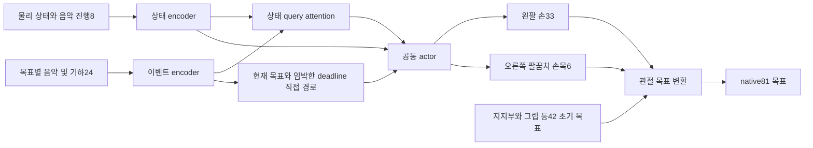

# 지지 자세와 연주 관절을 구분한 음악 제어 파이프라인

사용자가 설명한 초기 자세에 맞춰 **왼팔·왼손의 압현과 오른쪽 팔꿈치·손목의 타현을 함께 결정하는 39차원 정책**을 구현했다. 가슴·오른쪽 상완·허벅지의 기타 지지 조건을 유지하면서 연주를 학습하기 위한 시작 구조다. 초기 자세와 상세 물리 환경이 확정되기 전에 검증할 수 있는 관절 제어권, 음악 관측·기록, 신경망과 PPO 학습 모듈까지 구현했다.

이 구조의 목적은 정책이 기타를 지지하는 모든 자세와 피크 그립까지 동시에 재발견해야 하는 부담을 줄이는 것이다. 지지 자세를 유지하는 목표와 음악 시각에 따라 바뀌는 목표를 명시적으로 구분한다. 지지 자세만으로 연주 중 기타가 안정적으로 유지되는지는 후속 물리 실험의 질문이다.

## 몸의 역할과 제어권

| 부위 | 현재 역할 | 정책 출력 |
|---|---|---|
| 왼팔12 + 왼손21 scalar DOF | 목표 프렛 접근, 압현, 유지, 해제 | 33 |
| 오른쪽 팔꿈치3 + 손목3 scalar DOF | 피크의 줄 접근과 타현 궤적 | 6 |
| 몸통·가슴9 + 오른쪽 Thorax·Shoulder6 | 가슴과 상완 지지 자세의 목표각 유지 | 0, 초기 기준15개 유지 |
| 오른손 손가락21 | 초기 피크 그립 목표각 유지 | 0 |
| 목·머리6 | 초기 목표각 유지 | 0 |
| 허벅지·하체 | 기존 fixed-lower 자산의 지지 형상 | native81 제어 벡터에 하체 DOF 없음 |

관절 수는 생체 관절 개수가 아니라 시뮬레이터의 scalar DOF 수다. `R_Shoulder` 강체는 어깨부터 팔꿈치까지의 상완 구간이다. 그 지지 자세를 유지하면서 `R_Elbow`와 `R_Wrist` DOF를 타현에 사용한다. 이름의 x/y/z suffix를 world 축으로 해석하지 않는다.

**42개 목표각 유지와 실제 관절 상태 고정은 다르다.** 제어기는 외부에서 받은 기준 목표를 유지하지만, 유한한 힘을 내는 관절 제어와 물리 상호작용 때문에 실제 각도는 변할 수 있다. 피크 그립 목표 유지도 피크의 물리적 파지 성공을 자동으로 보장하지 않는다. 기타를 고정하거나 직접 위치를 덮어쓰는 기능은 추가하지 않았다. 왼손의 우연한 기타 접촉은 허용하되, 왼손이 기타를 떠받치는 것을 필수 목표로 요구하지 않는다.

39차원 행동은 초기 기준 목표 주변의 정규화된 오프셋이다. native 관절 한계와 외부에서 제공한 오프셋 범위를 교차한 후, 평활화와 관절별 속도 제한을 적용한다. 모든 이름을 검증하고 의미 순서로 native81에 배치하므로 native 배열 순서가 달라도 제어권이 바뀌지 않는다. 직전 목표에 held42 오염이 있으면 오류로 거부한다. 기준각·한계·속도·출력 순서까지 체크포인트 계약에 포함할 수 있다.

지지부를 정책이 조금씩 조정하는 기능은 현재 넣지 않았다. 이 선택은 입력 문제를 줄이지만 연주 반작용에 능동적으로 대응할 자유도도 줄인다. 후속 시험에서 지지 목표 유지 조건으로 수행 가능한 범위를 먼저 측정하고, 실패가 지지부 보정 부족 때문일 때 별도 행동 계약으로 확장한다.

## 음악 정보가 정책에 전달되는 방식

오디오에서 기존 탭·운지·타현 계획을 생성하는 앞단은 재사용한다. 새 정책은 raw audio 대신 이 계획과 현재 물리 상태를 받는다. 우선 곡은 `05_BN2-131-B_solo`다. B는 단음, C는 연속 두 이벤트, D는 명시적으로 선택한 짧은 구절이다. 현재 loader는 기존 provenance 경로를 재사용하므로 곡 안에 지원되는 단일 fretted B 후보가 하나 이상 있어야 한다. 우선05 곡은 이 조건을 만족하며, 단일 B 후보가 없는 곡의 일반 C/D 입력은 아직 지원하지 않는다. 미지원 이벤트가 선택 범위에 포함되면 해당 ID를 표시하고 거부한다. 실패나 준비 지연에 따라 음악 시계를 늦추지 않는다.

각 목표는 **24개 특징**을 갖는다. onset·종료·준비까지 남은 시간, 줄·프렛·손가락·방향, 현재/준비 상태, 50/100ms 매칭 여부, 연속 접촉 시간, 누적 유지 시간·유지율, 해제 기록, 목표 상대 위치·속도, 타현 deadline이다. 실제 기하 값은 새 환경이 기타 좌표계의 m와 m/s로 공급해야 한다. 누락된 기하를 성공 상태로 대체하지 않는다. 전역 음악 상태8개는 경과·남은 시간, 목표·매칭·해제 수, 누적 유지 시간과 가장 가까운 deadline을 전달한다.

미래 목표는 2초 창을 기본값으로 사용하며 1초 창과 비교할 수 있다. 현재 유지 중인 목표와 해제되지 않은 과거 목표도 보존한다. 기본 토큰 용량64를 넘으면 조용히 자르지 않고 오류로 알린다. 같은 줄의 현재 압현과 미래 운지 준비는 별도 목표로 남는다. 서로 다른 프렛의 audible 구간이 같은 줄에서 겹치는 경우는 거부한다. 낮은 프렛을 미리 누르는 것의 실제 유효성은 새 환경에서 접촉·줄 진동 조건과 함께 검증해야 한다.

`release(target_id, time)`는 순간적인 접촉 끊김이 아니라 해당 목표를 최종 해제·종료한다는 caller의 선언이다. 순간 접촉 여부는 매 구간의 valid target ID로 기록한다. 새 환경은 종료 시각과 실제 해제 조건을 확인해야 하며 released=True 하나를 음악 성공으로 판정하면 안 된다.

초 단위로 제공된 연속 측정 구간을 적분하여 유지 시간을 계산한다. **연속 접촉 시간은 준비 구간을 포함하고, audible 유지 시간만 원래 음 구간으로 자른다.** 23.2ms 음에 100ms 유지를 요구하지 않는다. 시뮬레이터는 측정 구간 전체의 유효성을 판단해야 하며, 이 CPU 기록기가 접촉이나 힘을 측정하는 것은 아니다.

타현은 환경에서 검증한 줄 교차 후보를 받아 목표와 일대일로 매칭한다. 주 지표 ±50ms와 진단 지표 ±100ms는 별도 장부다. 예를 들어 80ms 일찍 지나간 피크가 진단 장부에서 매칭돼도 이후 정확한 교차가 주 장부에서 매칭될 기회를 소모하지 않는다. 한 후보가 같은 장부에서 두 음을 동시에 만족시킬 수 없다.

## 모델과 학습 갱신



기본 hidden dimension은64다. 현재 상태를 query로 작은 attention이 가변 개수의 음악 목표를 요약한다. 현재 음 가운데 종료가 가장 임박한 목표와, 아직 매칭하지 않은 가장 가까운 유효 strict deadline 목표는 각각 별도 경로로 직접 전달한다. 동시에 울리는 다른 목표도 attention 입력에 남는다. deadline 직접 경로는 같은 lookahead 창 안에서 선택한다.

Actor와 value는 **서로 다른 encoder 파라미터**를 사용한다. 따라서 음악·안정성 value의 오차를 줄이는 단계가 actor를 직접 바꾸지 않는다. 두 value head는 음악 return과 안정성 cost return을 각각 예측한다. 왼손33·오른팔6 선형 출력 분할 자체를 새로운 협력 알고리즘으로 주장하지 않는다.

학습은 음악 advantage와 비용 advantage를 원래 단위에서 `A_music − λ A_cost`로 결합한 뒤 한 번 정규화한다. 기본은 고정 λ 기준군이며, 선택적으로 완료된 유효 물리 에피소드의 비용과 budget 차이에 따라 λ를 갱신한다. 실제 물리 실패 종료도 포함하고 simulator 오류·미완료 수집 조각은 multiplier 표본에서 제외한다. 유한 에피소드의 비할인 비용 budget을 사용할 때 cost gamma는1이어야 한다.

각 actor minibatch 이후 수집 당시 분포와 새 분포의 **전체 rollout 평균 analytic KL**을 검사한다. 기준을 넘으면 actor와 Adam 상태를 함께 복원하고 학습률을 줄여 제한된 횟수로 재시도한다. 예산을 소진하면 명시적으로 실패한다. Value 단계까지 포함한 update 중 오류가 나면 전체 모델·두 optimizer·update counter·비용 가중치와 Torch RNG를 이전 상태로 되돌린다. 평균 KL 제한은 각 상태의 행동 변화나 물리 안전 보장이 아니다.

초기 actor 평균은0, log standard deviation은−3, actor learning rate는3e−5, target KL은.02다. 이는 비교 실험을 시작할 수치이며 기타 연주에 최적화된 값이 아니다. 진짜 과제 종료에서는 bootstrap을 없애고, 계속되는 과제의 수집 중단에서는 마지막 실제 상태 value를 bootstrap하되 다음 에피소드로 GAE가 넘어가지 않게 한다.

체크포인트는 새39행동 구조와 입력·제어 계약이 정확히 일치할 때만 읽는다. 모델, 두 optimizer, 비용 가중치, update 수와 RNG를 함께 저장하며 기존 파일을 덮어쓰지 않는다. 기존54행동 또는 Fret·Strike 가중치를 이식하지 않는다. 물리 simulator 상태 저장은 이 모듈의 범위가 아니므로 새 환경은 reset부터 재개하는 절차를 별도로 구현해야 한다.

## 구현과 실행 방법

- [관절 제어권과 목표 변환](/home/ajou/yigyu/3/stability_adapter_2/music_pipeline_v2/control.py)
- [음악 목표와 진행 기록](/home/ajou/yigyu/3/stability_adapter_2/music_pipeline_v2/music.py)
- [공동 정책과 분리 value](/home/ajou/yigyu/3/stability_adapter_2/music_pipeline_v2/policy.py)
- [PPO와 체크포인트](/home/ajou/yigyu/3/stability_adapter_2/music_pipeline_v2/ppo.py)
- [실제 곡을 사용하는 CPU 통합 예제](/home/ajou/yigyu/3/stability_adapter_2/music_pipeline_v2/test_integration_v2.py)

통합 예제는 실제 곡과 기존 초기 자세 후보의 이름·기준각을 읽지만 **물리 입력, 목표 오차, 보상·비용은 합성 테스트 값**이다. 이 예제의332차원 상태는 테스트 전용이며 최종 환경 관측 차원이 아니다. 실제 환경에서는 관절 상태·기준/직전 목표, 기타와 사람의 상대 자세·속도, 피크와 줄 관계, 부위별 접촉, 안정성 여유와 실패 상태를 명시한 ABI를 전달해야 한다. 초기 자세 후보를 자동으로 최종 reset으로 채택하지 않는다.

```bash
cd /home/ajou/yigyu/3
PYTHONDONTWRITEBYTECODE=1 /home/ajou/miniconda3/envs/rl38/bin/python -m unittest -v \
  stability_adapter_2.music_pipeline_v2.test_control_v2 \
  stability_adapter_2.music_pipeline_v2.test_music \
  stability_adapter_2.music_pipeline_v2.test_policy \
  stability_adapter_2.music_pipeline_v2.test_ppo \
  stability_adapter_2.music_pipeline_v2.test_integration_v2
```

## 근거와 후속 평가

이 변경은 [기존 코드·파일럿·곡 분석과 연구 근거](/home/ajou/yigyu/3/docs/2026-10-12/stability_adapter_2/results/pipeline_learning_design_v2/README.md)에 이어 사용자의 지지 자세 조건을 반영한다. 기존 파일럿에서 관찰한 짧은 음의 불가능한 최소 유지 조건, 노출되지 않은 과제 이력, 과도한 PPO 갱신을 직접 다룬다. 외부 연구의 성과를 이 자유 기타 환경의 성과로 옮겨 주장하지 않는다.

초기 자세가 확정되면 먼저 **왼손 지지 없이도 연주 동작의 반작용을 견디는지**를 측정한다. 가슴·상완·허벅지의 접촉 분담이 시간에 따라 바뀔 수 있으므로 특정 접촉이 매 순간 반드시 존재해야 한다고 가정하지 않는다. 기타의 허용 위치·회전·속도, 실제 손가락 목표 추종, 피크 그립과 줄 교차, 의도하지 않은 충돌, 정상 완료와 붕괴를 함께 기록한다.

그 다음 지지 유지+손 이동, 단음 압현·타현·해제, 같은 줄 운지 전환, 짧은 구절 순으로 새 학습을 연결한다. 고정 비용 가중치와 budget, flat MLP와 attention, 직접 목표 경로 유무, 미래 창 길이를 같은 수정된 음악 판정 아래 비교한다. 안정성 cost의 단위·분모·실패 terminal penalty와 budget 값은 실제 환경 계약에서 정해야 한다. 초기 종료로 누적 비용이 작아지는 편법을 막기 위해 실패율과 완료율도 별도 주 지표로 보고한다. 복수 seed·다른 구간·초기 배치 변화까지 평가한 뒤에만 설계의 효과를 주장한다.


## 검증 결과와 보존

[최종 CPU 검증](/home/ajou/yigyu/3/docs/2026-10-12/stability_adapter_2/results/music_pipeline_v2/cpu_v2/result.json)에서26개 테스트가 통과했다. 실제05 곡의 B/C/D 입력, 관절39→81 변환, 짧은 음·준비 접촉·독립 타현 매칭, mask 처리, actor/value 분리, KL 실패와 value 단계 실패의 전체 복원, 체크포인트 재개를 확인했다. 이 중 통합 테스트의 물리·기하·보상은 합성 fixture이므로 새로운 학습 성능 결과가 아니다.

첫 실행은 초기 자세 파일의 PD_properties를 열별 배열이 아닌 행별 목록으로 읽은 테스트 오류2건으로 실패했다. runtime 모듈을 바꾸지 않고 수정한 `test_control_v2.py`와 `test_integration_v2.py`를 별도로 작성해 재검증했다. 원 테스트와 [첫 로그](/home/ajou/yigyu/3/docs/2026-10-12/stability_adapter_2/results/music_pipeline_v2/cpu_v1/tests.log)는 보존했다. 따라서 재현 시 위 명시적 v2 테스트 목록을 사용한다. 이전 실패 테스트까지 포함하는 무차별 discovery는 이 보존 기록도 실행한다.

최종 실행의 입력54개는 실행 전후 SHA가 일치했고, 기존 native 실행 입력1333개도 기존 봉인과 일치했다. 이번에는 새로운 native 실행·곡 학습을 수행하지 않았다. [독립 검수](/home/ajou/yigyu/3/docs/2026-10-12/stability_adapter_2/results/music_pipeline_v2/review.md)에서 현재 CPU 구현 범위의 미해결 차단 사유가 없음을 확인했다. 최종 원문 보존과 파일 목록은 같은 폴더의 final_verification.json과 artifact_inventory.json에 기록한다.
