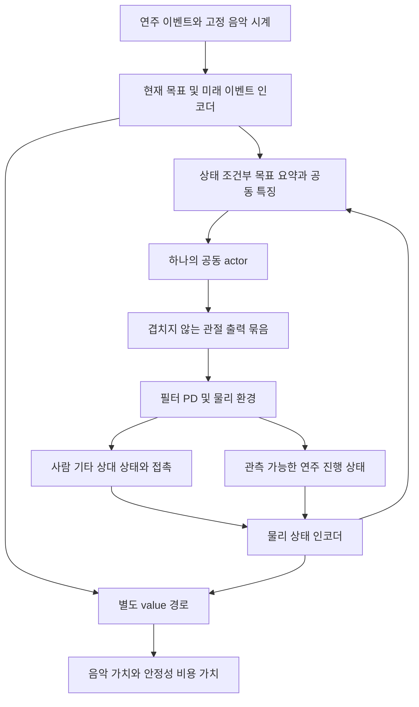

# 악기 안정성과 음악 목표를 함께 학습하는 파이프라인 개선안

2026-10-15. 기존의 음악 목표·물리 상태→공동 정책이라는 정보 흐름은 출발점으로 타당하다. 그러나 **현재 정보와 판정 규칙, 고정 보상 조합, PPO 갱신 설정만으로 효과적인 공동학습을 기대할 근거는 부족하다.** 특히 짧은 음에 불가능한 유지 조건, 관측되지 않는 연주 진행 이력, 첫 갱신의 큰 정책 변화는 네트워크 크기보다 먼저 해결해야 한다.

이번 개선은 모델·학습 설계에 반영한다. 초기 자세 연구가 끝난 후 새 환경에 적용하며, 이번에는 기존 환경·학습 코드·체크포인트를 수정하거나 native 학습을 실행하지 않았다. 우선 곡 `05_BN2-131-B_solo`, 최종 타이밍 ±50ms, 보조 진단 ±100ms는 유지한다. 이 문서는 확인된 사실, 프로젝트 설계 판단, 검증할 가설을 구분한다.

## 1. 무엇을 성공으로 정의할 것인가

원하는 결과는 정해진 음악 시각에 올바른 줄·프렛을 연주하면서 기타가 허용되는 상태 안에 머무르는 것이다. 안정성은 기타를 초기 위치·자세에 붙잡아 두는 것과 다르다. 허용 범위 안에서 음악 수행에 필요한 움직임은 가능해야 한다. 접촉이 바뀌는 순간에도 기타를 제어할 수 있는지가 중요하다.

따라서 다음 세 조건을 함께 본다.

- 음악: 지정 음의 onset·운지·줄·유지·해제를 만족하고, 잘못된 타현과 누락을 줄인다.
- 악기: 허용 위치·자세, 필요한 경우 과도한 속도와 낙하·이탈 조건을 만족한다. 실제 접촉 전환 구간의 위반을 별도 측정한다.
- 제어: 관절 범위·속도·힘 제한과 정해진 물리 계약 안에서 수행한다.

정지해서 기타만 잘 지지하는 정책은 음악 목표에서 실패한다. 정확한 시각에 손을 움직였어도 기타가 이탈하면 공동 과제에서 실패한다. 다만 학습 초기에 모든 보상을 이 세 조건의 곱으로 만들면 성공 전까지 신호가 거의 없어질 수 있으므로, 학습 신호와 최종 공동 성공 판정을 분리한다.

## 2. 실제 코드와 기록에서 확인한 장애

### 2.1 기존 결과가 알려주는 범위

기존 `00_SS1-68-E_comp` 파일럿은16갱신·4,096전이를 완료했다. 같은 단음 평가의 목표 marker 평균거리는154.192→154.101mm로 개선이 약0.092mm이며, 접촉·기하 유지시간은0초였다. 이 결과는 연주 성공을 보여주지 않지만,4,096전이만으로 공동 정책 접근 자체가 불가능하다고 결론내릴 수도 없다. 초기 배치의 도달 가능성, 판정 의미, 탐색·갱신 크기를 분리해 확인해야 한다. 새 우선 곡의 학습 결과로 전용하지 않는다. [파일럿 원자료 분석](/home/ajou/yigyu/3/docs/2026-10-12/stability_adapter_2/results/fresh_music_v1/analysis_v1.json)

### 2.2 음악 보상에 쓰이는 상태가 관측에서 빠져 있다

현재 물리 관측에는 이미 기타 기준 손·pick의 상대 위치·속도, 기타 pose와 위치 여유, 직전 최종 관절 목표가 들어 있다. 음악 입력도 현재 프렛·운지와 미래4이벤트를 제공한다. 따라서 목표나 상대 좌표가 전혀 없는 구조는 아니다. 다만 내부 보상에 쓰는 목표점과 손가락 사이의 오차를 직접 제공하지 않아, 정책이 프렛 번호와 형상 관계를 간접 학습해야 한다. [물리 관측](/home/ajou/yigyu/3/stability_adapter_2/environment_contract_v1.py:120), [음악 인코딩](/home/ajou/yigyu/3/stability_adapter_2/fresh_music_v1/events.py:142)

더 직접적인 문제는 연속 접촉시간, 누적 유지시간, 현재 접촉의 운지 소유자, 이미 타현한 이벤트, 해제 완료 여부가 보상·성공 판정에 쓰이지만 관측 추가분은 접촉 집계·음악 목표·readiness뿐이라는 점이다. 예를 들어 readiness=0인 두 상태가 각각 접촉0초와0.09초라면 다음 같은 행동의 결과가 달라질 수 있다. 이 숨은 과제 이력은 정책뿐 아니라 value 예측도 어렵게 만든다. [관측 구성](/home/ajou/yigyu/3/stability_adapter_2/fresh_music_v1/environment.py:243), [유지 상태](/home/ajou/yigyu/3/stability_adapter_2/fresh_music_v1/environment.py:273), [중복 타현 판정](/home/ajou/yigyu/3/stability_adapter_2/fresh_music_v1/environment.py:319)

**개선 결정:** 목표 상대 오차와 필요한 과제 진행 상태를 명시적으로 넣는다. 먼저 기록 가능한 상태를 보완하고, 그 후에도 필요한 이력이 남을 때 recurrent network를 비교한다. smoothing에 필요한 직전 최종 목표는 이미 관측되므로 이를 새로 누락된 상태라고 잘못 분류하지 않는다.

### 2.3 역할별 선형 head는 그 자체로 특별한 협력 구조가 아니다

현재 세 actor head는 같은128차원 특징에 대한 선형층이다. `concat(W1 h+b1, W2 h+b2, W3 h+b3)`는 행렬을 쌓은 하나의54출력 선형층과 수학적으로 같다. 이름을 support/fret/strike로 나누었다는 사실만으로 역할 분업이나 협력 학습이 추가되지 않는다. [정책 코드](/home/ajou/yigyu/3/stability_adapter_2/fresh_learning_v1/policy.py:17)

또한 actor와 두 critic은 같은 encoder를 공유하고 비용 계수는 고정1이다. critic이 두 개라는 사실은 제약 만족 보장이 아니다. 이 점은 아래 목적함수와 gradient 경로 설계에서 보완한다. [PPO 손실](/home/ajou/yigyu/3/stability_adapter_2/fresh_learning_v1/ppo.py:53)

### 2.4 작은 탐색 분산과 큰 첫 갱신이 함께 나타난다

v4의 초기 잠재 표준편차는 exp(−3)≈0.0498이다. 실제 첫 갱신 후 KL은0.343531이고,16개 갱신의 KL 범위는0.03330~0.41601로 모두 설정값0.03보다 크다. 첫 clip fraction은0.847656이다. 코드는 optimizer step을 수행한 뒤 epoch 마지막에 KL을 검사하므로 이미 발생한 첫 변화는 취소하지 않는다. 이는 NaN이나 업데이트 미실행과는 다른 문제다. [실측 기록](/home/ajou/yigyu/3/docs/2026-10-12/stability_adapter_2/results/fresh_music_v1/pilot_b16_v4/metrics.jsonl:1), [갱신 순서](/home/ajou/yigyu/3/stability_adapter_2/fresh_learning_v1/ppo.py:69), [수치 재계산과 입력 SHA](/home/ajou/yigyu/3/docs/2026-10-12/stability_adapter_2/results/pipeline_learning_design_v2/optimizer_audit.json)

설명용 계산으로, 독립54차원 Gaussian의 분산이 동일하고 각 평균만0.01씩 변하면 KL은 `54×0.01²/(2×exp(−3)²)≈1.089`다. 같은 가정에서 총 KL0.03에 해당하는 차원별 평균 변화의 RMS는 약0.00166이다. 이것은 실측 KL의 원인 규명이 아니라, 작은 분산에서 미세한 평균 변화도 큰 분포 변화가 될 수 있음을 보이는 예다. 역할별 평균·분산·KL을 직접 기록해야 한다.

**개선 결정:** 탐색 크기와 학습률을 함께 조정하고 첫 minibatch부터 KL을 검사한다. 작게 움직이는 정책을 만들었다는 이유로 학습이 안정되었다고 판단하지 않는다.

## 3. 새 우선 곡에서 판정 계약이 만드는 문제

`05_BN2-131-B_solo`는 원본66개 이벤트·67개 note target이며, 그중65개 이벤트·65개 target이 기존 compiler에서 supported다. `event-000042`는 같은 줄에서23.3ms 간격의11→9프렛 재타현을 compiler가 `alternate_restrike`로 묶은 경우다. 입력 운지가 없어서 실패한 것이 아니며, 이 미지원을 숨기거나 자동 삭제하지 않는다. 아래 분석은 이미 지원되는 입력도 현재 환경 판정상 달성 가능한지 보는 것이다. [이벤트별 수치와 입력 SHA](/home/ajou/yigyu/3/docs/2026-10-12/stability_adapter_2/results/pipeline_learning_design_v2/song_audit.json), [재현 분석기](/home/ajou/yigyu/3/docs/2026-10-12/stability_adapter_2/results/pipeline_learning_design_v2/song_audit_v2.py)

### 3.1 짧은 음에100ms 유지를 요구할 수 없다

기존 완료 조건은 `누적 유효 유지시간 ≥ max(0.1초, 0.8×요구 길이)`다. 그런데 원본 tempo(scale=1)에서 supported 이벤트 중6개의 발음 유지 구간이100ms보다 짧다. 누적 시간은 발음 구간 안에서만 집계하고 이6개는60Hz 집계의 경계 오차까지 고려해도 최대5표본(약83.3ms)이므로 현재 완료 조건을 만족할 수 없다. 이는 네트워크 용량이나 탐색 문제가 아니라 목표 정의의 모순이다. [현재 완료 조건](/home/ajou/yigyu/3/stability_adapter_2/fresh_music_v1/environment.py:347)

| 이벤트 | 발음 유지 구간 |
|---|---:|
| event-000012 |23.2ms|
| event-000015 |70.9ms|
| event-000035 |46.5ms|
| event-000049 |59.3ms|
| event-000051 |50.0ms|
| event-000054 |50.0ms|

**개선 결정:** 준비 접촉의 신뢰성, onset 순간의 올바른 상태, 발음 구간 유지율을 서로 다른 양으로 정의한다. 노트의 실제 구간 `I_e`에 대해 `유지율 = 유효 접촉시간 / |I_e|`를 계산한다. 충분히 짧은 음은240Hz 샘플 경계와 측정 해상도를 명시하고, 요구 시간이 노트 길이를 넘는 절대 하한을 두지 않는다. 유지율 문턱과 접촉 debounce의 수치는 새 환경의 접촉 모델로 보정한다. 기존100ms 상수를 일괄 축소해 모든 접촉을 성공으로 만드는 수정은 채택하지 않는다.

### 3.2 현재 발음과 다음 음의 준비는 별도 상태다

현재는 한 줄에서 하나의 프렛·손가락 owner만 선택한다. 같은 줄의 다른 운지로 이어지는 supported 인접 전환48개 중, 앞 음 종료부터 다음 onset까지 여유가100ms 미만인 경우가24개,50ms 미만인 경우가17개다. 첫 전환도7프렛 약지→5프렛 검지의 여유가0초다. 현재 owner만 접촉으로 인정하면서 다음 owner에 선행100ms dwell을 요구하면 빠른 전환의 목표와 충돌한다.

낮은 프렛을 다른 손가락으로 미리 준비하고 높은 프렛을 해제하는 방식이 가능한지는 실제 형상·접촉 모델로 확인해야 한다. 논리상 필요한 것은 **현재 발음을 결정하는 상태와 다음 음의 접촉 후보를 함께 표현할 수 있는 구조**다. 사전 접촉을 허용하더라도 현재 요구되는 음을 망치는 접촉은 성공으로 간주하지 않는다. 현 후보 모델에는 줄 진동·실제 pitch 판정이 없으므로 이것을 실제 음향 검증으로 표현하지 않는다.

### 3.3 고정4이벤트와 고정시간 미리보기는 다르다

빠른 구간의4이벤트와 느린 구간의4이벤트는 준비 가능한 시간이 다르다. 미래 정보는 초 단위 창으로 정하고, 현재 유지 중인 목표는 별도 슬롯으로 보존한다. 이벤트에는 개별 줄의 traversal offset을 포함한다. 구절이 바뀔 때 장시간 유지 중인 음을 미래 창 밖이라는 이유로 버리지 않는다.

지원 이벤트를 기준으로 현재 onset부터 네 번째 슬롯 onset까지는 최소0.3947초·중앙값1.10295초·최대2.9721초다. 완전한4슬롯이 있는62개 event-index 표본의46.77%에서1초 미만이다. 이는 매 제어시점에 대한 통계가 아니라 이벤트 onset 표본의 통계다. 또한 지원 이벤트 자체는 단일 pick이어도 sustain이 겹쳐 동시에2개 줄을 유지하는 구간이 있다. source 준비 창의 최대5개 중첩을 실제 동시5음으로 해석하지 않는다.

초기 비교 후보는1초와2초 창이다. 이는 최적값이 아니라 비교할 설계값이다. tensor 용량 K는 실제 입력 밀도를 보고 정하며 초과 시 명시적 overflow를 기록한다. 조용히 잘라서 미래가 충분히 제공되었다고 주장하지 않는다. 입력이 없는 휴지 구간도 valid mask로 구분한다.

## 4. 개선된 모델 구조

### 4.1 모델에 제공할 정보 계약

| 정보 묶음 | 내용 | 공동학습에서의 역할 |
|---|---|---|
| 음악 목표 | 현재 음·미래 음, 줄·프렛·운지, onset까지 시간, 유지·해제, traversal 순서와 방향 | 언제 무엇을 해야 하는지 지정 |
| 상대 기하 | 할당 손가락–목표점 오차·상대속도, pick–목표 줄/통과면 관계 | 프렛 번호만 보고 공간 관계를 재학습하는 부담 감소 |
| 사람·악기 상태 | 관절 위치·속도, 직전 최종 목표, 기타 pose·속도, world 중력/허용 범위 정보 | 현재 제어 상태와 악기 이동에 대응 |
| 접촉과 여유 | 부위별 유효 접촉 후보, 지속시간, 허용 위치·자세까지의 여유 | 다음 동작 중 지지가 취약해지는 조건을 구별 |
| 과제 진행 | 현재/준비 owner, matched 여부, 누적 hold·해제 상태, 유효 시간 창, 남은 과제시간 | 같은 자세라도 보상·종료가 달라지는 이력 노출 |

접촉 count를 실제 힘으로 바꾸어 설명하지 않는다. 아직 측정할 수 없는 지지력은 입력에 있는 척하지 않는다. 이미 알려진 미래 악보는 사용할 수 있지만, 미래의 실제 물리 상태나 평가 성공 여부를 미리 입력하지 않는다. 관측의 단위·좌표계·mask·정규화 통계를 checkpoint 계약에 포함한다.

### 4.2 권고하는 첫 구조

actor는 하나로 유지한다. 먼저 동일한 입력 계약을 사용하는 단순 MLP 기준 모델을 만든다. 비교할 구조화 모델에서는 물리 상태 encoder와 이벤트별 공유 encoder를 사용하고, 물리 상태를 query로 하는 작은 attention pooling으로 미래 목표를 요약한다. 현재 목표와 가장 가까운 deadline은 pooling 결과와 별도로 전달하여 평균 요약에 묻히지 않게 한다. attention은 어떤 목표 정보가 중요할지 학습하는 모듈이며, 실제 미래 물리 상태를 예측하는 planner는 아니다.

초기 용량 후보는 물리 특징128, 이벤트 특징64, 공동 특징256, 한 개의 작은 attention pooling이다. 이는 구현 시작을 위한 값이며 최적값이나 기여가 아니다. 단순 MLP와 actor 파라미터 수·학습 예산을 맞추어 비교한다. 긴 Transformer, 별도 motion generator, 추가 world model은 첫 개선안에 넣지 않는다.

출력은 현재 제어 가능한 관절들의 정규화된 목표 오프셋이다. 몸통·양팔·양손의 각 관절은 한 출력만 소유한다. 기준 관절 목표 `q_base`는 새 초기 상태 계약에서 제공하고 관측한다. `q_cmd = limit_and_filter(q_base + scale × tanh(u))`로 해석하며, 직전 목표에 계속 더하는 누적 행동으로 바꿀 경우에는 별도 계약으로 명시한다. 안정성을 특정 오른팔 head만의 책임으로 제한하지 않는다.

역할별로 다른 비선형 head와 지역 기하 입력을 추가하는 방식은 후속 비교 후보다. 기본형부터 여러 독립 정책을 학습하고 나중에 결합하지 않는다. 자유 기타의 움직임을 모든 단계에서 경험하면서 하나의 공동 정책이 역할 간 영향을 학습하게 한다. 이 선택은 이 프로젝트의 조건에 따른 설계 판단이며 개별 정책 방식보다 우월하다는 실험 결과는 아니다.

### 4.3 actor와 value의 gradient를 분리한다

권고 기본형은 actor encoder와 value encoder의 파라미터를 분리한다. 도식의 입력은 공통 데이터이며 encoder weight를 공유한다는 뜻이 아니다. 음악 value와 비용 value는 별도 head로 두고 각각 return 분포·오차·explained variance를 기록한다. value 손실이 커져 actor의 표현과 분포를 직접 바꾸는 경로를 제거하는 설계다. 음악/비용 value 사이의 간섭이 관측될 때에만 두 value encoder까지 분리한다.

이 구조의 효과는 별도 비교로 확인한다. actor 용량뿐 아니라 전체 파라미터 수·critic 계산량도 보고한다. 각각의 advantage를 독립적으로 표준편차1로 만든 뒤 그대로 합치면 안정성 비용의 단위가 바뀌므로, 원단위 복원 또는 명시적 scale accounting 없이 이를 적용하지 않는다.

## 5. 음악 목표와 안정성을 학습 목적에 반영하는 방법

### 5.1 고정 가중치 기준 모델과 제약 목적을 구분한다

첫 비교 기준은 정정된 입력·판정·최적화를 갖춘 고정 가중치 PPO다. 권고 목표는 다음과 같다.

`음악 성과 J_music(π)를 최대화하되, 안정성 비용 J_Cj(π) ≤ d_j를 만족한다.`

예를 들어 C1은 허용 pose 범위 이탈량, C2는 낙하·회복 불가능한 이탈의 에피소드 지표로 정의할 수 있다. 과도한 속도는 정상 연주 움직임까지0으로 유도하지 않도록 허용 초과분을 보조 측정한다. 정확한 비용과 budget d_j는 초기 자세·새 환경의 실행 가능 범위를 확인한 뒤 설정한다. 현재 실행에서 사용한 회전 거리 상한을 정확한 최단거리로 오인하지 않는다.

고정 가중치로 음악 점수와 안정성을 섞으면 곡 길이·이벤트 밀도·보상 크기가 달라질 때 tradeoff도 달라질 수 있다. 보상과 제약을 분리하는 발상은 CPO 연구에서 다뤄진다. **여기서는 CPO를 구현한 것이 아니며 해당 논문의 보장을 우리 PPO에 적용하지 않는다.** [Achiam et al., 2017](https://proceedings.mlr.press/v70/achiam17a.html)

구현 후보는 `A_music − Σ λ_j A_Cj`를 사용하는 PPO와 비음수 multiplier 갱신 `λ_j ← max(0, λ_j + η(J_Cj−d_j))`다. 단순한 기대 비용 제약은 모든 순간·모든 rollout의 안전을 보장하지 않는다. 위반률·최대 이탈·최악 구간을 별도 보고하고, multiplier가 커져 정책이 정지하거나 진동하는지도 확인한다. Lagrangian 학습의 overshoot는 알려진 문제이며 PID 계열 보완은 진동이 실제로 나타날 때 비교한다. [Stooke et al., 2020](https://proceedings.mlr.press/v119/stooke20a.html)

budget과 cost critic은 같은 비용 정의를 사용해야 한다. 유한 구절의 비할인 이탈시간 비율이나 에피소드 실패 확률을 budget으로 쓰면, cost return도 해당 유한 구절의 비할인 값으로 학습하고 실제 terminal에서 끝낸다. 이를 임의의 γ로 할인한 값과 섞지 않는다. 음악 return의 할인 설정은 별도로 기록한다. multiplier는 유효한 완료/물리 실패 에피소드의 비용으로 갱신하며, simulator 오류로 버린 rollout을 안정적인0비용 표본으로 넣지 않는다. 이 항목은 후속 trainer의 구현 계약이며 새 optimizer 실행 결과가 아니다.

비용의 분모는 실제 살아남은 길이가 아니라 사전에 선언한 구간 길이 또는 정해진 에피소드 지표로 통일한다. 분모를 고정해도 조기 낙하로 이탈량의 누적 분자가 작아지는 문제까지 해결되지는 않는다. 따라서 중도 물리 실패에는 별도 episode-failure 지표와 terminal 실패 비용을 반드시 포함하고, 해당 실패율을 독립 budget과 평가로 관리한다. C1 이탈시간만 낮아진 결과를 안정성 개선으로 판정하지 않는다. 음악 성과는 선언된 전체 목표 수를 분모로 두며, 물리 실패 이후의 남은 음도 누락으로 계산한다. simulator 오류와 물리적인 과제 실패는 구별한다. 전자는 부정확한 전이를 학습에서 제외하고, 후자는 유효 terminal transition과 실패 비용으로 학습한다.

### 5.2 접근 보상과 실제 음악 성과를 분리한다

음악 성과는 정해진 이벤트에 대해 올바른 줄·운지·타이밍의 일치, 요구 유지율, 필요한 해제와 누락·오타현으로 구성한다. 한 이벤트는 중복 보상하지 않는다. 최종 성공 보상과 평가는 ±50ms에 맞추고 ±100ms는 진단으로 유지한다. 초기 학습에서 넓은 창을 별도 curriculum으로 사용할 경우 해당 조건을 명시하고, ±50ms 과제로 돌아와 검증하기 전 승급시키지 않는다.

±50ms와 ±100ms 판정은 각각 독립된 일대일 매칭 기록을 사용한다. 넓은 창에서 먼저 매칭한 시도가 좁은 창의 정답 기회를 소모하지 않게 한다. 각 기준 안에서는 한 crossing과 한 target을 최대 한 번만 사용하고, 두 기준의 성공 수를 합산하지 않는다. 원본 crossing 시각과 모든 조건을 저장하여 평가 규칙을 재현한다.

희소한 성공만으로는 접근과 준비를 배우기 어려우므로 기하 오차에 대한 보조 신호를 준다. 현재의 지속적인 `exp(−거리/0.15)`는 가까이 머무는 시간에도 보상이 생긴다. 실제로 그 보상을 악용했다는 증거는 없지만, 새 설계에서는 접근 진행과 목표 수행을 분리하는 편이 목적을 명확히 한다.

후보는 `r_shape = β[γ Φ(z_next) − Φ(z_now)]`라는 potential-based shaping이다. z에는 음악 시각·owner·이벤트 진행을 포함한다. bounded potential을 사용하고 진짜 terminal에서 Φ=0, artificial rollout cut에서는 일관된 bootstrap을 적용한다. 시간·과제가 바뀌는 경계까지 포함해야 telescoping 성질이 유지된다. 이론적 정책 불변성은 해당 조건의 MDP에 관한 것이며 함수 근사 PPO의 수렴이나 성공을 보장하지 않는다. [Ng et al., 1999](https://ai.stanford.edu/~ang/papers/shaping-icml99.pdf)

손가락의 접근 신호는 기타가 움직이면 바뀌는 상대 목표에서 계산한다. 현재 유지 중인 음을 깨뜨리는 접근은 별도 음악 실패에 반영한다. 양손이 동시에 성공해야만 모든 신호를 주는 곱 형태는 피하고, 준비 단계에는 연속 오차를 제공하면서 최종 연주 성공은 공동 조건으로 판정한다.

## 6. PPO와 시간 처리의 구체적 개선

PPO를 유지할 수 있지만, 원 알고리즘의 surrogate clipping만으로 원하는 KL이나 물리 안정성이 보장되지는 않는다. [Schulman et al., 2017](https://arxiv.org/abs/1707.06347)

1. **첫 업데이트부터 검사:** rollout 기준 old policy를 보존하고 매 actor minibatch 후 총 KL·역할별 KL·표준편차·평균 변화·clip fraction을 측정한다. Gaussian 파라미터의 analytic KL을 같은 관측에서 계산할 수 있으며, clipped/filtered 제어 뒤 행동 분포의 보장으로 확대하지 않는다.
2. **큰 step 처리:** 정한 sampled-state KL 상한을 넘으면 actor weight뿐 아니라 actor optimizer state도 복원하고 학습률을 줄여 제한 횟수만 재시도한다. 재시도 로그와 중단 사유를 보존한다. 이 절차는 데이터에서의 갱신 제한이지 전 상태 공간의 trust-region 증명이 아니다. actor/value 분리로 value 갱신의 영향도 구분한다.
3. **탐색·학습률 공동 보정:** log_std를 줄이는 조치만 반복하지 않는다. 역할별 실제 관절 목표 분산·native 속도와 분포 변화를 함께 보고 actor 학습률을 보정한다. 미세 손가락 동작과 큰 팔 접근의 탐색 필요를 같은 rad 크기로 가정하지 않는다.
4. **관측/return scale 기록:** 이미 있는 물리 정규화를 유지하고, 새로운 시간·기하·진행 값도 단위별 scale과 mask를 정한다. 학습 중 통계 갱신을 rollout/optimizer 사이에서 일관되게 적용하고 평가에서는 고정한다.
5. **종료 의미 정정:** 정의된 구절 끝이 과제의 진짜 끝이면 terminal로 두고 다음 value=0을 사용한다. 계속되는 곡을 단지 rollout 예산 때문에 자른 경우에만 truncate+bootstrap한다. 기존 환경은 timeline 끝도 truncation으로 반환하므로 이 가정을 새 환경에서 바로잡는다. [기존 종료](/home/ajou/yigyu/3/stability_adapter_2/fresh_music_v1/environment.py:385), [GAE](/home/ajou/yigyu/3/stability_adapter_2/fresh_learning_v1/ppo.py:30)
6. **시간 상수로 비교:**60Hz에서 γ=0.99의1초 후 할인은약0.547이고 `(γλ)^60`은약0.0252다. 후자는 GAE에서1초 뒤 TD residual의 가중치이며 모델이1초 뒤를 전혀 못 배운다는 뜻은 아니다. control rate가 바뀌면 할인·lookahead·event window의 물리 시간도 함께 정한다. 할인율을 무조건 높이지 말고 접근 지연과 음악 실패의 tradeoff를 비교한다.

RoboPianist는 lookahead와 제어 주기, 할인율이 음악 과제 성능에 영향을 주었고 일부 조건에서 높은 할인율의 보수적 행동도 보고했다. 따라서 해당 수치를 우리60Hz 기타 과제에 그대로 복사하지 않는다. [RoboPianist, §4–5](https://arxiv.org/html/2304.04150v2)

구현 세부사항의 변화도 정책 성능을 크게 바꿀 수 있으므로 새 네트워크의 효과와 optimizer 수정 효과를 같은 실험으로 묶어 주장하지 않는다. [Engstrom et al., 2020](https://arxiv.org/abs/2005.12729)

## 7. 공동 정책을 어떻게 단계적으로 가르칠 것인가

모든 단계에서 기타는 자유 물체이고 정책은 새로 학습한 동일 계열의 공동 정책이다. 초기 단계라고 기타를 고정하거나 접촉을 강제로 유지해서 다른 dynamics를 학습하지 않는다. 필요하면 과제 종류·목표 수·거리·tempo를 조절한다. 초기 자세와 reset 분포는 별도 연구 결과로 제공받는다.

| 단계 | 학습 과제 | 다음 단계에 필요한 증거 |
|---|---|---|
| 실행 가능성 확인 | 실제 목표로 접근할 관절 범위와 타이밍이 존재하는지 확인 | 판정 자체의 모순 없음, 접촉 가능한 목표·허용 상태 검증 |
| 지지하며 이동 | 현재와 가까운 목표로 손을 이동하며 악기 허용 상태 유지 | 거리 감소와 안정성이 함께 개선, 정지로 비용만 낮추지 않음 |
| 한 음과 해제 | 압현·올바른 타현·유지·해제의 전체 cycle | 각 하위 지표와 공동 성공, 짧은 음에서도 정의가 유효 |
| 전환 | 같은 줄 다른 프렛, 다른 줄, 준비 겹침·지지 변화 | 다음 음 준비가 현재 음을 깨지 않음, deadline 준수 |
| 짧은 구절 | 선택 곡의 연속 구간 | ±50ms 공동 성과와 악기 범위 만족, 전 구간 시작부터 평가 |

한동안 지지만 학습한 뒤 완전히 새로운 음악 목적을 추가하는 긴 단절은 피한다. 지지 단계에도 움직여야 달성되는 목표를 주고, 이후에도 이전의 쉬운 과제를 일부 섞어 지지·해제 능력을 유지한다. 혼합 비율과 승급 문턱은 첫 새 환경 실험에서 정하며 문서 숫자를 임의로 성공 기준처럼 쓰지 않는다.

어려운 구간을 연습할 때 reset은 실제 rollout에서 얻은 물리적으로 유효한 상태를 사용하거나, 초기 배치부터 준비를 다시 수행한다. 허공의 관절 pose와 기타 pose를 임의 조합해 성공률을 높이지 않는다. 이때 저장할 상태에는 접촉/제어기 상태와 음악 ledger도 포함해야 한다. 최종 평가는 검증된 초기 배치부터 연속 실행하고 연습 reset으로 대체하지 않는다.

## 8. 다른 연구에서 가져올 수 있는 근거와 한계

Synchronize Dual Hands는 단일 손의 기본 능력을 먼저 학습하고 latent synchronization으로 양손을 조정한다. 고정 기타·손 제어와 reference motion을 쓰는 조건이 명시되어 있다. 기본 능력을 단계적으로 가르친다는 점은 참고할 수 있지만, 그 pretrained policy 결합을 자유 기타 지지까지 해결하는 증거로 사용할 수 없다. 우리의 공동 정책 선택은 움직이는 악기를 통한 상호작용을 처음부터 경험하게 하려는 가설이다. [Xu and Wang, 2024, §3–5](https://arxiv.org/html/2409.16629v1)

RoboPianist는 운지 정보·보조 보상·미래 목표가 고차원 악기 제어에서 중요함을 보여준다. 우리에게 적용할 부분은 성공 신호만 기다리지 않고 목표와 준비 정보를 명확히 주자는 설계 근거다. 피아노 결과가 사람의 몸과 자유 기타의 지지를 입증하지는 않는다. [Zakka et al., 2023, §4](https://arxiv.org/html/2304.04150v2)

모션 reference가 없는 현재 조건에서는 사람 모션 discriminator를 학습의 필수 구성으로 두지 않는다. 목표 수행·접촉·안정성만으로 인간다운 모션이 입증되지는 않으므로, 논문 주장은 실제 검증한 동작 수행과 상호작용 범위에 맞춘다.

## 9. 무엇을 비교해야 개선됐다고 말할 수 있는가

불가능한 짧은 음 판정과 숨은 과제 이력 같은 의미상 결함은 모든 새로운 비교군에서 동일하게 정정한다. 결함 있는 옛 구현만 상대군으로 삼으면 설계 효과를 과장할 수 있다. 단계별로 한 가지 차이를 비교한다.

| 순서 | 비교 | 검증할 가설 |
|---|---|---|
| 1 | 정정된 flat MLP에서 기존 업데이트와 첫-step KL 제어 | 네트워크를 바꾸기 전에 최적화 문제가 줄어드는가? |
| 2 | 같은 입력을 연결한 MLP와 음악·상태를 구분한 작은 pooling 모델 | 정보 배치가 표본 효율과 전환 성공에 기여하는가? |
| 3 | 동일 현재 목표에 미래 창0/1/2초 | 사전 준비·타이밍·지지 전환에 미래 정보가 기여하는가? |
| 4 | 같은 모델의 고정 비용 가중치와 budget 기반 multiplier | 비슷한 안정성 수준에서 더 많은 음을 수행하는가? |
| 5 | 같은 최종 과제에서 직접 학습과 단계적 혼합 과제 | 탐색·지지 유지와 구절 학습 효율이 개선되는가? |
| 선택 | actor/value encoder 공유와 분리, 지역 비선형 출력 head | 실제 gradient 간섭·역할별 표현의 이득이 있는가? |

각 비교의 공통 기준은 초기 배치 분포, 이벤트 지원 범위, 물리 자산·제어 주기, 총 native 전이 예산이다. 파라미터 수와 실행시간도 보고한다. 단일 seed 최고 결과만 고르지 않고 복수 학습 seed의 분산과 실패를 기록한다. 첫 확인은3 seeds를 출발점으로 삼되 이를 통계적 충분성의 보장으로 표현하지 않는다.

최소 보고 지표는 다음과 같다.

- ±50ms의 목표 줄 타현 precision/recall 및 절대 시간오차. 맞춘 음의 평균 시간오차만으로 누락을 숨기지 않는다. ±100ms는 별도 진단이다.
- 올바른 프렛/운지의 onset 상태, 음 길이 대비 유지율, release·전환 실패, 전체 이벤트 공동 성공률.
- 기타 위치·자세 범위 위반율·최대값·낙하율과, 손의 이동/지지 전환 구간만 따로 본 동일 지표.
- 최초 공동 성공까지의 전이 수, 정해진 전이 예산에서의 성과, KL·role별 분산·value 오차·gradient 진단.
- 같은 구간의 다른 초기 배치, 미학습 짧은 구간, 이후 다른 곡을 분리한 일반화 평가. 이미 학습한 첫 단음의 seed만 바꾼 평가를 새 과제 일반화로 부르지 않는다.

## 10. 이번에 바꾼 설계와 아직 남긴 결정

**설계에 반영:** 목표 상대 오차와 진행 이력 입력, 현재 발음/다음 준비 분리, 음 길이와 양립하는 유지 판정, 시간 기반 미래 창, 공동 actor와 분리된 value 경로, 고정 비용 기준군 및 budget 목적 비교, 첫-step KL 제어, 실제 terminal 구분, 자유 기타를 유지한 단계적 혼합 과제다.

**초기 자세·새 환경 이후 확정:** 실제 접촉 surface와 onset 판정 해상도, 실행 가능한 목표/초기 분포, 제어 관절과 action scale, 안정성 budget, debounce·유지율·승급 문턱, 최종 입력 차원과 네트워크 폭이다. 이 기술적 수치의 결정을 지금 사용자에게 일괄 넘기지 않는다.

**이번에 입증하지 않은 것:** 새 구조의 성능 향상, 안전 보장, 실제 음향 재현, 인간 모션 유사성, SIGGRAPH 수준의 독창성이다. 향후 연구 기여 후보는 시간 조건에 맞춘 동작과 악기 지지를 어떤 정보·학습 구조로 함께 개선했는지이며, 위 비교로 그 원인을 보여야 한다.

설계 요약은 [현재 모델 파이프라인 문서](/home/ajou/yigyu/3/docs/plans/music_model_pipeline_20261015.md), 사용자 결정은 [확인 사항 문서](/home/ajou/yigyu/3/docs/FRESH_MUSIC_USER_REVIEW.md), 1차 논문 목록은 [references.json](/home/ajou/yigyu/3/docs/2026-10-12/stability_adapter_2/results/pipeline_learning_design_v2/references.json)에 있다.

분석기의 첫 시도는 존재하지 않는 namespace package의 `__init__.py`를 입력 SHA 목록에 넣어 결과 생성 전에 중단했다. 원문을 보존하고 `song_audit_v2.py`에서 목록을 정정했으며25개 실제 입력의 사전·사후 SHA가 일치했다. [시도 기록](/home/ajou/yigyu/3/docs/2026-10-12/stability_adapter_2/results/pipeline_learning_design_v2/audit_attempts.json). 이 기록은 데이터 분석의 재현 범위이며 native 검증을 뜻하지 않는다.

[독립 검수](/home/ajou/yigyu/3/docs/2026-10-12/stability_adapter_2/results/pipeline_learning_design_v2/review.md)에서 미해결 Critical/Warning은 없었다. 조기 실패 시 비용 분모 고정만으로 편향을 해결할 수 없다는 지적을 반영해 별도 실패 지표·terminal 비용·failure budget을 필수로 명시했다. 곡 분석25개와 optimizer 분석7개의 입력을 [보존 기록](/home/ajou/yigyu/3/docs/2026-10-12/stability_adapter_2/results/pipeline_learning_design_v2/analysis_preservation.json)에 모았고, 분석 소스·설정27개를 `source_final/`에 보존했다. 최종 파일 목록과 현재 문서 SHA는 이 디렉토리의 `artifact_inventory.json`, 최종 보존 확인은 `final_verification.json`에 기록한다.
