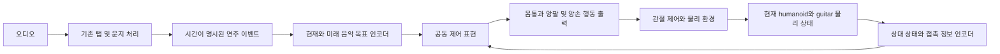

# 음악 조건 공동 제어 모델 파이프라인 설계

2026-10-15. 안정적인 초기 자세 연구가 끝나기 전에는 모델의 정보 흐름과 학습 구조에 집중한다. 우선 입력 예제는 `05_BN2-131-B_solo`, 최종 타이밍 주 지표는 ±50ms이며 ±100ms는 초기 진단이다. 아래 구조는 비교 실험을 위한 설계 초안이다. 구현된 파일럿이나 최종 확정 네트워크와 구분한다.

## 작업 순서

- [x] 사용자 선택과 우선순위 기록, 지정 곡의 기존 입력 검사와 SHA 확인.
- [x] 모델 입력·공유 정보·출력·학습 단계의 첫 설계안 작성.
- [ ] 입력 표현과 시간 정보 처리 후보를 비교하고 최소 기준 모델 확정.
- [ ] 초기 자세 연구 결과를 받은 뒤 세부 환경 계약과 모델 차원을 확정.
- [ ] 새 환경에서 단계별 학습과 동일 조건 비교 실험 수행.

이번 문서 갱신은 위 첫 두 단계다. 소비된 소스·체크포인트·실험 결과는 변경하지 않는다.

## 설계의 중심 질문

정책은 다음 음을 언제 어디서 연주해야 하는지와, 지금 손과 기타가 어떤 상태인지를 함께 알아야 한다. 검증할 가설은 미래 음악 목표와 사람–기타의 상대 상태를 공유하면 접근·압현·타현 중 악기 지지를 조정하기 쉬워진다는 것이다. 공동 입력이나 역할별 출력만으로 이 효과 또는 논문 독창성이 입증되지는 않는다.

## 정보 흐름 초안

오디오는 전체 시스템의 입력이고 제어 정책에는 오디오에서 추출한 이벤트를 제공하는 구성을 우선 검토한다. 오디오 전처리의 오류와 제어 정책의 실패를 따로 측정할 수 있도록 이벤트의 원본 시각·줄·프렛·운지를 유지한다.

음악 인코더는 현재 울려야 하는 음, 앞으로 준비할 음, 목표 시각까지의 시간, 유지·해제 시각, 타현 방향을 표현한다. 현재 목표와 미래 목표를 구별하며 미래 목표가 현재 유지 중인 운지를 덮어쓰지 않도록 입력 계약을 정한다. 미래 창의 길이와 가변 이벤트 수를 표현하는 방법은 곡의 실제 이벤트 밀도를 보고 결정한다. 특정 Transformer나 RNN을 먼저 확정하지 않는다.

상태 인코더는 관절 상태, 기타의 위치·자세·속도, 기타 기준 손과 목표의 상대 위치, 관련 접촉 정보를 표현하는 후보로 둔다. 안정성과 중력 방향에 필요한 world 기준 정보도 유지한다. 접촉의 지속시간이나 움직임 이력이 실제로 필요하면 명시적 상태 또는 짧은 이력을 추가하고, 필요성이 확인되기 전부터 별도 예측 네트워크를 늘리지 않는다.

두 표현을 합친 공동 제어 표현에서 몸통·양팔·양손 행동을 함께 결정한다. 역할별 출력 head를 사용하더라도 각 head가 양손과 기타 상태를 공유하도록 설계한다. 지지를 오른팔만의 역할로 고정하지 않으며, 하나의 관절 목표는 정확히 하나의 출력 경로가 소유한다. 왼손 정책·오른손 정책·안정화 정책이 같은 관절 목표를 순차적으로 덮어쓰는 구성을 피한다.

초기 행동 표현 후보는 제한된 관절 목표 변화량이다. 최종 관절 집합·크기·제어 주기는 새 환경에 맞춰 정한다. 기존 파일럿의744차원 관측과54차원 행동은 당시 실행 계약이며 최종 설계의 필수 숫자가 아니다. 초기 자세는 reset 조건으로 환경에서 제공하고, 준비 완료 여부는 관측·평가에 반영한다. 준비가 늦었다고 음악 시계를 자동으로 멈추거나 목표 onset을 옮겨 타이밍 실패를 숨기지 않는다.

## 학습 구조 초안

처음에는 하나의 공동 정책을 새로 초기화하고, 같은 출력 계약 안에서 과제 난도를 올리는 방식을 검토한다. 악기 지지를 유지하며 목표에 접근하는 단계, 한 음의 압현·유지·해제 단계, 시간 조건이 있는 양손 연주 단계, 짧은 구절 단계가 후보 순서다. 각 단계의 전환은 갱신 횟수보다 접근·유지·타이밍·악기 안정성의 실제 기준으로 판단한다. 기준의 수치는 환경 구현 단계에서 확정한다.

PPO와 보상·비용 critic은 비교를 시작하는 후보로 유지한다. critic이 분리되었다는 이유만으로 안전 제약이 보장되거나 지지와 연주가 자동 분리된다고 해석하지 않는다. 목표 도달 여부와 정책 갱신 크기를 따로 관찰한다. 기존 Fret·Strike 가중치를 이식하지 않지만, 새 공동 정책의 단계 간 학습 결과를 이어가는 방식은 검토할 수 있다.

## 비교로 확인할 설계 효과

| 비교 항목 | 답하려는 질문 |
|---|---|
| 동일 정보를 단순 연결한 모델과 음악·상태를 구분해 표현한 모델 | 표현 구조 자체가 도움이 되는가? 가능한 한 모델 크기와 학습 예산을 맞춘다. |
| 현재 목표만 입력한 모델과 미래 목표도 입력한 모델 | 다음 음의 사전 준비와 시간 정확도에 미래 정보가 기여하는가? |
| 역할 간 공유 범위를 달리한 모델 | 양손 연주와 악기 지지 사이의 조정에 공유 정보가 기여하는가? |

비교는 동일한 초기 배치 분포·물리 환경·목표·평가 조건에서 수행한다. 최종 ±50ms 타이밍, 올바른 줄·프렛·운지와 유지, 악기 위치·자세·움직임, 실패 및 중도 종료를 분리 보고한다. 초기 자세가 바뀐 효과를 모델 구조의 효과로 섞지 않는다.

## 초기 자세 연구 이후 연결할 사항

초기 상태와 허용 변화 범위, 제어 가능한 관절, 실제 접촉 표면, 압현·타현 후보의 정의, 행동 제한과 종료 조건을 환경 계약으로 받는다. 기존 fret·strike의 관측·목표·접촉·보상·종료 구조를 참고하되 고정 기타에서만 성립하는 가정이 있는지 확인한다. 현재 단계에서는 해당 상수나 기존 환경 코드를 수정하지 않는다.

지정 곡은 기존 검사에서 선택 B/C/D 입력이 유효했고 검사 입력 SHA가 변하지 않았다. 원본66개 이벤트 중 `event-000042`는 미지원 목록에 남아 있다. 첫 시연 구간은 이 제한과 실제 난도를 확인하여 정하며 전체 곡을 이미 지원한다고 주장하지 않는다.

[확정된 사용자 답변](/home/ajou/yigyu/3/docs/FRESH_MUSIC_USER_REVIEW.md) · [기존 파일럿 구현](/home/ajou/yigyu/3/stability_adapter_2/fresh_music_v1/README.md) · [기존 곡 입력 검사](/home/ajou/yigyu/3/docs/2026-10-12/stability_adapter_2/results/fresh_music_v1/input_audit_v1.json)
