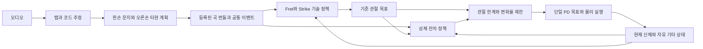

# Methodology

논문 제목: **From Audio to Full-Body Guitar Performance with a Freely Moving Instrument**

## 3.1 문제 정의와 접근 방법

본 연구는 입력 오디오에 포함된 기타 연주를 명시적인 음악 목표로 변환하고, 움직이는 기타와 상호작용하는 휴머노이드의 관절 제어로 연결하는 문제를 다룬다. 고정된 악기에서는 손의 운동을 주어진 줄·프렛 위치에 맞추는 것이 주요 제어 과제인 반면, 자유 기타에서는 신체와 악기의 접촉이 악기 자세를 바꾸고, 그 변화가 다시 손의 목표 위치를 바꾼다. 여기서 압현은 왼손으로 줄을 눌러 음높이를 정하는 동작이고, 타현은 오른손으로 줄을 건드려 음의 시작을 만드는 동작이다. 프렛은 지판을 가로지르는 금속 막대로, 어느 프렛 구간을 누르는지가 음높이에 대응한다. 따라서 압현과 타현의 정확도뿐 아니라 연주 가능한 악기 배치를 유지하는 제어가 함께 필요하다. 이를 위해 고정 기타에서 학습한 두 손의 기술 정책을 재사용하고, 실제 신체와 기타 상태를 관측하는 상체 잔차 정책으로 관절 목표를 보정한다. 정책(policy)은 입력된 상태 정보로부터 다음 제어 명령을 선택하는 함수이며, 잔차(residual)는 기존 기술이 제안한 목표에 더하는 보정량을 뜻한다.

정책에 제공하는 상태 정보의 묶음을 관측(observation), 정책이 선택한 제어 출력을 행동(action), 실행 결과가 학습 목적에 얼마나 부합하는지 나타내는 수치를 보상(reward)이라 한다. 본 연구의 잔차 정책은 신체·기타·음악 상태를 관측하고, 관절 목표의 보정량을 행동으로 출력한다. 물리 시뮬레이션이 그 목표에 따른 움직임을 계산하면, 음악 수행과 악기 유지 상태에서 보상을 계산하여 정책 학습에 사용한다. 따라서 행동을 출력하는 단계와 그 행동이 성공했는지 평가하는 단계는 구분된다.

오디오 신호를 \(x\), 오디오에서 구성한 연주 목표열을 \(\mathcal{E}=\{E_i\}_{i=1}^{N}\), 시각 \(t\)의 신체·기타 상태를 \(s_t\)라 하자. \(N\)은 목표 이벤트의 수이며, 각 \(E_i\)는 특정 시점에 수행해야 할 연주 조건을 나타낸다. 제어기는 \(s_t\)와 현재 음악 목표에 조건화된 관절 목표 \(q_t^{\mathrm{final}}\)을 출력한다. 이는 각 관절이 도달하도록 요청하는 각도를 모은 벡터다. 학습 목적은 각 이벤트의 줄·프렛·시간·타현 방향 조건을 만족하면서 기타가 허용 위치와 회전 범위를 유지하도록 하는 것이다. 기타의 위치나 회전은 정책 행동에 포함되지 않으며, 중력과 물리 접촉, 스트랩을 사용하는 조건에서의 수동 장력에 의해 결정된다. 기타 자세를 직접 덮어쓰거나 목표 자세로 복원하는 별도 제어력은 사용하지 않는다.

실험 장면은 전신 휴머노이드, 의자, 자유 기타로 구성한다. 사람 형태의 시뮬레이션 신체인 휴머노이드의 기준 몸체(root)와 하체는 고정하고, 몸통·목·머리·양팔·양손에 해당하는 81개 관절 목표를 제어한다. 하체는 행동 공간에 포함되지 않지만, 허벅지 등 신체 형상이 악기 지지와 접촉에 참여한다. 따라서 본 방법에서 전신이라는 표현은 전체 신체를 포함한 연주 장면과 접촉 조건을 의미하며, 보행이나 전신의 모든 관절을 학습한다는 의미는 아니다.

전체 처리 과정은 오디오 해석, 연주 목표 구성, 동결 기술 정책의 추론, 잔차 보정, 물리 실행, 음악 판정으로 이루어진다. 동결(frozen)은 이미 학습한 정책의 가중치를 이후 공동 학습에서 변경하지 않는다는 뜻이며, 신체의 움직임을 고정한다는 뜻은 아니다. 오디오 해석 모듈은 줄·프렛 표기인 탭과 화성 정보인 코드를 생성하고, 이를 왼손 운지와 오른손 타현 계획으로 변환한다. 두 손의 계획은 공통 이벤트와 음악 시간축을 공유한다. 제어 단계에서는 압현을 담당하는 Fret와 타현을 담당하는 Strike 정책이 기준 관절 목표를 제안하고, 잔차 정책이 자유 기타의 운동과 신체 상태에 따라 이를 수정한다. 최종 관절 목표는 하나의 비례·미분(PD) 제어 경로를 통해 실행된다. PD 제어기는 목표와 실제 관절각의 차이를 줄이는 구동과 빠른 운동을 감쇠하는 작용을 결합하며, 구체적인 목표 제출 과정은 §3.5에서 설명한다. 자유 기타 제어 실험의 입력은 검수·등록된 곡별 목표이며, 오디오 추정 오차를 포함하는 종단 간 성능은 별도의 평가 대상으로 둔다. 방법의 구현과 학습 실행만으로 지속적인 자유 기타 연주 성공을 가정하지 않으며, 실제 달성 수준은 Result에서 분석한다.

*그림 3.1. 오디오 기반 연주 목표와 자유 기타 제어의 연결. 자유 기타 평가에서는 등록된 곡별 목표 이후의 제어·판정 경로를 실행한다.*

구현 근거: [오디오 처리](/home/ajou/yigyu/3/tab2fingermapping/README.md), [공통 이벤트 구현 범위](/home/ajou/yigyu/3/full/03_implementation/STATUS.md), [공동 제어 구조](/home/ajou/yigyu/3/docs/2026-10-12/Meeting/06_StabilityAdapter2_현재_학습구조.md).

## 3.2 오디오에서 양손 연주 목표로의 변환

### 탭·코드 추정과 입력 관리

기타 탭(tablature)은 연주할 음을 줄과 프렛 번호로 나타내는 표기이며, 코드(chord)는 함께 울리는 음들의 화성적 묶음이다. 오디오 해석에는 Conformer 신경망 기반 탭 전사와 자동 코드 추정(Automatic Chord Estimation, ACE)을 사용한다. 전사는 녹음된 소리를 음표 정보로 바꾸는 과정으로, 이후 제어기가 수행할 음악 목표를 제공한다. 탭 전사 결과는 음의 발생 시각과 줄·프렛 정보를 제공하고, 코드 추정 결과는 시간에 따른 화성 정보를 제공한다. 두 결과를 코드 트랙 융합과 운지 배정 단계에 연결하여 note, chord, fingering 산출물을 구성한다. 생성 결과와 물리 제어 입력 사이에는 검수·등록 단계를 두어, 제어 실험에 사용한 목표의 출처를 추적할 수 있도록 한다. 물리 학습기는 검수 전 생성 디렉토리의 산출물을 직접 읽지 않고 등록된 곡 번들을 사용한다. 이러한 구분은 오디오 해석 오류와 주어진 음악 목표를 실행하지 못한 제어 오류를 분리하기 위한 것이다.

탭 전사기의 입력 오디오는 22,050 Hz 단일 채널로 변환하고, Constant-Q Transform(CQT)으로 주파수 특징을 구성한다. CQT는 오디오를 시간에 따른 주파수 성분으로 나타내되 음악 음높이의 간격에 맞추어 주파수 축을 배치하는 변환이다. CQT는 hop 길이 256 sample, 288개 주파수 bin, 옥타브당 36개 bin을 사용하며, 성분의 크기에 \(\log(1+z)\) 형태의 log1p 변환을 적용한다. 여기서 \(z\)는 변환 전의 성분 크기이며, 큰 크기와 작은 크기의 수치 차이를 압축한다. Hop은 연속 분석 시점 사이의 간격, bin은 주파수 축의 한 구간을 뜻한다. Conformer 인코더는 국소적인 음향 특징과 시간적 문맥을 결합하고, 각 출력 시점에서 여섯 현의 음높이 클래스를 예측한다. MIDI 음높이는 반음 간격을 정수 하나씩의 차이로 표현하는 번호 체계다. 현별 클래스는 MIDI 음높이 40–88의 49개 값과 무음을 포함한 50개로 구성한다. 따라서 신경망의 출력은 현별 음높이 분류이며, 이 단계에서 손가락이나 관절 동작을 직접 결정하지 않는다.

현별 예측에서 동일한 음높이가 이어지는 구간을 묶어 음표를 구성한다. 각 음표는 줄 인덱스, 시작 시각, 종료 시각, MIDI 음높이의 네 필드로 저장한다. 이후 단계에서 이 정보를 줄·프렛 및 운지 표현으로 연결한다. 프레임 단위 분류와 음표 구간화를 분리하면 같은 줄의 음높이 변화와 무음 전환을 연주 목표의 시간 경계로 표현할 수 있다. 이 경계는 제어 입력을 구성하기 위한 추정값이며, 원음의 모든 타현 시작점을 정확히 복원했다는 의미는 아니다. [전사 특징 추출](/home/ajou/yigyu/3/tab2fingermapping/conformer/feature_extractor.py), [전사 모델과 음표 구간화](/home/ajou/yigyu/3/tab2fingermapping/conformer/transcribe.py).

오디오 onset은 새로운 소리가 시작된 시각을 나타내지만, 항상 새로운 피크 타현을 뜻하지는 않는다. 따라서 음의 onset을 오른손 공격 명령으로 단순 치환하지 않고, 타현 의도와 기본 연주 설정(profile)을 함께 해석한다. 특히 왼손 압현 계획만으로 오른손 목표를 만들면 압현이 필요하지 않은 개방현이 누락될 수 있다. 오른손 타현 계획은 원래 note 입력과 별도로 검수한 타현 의도 표현인 StrikeIntent를 바탕으로 구성한다.

구현 근거: [오디오 파이프라인](/home/ajou/yigyu/3/tab2fingermapping/pipeline.py), [곡 번들](/home/ajou/yigyu/3/data/song_bundles/README.md), [타현 의도 표현](/home/ajou/yigyu/3/strike/01_goal_contract/GOAL_ARCHITECTURE.md).

### 왼손 운지와 오른손 타현 계획

줄을 누르지 않은 개방현을 기준으로 한 표준 튜닝에서 저음현부터 고음현까지의 MIDI 음높이는 \((40,45,50,55,59,64)\)이다. 줄 \(s\)의 개방현 음높이를 \(m_s^{\mathrm{open}}\), 프렛 번호를 \(n\)이라 하면 연주 음높이는 \(m=m_s^{\mathrm{open}}+n\)으로 표현한다. 입력 음표에 줄과 음높이가 주어지면 프렛은 \(n=m-m_s^{\mathrm{open}}\)으로 구할 수 있다. 동일한 음높이라도 선택한 줄에 따라 프렛이 달라지므로, 현별 음높이와 줄 인덱스를 함께 보존한다. 개방현은 \(n=0\)으로 표현하며 왼손 압현 없이도 오른손의 타현 대상이 된다. [튜닝과 프렛 변환](/home/ajou/yigyu/3/tab2fingermapping/fingermapping/grips.py:13), [입력 줄을 유지하는 운지 배정](/home/ajou/yigyu/3/tab2fingermapping/fingermapping/assign.py:50).

왼손 운지 배정은 탭에 지정된 줄·프렛을 유지한 채 손가락과 손의 위치를 선택한다. 규칙 기반 탐색은 프렛 간격, 손가락 순서와 교차, 한 손가락으로 여러 줄을 누르는 바레(barre), 기존 음의 유지와 해제 조건을 고려한다. 이때 소리가 시작되는 onset과 손가락이 줄을 누르기 시작하는 시각을 구분하고, 음이 이어져야 하는 sustain 구간과 손가락의 해제 시각도 별도로 표현한다. 이는 타현 시점 이전에 필요한 압현 상태를 준비하고, 뒤따르는 음을 위해 운지를 전환할 수 있도록 하기 위함이다. 다만 이 탐색은 실제 관절 한계나 역기구학적 도달성을 검증하는 과정은 아니며, 선택한 운지의 물리적 실행 가능성은 Fret 정책과 시뮬레이션에서 평가한다. 역기구학은 손끝 같은 부위를 목표 위치에 놓을 수 있는 관절각을 역으로 구하는 계산을 뜻한다. 개별 Fret S0의 실행 범위는 단음 중심이며, 계획 표현에 포함된 바레나 특수 주법 전체의 물리적 수행을 전제하지 않는다.

이러한 목표 표현은 관절 궤적을 유일하게 지정하지 않는다. 같은 압현 위치를 만족하는 손목·팔·몸통 자세가 여러 개 존재할 수 있고, 기타의 운동에 따라 각 자세에서 형성되는 접촉도 달라진다. 본 방법은 목표를 만족하는 자세의 선택을 동결된 연주 기술과 상체 잔차 제어에 맡긴다. 이에 따라 음악 계획은 어떤 음을 언제 연주할지를 규정하고, 제어 정책은 실제 신체와 악기의 상태에서 그 목표를 수행할 관절 목표를 결정한다.

오른손 계획은 줄을 건드리는 피크의 사용 주체, 단일 타현과 여러 줄을 쓸어 치는 strum의 구분, down·up 방향, 통과할 현과 실제 소리를 낼 현, 현별 시간 offset을 포함한다. Offset은 여러 현을 순서대로 지날 때 각 현의 목표 시각이 기준 시각에서 얼마나 떨어져 있는지를 나타낸다. 타현 전 접근과 타현 후 회복도 계획의 일부로 다룬다. 계획과 실제 동작의 대응은 별도의 검출기와 정합기로 판단하여, 같은 현을 통과하는 사건인 crossing의 중복이나 잘못된 방향·순서의 타현을 성공으로 중복 집계하지 않는다. 본 실험은 피크 위치를 나타내는 기하 표식(marker)을 사용하는 경로를 대상으로 하며, 손가락 타현이나 실제 피크의 파지·미끄러짐은 별도의 모델링 대상이다.

구현 근거: [운지 배정](/home/ajou/yigyu/3/tab2fingermapping/fingermapping/ALGORITHM.md), [Fret 입력 범위](/home/ajou/yigyu/3/fret/README.md), [오른손 계획](/home/ajou/yigyu/3/strike/01_goal_contract/MAPPER_RULES.md), [타현 판정 조건](/home/ajou/yigyu/3/strike/RIGHT_HAND_RULES.md).

## 3.3 공통 이벤트와 음악 시간축

압현은 일정 시간 유지되는 상태이고, 타현은 특정 시점에 발생하는 사건이다. 같은 줄과 프렛을 누른 상태에서 여러 차례 타현할 수 있으므로, 압현 구간과 타현 이벤트는 일대일 관계가 아니다. 또한 개방현 타현에는 왼손 압현이 필요하지 않으며, 손가락이 목표 프렛에 도달했더라도 타현이 없으면 해당 음악 이벤트가 완성되지 않는다. 따라서 양손에 동일한 동작 시각표를 적용하기보다, 각 타현 시점에 필요한 압현 상태를 함께 검사하는 시간 표현을 사용한다.

두 손은 동일한 음악 이벤트를 서로 다른 운동 목표로 해석해야 한다. 이를 위해 양손이 공유하는 표준 이벤트 표현인 Canonical PlayEvent를 사용한다. 이는 같은 음악적 시작점으로 묶인 음들의 현별 목표를 저장하고, 왼손에는 필요한 압현 상태로, 오른손에는 타현 순서와 시각으로 나누어 전달한다. 이처럼 하나의 이벤트에서 각 손에 필요한 부분을 꺼내는 과정을 projection이라 부른다. 이벤트 \(E_i\)는 필수 현 집합 \(\mathcal{S}_i\), 현별 목표 프렛·운지·crossing 시각, 타현 방향과 현을 통과할 순서(traversal)를 포함한다. 단일 타현과 여러 현을 순차적으로 통과하는 strum을 같은 표현으로 다루되, 개별 현의 성공과 이벤트 전체의 성공은 구분한다. 한 현의 성공만으로 다중 현 이벤트가 완료된 것으로 판단하지 않기 위해서다.

물리 시간과 음악 시간은 준비 구간을 기준으로 연결한다. 준비 시간을 \(T_{\mathrm{prep}}=2\,\mathrm{s}\)라 하면, 연주 구간의 음악 시간은 \(\tau=t-T_{\mathrm{prep}}\)로 정의한다. 준비 중에도 물리 시뮬레이션과 잔차 제어는 수행하지만 음악 보상은 활성화하지 않는다. 준비가 끝나면 공통 악보 시계(score clock)를 첫 음악 시점에 연결하고, 이후에는 고정된 시간축에서 이벤트를 실행한다. 이벤트 실패 때문에 음악 시간을 되돌리거나 성공할 때까지 정지시키지 않는다. 각 이벤트는 성공 여부를 마감하는 지정 시각(deadline)에서 성공 또는 실패로 확정된다.

시간축을 설명하기 위한 가상 예로, 악보의 1.0초에 특정 줄의 3번 프렛 음을 한 번 타현해야 한다고 하자. 준비 시간이 2초이므로 목표 타현 시각은 물리 시간 3.0초에 해당한다. 왼손은 타현에 앞서 필요한 압현 상태를 준비하고, 오른손은 그 시점에 해당 현을 통과해야 한다. 왼손만 정확히 도달하거나 오른손만 제때 움직인 경우에는 공동 성공이 아니며, 실제 판정은 §3.7의 시간 허용 범위와 압현 유지 등 모든 조건을 검사한다. 이 예는 시간 대응의 설명이며 실험에서 측정한 결과는 아니다.

| 시간 표현 | 정의와 용도 |
|---|---|
| 물리 시간 | 환경 시작 이후 물리 엔진이 적분한 시간 |
| 음악 시간 | 준비 구간 이후 공통 악보 시간축 |
| 목표 시각 | 이벤트 onset과 현별 traversal offset이 지정한 crossing 시각 |
| 실행 시각 | 실제 압현 상태 변화와 검출된 피크 crossing 시각 |
| 영상 길이 | 저장 frame 수와 재생 frame rate로 결정되는 표시 시간 |

개별 기술의 자유 기타 전이 진단은 원본 정책의 첫 종료 신호에서 끝날 수 있다. 반면 공동 제어 평가는 개별 정책의 종료 신호를 진단값으로 보존하면서 정해진 곡 종료 시점(horizon)까지 진행한다. 따라서 두 평가의 실행 길이와 성공 분모는 동일하지 않다. 공통 이벤트 표현이나 CPU에서의 동기화 계약 검증 역시 자유 기타의 물리적 연주 성공과 구분한다.

구현 근거: [공통 이벤트 compiler](/home/ajou/yigyu/3/tab2body/full/events.py), [공동 음악 시간과 판정](/home/ajou/yigyu/3/stability_adapter_2/dual_music_clock_v1.py), [평가 horizon](/home/ajou/yigyu/3/stability_adapter_2/deadline_native_v1.py).

## 3.4 움직이는 기타를 기준으로 한 상태 표현

좌표계는 위치와 방향을 수치로 나타내기 위해 정한 원점과 세 축이다. 장면에 고정된 world 좌표계에서는 기타가 움직일 때 프렛의 위치도 바뀌지만, 기타에 붙어 함께 움직이는 좌표계에서는 같은 프렛이 같은 로컬 위치를 유지한다. 손의 목표와 실제 손 위치는 매 시각의 기타 좌표계에서 비교한다. 기타에 부착된 줄·프렛 목표는 기타 로컬 좌표계 \(G\)에서 정의하고, 현재 기타의 위치와 회전으로 world 좌표계에 변환한다. 이 표현에서는 신체 관절각이 같더라도 기타가 이동하면 손과 목표 사이의 상대 오차가 달라진다. 고정 기타에서 유효했던 절대 위치를 그대로 사용할 때 발생하는 목표 불일치를 줄이기 위한 구성이다.

물리 엔진에서 기타의 자세를 기록하는 기준점인 actor-root의 world 위치와 회전을 각각 \(p_G\), \(R_G\), 해당 기준점의 선속도와 기타 각속도를 \(v_G\), \(\omega_G\)라 하자. world 좌표에서 손 표본의 위치와 속도가 \(p_H\), \(v_H\)일 때 기타 상대 위치와 속도는 다음과 같다. \(R_G\)는 기타 로컬 방향을 world 방향으로 옮기는 회전행렬이며, 전치행렬 \(R_G^\top\)는 반대 방향으로 좌표를 변환한다. 위첨자 \(G\)는 기타 좌표계에서 표현한 값, \(\times\)는 두 벡터의 외적을 뜻한다.

\[
p_H^G=R_G^\top(p_H-p_G),
\qquad
v_H^G=R_G^\top\left[v_H-v_G-\omega_G\times(p_H-p_G)\right].
\]

위치 식에서는 먼저 기타 원점의 위치를 빼고, 그 차이를 기타 축 방향으로 회전시킨다. 속도 식에서는 기타의 병진 속도와 회전에 의해 생기는 표본점의 속도를 모두 제거한다. 따라서 기타와 손이 함께 같은 방향으로 움직이는 경우와, 손이 기타에 대해 미끄러지는 경우를 구분할 수 있다. 물리 엔진이 질량중심 기준 선속도를 반환하는 경우에는 먼저 actor origin이나 실제 표본점 기준 속도로 변환한다. 회전 관측은 회전행렬의 첫 두 열을 연결한 6차원 표현을 사용한다. 기타 로컬축은 \(+x\)가 6번줄에서 1번줄, \(+y\)가 브리지에서 너트, \(+z\)가 지판 바깥쪽을 향하도록 정의한다. 입력 CSV와 시뮬레이터의 현 순서가 반대인 경우에는 인덱스를 명시적으로 변환한다.

기타 actor-root, 바디를 둘러싼 상자(bounding box)의 중심, 질량 분포에 의해 정해지는 질량중심은 서로 다른 기준점이다. 본 제어기의 위치 관측과 허용 범위는 actor-root를 기준으로 하며, 외관상의 바디 중심이나 질량중심으로 임의 대체하지 않는다. 이 구분은 기타 형상이나 질량 분포를 바꿀 때에도 같은 위치 지표의 의미를 유지하기 위해 필요하다.

구현 근거: [좌표와 상태 표현](/home/ajou/yigyu/3/stability_adapter_2/environment_contract_v1.py), [스트랩 표본점 속도](/home/ajou/yigyu/3/stability_adapter_2/strap.py).

## 3.5 동결 기술 정책과 상체 잔차 제어

### 기준 관절 목표의 구성

Fret와 Strike는 고정 기타 환경에서 각각 학습한 압현·타현 정책이다. 두 정책은 각각 420차원과 303차원 관측을 받아 30차원 행동을 출력한다. 여기서 차원은 관측이나 행동을 구성하는 수치의 개수이며, 공간의 축 개수를 뜻하지 않는다. 자유 기타 제어에서는 실제 기타 상태와 같은 음악 시간축에 맞추어 각 정책의 관측을 구성하고, 가중치를 동결한 상태에서 추론한다. 학습 도중 저장한 정책 상태인 대표 checkpoint는 Fret 35,000 iteration과 Strike 10,000 iteration이며, 서로 다른 학습 run의 iteration 수를 동일한 학습량이나 성능 척도로 해석하지 않는다.

동결 기술의 출력은 자유 기타의 초기 지지 자세와 직접 양립하지 않을 수 있다. 특히 팔 목표가 초기 지지 배치에서 크게 벗어나면 작은 잔차 행동만으로 이를 상쇄하기 어렵다. 이를 완화하기 위해 기준 목표 제한인 nominal guard를 적용한다. Nominal은 잔차를 더하기 전의 기준 관절 목표를 뜻하며, guard는 그 기준 자체가 초기 지지 배치에서 지나치게 멀어지지 않도록 제한하는 과정이다. 시뮬레이션을 초기화하는 reset 시점에는 지지 배치를 위한 기준 PD 목표인 preload를 정한다. 양팔 24개 관절의 기준 목표는 이 reset preload의 \(\pm0.15\,\mathrm{rad}\), 왼엄지 5개 관절은 \(\pm0.10\,\mathrm{rad}\) 범위로 제한한다. 나머지 손가락 목표는 원본 정책에서 받아들이고, 몸통·목·머리 목표와 결합하여 81차원의 기준 목표 \(q_t^{\mathrm{nom}}\)을 구성한다. 준비 구간에서는 preload 자체를 기준 목표로 사용한다.

이 제한은 원본 정책의 행동을 그대로 재생하는 조건과 다르다. 따라서 원본 정책의 성능, 자유 기타에 연결한 정책의 성능, 기준 목표 제한의 영향, 학습 잔차의 영향은 각각 구분하여 평가한다. 잔차 정책은 기준 목표를 입력으로 함께 받아 자신이 보정할 동작과 기타 상태 사이의 관계를 관측한다.

구현 근거: [동결 정책 연결](/home/ajou/yigyu/3/stability_adapter_2/deadline_native_v1.py), [기준 목표 제한](/home/ajou/yigyu/3/stability_adapter_2/deadline_support_nominal_v1.py).

### 관측과 정책 구조

잔차 정책의 관측 \(o_t\in\mathbb{R}^{825}\)은 물리 상태 548차원, 음악·검출 상태 191차원, 기준 목표 81차원, 스트랩 상태 5차원을 연결하여 구성한다. 물리 상태는 신체와 기타의 운동 및 목표 제약을, 음악 상태는 실제 음높이와 다음 이벤트의 조건을 제공한다. 기준 목표와 스트랩 상태를 함께 입력함으로써 동일한 신체 자세에서도 원본 정책의 요청이나 지지 조건에 따라 다른 보정을 선택할 수 있도록 한다. 음악 관측의 dwell은 필요한 압현 상태가 유지된 시간, hit는 판정기가 인정한 현 통과, mask는 특정 목표나 조건의 활성 여부를 나타내는 값이다. Press cell은 하나의 현과 프렛에 대응하는 압현 영역이며, sounding fret는 실제 압현 상태에서 현재 음높이를 결정하는 것으로 판정된 프렛이다.

| 관측 블록 | 차원 | 주요 정보 |
|---|---:|---|
| 물리 상태 | 548 | 관절각·속도·직전 최종 목표·관절 한계, 몸통 기준 대비 변화, 기타 자세·속도·위치 여유, 양손 상대 상태, 시간 |
| 음악·검출 상태 | 191 | 필수 프렛, 관측 음높이·dwell·인정 hit, 이벤트 시간·방향·mask, 6×22 press cells, 피크 이력 |
| 기준 목표 | 81 | nominal guard를 적용한 \(q_t^{\mathrm{nom}}\) |
| 스트랩 상태 | 5 | 사용 여부, 현재 경로 길이, 정지 길이, 길이 변화율, 계산 장력 |

학습에서는 행동을 선택하는 Actor와 앞으로 얻을 보상의 누적값을 추정하는 Critic을 분리한다. Critic의 추정은 같은 행동이 예상보다 나은 결과를 냈는지 판단하는 기준으로 사용한다. 두 신경망은 각각 입력 825차원, 은닉층 512·256차원의 다층 퍼셉트론(MLP)으로 구성한다. 은닉층은 입력과 출력 사이에서 정보를 변환하는 층이며, 각 숫자는 그 층의 계산 단위 수다.

Actor는 81차원 잠재 Gaussian의 평균을 출력하고, Critic은 관측당 수치 하나인 scalar value를 추정한다. Gaussian은 평균 주변에서 행동을 확률적으로 선택하는 정규분포이며, 대각 공분산은 각 행동 성분의 변동을 독립적으로 설정한다는 뜻이다. 이 분포에서 얻은 변환 전 행동 \(u_t\)에 각 성분을 −1과 1 사이로 제한하는 \(\tanh\)를 적용하여 정규화된 보정 \(a_t\in[-1,1]^{81}\)을 구한다. 학습에서는 변환 전 행동과 그 선택 가능성을 나타내는 로그 확률(log probability)을 보존하며, 물리 환경에 제출하는 관절 목표와 구분한다. 일반적인 신체 접촉력 센서나 손바닥 접촉 mask는 별도 관측 블록에 포함되지 않는다. press cell과 sounding fret는 음악 판정을 위한 기하 상태이며 일반 접촉력 관측과는 다르다.

*그림 3.2. 825차원 관측을 사용하는 잔차 Actor·Critic과 동결된 기술 정책의 관계. Actor의 81차원 보정은 관절별 제약을 거쳐 단일 PD 목표로 제출된다.*

구현 근거: [Actor·Critic](/home/ajou/yigyu/3/stability_adapter_2/joint_policy_v1.py), [관측 블록](/home/ajou/yigyu/3/stability_adapter_2/joint_learning_observation_v1.py), [네트워크 구성](/home/ajou/yigyu/3/docs/2026-10-12/Meeting/06_StabilityAdapter2_현재_학습구조.md).

### 관절 목표의 제한과 물리 실행

관절 그룹마다 허용할 잔차 크기와 목표 변화율을 다르게 설정한다. 몸통은 지지 자세의 급격한 변화를 줄이기 위해 작은 보정과 낮은 변화율을 사용하고, 손가락은 압현·해제 전환을 위해 상대적으로 빠른 목표 변화를 허용한다.

| 관절 그룹 | 차원 | 기준 목표 대비 보정 한도 | 목표 변화율 한도 |
|---|---:|---:|---:|
| Torso·Spine·Chest | 9 | ±0.03 rad | 0.10 rad/s |
| Neck·Head | 6 | ±0.10 rad | 0.50 rad/s |
| 양측 Thorax·Shoulder·Elbow·Wrist | 24 | ±0.30 rad | 1.00 rad/s |
| 양손 손가락 | 42 | ±0.20 rad | 1.50 rad/s |

계산은 기준 목표에 잔차를 더하고, 허용 관절 범위로 제한한 다음, 직전 제출값에서 한 번에 너무 크게 바뀌지 않도록 변화량을 제한하는 순서로 수행한다. 관절별 보정 한도를 벡터 \(c\), 목표 변화율 한도를 \(v^{\max}\), 유효 관절 범위를 \([\ell,h]\)라 하자. \(\odot\)는 원소별 곱이며, \(\operatorname{clip}\)은 각 원소를 주어진 범위로 제한한다. 시간 간격 \(\Delta t\)는 한 번의 제어 간격이다. 아래에서 \(\mu_\theta\)는 학습 파라미터 \(\theta\)를 가진 Actor가 출력하는 평균, \(\sigma\)는 행동 성분별 표준편차, \(\operatorname{diag}(\sigma^2)\)는 그 분산을 대각선에 놓은 행렬이다. \(q_t^{\mathrm{req}}\)는 잔차를 더한 요청, \(\widetilde q_t\)는 변화율 제한을 거친 중간 목표다. 최종 목표는 다음과 같이 계산한다.

\[
\begin{aligned}
u_t&\sim\mathcal{N}\!\left(\mu_\theta(o_t),\operatorname{diag}(\sigma^2)\right),
& a_t&=\tanh(u_t),\\
q_t^{\mathrm{req}}&=\operatorname{clip}\!\left(q_t^{\mathrm{nom}}+c\odot a_t,\ell,h\right),\\
\widetilde q_t&=\operatorname{clip}\!\left(q_t^{\mathrm{req}},
q_{t-1}^{\mathrm{final}}-v^{\max}\Delta t,
q_{t-1}^{\mathrm{final}}+v^{\max}\Delta t\right),\\
q_t^{\mathrm{final}}&=\operatorname{clip}(\widetilde q_t,\ell,h).
\end{aligned}
\]

몸통의 유효 범위는 물리 모델에 지정된 native 관절 한계와 reset 기준 \(\pm5^{\circ}\)의 교집합이다. 기준 목표 제한과 잔차 한도는 별도로 적용하므로, 팔은 preload 대비 \(\pm0.15\,\mathrm{rad}\)로 제한한 기준 목표에 최대 \(\pm0.30\,\mathrm{rad}\)의 보정 요청을 더할 수 있다. 변화율 제한은 제출 목표의 변화량을 제어하며, 실제 관절속도가 그 한도 이하라는 보장은 제공하지 않는다.

81개 최종 목표는 하나의 제출 경로를 통해 물리 엔진에 내장된 위치 목표 추종 제어인 native POSITION PD에 전달한다. 목표를 제출해도 실제 관절은 그 각도로 즉시 이동하지 않으며, 구동과 중력·접촉의 영향을 받아 움직인다. 따라서 목표 관절각과 실제 관절각은 별도로 측정해야 한다. 제어 주파수는 60 Hz이며, 각 목표를 240 Hz 물리 step 네 번 동안 유지한다. 원본 정책의 요청, 최종 제출 목표, 실제 관절각을 각각 기록하고, 원본 정책의 행동 이력에는 최종 목표를 원본 행동 좌표로 되돌린 값을 전달한다. 원본 정책과 native 관절 범위가 다르면 역변환 과정에서 제한이 발생할 수 있으므로, 이력 재구성 오차를 별도로 기록한다. 이 구성은 같은 관절을 여러 제어기가 동시에 덮어쓰지 않게 하고, 원본 정책이 실제 실행된 목표에 가능한 범위에서 조건화되도록 한다.

구현 근거: [잔차 변환](/home/ajou/yigyu/3/stability_adapter_2/deadline_bounded_residual_v1.py), [관절 한계와 변화율](/home/ajou/yigyu/3/stability_adapter_2/environment_contract_v1.py).

## 3.6 자유 기타의 지지와 허용 자세

### 신체 접촉과 수동 스트랩

초기 지지 자세는 왼손의 넥 접근과 허벅지·몸통·오른팔의 바디 배치를 함께 고려한다. 왼손 손바닥의 넥 아래 지지는 초기 배치의 선호 조건이며, 연주 내내 같은 접촉을 강제하지 않는다. 운지 전환에서는 손가락이 열리고 다시 접촉해야 하므로, 초기 자세나 손가락 굽힘을 유지하는 것만으로 음악적 성공을 대신할 수 없다. 또한 접촉이 검출되었다는 사실은 해당 부위가 충분한 지지력을 제공했다는 증거와 구분한다. 지지 배치의 효과는 기타의 운동과 음악 수행 지표를 함께 사용하여 평가한다.

스트랩은 사용 여부를 비교할 수 있는 수동 지지 요소로 모델링한다. 스트랩을 사용하는 공동 제어 조건에서는 13점 경로의 인장 전용 케이블을 적용한다. 이 모델은 느슨할 때는 힘을 내지 않고, 팽팽해진 뒤에는 늘어난 길이와 늘어나는 속도에 따라 당기는 힘을 낸다. 경로 길이를 \(L\), 정지 길이를 \(L_0\), 길이 변화율을 \(\dot L\)라 하자. \(k\)는 늘어난 길이당 힘을 정하는 강성, \(c_s\)는 길이 변화 속도에 대한 감쇠 계수, \(T_{\max}\)는 장력 상한이다. 장력은 다음과 같다.

\[
T=\begin{cases}
0, & L\leq L_0,\\
\operatorname{clip}\!\left(k(L-L_0)+c_s\dot L,0,T_{\max}\right),&L>L_0.
\end{cases}
\]

사용한 파라미터는 \(L_0=1.1018469719600776\,\mathrm{m}\), \(k=6000\,\mathrm{N/m}\), \(c_s=120\,\mathrm{N\,s/m}\), \(T_{\max}=300\,\mathrm{N}\)이다. 경로의 각 구간(segment) 장력을 양끝과 경로를 안내하는 지점(guide)에 작용·반작용으로 적용하며, 느슨한 케이블은 압축력을 전달하지 않는다. 장력은 기하 상태와 케이블 법칙으로 결정되므로 잔차 정책이 임의의 기타 복원력을 선택할 수 없다. 기록한 장력 역시 이 법칙으로 계산·제출한 값이며 힘 센서 측정값은 아니다.

구현 근거: [지지 배치](/home/ajou/yigyu/3/stability_adapter_2/PLAN.md), [케이블 모델](/home/ajou/yigyu/3/stability_adapter_2/strap.py), [실험 스트랩 설정](/home/ajou/yigyu/3/stability_adapter_2/deadline_native_v4.py).

### 위치·회전 허용 집합

악기가 반드시 한 자세에 머물 필요는 없지만, 손이 연주를 이어갈 수 있는 배치에서는 크게 벗어나지 않아야 한다. 이를 표현하기 위해 위치와 방향의 허용 집합, 즉 제어 목적상 받아들일 수 있는 자세들의 범위를 정한다. 이 범위는 보상과 평가의 기준이며, 경계 밖으로 움직이지 못하게 하는 물리적 벽은 아니다. 기타의 위치 허용 집합은 world actor-root를 기준으로 \(X\in[-0.50,-0.15]\,\mathrm{m}\), \(Y\in[-0.15,0.15]\,\mathrm{m}\), \(Z\in[0.65,z_{\mathrm{chest}}]\,\mathrm{m}\)인 상자로 정의한다. 여기서 \(z_{\mathrm{chest}}\)는 reset 시 저장한 Chest origin의 높이다. 각 축의 이탈 거리 \(d_{\mathrm{axis}}\)는 해당 범위 안에서 0이며, 범위 밖에서는 가까운 경계까지의 거리다. 이 정의는 위치를 단일 점으로 고정하기보다 일정 범위의 움직임을 허용한다.

회전 허용 집합은 world의 고정된 x·y·z축을 순서대로 사용하는 외재적 오일러 각(extrinsic Euler xyz)의 \(X\in[45,90]^{\circ}\), \(Y\in[50,100]^{\circ}\), \(Z\in[135,180]^{\circ}\)가 생성하는 회전으로 정의한다. Euler 각은 동일한 회전에 여러 표현이 존재하고 특이점도 가지므로, 단일 표현의 축별 수치를 비교하는 것만으로 허용 여부를 판정하지 않는다. 구현은 회전을 네 성분으로 표현하는 quaternion에서 부호를 모두 뒤집어도 같은 회전이 되는 성질과, 동일 회전의 대체 표현을 처리한다.

SO(3)는 3차원 공간에서 물체의 방향을 나타내는 회전들의 집합이며, 여기서 두 방향 사이의 거리는 한 방향을 다른 방향으로 돌리는 데 필요한 회전각으로 측정한다. 학습에 사용하는 회전 이탈량 \(\theta_{\mathrm{upper}}\)는 허용된 회전까지 찾은 SO(3) 거리의 상한 근사값이며, 허용 집합까지의 정확한 최단 거리를 인증한 값은 아니다. 허용된 방향 하나를 찾으면 그 방향까지의 거리는 계산할 수 있지만, 그것이 허용된 모든 방향 가운데 가장 가까운 것인지는 별도의 문제이기 때문이다. 초기 자세로부터의 회전 변화량도 이 허용 집합 이탈량과 구분한다.

구현 근거: [허용 범위 정의](/home/ajou/yigyu/3/stability_adapter_2/PLAYABLE_ENVELOPE_CONTRACT.md), [회전 이탈 처리](/home/ajou/yigyu/3/stability_adapter_2/deadline_rotation_v3.py).

## 3.7 압현과 타현의 공동 음악 판정

양손의 개별 목표 달성과 실제 연주 이벤트의 성공은 동일하지 않다. Fret의 지정 손가락(assigned-finger) 지표는 계획한 손가락이 지정 위치를 수행했는지를 나타내고, 실제 음높이는 현별 유효 press cell로부터 얻은 sounding fret로 판단한다. 공동 판정에서는 목표 현·프렛 상태가 준비된 시점에 피크가 올바르게 현을 통과해야 한다. 타현 이후에 압현을 수정하더라도 이미 발생한 오음 타현을 성공으로 변경하지 않는다.

물리 시뮬레이션은 이산 시점의 위치를 계산하므로, 각 시점의 피크 위치만 검사하면 두 시점 사이에 현을 통과한 사건을 놓칠 수 있다. 이를 줄이기 위해 240 Hz 물리 step의 이전·현재 위치 사이를 피크가 쓸고 지나간 기하 영역(swept geometry)에서 crossing을 검출하고, step 내부 통과 비율로 세부 시각을 추정한다. 해당 시각의 압현은 이전·현재 물리 step 양끝에서 같은 목표 sounding fret가 관측되고 필요한 dwell을 만족하는지 확인하는 보수적 구간 판정으로 처리한다. 사용한 dwell은 0.1초이며, 타현 시간 허용 범위는 목표 시각의 ±50 ms다. 이 과정은 실제 solver의 step 내부 압현 snapshot을 추출한 것이 아니므로, 연속 시간의 접촉 상태를 완전히 복원했다고 해석하지 않는다.

공동 검출기는 목표 현, 중복 여부, 타현 방향과 영역, traversal 순서, 타이밍, sounding fret와 dwell을 검사한다. 이벤트 deadline에서 필요한 모든 현의 crossing이 인정되고 잘못된 crossing이 없어야 joint success로 집계한다. 현별 hit, 이벤트 전체 성공, 준비 구간(PREP)과 음악 목표가 없는 휴지 구간(REST)을 구분하여 기록하고 각 지표의 분모를 유지한다. 원본 Strike가 사용하는 동작 단계(phase)와 타현 허용 여부(permission)의 판정은 공동 검출기와 완전히 같은 것으로 확인되지 않았으므로, 원본 정책의 결과와 공동 음악 판정을 각각 출력한다.

현과 피크는 이 음악 판정에서 기하 marker로 표현한다. 신체와 기타 바디의 접촉은 물리 엔진에서 처리하지만, 줄의 탄성 변형·진동, 피크와 줄 사이의 반력, 음향 합성은 모델에 포함하지 않는다. 영상에서 여섯 현을 표시하는 기능도 음악 판정을 위한 기하 표현과 시각화를 제공하며, 줄의 물리·음향 시뮬레이션을 추가하는 것은 아니다.

구현 근거: [공동 음악 판정](/home/ajou/yigyu/3/stability_adapter_2/dual_music_clock_v1.py).

## 3.8 보상 함수와 정책 학습

### 연속 상태와 음악 이벤트 보상

연주 성공만을 보상하면 아직 손이 목표에 도달하지 못하는 동안에는 어떤 움직임이 나아졌는지 학습에 전달하기 어렵다. 반대로 거리나 자세 유지에만 보상을 주면 실제 타현 없이 그 상태에 머무를 수 있다. 따라서 잔차 정책은 목표 접근과 악기 유지의 연속적인 신호를 제공하면서도, 올바른 crossing과 이벤트 완료를 별도의 보상으로 평가한다. 구체적으로 음악 상태, 양손 접근, 기타 안정성, 신체 변화와 관절 목표 변화량을 결합한다. 상태 기반 항에는 제어 간격 \(\Delta t=1/60\,\mathrm{s}\)를 곱하고, crossing과 이벤트 deadline의 보상은 해당 사건이 발생할 때 한 번 부여한다. 이를 통해 제어 주파수에 따라 연속 보상과 사건 보상의 상대 크기가 불필요하게 달라지는 것을 줄인다. 아래 표의 계수는 최종 배율 0.1을 적용하기 전의 값이다.

| 보상 항 | 계산 | 의미 |
|---|---|---|
| 위치 이탈 | \(-8\sum H(d_{\mathrm{axis}}/0.05)\)/초 | 기타 actor-root의 축별 상자 이탈 |
| 회전 이탈 | \(-4H(\theta_{\mathrm{upper}}/0.15)\)/초 | 허용 회전 집합까지 거리의 상한 근사 |
| 음높이 일치 | \(+0.6\,\mathrm{match}\)/초 | 필수 현의 sounding fret와 목표의 일치율 |
| 왼손 접근 | \(+0.15A\)/초 | 목표까지 \(\exp(-d/0.04)\)의 활성 손가락 평균 |
| 피크 접근 | \(+0.15K\)/초 | 현재 phase의 목표까지 \(\exp(-d/0.04)\) |
| 몸통 변화 | \(-0.1\operatorname{mean}H(\mathrm{excess}/5^{\circ})\)/초 | 초기 몸통각 대비 ±2° 밖의 변화 |
| 목표 변화율 | \(-0.01\operatorname{mean}(\mathrm{rate\_fraction}^2)\)/초 | 허용 목표 변화량으로 정규화한 변화 |
| Crossing | 인정 +1, 잘못된 PLAY crossing −0.25 | PREP crossing은 해당 벌점에서 제외 |
| 이벤트 deadline | 성공 +1, 누락·오류 −0.5 | 필수 현과 잘못된 crossing을 함께 평가 |

\(H(z)\)는 \(|z|\leq1\)일 때 \(z^2/2\), 그 밖에서는 \(|z|-1/2\)인 Huber 함수다. 작은 오차에서는 제곱으로, 큰 오차에서는 선형으로 증가하므로 큰 이탈 하나가 제곱에 비례하여 비용을 급격히 키우는 것을 줄인다. 접근 항의 \(d\)는 거리이며 단위는 m, 회전 이탈 항의 \(\theta_{\mathrm{upper}}\)는 rad 단위다. 연속 항의 시간 적분과 사건 보상의 합을 \(r_t^{\mathrm{raw}}\)라 할 때 정상적인 한 제어 전이(transition)의 보상은 다음과 같다. 전이는 한 번의 관측과 행동, 그 실행으로 얻은 다음 관측과 보상을 묶은 학습 자료다.

\[
r_t=0.1\max(-8,r_t^{\mathrm{raw}}).
\]

60 Hz 제어 시점에서 관측한 유한한 실제 관절속도의 절댓값이 50 rad/s를 넘으면 안전 종료를 적용한다. 이때 현재 tick의 원보상을 −8로 대체하고, 남은 각 tick의 하한 −8을 할인한 합과 추가 종료 비용 −1을 더한 뒤 0.1 배율을 적용한다. 이는 조기 종료로 이후의 비용을 회피하는 유인을 줄이기 위한 처리이다. 관절속도 검사는 모든 240 Hz 물리 substep의 속도 상한을 보증하지는 않는다. 비유한 상태나 API 계약 위반은 정상적인 보상 0의 transition으로 처리하지 않고 실행 오류로 구분한다.

이 보상은 실행한 공동 제어 조건의 목적 함수를 정의한다. 지속 압현·압현 중단(dropout)·해제의 상세 판정 기록(ledger), 시선, 실제 접촉력에 대한 별도 항 전체를 포함하지는 않는다. 또한 접근 보상은 손과 목표의 거리를 줄이는 신호일 뿐 압현이나 음악 이벤트 성공을 보장하지 않는다. 피크 접근점과 원본 phase 의도의 정합성 역시 별도 검증 대상이다. 따라서 학습 보상 합계와 음악 정확도·자연스러움을 동일한 지표로 취급하지 않는다.

구현 근거: [보상 계산](/home/ajou/yigyu/3/stability_adapter_2/deadline_native_v1.py), [안정성 비용](/home/ajou/yigyu/3/stability_adapter_2/deadline_stability_reward_v1.py), [보상 하한과 종료](/home/ajou/yigyu/3/stability_adapter_2/deadline_native_v4.py).

### PPO 갱신과 병렬 수집

정책 학습은 현재 정책으로 여러 제어 전이를 수집하고, 예상보다 좋은 결과를 낸 행동의 선택 가능성을 높이는 과정을 반복한다. 이때 한 번의 갱신으로 행동이 지나치게 달라지면 이미 형성된 지지와 연주 동작을 잃을 수 있다. 이를 억제하기 위해 정책 확률비의 영향을 제한하는 PPO(Proximal Policy Optimization)의 clipped objective를 사용한다. 행동의 상대적인 이득인 advantage는 관측된 보상과 Critic의 예측을 비교하여 추정하며, 여러 시점의 정보를 결합하는 GAE(Generalized Advantage Estimation)를 사용한다.

정책 확률비를 \(\rho_t(\theta)=\pi_\theta(u_t\mid o_t)/\pi_{\mathrm{old}}(u_t\mid o_t)\), advantage 추정치를 \(\widehat A_t\)라 하자. \(\pi_{\mathrm{old}}\)는 자료를 수집한 정책, \(\pi_\theta\)는 갱신할 정책이며, 확률비는 같은 행동의 선택 가능성이 얼마나 바뀌었는지를 나타낸다. 아래 식의 \(\epsilon\)은 목적 함수에서 확률비를 제한하는 구간의 폭이고, \(\mathbb{E}_t\)는 수집한 시점들에 대한 평균이다. 두 항 중 작은 값을 취하여 큰 정책 변화로 얻는 이득을 제한하는 목적을 다음과 같이 사용한다.

\[
L^{\mathrm{clip}}(\theta)=\mathbb{E}_t\!\left[
\min\left(\rho_t(\theta)\widehat A_t,
\operatorname{clip}(\rho_t(\theta),1-\epsilon,1+\epsilon)\widehat A_t\right)
\right].
\]

파라미터를 갱신하는 최적화 알고리즘인 Adam의 학습률은 \(3\times10^{-5}\), 수집한 자료를 반복 사용하는 epoch 수는 4, 한 번에 갱신에 사용하는 minibatch 크기는 128이다. Policy와 value clip은 각각 0.2, value loss 가중치는 0.5, entropy 가중치는 0.001, gradient norm 한도는 1.0으로 설정한다. 할인율 \(\gamma=2^{-1/600}\)는 60 Hz에서 10초의 보상 반감기에, GAE 계수 \(\lambda=2^{-1/60}\)는 \(\lambda\) 자체의 가중치가 1초마다 절반이 되도록 설정한 값이다. 실제 GAE의 시간 가중치는 \(\gamma\lambda\)의 거듭제곱으로 결정된다. 고정된 step 수 대신 실제 시간에 대응하는 계수를 사용하여 연주와 지지의 시간 척도를 명시한다.

PPO의 확률비 제한에 더하여, 실제 행동 분포의 변화량도 검사한다. 정책을 연속 실행하여 수집한 궤적을 rollout이라 하며, 각 갱신 후보에 대해 rollout 전체에서 이전·이후 Gaussian 분포의 차이를 나타내는 KL 발산을 계산한다. 81개 행동 차원의 KL을 합한 뒤 표본에 평균하며, 허용 상한은 0.02다. KL 또는 유한성 조건을 만족하지 못하면 모델과 Adam 상태를 복원하고 학습률을 절반으로 줄여 다시 시도한다. 한 갱신에서 최대 여덟 후보를 검사한다. 확률비와 KL을 비교하는 동안 관측 정규화 통계는 고정한다. 이 절차는 제한된 rollout에서 정책이 한 번에 크게 바뀌는 것을 억제하기 위한 것이다.

물리 환경은 CPU의 독립 프로세스에서 실행하고, 정책 추론과 최적화는 GPU를 사용한다. 병렬 수집의 생산 설정은 4개 환경에서 각각 256 step을 모아 갱신당 1,024 transition을 구성한다. 초기 노이즈를 적용한 실행 확인은 4개 환경×64 step, 총 256 transition의 별도 조건을 사용한다. 두 조건은 수집량과 초기 분포가 다르므로 학습량과 처리량을 비교할 때 구분한다.

구현 근거: [PPO 갱신 보호](/home/ajou/yigyu/3/stability_adapter_2/deadline_guarded_ppo_v3.py), [시간 척도와 학습 설정](/home/ajou/yigyu/3/stability_adapter_2/joint_ppo_v1.py), [병렬 수집](/home/ajou/yigyu/3/stability_adapter_2/PARALLEL_COLLECTION_PLAN_V1.md).

## 3.9 초기 조건과 기타 형상

자유 기타의 초기 조건은 원본 고정 기타 정책의 학습 조건과 구분하여 관리한다. 초기 노이즈 조건에서는 기타 자세 제안과 양팔 초기 역기구학 배치를 검증한 뒤, 통과한 초기 상태를 모은 다섯 개 항목의 bank에서 같은 확률로 하나를 선택한다. 따라서 이 분포는 검증된 유한 상태 집합에 대한 이산 균일 분포이며, 매 reset마다 연속 공간에서 새 노이즈를 적용하는 방식은 아니다. 역기구학은 초기 상태를 준비하는 데 사용하며, 연주 중 기타나 신체 상태를 덮어쓰는 제어기로 사용하지 않는다.

기타 형상에 대한 검증은 원본 자산, 현실 비율 근사, 외관 표현 개선, OM 도면 기반 바디를 구분하여 수행한다. 형상 변경은 접촉 위치뿐 아니라 질량중심, 관성, 초기 배치와 스트랩 경로의 의미에도 영향을 줄 수 있다. 따라서 여러 조건이 함께 바뀐 결과를 단일 형상의 효과로 해석하지 않으며, OM 바디의 정적 지지·영상 검증과 이전 형상의 공동 정책 평가를 같은 실험 조건으로 합치지 않는다. 변경한 자산에서 음악 수행을 주장하려면 해당 자산을 사용하는 정책 평가가 필요하다.

구현 근거: [초기 분포](/home/ajou/yigyu/3/stability_adapter_2/INITIAL_POSE_NOISE_PLAN_V1.md), [형상별 실험 결과](/home/ajou/yigyu/3/paper/05_result.md).
