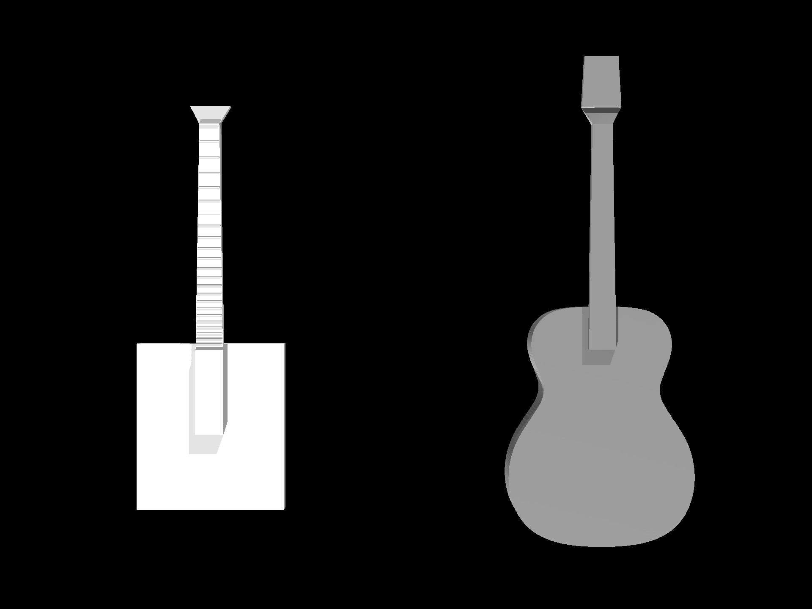

# 초기 기타와 현재 기타의 형상 비교

왼쪽은 초기 사각 바디 기타, 오른쪽은 최신 자세 실험에 사용한 OM 형상 v3 기타다. 두 모델을 같은 Isaac Gym 환경에 동시에 배치하고 정면 카메라로 촬영했다. 이미지 크기는 1920 × 1440이다.

| 위치 | 실제 사용 파일 | 보여줄 차이 |
|---|---|---|
|왼쪽·초기|[초기 기타 XML](../../../../../tab2body/assets/guitar_asset.xml)|직육면체로 단순화한 바디|
|오른쪽·현재|[OM v3 기타 XML](../../../../../stability_adapter_2/assets/om_body_geometry_v3/guitar_asset.xml)|도면을 바탕으로 구성한 곡선 바디와 변경된 전체 외형|

양쪽 배율은 1이며 넥을 위로 세우고 같은 actor 원점 높이로 배치했다. 개별 모델을 화면에 맞춰 확대하거나 축소하지 않았다. 전체 길이·폭과 바디 꼬리 높이가 다른 것은 원모델의 형상 차이다. 서로 다른 두 사진을 합친 이미지가 아니다.

미팅에서는 “초기에는 단순한 사각 바디를 사용했고, 현재는 제작 도면에 기반한 바디 윤곽과 깊이를 반영한 기타 형상으로 확장했다”라고 설명할 수 있다. 실제 형상 수치와 출처는 [기타 모델 문서](../../../../../paper/object/GUITAR.md)를 참고한다.

이 촬영에만 두 기타의 base와 중력을 고정/비활성화하고 물리 시간을 진행하지 않았다. 연구 환경에서의 자유 기타·지지 안정성을 검증하는 이미지는 아니다. 원본 자산·자세·학습 코드는 수정하지 않았다.

Isaac Gym 로더가 시각 geom 로드 메시지 12개를 남겼다. 원본 native 화면을 그대로 저장했으므로 일부 시각 요소와 현이 보이지 않을 수 있다. 현을 표시하는 선이나 대체 메시를 후처리로 추가하지 않았다. 입력 해시·배치·카메라·실행 로그와 검증은 [제작 자료](../../supporting/guitar_model_comparison_v1/README.md)에 보관했다.
