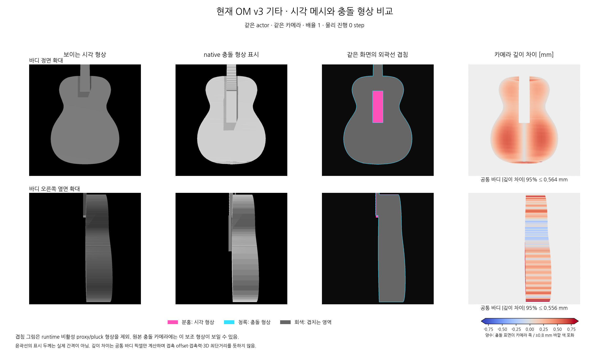

# 새 기타의 시각 형상과 충돌 형상 비교

현재 OM v3 자산 하나를 Isaac Gym에 불러와 같은 배치·같은 카메라에서 `use_collision_geometry=False/True`로 촬영했다. 새 자세나 물리 실험을 만든 것이 아니라 별도 정지 장면에서 두 표시 방식을 비교했다. 물리시간은 진행하지 않았고 원본 모델·메시·진행 중 연구를 수정하지 않았다.

[기타 전체 비교](../images/guitar_collision_comparison_v1/whole_guitar_comparison.png)도 함께 볼 수 있다. 원본 native PNG 6개는 [촬영 폴더](../images/guitar_collision_comparison_v1)에 있다.

## 무엇이 다른가

바디의 큰 외곽은 대부분 겹친다. 시각 바디는 촘촘한 표면이고 충돌 바디는 native 로더에서 확인한 63개 조각이므로, 충돌 화면에 조각별 평면과 경계가 더 뚜렷하게 나타난다. 명암·재질 차이는 형상 간격과 구분한다. 분홍·청록 선이 거의 같은 위치에 있는 것은 이 카메라에서 외곽이 가깝다는 뜻이며, 모든 방향의 표면이 완전히 같다는 증명은 아니다.

분홍은 시각 형상, 청록은 충돌 형상, 회색은 겹치는 투영 영역이다. 표시를 읽기 쉽도록 윤곽선을 약간 두껍게 그렸으며 선 두께가 실제 차이의 크기는 아니다. 목 아래의 분홍 사각 영역 등은 바디 외곽 전체의 오차가 아니라 해당 카메라에서 visual과 collision/가림 구성이 다른 부분이다.

두 depth 카메라에서 **동일한 화면 픽셀에 G:body가 함께 보이는 영역**을 골라 경계3픽셀을 제거하고 깊이 차이를 계산했다. 양수는 충돌 표면이 카메라에 더 가깝다는 뜻이다.

| 바디 확대 시점 | 표본 픽셀 수 | 깊이 절대차 중앙값 | 95백분위 | 99백분위 | 최대값 |
|---|---:|---:|---:|---:|---:|
|정면|332,441|0.288mm|0.564mm|0.591mm|2.365mm|
|오른쪽 옆면|205,552|0.215mm|0.556mm|1.461mm|30.680mm|

이 값은 **같은 카메라 광선을 따라 처음 만나는 두 표면 사이의 깊이 차이**다. 3D 표면 최단거리·침투 깊이·접촉 간격과 다르다. 특히 옆면의 곡면 가장자리나 조각 경계처럼 광선이 표면을 비스듬하게 스치는 위치에서는 작은 윤곽 변화도 큰 깊이 차이가 될 수 있다. 따라서 위 최대30.680mm를 “충돌 메시가 바깥으로3cm 튀어나온다”라고 해석하면 안 된다. 열지도는 −0.8~+0.8mm 범위로 표시하고 그 바깥은 색을 포화시켰다. 큰 값도 analysis.json에 모두 남겼다.

기존 생성 manifest의 **원본 평면 XY 윤곽 표본 최대오차는0.494161mm**다. 이는 원본 조각 표본 검사이고 이번 native 카메라 깊이 통계와 다른 측정이다. 두 수치 중 어느 것도 바디 전체3D 오차의 상한을 보장하지 않는다.

## 실제 접촉 범위로 해석할 때의 조건

- native collision camera는 시뮬레이터가 불러온 충돌 형상을 보여준다. solver가 접촉을 생성하는 contact offset의 외곽 팽창, 접촉력과 동적 관통량을 그린 것은 아니다.
- 기타 shape의 contact offset은 저장된 native 참조와 같은 **0.1mm**, rest offset은0이다. 상대 인체 shape 설정도 접촉 생성에 관여한다. 이 정지 촬영에는 인체나 접촉 판정이 없다.
- 실제 참조에서 비활성 처리한 `G:thumb_support_proxy`, `G:pluck_range`도 충돌 카메라 원본에는 보일 수 있다. 겹침 그림은 해당 body segmentation을 제외했다. 이 보조 상자를 사람이 실제로 부딪히는 범위로 설명하지 않는다.
- 넥·프렛은 두 표시에서 차이가 더 눈에 띈다. native 시각 로더가 시각 geom 로드 오류6개를 남겼고 현재 시각/충돌 표시 경로의 차이가 있으므로, 모든 화면 차이를 물리 형상 불일치로 단정하지 않는다. 원본 로그를 보존했고 대체 메시·현 표시선을 추가하지 않았다.

이번 그림만으로 사람이 기타와 떨어져 보이는 모든 원인을 결정할 수는 없다. 해당 자세의 인체 시각/충돌 형상과 실제 접촉점도 함께 비교해야 한다. 이미 모아 둔 [실제 접촉점 세 시점 이미지](01c_contact_visualization.md)는 그 위치를 확인하는 보조 자료다.

[재현 코드·입력 해시·native 로그·깊이/segmentation 원자료·수치](../../supporting/guitar_collision_comparison_v1/README.md)에 제작 근거를 보관했다. 모델은 [OM v3 원본 XML](../../../../../stability_adapter_2/assets/om_body_geometry_v3/guitar_asset.xml)이며, 도면 기반 바디의 저자·변경·이용 조건은 [Christophe Grellier OM 출처](../../../../../stability_adapter_2/assets/om_body_geometry_v3/ATTRIBUTION.md)를 따른다.
