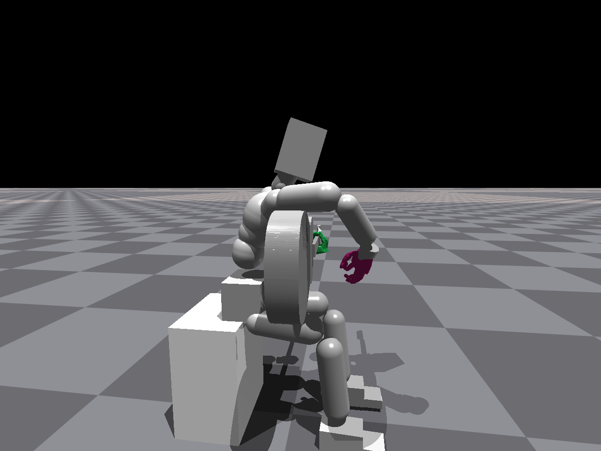
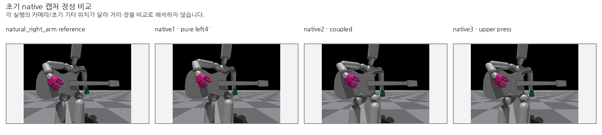
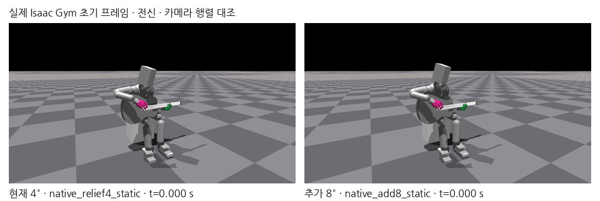

# 초기 자세를 찾아간 과정

기존 실험에서 저장한 이미지 10개를 [initial_pose_search 폴더](../images/initial_pose_search)에 모았다. 원본 PNG의 바이트 동일 사본이며 이번 수집에서 새 장면·사진·비교표를 만들지 않았다. 여러 장면이 들어 있는 비교표도 당시 만들어 둔 완성본이다.

## 전방 숙임과 측면 기울임

| 순서 | 기존 이미지 | 무엇을 시도했는가 | 당시 확인한 한계 |
|---|---|---|---|
|1|[척추 분산 굽힘 3°·9°·12°](../images/initial_pose_search/01_distributed_spine_bend_3_9_12deg.png)|Torso·Spine·Chest에 굽힘을 나누고 왼손 지지 유무 비교. 각 행은 별도 조건, 열은 0/2/5초.|초기 사각 기타·스트랩 ON·Root/하체 고정. 왼손 철수 조건은 큰 이동·회전으로 실패.|
|2|[추가 전방 숙임 18°의 측면](../images/initial_pose_search/02_forward_lean_18deg_side.png) · [기준/보정 OFF/보정 ON 초기 비교](../images/initial_pose_search/02b_forward_lean_reference_and_18deg.png)|OM 바디를 가슴·오른상완에 가까이 놓기 위해 추가 전경과 기타 뒤쪽 30mm 초기 이동 적용.|스트랩 ON·Root/하체 고정. 지속 상완 지지와 초기 기타 유지 미달. ON/OFF 비교는 제어도 바뀌므로 숙임 단독 효과가 아님.|
|3|[넥 쪽으로 4° 기울인 초기 모습](../images/initial_pose_search/03_neck_side_lean_4deg_initial.png) · [기준 포함 네 초기 조건](../images/initial_pose_search/03b_neck_side_lean_four_conditions.png)|휴머노이드 왼쪽, 기타 넥 쪽으로 기울임. 정면 화면에서는 오른쪽 방향.|스트랩 OFF·Root/하체 고정·왼손 지지 없음. 세 실제 조건 모두 상완 접촉 0/1200, 기타 유지 실패. 카메라·배치가 달라 정성 비교용.|
|4|[바디 쪽으로 4° 기울인 초기 모습](../images/initial_pose_search/04_body_side_lean_4deg_initial.png) · [같은 자세·다른 두 제어 조건](../images/initial_pose_search/04b_body_side_lean_two_controls.png)|휴머노이드 오른쪽, 기타 바디 쪽으로 기울임. 정면 화면에서는 왼쪽 방향.|스트랩 OFF·Root/하체 고정·왼손 지지 없음. 상완 접촉은 생겼으나 기타가 약48~52° 회전해 초기 자세 유지 실패. 두 초기 사진은 다른 각도 후보가 아니라 제어 비교용 같은 자세.|

## 숙임을 줄이고 몸통 방향을 조정한 후속 과정

| 순서 | 기존 이미지 | 무엇을 시도했는가 | 해석할 범위 |
|---|---|---|---|
|5|[숙임 감소와 넥 쪽 몸통 회전](../images/initial_pose_search/05_reduce_bend_and_neckward_turn.png)|기존 후보에서 추가 앞굽힘 8°→2°, 넥 쪽 yaw 목표 12°로 몸통을 조정. 각 행은 다른 초기 조건, 열은 0/5초.|같은 전신 카메라에서 같은 화면 좌표를 잘라 확대한 기존 비교표. 목표 12°는 기타 회전이 아닌 몸통 회전이며 실제 관측각과 다름.|
|6|[더 적게 숙인 넥 방향 19° 후보](../images/initial_pose_search/06_less_bend_neckward12_vs19.png)|이전 추가 앞굽힘 +2°/yaw12°에서 −6°/19°로 변경. 윗줄은 초기, 아랫줄은 5초.|실제 종료 전방 기울기가 8.50° 줄어든 단기 진단 후보. 19°는 목표값이며 실제 Chest heading은 약27.99°. 장시간 연주 검증이 아님.|
|7|[허리를 추가로 펴기 전후](../images/initial_pose_search/07_waist_straighten_initial_comparison.png)|다음 waist 지지 계열에서 기존 완화4° 자세와 추가8° 펴기 후보의 초기 전신 비교.|양쪽 모두 0초 캡처. Root/하체 고정·스트랩 OFF이며 왼손 기여가 남는 별도 조건. 기존 학습 기준 자세를 교체한 결과가 아님.|

각도는 실험별 기준에서 추가한 목표값 또는 원문에 정의된 자세 측정값이다. 서로 다른 실험의 수치를 같은 해부학적 허리각으로 비교하지 않는다. 모든 그림은 외형 변화와 탐색 과정 설명용이며 정지·동작 중 유지 성공 여부는 해당 실험 기록으로 구분한다. 이번에 모은 7계열은 Root/하체 고정 조건이므로 기존 Root만 고정·하체 유한 제어 학습 결과와 구분한다.

발표에서는 “초기에는 숙임을 늘려 접촉을 만들려 했지만, 굽힘만으로는 기타 이탈을 막지 못했다. 양측 기울임과 기타 배치를 비교한 뒤 지지점 배치와 몸통 방향을 함께 조정하며 숙임을 줄였다”는 흐름으로 설명할 수 있다. 조건과 제어가 함께 바뀐 탐색 과정이므로 단일 요인의 효과를 분리한 실험으로 제시하지 않는다.

원결과 설명 9개, 수집 코드, 이미지별 원본 경로·SHA·크기·해상도는 [수집 보조 자료](../../supporting/initial_pose_search_v1/README.md)에 있다.

추가 요청한 더 이른 [오른쪽 기울임 및 둥근 허리의 개별 초기 이미지 5개](01d_right_tilt_and_rounded_spine.md)도 같은 이미지 폴더에 모았다. 첫 수집 10개와 추가 수집 5개의 출처 manifest는 별도로 보존한다.
