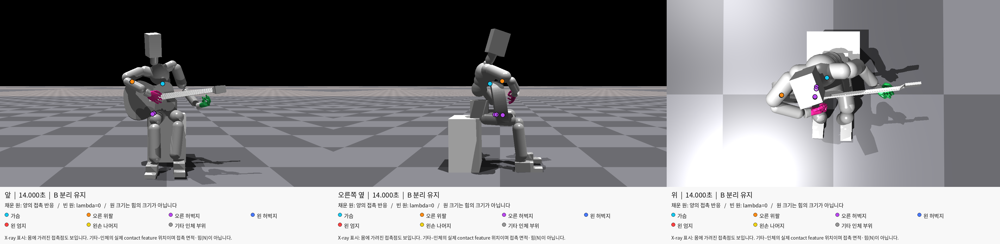

# 기타–인체 접촉 지점 시각화

기존에 제작한 앞·오른쪽 옆·위 세 시점의 접촉 표시 이미지 6개를 [contact_visualization 폴더](../images/contact_visualization)에 원본 그대로 복사했다. 각 이미지의 순서는 왼쪽부터 앞·오른쪽 옆·위다. 새 촬영이나 이미지 편집은 수행하지 않았다.

| 시각·단계 | 이미지 | 관찰 |
|---|---|---|
|0.5초·초기 준비|[열기](../images/contact_visualization/01_preparation_0p5s.png)|가슴·오른 위팔·오른 허벅지와 일부 왼손 접촉|
|3.5초·A 잡기|[열기](../images/contact_visualization/02_left_grip_A_3p5s.png)|왼 엄지·검지 접촉. 이 시점에 가슴 접촉은 없음|
|5.333초·A 해제 중|[열기](../images/contact_visualization/03_release_transition_5p333s.png)|오른 허벅지 접촉은 없고 왼손 일부 접촉이 남아 있어 완전 해제 구간이 아님|
|6.5초·A 놓기|[열기](../images/contact_visualization/04_left_released_A_6p5s.png)|왼손 접촉 없이 가슴·오른 위팔·오른 허벅지 접촉|
|10.5초·B 잡기|[열기](../images/contact_visualization/05_left_grip_B_10p5s.png)|왼손과 가슴·오른 위팔·오른 허벅지 접촉|
|14초·B 놓기|[열기](../images/contact_visualization/06_left_released_B_14s.png)|왼팔·손 접촉 없이 가슴·오른 위팔·오른 허벅지 접촉|

청록은 가슴, 주황은 오른 위팔, 보라는 오른 허벅지, 파랑은 왼 허벅지, 빨강은 왼 엄지, 노랑은 왼손 나머지 부위다. 채운 원은 양의 raw lambda가 기록된 feature, 빈 원은 lambda=0인 feature다. 원 크기는 접촉 면적·압력·힘 크기를 뜻하지 않는다. 몸에 가려진 지점도 보이도록 표시했다.

이는 자유 기타·스트랩 OFF·Root/하체 고정·오른손 타현 OFF인 16초 잡기·놓기 시험의 자료다. 원제작 시 동일 제어로 물리를 재실행했고 초기값·60Hz 상태·240Hz 접촉 기록이 앞선 시험과 정확히 같음을 확인했다. 이번 미팅 수집은 저장 PNG를 복사하는 작업만 수행했다. 화면의 30fps 접촉 표시는 순간 관찰이며 연속 접촉이나 지지력 분담의 인증은 아니다.

이전에 수집해 둔 [학습 기준 자세의 접촉·형상 비교 이미지](../images/02_reference_recorded_contact_points.png)도 그대로 남아 있다. 이 그림은 Root 고정·하체 유한 제어의 별도 자세 기록이므로 위 16초 시험과 구분한다.

원결과 설명과 접촉 요약, 원본 경로·SHA·복사 검증은 [보조 자료](../../supporting/contact_visualization_v1/README.md)에 있다.

현재 학습 기준035/v14의 **준비 완료22초**를 보려면 [현재 초기 자세의 접촉 표시](01f_current_pose_contacts_22s.md)를 확인한다. 이 문서의16초 별도 후보와 물리 조건이 다르다.
