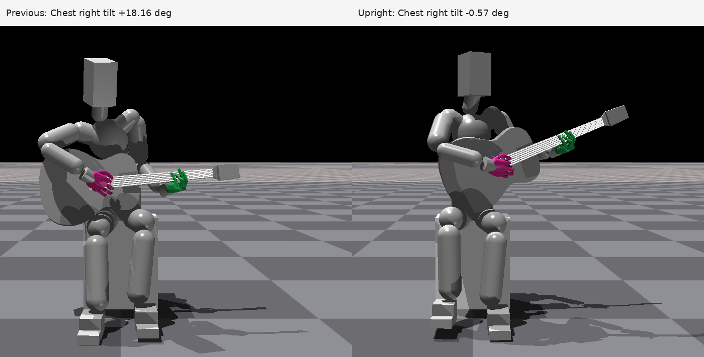
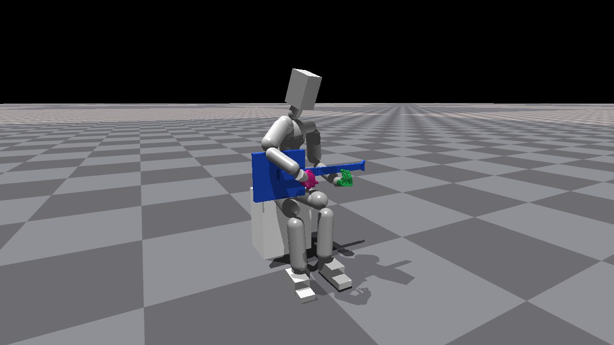

# 초기의 오른쪽 기울임과 둥근 허리 자세

이전 탐색 모음에 다음 이미지 5개를 추가했다. 오른쪽 기울임은 최근 추가4° 후보와 구분한 더 이른 자세이며, 둥근 허리는 초기 사각 기타를 사용하던 9°·12° 분산 굽힘 후보다.

| 이미지 | 설명 |
|---|---|
|[오른쪽으로 기울어졌던 자세·0초](../images/initial_pose_search/08_right_tilt_original_t0.png)|보존된 `rotational_stable_pd_interior_static_v1` 실제 Isaac Gym 영상의 첫 프레임. 새 렌더 없이 기존 MP4에서 추출했다.|
|[오른쪽 기울임 교정 전후·5초](../images/initial_pose_search/08b_right_tilt_vs_upright_at5s.png)|이미 만들어져 있던 비교 PNG 그대로. 왼쪽 기존 Chest 우측 기울기 +18.16°, 오른쪽 교정 후 −0.57°. 같은 카메라·같은 5초 시점이다. 18.16°를 위 0초 이미지의 측정값으로 설명하지 않는다.|
|[둥근 허리 9°·왼손 지지·0초](../images/initial_pose_search/09_rounded_spine_9deg_left_support_t0.png)|Torso·Spine·Chest로 굽힘을 분산한 후보의 기존 raw native 초기 PNG.|
|[둥근 허리 9°·왼손 철수·0초](../images/initial_pose_search/09b_rounded_spine_9deg_left_away_t0.png)|위 9° 자세에서 왼팔을 뗀 초기 조건. 동작 중 놓는 시험이 아님.|
|[둥근 허리 12°·왼손 철수·0초](../images/initial_pose_search/10_rounded_spine_12deg_left_away_t0.png)|굽힘을 더 분산한 조건의 기존 raw native 초기 PNG.|

오른쪽 기울임 계열은 Root 고정·하체 유한 제어·자유 기타·중력 ON·스트랩 OFF다. 교정 후 정지 결과와 왼손 해제 실패를 구분하며 당시 자세를 최종 연주 성공으로 설명하지 않는다. 둥근 허리 계열은 Root/하체 고정·스트랩 ON·초기 사각 기타 조건이다. 9°·12°는 누적 world 전경 목표이며 개별 관절각이나 임상적 척추 곡률이 아니다. 더 굽힌 것만으로 왼손 없는 기타 유지에 성공한 결과는 아니었다.

기존 [3°·9°·12°의 0/2/5초 비교표](../images/initial_pose_search/01_distributed_spine_bend_3_9_12deg.png)도 함께 볼 수 있다. 원본 출처·정정된 결과 문서·파일 SHA·영상 첫 프레임 대조 결과는 [보조 자료](../../supporting/initial_pose_search_addendum_v1/README.md)에 있다.
