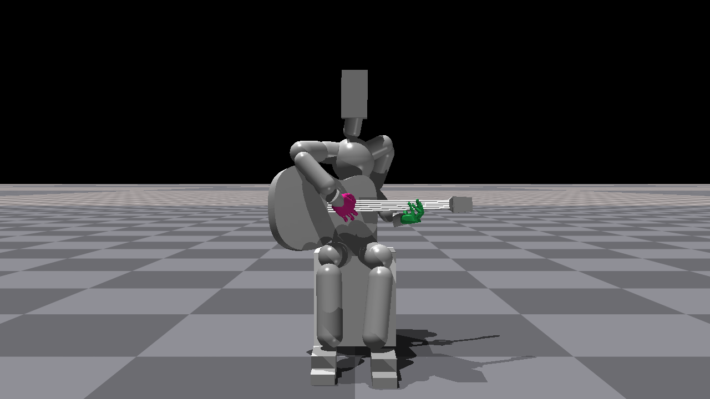

# 현재 초기 자세의 이미지와 영상

프로젝트에서 현재 학습 기준으로 안내하는 **current_v3: 035 설정·native v14**의 이미지 6개와 실제 Isaac Gym 전신 녹화 5개를 가져왔다. 오늘 접촉 시각화에 사용한 별도 자세의 초기 이미지 3개도 구분해 추가했다. 두 자세의 제어 조건과 검증 범위를 혼합하지 않는다.

## 현재 학습 기준: 035/v14

Root만 고정하고 하체는 원래 관절 범위 안의 유한한 제어로 유지한다. 기타는 자유 강체·중력 ON·스트랩 OFF다. 준비 보정을 마친 22초의 실제 상태가 아래 대표 이미지다. 출발 candidate의 0초 모습과 구분한다.

| 이미지 | 내용 |
|---|---|
|[준비 완료 전신](../images/current_initial_pose_v3/prepared_22s_whole_body.png)|baseline v14, 22초|
|[준비 완료 측면 보조](../images/current_initial_pose_v3/prepared_22s_hands.png)|같은 시각. 원본 이름은 hands지만 실제로는 측면 시점|
|[준비 완료 발](../images/current_initial_pose_v3/prepared_22s_feet.png)|같은 시각의 하체·접지 모습|
|[왼손 해제 상태 타현](../images/current_initial_pose_v3/free_strike_29s_whole_body.png)|free_strike v14, 29초|
|[재접촉 시작](../images/current_initial_pose_v3/released_40s_whole_body.png)|regrasp v14, 40초|
|[넥 재접촉·준비 복귀](../images/current_initial_pose_v3/returned_49s_whole_body.png)|regrasp v14, 49초|

[같은 준비 완료22초의 실제 접촉점 표시](01f_current_pose_contacts_22s.md)에서 가슴·오른 위팔·허벅지·왼 검지의 접촉을 원본 native 두 시점으로 확인할 수 있다.

### 실제 Isaac Gym 녹화

각 영상은 별도로 실행한 시험의 원본 MP4 사본이다. 기존 카메라 녹화는 5fps이며 물리는 240Hz다. 영상 길이는 마지막 프레임을 포함하므로 실제 실행보다 0.2초 길다.

| 시험 | 영상 | 주요 관찰 구간 |
|---|---|---|
|정지 유지|[전신 28.2초](../videos/current_initial_pose_v3/baseline_whole_body.mp4)|17–22초 준비 유지|
|반복 타현|[전신 34.2초](../videos/current_initial_pose_v3/repeat_whole_body.mp4)|22–34초, 세 왕복|
|왼손 완전 해제|[전신 40.2초](../videos/current_initial_pose_v3/release_whole_body.mp4)|25–40초, 왼손 해제 유지|
|해제 상태 타현|[전신 40.2초](../videos/current_initial_pose_v3/free_strike_whole_body.mp4)|27–39초, 세 왕복|
|넥 재접촉·준비 복귀|[전신 49.2초](../videos/current_initial_pose_v3/regrasp_whole_body.mp4)|40–49초, 마지막44–49초 준비 유지|

이미 모아 둔 [정면 60fps·33초 편집 재생](../videos/01_reference_pose_release_strike_regrasp.mp4)은 보기 편한 발표용 보조 자료다. 저장 몸체 자세를 적용한 MuJoCo 재생이며 Isaac Gym 카메라 원본과 구분한다. 두 시험을 편집했으므로 모든 동작을 같은 실행에서 연속 수행한 근거로 제시하지 않는다.

current_v3는 다섯 개별 시험을 통과한 실용 후보다. 전체 동작의 연속 실행, 동일 조건 재시작 재현, 재접촉 후 왼손 하중 비의존, 실제 현 압력·발음은 아직 별도 검증 사항이다.

## 오늘 접촉 시각화에 사용한 별도 자세

이 계열은 Root/하체 고정·자유 기타·스트랩 OFF이며 오른손 타현은 껐다. 현재 학습 기준에 자동 적용된 자세가 아니다.

| 이미지·영상 | 용도 |
|---|---|
|[실제 초기 native 이미지](../images/diagnostic_initial_pose_20261019/initial_native.png)|0초의 상체·기타·왼손 배치|
|[6현 표시 초기 이미지](../images/diagnostic_initial_pose_20261019/initial_strings.png)|깊이 가림을 적용한 현 표시 overlay 포함|
|[초기 지지 측면](../images/diagnostic_initial_pose_20261019/initial_support_side.png)|가슴·오른 위팔과 기타 배치|
|[16초 전신 잡기·놓기](../videos/03_current_pose_grip_cycle_full_body.mp4)|기존 수집 영상. A/B 두 지점에서 잡고 놓기|
|[16초 손 근접](../videos/03b_current_pose_grip_cycle_hands.mp4)|손과 넥 접촉 확인|
|[16초 지지 근접](../videos/03c_current_pose_grip_cycle_support.mp4)|가슴·오른 위팔의 지지 배치|

[세 시점 접촉 표시 이미지](01c_contact_visualization.md)와 함께 볼 수 있다. 전체 시험에서 초기 대비 순간 최대 이동37.288mm·회전14.516°였으므로, 마지막 분리 구간의 정착을 전 과정 안정성으로 확대하지 않는다.

모든 추가 미디어는 원본과 바이트 동일하며 새 물리 실행·렌더·편집을 수행하지 않았다. 출처·설정·해상도·fps·전체 decode 검증은 [제작 보조 자료](../../supporting/current_initial_pose_v1/README.md)에 있다.
