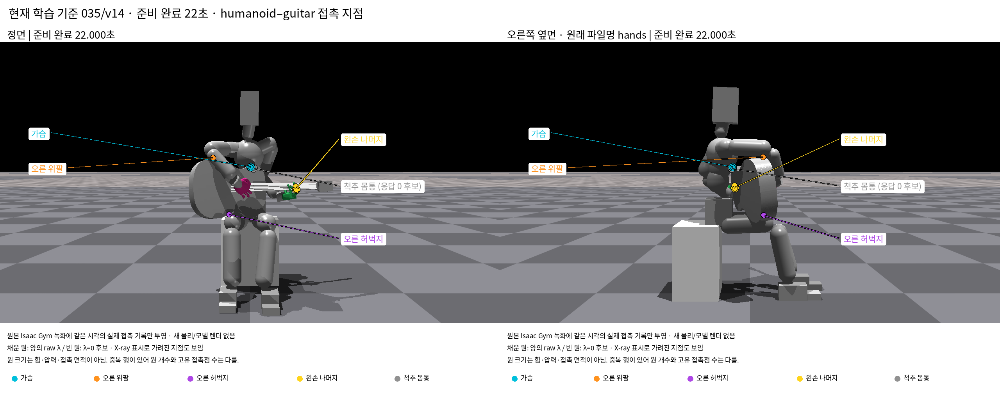

# 현재 선택된 초기 자세의 접촉 지점

현재 학습 기준 **035 설정·native baseline v14의 준비 완료22초**를 대상으로 접촉을 표시했다. 이전의 별도 잡기·놓기16초 후보와 구분한다. Root 고정·하체 유한 제어·자유 기타·중력 ON·스트랩 OFF 조건이다.

[정면 이미지](../images/current_pose_contacts_22s_v1/prepared22_contacts_whole_body.png) · [측면 이미지](../images/current_pose_contacts_22s_v1/prepared22_contacts_hands.png)

## 접촉 위치와 표시

같은 시각의 native 원본 이미지에 body-local 접촉 특징점을 저장 body pose와 카메라 행렬로 투영했다. 배경은 원래 Isaac Gym 녹화이며 새 물리 실행이나 모델 렌더는 수행하지 않았다. 원본 이미지 SHA는 당시 capture 기록과 일치한다. 각 그림 위의 시점 제목·점·부위 이름·설명만 추가했다.

| 색·부위 | 양의 raw lambda 행 | lambda=0 후보 행 | 해석 |
|---|---:|---:|---|
|청록·가슴 Chest|1|2|이 순간에 양의 접촉 응답이 있는 가슴 접촉|
|주황·오른 위팔 R_Shoulder|1|0|오른 위팔과 기타 바디 사이 접촉|
|보라·오른 허벅지 R_Hip|3|0|오른 허벅지와 기타 바디 사이 접촉. 중복 위치 포함|
|노랑·왼손 나머지|2|1|검지 index2/index3와 기타 fret5의 접촉. 손 전체의 지속 지지 기여를 뜻하지 않음|
|회색·척추 몸통 Spine|0|1|접촉 목록에만 있고 이 순간의 raw 응답은0인 후보. 양성 지지로 세지 않음|
|합계|7|4|원자료11행이며 고유 접촉점11개라는 뜻이 아님|

채운 원은 양의 raw lambda, 빈 원은 lambda=0 후보다. 점의 크기는 화면에서 고정하며 힘·압력·접촉 면적을 나타내지 않는다. 가림을 무시한 X-ray 표시라 기타나 몸 뒤의 점도 보인다. 같은 좌표의 원시 행은 겹쳐 보이고, 채운 점과 빈 원도 같은 위치에 함께 있을 수 있다. 손의 초록·분홍 표면색은 모델 재질색이며 접촉 표식과 구분한다.

이 순간의 양성 접촉은 **가슴·오른 위팔·오른 허벅지와 왼 검지**에서 관측됐다. 접촉 존재만으로 각 부위가 기타 무게를 얼마나 받는지나 왼손 하중 비의존을 판단하지 않는다. 특히 29초 타현 자료의 척추 양성 접촉을 이22초 준비 상태에 그대로 옮겨 설명하지 않는다.

## 근거와 확인 범위

- 시각22.000초, physics step5280의240Hz 접촉 표본과 같은 시각의 body 상태를 사용했다.
- 기타 쪽 특징점과 인체 쪽 특징점을 각각 body 원점 좌표계에서 world로 변환했다. 두 점의 최대 위치 차이는 약0.0000833mm였다. 좌표 변환 일치 검사이며 실제 접촉 틈이나 모델 정확도 측정이 아니다.
- COM·contact offset·형상 두께를 점 위치에 더하지 않았다. 접촉 기록의 raw lambda를 뉴턴 힘으로 환산하지 않았다.
- 카메라는 기록된 native view/projection 행렬을 사용했고 모든 표시점이 원본 화면 안으로 투영됨을 확인했다.
- 원녹화의 두 시점은 정면과 측면(hands)이다. 원녹화에 없는 위 시점은 새 native 화면처럼 만들지 않았다.

원본은 [준비 완료 상태](../../../../../paper/initial_pose/current_v3/pose/prepared_state_baseline_v14_22s.json)와 [baseline v14 기록](../../../../../paper/initial_pose/lower_body_release_v1/front_facing_ready_v1/native_baseline_v14)이다. 제작 코드·동일 시각 접촉 원자료·세계 좌표·카메라 투영 좌표·입력 SHA·검증은 [보조 자료](../../supporting/current_pose_contacts_22s_v1/README.md)에 있다.
