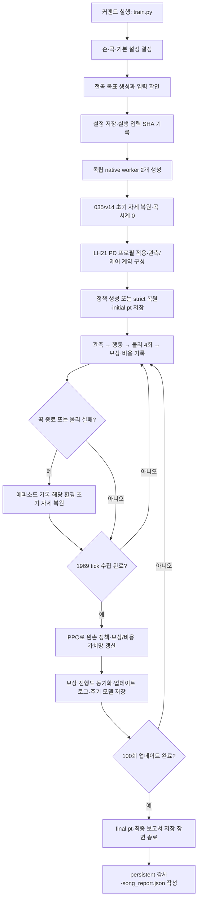

# 곡 단위 왼손 학습의 실제 실행 흐름

이 문서는 아래 커맨드가 현재 구현에서 어떻게 실행되는지 설명한다. 합의한 초기 자세에서 시작해 선택한 곡 전체를 반복하고, 왼손 정책을 PPO로 갱신하는 경로다. 오른손 학습으로 바꿀 때 달라지는 부분도 함께 정리했다.

요청한 문서 위치는 `docs/2026-10-26/learning_flow`이며, **코드 확인일은 2026-10-20**이다. 디렉토리의 날짜를 미래 실행·검증 날짜로 해석하지 않는다. 이후 사용자 요청에 따라 왼손의 성능 기반3단계 보상과 유연한 손가락 제어 프로필을 반영했다. 이전 단계 보상의 구현·검증 범위는 [단계 보상 기록](/home/ajou/yigyu/3/docs/2026-10-26/learning_flow/left_curriculum_v1/README.md)을 따른다. 그 기록의 결과를 새 손가락 제어 프로필의 실행 결과로 읽지 않는다.

## 1. 대상 커맨드와 실행 환경

아래 블록을 위에서부터 실행하면 **현재 왼손512상태·유연한 손가락 제어·3단계 보상**으로 새 학습을 시작한다. 프로젝트 루트와 Isaac Gym Preview4가 설치된 `rl38` 실행 환경을 먼저 지정한다.

```bash
cd /home/ajou/yigyu/3
export PATH=/home/ajou/miniconda3/envs/rl38/bin:$PATH
export LD_LIBRARY_PATH=/home/ajou/miniconda3/envs/rl38/lib${LD_LIBRARY_PATH:+:$LD_LIBRARY_PATH}
export PYTHONPATH=/home/ajou/yigyu/3/isaacgym/python:/home/ajou/yigyu/3${PYTHONPATH:+:$PYTHONPATH}
export PYTHONDONTWRITEBYTECODE=1

python -m guitar_learning.train \
  --hand left \
  --song 05_BN2-131-B_solo \
  --num-envs 2 \
  --updates 100 \
  --size medium \
  --device auto \
  --seed 7 \
  --out /home/ajou/yigyu/3/runs/left_song_01
```

위 명령은 기본값을 드러내 적은 실행 예다. `--num-envs`부터 `--seed`까지 생략해도 같은 기본 설정이다. `--horizon`을 생략하면 곡 전체인1969tick을 사용한다. 처음 실행할 때는 `--resume`을 넣지 않는다. 초기 자세 자료는 자동으로 읽으며 별도의 자세 불러오기나 전문가 학습 커맨드는 필요하지 않다. 이 실행은 headless 학습이며 화면이나 동영상을 자동으로 생성하지 않는다.

출력 경로는 **아직 존재하지 않는 새 디렉토리**여야 한다. 프로그램이 부모 경로와 출력 디렉토리를 생성한다. 같은 경로로 다시 실행하면 덮어쓰지 않고 종료한다.

| 인자 | 실제 의미 |
| --- | --- |
| `--hand left` | 왼팔·왼손 33개 정책 출력 채널을 학습한다. 오른손 측 6개 출력은 0이다. |
| `--song 05_BN2-131-B_solo` | 등록된 해당 곡의 67개 목표 음 전체를 사용한다. |
| `--out …/runs/left_song_01` | 설정·로그·모델·실행 보고서를 이 디렉토리에 저장한다. |

생략한 설정은 다음과 같이 결정된다.

| 설정 | 기본값 | 해석 |
| --- | ---: | --- |
| 병렬 환경 수 | 2 | 독립된 장면 2개에서 같은 곡과 같은 공유 정책을 사용한다. |
| PPO 업데이트 수 | 100 | 수집과 정책 갱신을 100번 반복한다. 성공하면 자동 조기 종료하는 조건은 없다. |
| 수집 길이 `horizon` | 1969 tick | 업데이트당 환경별로 전곡 길이만큼 수집한다. |
| 정책 장치 | `auto` | CUDA 사용 가능 시 `cuda:0`, 아니면 CPU다. 물리 적분은 CPU PhysX다. |
| 난수 seed | 7 | 부모 정책·학습의 seed다. worker는 `7 + worker_id`로 초기화한다. |
| 모델 크기 | `medium` | 정책 결합층은 512 → 512 → 256이다. |
| 초기 탐색 표준편차 | `exp(-3) ≈ 0.0498` | 선택한 손의 tanh 적용 전 행동 분포에 사용한다. |
| 중간 모델 저장 | 5업데이트마다 | 마지막 회차의 주기 저장은 생략하고 `final.pt`로 저장한다. 기본100회에서는5~95회가 중간 모델이다. |

정상적으로 100회 모두 갱신하면 수집 전이는 `1969 × 2 × 100 = 393,800`개다. 물리 실패가 발생하면 해당 환경은 곡 중간에 초기화될 수 있으므로 이것이 전곡 200회 완주를 보장하지는 않는다. 32.82초는 시뮬레이션의 곡 길이이며 실제 실행 시간은 장면 생성·연산·기록 속도에 따라 달라진다.

처음 확인할 출력은 다음 세 곳이다. 전체 파일 설명과 저장 시점은14절, 이어 학습하는 명령은16절에 있다.

| 확인 목적 | 위 명령의 출력 경로 |
| --- | --- |
| 실행 중 진행 상황 | `/home/ajou/yigyu/3/runs/left_song_01/status.json`, `learning_status.json` |
| 학습을 끝낸 모델 | `/home/ajou/yigyu/3/runs/left_song_01/final.pt` |
| 실행 결과와 전곡 성과 | 같은 출력 디렉토리의 `report.json`, `song_report.json` |

## 2. 전체 흐름



두 환경의 에피소드와 곡 시계는 독립적이다. 한 환경이 실패해 초기화되어도 다른 환경의 곡은 계속된다. 정책은 부모 프로세스에 하나 있으며 두 환경의 자료를 모아 함께 갱신한다.

## 3. 실행 파일과 호출 순서

아래 파일은 모두 `/home/ajou/yigyu/3/guitar_learning` 안에 있다.

| 순서 | 파일·주요 함수 | 맡는 일 |
| --- | --- | --- |
| 1 | [train.py](/home/ajou/yigyu/3/guitar_learning/train.py), `main()` 호출 | 사용자가 실행하는 진입점이다. |
| 2 | [training/start.py](/home/ajou/yigyu/3/guitar_learning/training/start.py), `main()`·`settings_document()` | 커맨드 해석, 전체 곡 확인, 설정 구성, 장치 선택을 한다. |
| 3 | 같은 파일의 `run()` | 공용 runner에 손별 정책·곡 환경 worker를 연결한다. 이 프로세스 안의 객체 바인딩을 바꾸며 소스 파일을 수정하지 않는다. |
| 4 | [training/runner.py](/home/ajou/yigyu/3/guitar_learning/training/runner.py), `main()` | 출력·입력 기록, worker 생성, 수집/PPO 반복, 모델 저장을 관리한다. |
| 4-1 | [training/parallel.py](/home/ajou/yigyu/3/guitar_learning/training/parallel.py), `Pool`·`_worker()` | worker 프로세스를 만들고 reset·step·종료 요청과 에피소드별 원자료 저장을 처리한다. |
| 5 | [song/runtime.py](/home/ajou/yigyu/3/guitar_learning/song/runtime.py), `native_environment()` | 각 worker에서 선택한 곡·손의 지속형 물리 환경을 만든다. |
| 6 | [song/hand_environment.py](/home/ajou/yigyu/3/guitar_learning/song/hand_environment.py), `build_environment()`·`HandSongEnvironment` | 전곡 환경에 손별 행동 제한·보상·성공 판정을 적용한다. |
| 6-1 | [song/left_environment.py](/home/ajou/yigyu/3/guitar_learning/song/left_environment.py), `LeftSongEnvironment` | 기본 왼손의512관측·손목/접촉/곡 시각 보상·성과를 구성한다. |
| 6-2 | [song/curriculum_runtime.py](/home/ajou/yigyu/3/guitar_learning/song/curriculum_runtime.py), `CurriculumCoordinator` | 최근 완료 에피소드로 보상 비중을 바꾸고 정책buffer와worker에 반영한다. |
| 7 | [runtime/finger_session.py](/home/ajou/yigyu/3/guitar_learning/runtime/finger_session.py), `FlexibleLeftFingerSession` | 기본 왼손의 실제 native PD를 초기화 때 한 번 변경하고 LH21의 최종 목표 변화율을 적용한다. |
| 7-1 | [runtime/persistent_session.py](/home/ajou/yigyu/3/guitar_learning/runtime/persistent_session.py), `PersistentHeadlessPreparedSession` | 새 왼손 세션이 상속하는 장면 재사용·준비 상태 복원 기반이다. 오른손은 이 기존 세션을 직접 사용한다. |
| 7-2 | [core/finger_control.py](/home/ajou/yigyu/3/guitar_learning/core/finger_control.py), `default_profile()`·`profile_control_settings()` | LH21의 전체 native 목표 범위·변화율·평활화와 고정 PD 프로필을 정의한다. |
| 7-3 | [core/environment_v4.py](/home/ajou/yigyu/3/guitar_learning/core/environment_v4.py), `FreeGuitarEnvironment.reset()`·`step()` / [core/control.py](/home/ajou/yigyu/3/guitar_learning/core/control.py), `JointTargetContract` | 준비 상태로 목표 계약을 만들고39행동을105관절 목표로 바꿔 매 tick 물리4회를 진행한다. |
| 7-4 | [song/measurement.py](/home/ajou/yigyu/3/guitar_learning/song/measurement.py), `SongMeasurement` / [core/safety.py](/home/ajou/yigyu/3/guitar_learning/core/safety.py), `StabilityMonitor` | 실제240Hz 접촉·목표 수행과 안전을 측정한다. 손별/단계 보상은 위 환경들이 이 측정을 사용해 계산한다. |
| 8 | [skills/specialist_policy.py](/home/ajou/yigyu/3/guitar_learning/skills/specialist_policy.py), `SpecialistPolicy` | 관측에서 선택한 손의 행동과 보상·비용 가치를 계산한다. |
| 9 | [training/parallel.py](/home/ajou/yigyu/3/guitar_learning/training/parallel.py), `Collector.collect()` | 두 환경을 진행하고 PPO용 자료를 모은다. 종료된 환경만 reset한다. |
| 10 | [training/ppo.py](/home/ajou/yigyu/3/guitar_learning/training/ppo.py), `PPOTrainer.update()` | 모은 자료로 정책과 가치망을 갱신한다. |
| 10-1 | 같은 `training/ppo.py`의 `PPOTrainer.save()`·`load()` | 학습 상태를 모델 파일로 저장하고, 재개 시 같은 계약인지 확인한 뒤 복원한다. |
| 10-2 | [training/training_log_io.py](/home/ajou/yigyu/3/guitar_learning/training/training_log_io.py), `publish_final_checkpoint()` | 최종 `final.pt`와 저장 manifest인 `final_checkpoint.json`을 만든다. |
| 11 | [training/persistent_audit.py](/home/ajou/yigyu/3/guitar_learning/training/persistent_audit.py), `finalize_persistent_run()` | 장면 재사용·reset 범위·종료 기록을 감사한다. |
| 12 | [song/runtime.py](/home/ajou/yigyu/3/guitar_learning/song/runtime.py), `summarize_run()` | 전곡 완주·손별 성공·실패 통계를 `song_report.json`으로 저장한다. |

실제 호출은 부모와 worker에서 나뉜다. `training/start.py`가 공용 runner에 `SpecialistPolicy(role='left')`와 `song.runtime.native_environment`를 연결한다. runner가 부르는 이름은 `Policy`·`Pool`이어도 이 커맨드에서는 해당 왼손 정책·전곡 worker로 동작한다. `training/runner.py`를 별도로 실행하거나 `tool/experiments`의 학습기를 추가로 실행할 필요가 없다.

코드를 따라 읽으려면 **`train.py → training/start.py → training/runner.py`**에서 시작한다. 환경 진행은 **`training/parallel.py → song/runtime.py → song/hand_environment.py → song/left_environment.py`**, 실제 제어는 **`core/environment_v4.py → runtime/finger_session.py`**, 가중치 갱신·저장은 **`training/ppo.py`**를 보면 된다. 이 순서는 주요 연결 관계이며 환경의 전체 상속 계층을 모두 나열한 것은 아니다.

## 4. 시작 시 곡을 어떻게 준비하는가

곡 입력 디렉토리는 [05_BN2-131-B_solo](/home/ajou/yigyu/3/data/song_bundles/05_BN2-131-B_solo)다. 주요 입력은 manifest, 원오디오, 운지와 타현 계획이다.

- [manifest.json](/home/ajou/yigyu/3/data/song_bundles/05_BN2-131-B_solo/manifest.json): 등록된 입력 파일과 해시를 확인한다.
- [source/audio.wav](/home/ajou/yigyu/3/data/song_bundles/05_BN2-131-B_solo/source/audio.wav): 길이·샘플 수·해시를 사용한다. 매 tick의 음향 보상을 계산하는 입력은 아니다.
- [mapping/fingering.json](/home/ajou/yigyu/3/data/song_bundles/05_BN2-131-B_solo/mapping/fingering.json): 각 음의 현·프렛·손가락 정보를 제공한다.
- [training/strike_plan.json](/home/ajou/yigyu/3/data/song_bundles/05_BN2-131-B_solo/training/strike_plan.json): 타현 시각·방향 등 정해진 계획을 제공한다.

[song/task.py](/home/ajou/yigyu/3/guitar_learning/song/task.py)의 `make_task()`가 compiler 결과를 전곡 목표로 만든다. 각 목표에는 ID, 현, 프렛, 손가락, 타현 방향, 준비 시작·음 시작·음 종료 시각이 들어간다.

이 곡의 원본 이벤트는 66개이고 목표 음은 67개다. 명시된 동일 현 재타현 이벤트를 원래 note onset별로 확장하므로 수가 다르다. 확장된 음은 원계획의 집계 방향을 각각 상속하며 두 번째 타현 방향을 새로 추론하지 않는다. 모든 원본 음이 정확히 한 번 포함되는지 검사한다.

원본 시간축을 유지하고 모든 음 시각에 정책 준비 3초를 더한다. 유지 종료는 원본 sustain과 release 중 이른 시각을 사용한다. 곡의 첫 음을 0초로 당기거나 67음 중 한 음만 뽑지 않는다. 원본 번들도 덮어쓰지 않는다.

열린현, 지원하지 않는 동작, 같은 현의 충돌하는 목표, 누락된 계획, 오디오 밖으로 벗어난 목표 등은 오류로 처리한다. `--song`에는 등록 디렉토리의 식별자만 지정할 수 있다. 이 커맨드는 오디오 전사·새 운지 생성부터 수행하는 전처리 커맨드가 아니다.

## 5. 설정과 입력을 기록한 뒤 장면을 만든다

runner는 새 출력 디렉토리에 `settings.json`을 저장한다. 여기에는 해석된 실제 장치, 손, 곡 경로, 67음·1969tick·왼손512상태 정보와 PPO 설정이 들어간다. 기본 왼손의 `song.finger_control`에는 `guitar_learning.flexible_left_fingers.v1` 고정 프로필도 기록한다.

이어서 실행 소스·선택한 곡 번들·초기 자세 자료·모델 자산 등의 SHA를 `inputs_before.json`에 기록한다. 원본 모델과 설정의 일치 여부를 확인한 뒤 worker를 시작한다. 이 과정은 커맨드 내부에서 자동으로 수행된다. 사용자가 별도의 BC 학습이나 과거 성공 평가를 먼저 수행할 필요는 없다.

부모 프로세스가 정책 추론·PPO를 담당하고 worker 2개가 각각 headless Isaac Gym 장면을 담당한다. Isaac Gym은 NumPy·Torch보다 먼저 불러온다. 실행 중 소스나 입력을 바꾸면 무결성 확인에 영향을 주므로 학습 실행과 코드 수정은 분리한다.

## 6. 정한 초기 자세는 어떻게 불러오는가

초기 자세는 합의한 **035/v14 준비 상태**다. [runtime/prepared_reset_v1.py](/home/ajou/yigyu/3/guitar_learning/runtime/prepared_reset_v1.py)가 준비 상태·관절 목표·자산을 검증하고, persistent session이 사람 관절 위치/속도와 기타 상태를 복원한다.

원본 상태는 과거 물리 5280step, 즉 22초 준비를 마친 자료다. 현재 학습에서 매번 22초 준비 동작을 재생하지 않는다. 저장된 상태를 에피소드 시작에 복원하고 실제 곡·정책 시계는 0에서 시작한다. 기존 유한 제어기의 준비 완료 단계는 유지한다.

현재 경로는 **native 정착 대기 0초**다. reset 관측을 받은 다음 첫 정책 tick부터 행동·접촉·보상·안전 비용을 기록한다. 뒤에서 설명하는 정책 준비 3초는 정책이 실제로 움직이는 학습 구간이다.

각 worker는 장면·자산·제어기를 한 번 만들고 계속 재사용한다. 에피소드 종료 시 준비 상태·제어 이력·곡 시계·음별 원장을 초기화하며, 매 tick 상태를 강제로 되쓰지는 않는다. 기타는 중력 ON의 자유 강체이고 스트랩은 OFF다. 사람 root 고정과 하체의 유한 자세 유지 제어를 유지하며 기타에 직접 보조 힘을 주지 않는다.

기본 왼손은 원래035/v14 상태 복원이 끝난 물리 step0에서 LH21의 실제 native PD만 한 번 변경한다. 이때 PD setter에만 초기화 구간을 열고 즉시 닫으며, 변경 전후 실제 사람·기타 상태와 관절 목표가 같은지 다시 읽어 확인한다. 이후 reset은 원본의 사본에서 명시적으로 파생한 새 PD 예상값과 실제 물리 속성 서명을 검사한다. 반복 reset 때 PD를 다시 변경하지 않는다. 원본 준비 자료·native 자산·CAS는 그대로 보존한다.

초기 자세 자체를 새로 정한 것은 아니다. 정적 비교 이미지의 **엄지 B 후보는 학습에 적용하거나 고정하지 않았다.** 엄지5축도 나머지 손가락과 함께 정책이 움직이며, 느슨한 PD 설정 자체가 자연스러운 접촉을 뜻하지 않는다.

## 7. 한 곡의 시간축

```text
정책 시간 0             3.0                    32.3064       32.8167초
          | 준비 3초    | 원오디오 29.3064초     | 말미·tick 정렬 |
          |------------- 정책 행동·물리·기록 계속 --------------|
```

```text
tick 수 = ceil((정책 준비 3.0 + 오디오 29.3064… + 말미 0.5) × 60)
        = 1969
실제 에피소드 길이 = 1969 / 60 = 32.816666…초
```

준비 구간에도 앞으로의 목표가 관측에 들어오며 선택한 손이 움직일 수 있다. 접촉과 안전 측정도 진행한다. 다만 실제 음의 깨끗한 유지 시간·누락은 해당 음의 시작/끝 구간을 기준으로 계산한다. 준비 중 움직였다는 이유만으로 음 수행 성공을 주지 않는다.

전곡 경로는 준비용 contact 환경을 재사용하지만, 옛 단음 준비 환경의 별도 `preparation_contact` 보상까지 사용하는 것은 아니다. 현재 보상은 다음 절의 song 보상과 공유 항목이다.

## 8. 정책이 보는 정보와 내보내는 행동

| 입력 | 환경 하나의 크기 | 내용 |
| --- | --- | --- |
| `state` | 512 | 기본468개 + 전곡 이력32개 + 손목 목표 오차·접촉 이력·학습 비중12개다. 오른손은500개다. |
| `events` | 64 × 24 | 현재/미래 목표의 시각, 현·프렛·손가락·방향, 접촉 진행, 상대 위치·속도 등이다. |
| `mask` | 64 | 실제 목표와 빈 칸을 구분한다. |
| `priority_events` | 2 × 24 | 현재 목표와 가장 가까운 strict 마감 목표를 직접 전달한다. |
| `priority_mask` | 2 | 우선 목표의 유효 여부다. |

기본 관측은 관절 위치/속도·목표 오차·직전 행동, 기타와 몸의 상대 상태, 손의 기타 기준 상대 상태, 접촉·안전 변화·음악 진행 등을 포함한다. 전곡 이력 32개는 곡 진행률, 성공/누락 수, clean 유지 비율, 집중 목표 상태 등이다. 정해진 scale로 나누고 범위를 제한하며 실행 중 평균/분산을 계속 학습하는 정규화는 아니다.

64칸은 곡 전체 음 수의 상한이 아니다. 최대 4초 앞까지의 시간창에 들어오는 목표를 선택하고 빈 칸을 padding한다. 따라서 67음 전체를 수행하면서도 매 tick 67음을 모두 입력할 필요는 없다. 같은 시간창에 64개를 초과하면 오류다.

정책은 상태와 목표들을 attention으로 결합한다. `medium`에서는 상태 인코더 256 → 256, 목표 인코더 128 → 128, 결합층 512 → 512 → 256을 사용한다. 선택한 손의 actor와 별도 보상·비용 critic이 학습된다. 이 경로에는 recurrent memory가 없으며 진행 이력을 관측으로 전달한다.

행동 인터페이스는 항상 39차원이다. 이 커맨드는 `[0:33]`의 왼팔·왼손만 탐색하고 `[33:39]`의 오른팔꿈치·손목은 정확히 0을 낸다. 오른쪽 actor는 갱신하지 않고 행동 확률·엔트로피도 선택한 손의 채널만 계산한다. 환경도 비활성 손의 0이 아닌 행동을 물리 진행 전에 거부한다.

**행동 0은 관절 각도 0이나 물리 고정이 아니라 초기 기준 목표에 대한 잔차 0**이다. 기존 유한 제어와 물리 반응은 유지한다. 다른 상체 42개 목표와 하체 24개 제어는 정책 출력이 아니며 전체 105축을 모두 새로 학습하는 구조도 아니다.

### 8.1. 왼손 손가락의 제어 범위와 부드러움

기본 왼손의21개 손가락 축에는 다음 고정 프로필이 적용된다. 왼팔12축과 손가락21축의 정책 역할·관측 차원은 그대로다.

| 항목 | 현재 기본 왼손 |
| --- | --- |
| LH21 목표 범위 | 각 관절의 기존 native 하한~상한 전체. 이전 기준±0.5rad 탐색 창을 사용하지 않는다. |
| LH21 최대 목표 변화율 | 4rad/s; 정책 목표 변환과 최종 native 제출에 같은 제한을 적용한다. |
| LH21 목표 평활화 계수 | 0.45 |
| 검지·중지·약지·새끼16축 native stiffness/damping | 12/1.5; 이전 값은20/5였다. |
| 엄지5축 native stiffness/damping | 8/1.25; 이전 값은20/5였다. |
| 기존 native effort 상한 | 엄지4Nm, 다른 손가락20Nm 유지 |
| 왼팔 등 나머지 활성 축 | 기존 범위·변화율·평활화0.2 유지 |

정규화 행동±1은 손가락별 native 끝점에 대응하지만 평활화·목표 변화율이 있어 한 tick에 끝점으로 점프하지 않는다. 행동0은 원래 초기 기준 목표이며, 범위를 넓히더라도 기존 native 관절 한계를 넘는 목표를 허용하지 않는다. 4rad/s는 목표 변화 제한이고 실제 관절 속도는 물리와 접촉에 따라 달라지며 기존 안전 판정을 받는다.

실제 native POSITION 제어 모드·힘 상한·관절 한계·나머지84축의 native PD는 유지한다. 하체 유지와 기타 안전 조건·물리240Hz도 동일하다. 더 넓은 탐색 범위와 낮은 PD를 실제 압력·음향·학습 성공의 근거로 삼지 않는다.

## 9. 한 tick에서 실제로 일어나는 일

1. 부모 정책이 두 환경의 현재 관측을 받아 행동 39개와 보상/비용 가치를 계산한다. 새 학습의 actor 출력 평균은 처음 0이며 선택한 손에 작은 확률적 탐색을 더하고 tanh로 범위를 제한한다.
2. worker에 행동을 보낸다. 제어기가 기준 자세에 대한 잔차를 관절 목표로 바꾼다. LH21은 전체 native 범위·평활화0.45·최대4rad/s를 적용한다. 왼팔은 기존 반폭0.35rad·평활화0.2·3rad/s, 오른쪽 활성 축은 반폭0.25rad·평활화0.2·3rad/s를 유지한다. 비활성 오른손 정책 행동은0이다.
3. 기존 하체 유지 제어를 거쳐 native 목표를 제출한다. 새 왼손 최종 제출에서도 LH21에4rad/s를 적용해 옛1.5rad/s 제한으로 다시 줄어들지 않는다. 이후 **240Hz 물리를 4회** 진행한다. 관절 위치나 기타 상태를 행동값으로 직접 덮어쓰지 않는다.
4. 4개 물리 표본 각각에서 현재 기타 프레임의 목표·접촉·타현·안전을 측정하고 음별 원장을 갱신한다.
5. 선택한 손의 보상과 안정 비용을 합산한다. 실패가 있으면 해당 제어 tick의 양성 song 보상을 억제하고 종료 처리한다.
6. 4번째 표본의 다음 관측과 보상·비용·종료 사유를 부모로 반환한다. 정책 1tick은 `1/60초`다.
7. 부모는 다음 가치도 계산하고 관측·행동·log probability·보상·비용·종료 정보 등을 수집 버퍼에 저장한다. 종료된 환경은 에피소드 기록 뒤 바로 reset한다.

안전 기준을 60Hz 끝점에서만 보는 것이 아니라 240Hz 표본마다 본다. 중간 표본의 실패도 tick 끝에서 반환된다.

## 10. 왼손 보상과 성공 판정

접촉은 [song/measurement.py](/home/ajou/yigyu/3/guitar_learning/song/measurement.py)와 fretting quality 분류로 측정한다. 목표 현·프렛·손가락과 실제 native 접촉 feature를 비교해 clean 후보·오압현 등을 구분한다. 단순한 손끝 거리만으로 접촉 성공을 선언하지 않는다.

왼손 보상의 기존 곡 항목은 다음과 같다. 현재 기본 왼손은 여기에 손목·준비 접촉 보상을 더하고 아래10.1절의 비중을 적용한다. 음별 시간 항목은 실제 240Hz 구간에 적분하고 한 번만 주는 성공/누락 보상은 원장에 기록한다.

| 항목 | 계산·의미 |
| --- | --- |
| `song_clean_hold` | 음의 실제 수행 구간에서 이전·현재 표본이 모두 clean 후보이면 초당 +2다. |
| `song_left_success` | 해당 음의 요구 clean 누적 유지 시간을 처음 달성하면 +1이다. |
| `song_wrong_press` | 오압현 시간을 초당 −1로 감점한다. 현행 V2는 준비 구간이 아닌 음의 onset~end에서 계산한다. |
| `song_missing_press` | 음 수행 중 clean도 wrong도 아닌 누락 시간을 초당 −0.5로 감점한다. |
| `song_left_approach` | 지정된 준비 접근 구간의 거리 기반 보조 보상이다. 접근 중인 목표들의 `exp(-(거리/0.03m)^2)` 평균에 초당 0.2를 곱하며 접촉 성공을 대체하지 않는다. |
| `song_left_missed` | 음 종료까지 요구 clean 유지에 도달하지 못하면 해당 음에 −0.5다. |
| `action_change` | `−0.01 × mean((현재행동−이전행동)^2) / 60`으로 급격한 행동 변화를 감점한다. |
| `terminal_failure` | 물리 안전 실패 tick에 −2다. |

각 음의 길이를 `d = end_s − onset_s`라고 하면 요구 clean 유지 시간은 다음과 같다.

```text
required_dwell_s = min(d, max(0.05초, d × 0.4))
```

예를 들어 0.5초 음은 0.2초의 clean 누적 유지가 필요하다. 0.03초 음은 길이보다 긴 0.05초를 요구하지 않고 0.03초를 요구한다. 각 적분 구간은 양 끝의 clean 상태를 요구하지만 **음 전체에서 한 번의 연속 유지 구간이어야 한다는 조건은 아니다**.

왼손의 최종 `stage_success`는 곡 종료까지 도달하고 안전이 무효화되지 않았으며 **67음 모두 왼손 요구를 달성했을 때** 참이다. 오른손이 타현하지 않았다는 이유로 왼손 성공을 막지 않는다. 오른손 보상·양손 coupled 보상은 왼손 학습 보상에서 제외하고 진단으로 보존한다.

현재 song 보상에는 별도 `timely_release` 항목이 없다. release는 목표의 끝과 전환 문맥에 반영되지만 이 커맨드가 독립적인 해제 성공 보상까지 최적화한다고 해석하지 않는다. 판정은 clean 접촉·기하 기반이며 실제 현 압력·음향 생성·올바른 음색을 검증한 성공은 아니다.

### 10.1. 현재 적용되는 왼손 3단계

[단계 상태](/home/ajou/yigyu/3/guitar_learning/song/left_curriculum.py)는 연속 진행도 0~2를 사용한다. 다음 세 지점 사이를 선형으로 보간한다. 첫 단계에도 접촉·곡 수행 보상이 있어 손목 도달 전에도 압현을 탐색할 수 있다.

| 보상 묶음 | 위치 잡기(0) | 압현(1) | 곡 연결(2) |
| --- | ---: | ---: | ---: |
| 손목 영역·자세 `wrist` | 1.0 | 0.35 | 0.10 |
| 준비/수행 clean 접촉·오압현 `contact` | 0.15 | 1.0 | 1.0 |
| 원곡의 유지·성공·누락 `timing` | 0.10 | 0.35 | 1.0 |
| 기존 손끝 접근 `approach` | 0.20 | 0.10 | 0 |

`action_change`, `terminal_failure`, 모든 안정 비용은 비중을 낮추지 않는다. 실패 tick의 새 손목/접촉 양성 보상도 억제한다.

손목 목표는 초기 035/v14에서 실제 측정한 손목의 기타 기준 위치에서 시작한다. 곡의 `anchor_fret`을 읽고 현재 기타 프렛 마커의 y 변화만 더한다. 이전 자료의 절대 `wrist_pos_guitar`는 사용하지 않는다. 위치 4cm·초기 상대 방향 0.6rad 이내는 손목 도달의 보조 기준이며 압현 성공이 아니다. 연속 표본에서 준비~음 종료 구간의 도달 시간을 누적해 각 목표의 도달 여부를 기록한다.

새 `song_left_contact`는 press~end 구간의 실제 clean 표본쌍에 초당 0.5와 최초 요구 유지 달성 시 0.5를 준다. 요구 시간은 해당 준비/수행 구간 길이와 0.05초 중 작은 값이다. 이는 초기 접촉을 배우기 위한 완화 지표이며 원곡 onset~end의 유지 요구와 성공 판정을 대체하지 않는다. 손목 보상 `song_wrist_position`은 목표 준비/수행 구간에서 위치 점수 × (0.8 + 0.2 × 방향 점수)를 초 단위로 적분한다.

최근 8회 완료 에피소드에서 최소 4회 기록, 안전한 전곡 비율 75% 이상·목표별 손목 도달 비율 평균 70% 이상이면 0→1을 진행한다. 1→2에는 clean 접촉 달성 비율 평균 60%도 필요하다. 새 안전 전곡이 있는 PPO 업데이트당 최대 0.1만 증가한다. 실패는 창에 0점으로 남기고 부분 궤적은 제외한다. 이전 근거만으로 새 에피소드 없이 자동 진급하지 않는다. 이 기준은 초기 학습 설정이며 수렴 성능을 주장하지 않는다.

단계는 부모가 양 환경의 근거를 모아 결정한다. 수집 도중에는 비중이 고정되고, 성공한 PPO 이후 동일 진행도를 모든 worker에 반영해 관측만 갱신한다. 에피소드·곡 시계·물리를 초기화하지 않는다. 정책 관측의 추가 12개는 손목 위치 오차 3·방향 오차 3·집중 목표의 relaxed 접촉 진행/달성 2·전체 relaxed 달성 비율 1·단계 진행도 1·접촉/시간 비중 2다. 따라서 새로운 최초 접촉 보너스의 진행 상태도 관측된다.

`left_curriculum`의 진행도·비중·도달/접촉률은 전이/episode에 남고 새 진행도와 창 평균은 `update_*.json`과 `song_report.json`에 남는다. 정책 buffer에 진행도와 최근 창을 저장하므로 strict resume로 이어진다. 전곡 성공은 원 67음의 timed clean 유지와 안전 완주를 계속 요구한다.

## 11. 안정 비용과 에피소드 종료

음악 보상과 별도로 매 240Hz 표본의 안정 비용을 수집한다. reset 기준 기타 위치/회전, 발 위치 변화, 기타 지지 접촉과 발 접지 소실에 비용을 준다. 실패 시 비용 +5를 에피소드 종료 tick에 한 번 더한다.

기본 안전 종료 조건은 다음과 같다. 정확한 구현은 [core/safety.py](/home/ajou/yigyu/3/guitar_learning/core/safety.py)에 있다.

| 측정 | 실패 조건 |
| --- | --- |
| 기타 위치 변화 크기 | 0.08m 초과 |
| 기타 회전 변화 크기 | 0.35rad 초과 |
| 좌우 발 중 최대 위치 변화 | 0.04m 초과 |
| 모든 기타 지지 접촉 소실 | 0.25초 초과 |
| 어느 한 발의 접지 소실 | 0.25초 초과 |
| 사람 관절 최대 절대 속도 | 50rad/s 초과 |

가슴·오른쪽 상완·오른쪽 허벅지의 기타 지지는 합쳐서 측정한다. 가슴 접촉 하나가 줄어드는 것과 모든 지지 소실은 다르다. 접촉의 양성 lambda는 접촉 flag이며 보정된 압력이나 뉴턴 단위 힘으로 해석하지 않는다.

에피소드는 전곡 시간축 종료(`timeline_complete`) 또는 물리 실패(`terminal_failure`) 시 끝난다. 특정 음을 놓쳤다는 이유만으로 곡을 중간에 멈추지는 않으므로 안전하면 뒤의 음도 계속 학습한다. 수집이 끝나 실행을 종료할 때 남은 부분 에피소드는 전곡 성공으로 세지 않는다.

## 12. 수집·에피소드·업데이트의 관계

**에피소드**는 초기 자세에서 곡 종료/물리 실패까지이고, **수집 길이**는 PPO 자료를 몇 tick 모을지이며, **업데이트**는 모은 자료로 정책을 갱신하는 한 번의 과정이다.

기본 커맨드는 매 업데이트 환경별 1969tick을 수집한다. 실패 없이 시작했다면 두 환경 각각 전곡 1회가 끝난다. 실패가 있었다면 같은 1969tick 안에 실패 에피소드와 다음 에피소드 일부가 섞일 수 있다.

`--horizon 512`로 바꾸면 다음처럼 진행된다.

```text
수집 1: 곡 tick    1~512   → PPO 업데이트 1
수집 2: 곡 tick  513~1024  → PPO 업데이트 2
수집 3: 곡 tick 1025~1536  → PPO 업데이트 3
수집 4: 곡 tick 1537~1969  → 전곡 종료·reset
        다음 에피소드 tick 1~79까지 수집 → PPO 업데이트 4
```

이 예시는 물리 실패가 없을 때다. 업데이트 경계 자체는 reset 사유가 아니며 곡 시계·기타 장면·접촉/음별 원장을 유지한다. 정책은 업데이트 직후 새 가중치를 사용해 이어서 행동한다. 최적화 동안 worker의 시뮬레이션 시간은 자동으로 흐르지 않는다.

따라서 짧은 `horizon`은 곡을 한 음으로 줄이는 설정이 아니다. `--updates 1 --horizon 512`로 끝내면 전곡에 도달하기 전에 실행을 마칠 수 있다.

## 13. PPO는 무엇을 갱신하는가

부모는 두 환경의 자료를 `[1969, 2, …]` 형태로 모은 뒤 총 3938개 전이로 갱신한다. 관측·행동을 다시 실행하는 별도 전문가 학습이 아니라 방금 정책이 실제 물리 환경에서 만든 자료를 사용한다.

1. 보상 critic으로 보상 advantage/return, 비용 critic으로 비용 advantage/return을 GAE로 계산한다.
2. `보상 advantage − cost_weight × 비용 advantage`를 결합하고 정규화한다. 기본 `cost_weight`는 1이다.
3. 이전/현재 행동 확률의 비율로 clipped PPO 목적을 계산해 왼손 actor를 갱신한다. 오른손 actor는 학습하지 않는다.
4. 보상·비용 critic은 각각의 return에 맞게 갱신한다.
5. KL 변화·gradient·loss 등을 계산한다. 업데이트가 성공하면 새 완료 에피소드의 도달·접촉 성능을 집계하고 보상 진행도를 최대0.1 바꾼다.
6. 진행도를 모든worker에 동기화하고 다음 관측의 비중을 갱신한 뒤 업데이트 기록을 저장한다. 물리 시계·장면·에피소드 원장은 유지한다.

| PPO 설정 | 기본값 |
| --- | ---: |
| actor 학습률 / value 학습률 | 0.00003 / 0.0003 |
| 보상 discount / 비용 discount | 0.99 / 1.0 |
| GAE lambda | 0.95 |
| clip ratio | 0.2 |
| epoch / minibatch | 2 / 256 |
| 최대 gradient norm | 0.5 |
| KL 기준 / 재시도 수 | 0.02 / 3 |

KL 기준을 넘는 actor 변경은 복원하고 학습률을 줄여 재시도한다. 허용된 재시도까지 실패하면 오류로 종료하며 실패한 업데이트를 완료 처리하지 않는다. 기본 에피소드 비용 budget은 설정되어 있지 않아 `cost_weight`를 budget으로 자동 조정하지 않는다.

현재 왼손에는10.1절의 성능 기반 보상 curriculum이 적용된다. 곡은 처음부터 전체를 반복하며 단음/구간만 선택하거나 성공한 음만 골라 재시작하지 않는다. BC·기존 왼손/오른손 전문가 checkpoint는 자동으로 가져오지 않는다.

## 14. 출력 파일은 언제 무엇을 저장하는가

기준 출력 경로는 `/home/ajou/yigyu/3/runs/left_song_01`이다. 정상 실행을 기준으로 주요 파일은 다음과 같다. 시작 초기에 실패하면 이후 단계의 파일은 생성되지 않을 수 있다.

| 파일·디렉토리 | 시점과 내용 |
| --- | --- |
| `settings.json` | 시작 시 해석된 전체 설정이다. |
| `inputs_before.json` | 실행 전 입력 해시다. 종료 때 다시 계산한 값과 비교하고 차이는 `report.json`의 `changed_inputs` 등에 기록한다. |
| `training_contract.json`, `reset_initial.json` | 실제 초기 관측/행동/보상/종료 계약과 준비 상태 기록이다. |
| `initial.pt` | 새 모델 생성 직후 또는 strict resume 직후의 시작 모델이다. |
| `transitions.jsonl.gz` | 수집 tick별 병렬 전이 로그다. 기본 standard 기록은 원시 전체 상태를 반복 저장하지 않는다. |
| `episodes.jsonl` | 완료 에피소드와 종료 시 남은 불완전 에피소드 기록이다. 실제 완료/불완전 여부를 구분하며 전곡 종료 기록에는67음의 `per_note`가 보존된다. |
| `learning_status.json` | 수집 중 60tick마다, 업데이트 완료 때 갱신되는 학습 상태다. |
| `learning_metrics.jsonl` | 업데이트별 누적·구간 통계다. |
| `training_summary.json` | 로그를 읽는 동안 누적한 학습·에피소드·보상 통계다. 전곡 요약의 근거로 사용한다. |
| `status.json`, `resources.jsonl`, `events.jsonl` | 수집·최적화 등 실행 단계, 자원 사용량, 실행 이벤트 기록이다. |
| `update_000000.json` 등 | 0부터 시작하는 업데이트별 PPO 상세 진단이다. |
| `checkpoint_000004.pt` 등 | 첫 5회 업데이트 후의 중간 모델이다. 파일 번호는 0부터 시작한다. |
| `final.pt` | 정상 종료 시점의 최종 모델이다. 아래 `final_checkpoint.json` 및 실행 결과를 함께 확인한다. |
| `final_checkpoint.json` | 최종 모델의 경로·SHA·누적 업데이트 수·저장 방식과 이번 실행 metadata다. |
| `failure_last_valid.pt` | 오류/중단 시 유효한 trainer가 있으면 저장을 시도하는 복구 모델이다. 항상 생기는 파일은 아니다. |
| `report.json`, `core_report.json` | runner 실행 결과와 persistent 감사 반영 결과다. |
| `persistent_audit.json` | worker마다 장면 1회 생성/종료, 에피소드 경계 reset, 자산·제어 속성 보존 등을 확인한다. |
| `song_report.json` | 완전한 안전 전곡, 손별 전곡 성공, 물리 실패, 부분 에피소드 등을 요약한다. |
| `worker_000/environment`, `worker_001/environment` | 각 native 장면의 에피소드 reset·생명주기 근거다. |

### 14.1. 모델이 저장되는 정확한 시점

저장 동작의 호출자는 `training/runner.py`, 실제 checkpoint 작성자는 `training/ppo.py`의 `PPOTrainer.save()`다.

1. worker 초기 reset과 계약 구성이 끝나면 정책·trainer를 만든다. `--resume`이 있으면 `PPOTrainer.load()`로 복원하고 curriculum도 worker에 동기화한다. 그 뒤 **학습 전 상태를 `initial.pt`로 한 번 저장**한다. 새 학습이면 새 가중치이고 재개이면 불러온 가중치다.
2. 한 수집을 마치면 PPO를 갱신하고 보상 진행도를 동기화한다. 매회 `update_000000.json` 같은 진단을 쓰며, **모든 업데이트마다 `.pt` 모델을 저장하는 것은 아니다.**
3. 기본5회마다, 이번 실행의 마지막 회차가 아니면 중간 모델을 저장한다. 기본100회 명령에서는 아래 순서다.

| 완료된 이번 실행 업데이트 수 | 저장 모델 |
| ---: | --- |
| 0 | `initial.pt` |
| 1~4 | 중간 모델 없음; `update_000000.json`부터 업데이트 기록 생성 |
| 5 | `checkpoint_000004.pt` |
| 10 | `checkpoint_000009.pt` |
| … | 5회 간격으로 계속 |
| 95 | `checkpoint_000094.pt` |
| 100 | `final.pt`, `final_checkpoint.json`; `checkpoint_000099.pt`는 만들지 않음 |

번호는 **이번 실행의0기준 반복 인덱스**다. `--resume`으로 누적 업데이트가 이미100이어도 새 출력의 첫 업데이트 로그는 `update_000000.json`에서 시작한다. 누적 횟수는 checkpoint의 `updates`와 보고서의 `optimizer_updates`에서 확인한다.

4. 반복을 정상적으로 마치면 `publish_final_checkpoint()`가 `final.pt`를 공개한다. 현재 PPO 상태와 직전 checkpoint가 정확히 같을 때는 그 파일의 hardlink를 사용할 수 있고, 다르면 전체 상태를 새로 저장한다. 방식을 `final_checkpoint.json`에 기록한다. 기본100회는 마지막100회째 갱신 뒤 새 상태를 저장한다.
5. 이후 worker를 종료하고 runner 보고서·persistent 감사·전곡 요약을 작성한다. **`final.pt`가 존재해도 최종 감사가 실패할 수 있으므로** 완료 여부는 `report.json`의 `completed`와 `failure`를 함께 확인한다.

오류나 Ctrl+C를 처리할 수 있는 경우에는 `monitoring.save_failure_checkpoint()`가 `failure_last_valid.pt` 저장을 시도한다. 아직 trainer가 없거나 strict load를 완료하지 못했거나 저장 자체가 실패하면 파일이 없을 수 있다. 강제 프로세스 종료·전원 중단 시 저장을 보장하지 않는다. 남은 부분 수집은 PPO 반영으로 간주하지 않으며 복구 경로와 실패 이유는 `report.json`의 `recovery_checkpoint`를 따른다.

### 14.2. 저장 모델 안에 들어가는 것

PPO checkpoint는 정책/가치망 가중치, 왼손 단계/최근 이력buffer, actor/value optimizer, 업데이트 수, 비용 가중치, 부모 Torch/NumPy/Python/CUDA 난수 상태, 모델/훈련 계약 등을 저장한다. 실제 PhysX 장면의 중간 상태를 저장하는 파일은 아니다.

로그의 `sampled`, `logged`, `durable`, `committed`는 각각 수집·로그 반영·내구 기록·PPO 반영을 구분한다. 로그에 남았다는 사실만으로 해당 전이가 PPO 업데이트까지 반영됐다고 해석하지 않는다. 기본 `save_first_rollout=False`이므로 첫 전체 수집 버퍼 파일은 별도로 저장하지 않는다.

### 14.3. 출력 구조 예시

```text
/home/ajou/yigyu/3/runs/left_song_01/
├── settings.json                  # 실제 손·곡·프로필·훈련 설정
├── training_contract.json         # 관측512·행동39·보상·물리 제어 계약
├── initial.pt                     # 이번 실행의 시작 학습 상태
├── checkpoint_000004.pt           # 5회 업데이트 후; 충분히 실행했을 때 생성
├── ...
├── final.pt                       # 최종 학습 상태
├── final_checkpoint.json          # 최종 모델 SHA·누적 횟수·저장 방식
├── transitions.jsonl.gz           # 수집한 전이 로그; 학습 모델 파일이 아님
├── episodes.jsonl                 # 완료/불완전 에피소드와 음별 수행
├── update_000000.json              # 첫 업데이트 진단
├── learning_status.json           # 수집/학습 통계
├── status.json                    # 현재 실행 단계
├── report.json                    # 실행·입력·worker·최종 감사 결과
├── song_report.json               # 전곡 성공·안전 완주·부분 궤적 요약
├── worker_000/
│   ├── environment/               # 준비 상태 복원·생명주기 기록
│   ├── audit_episode_000000/       # 초기 native 상태·속성·계약
│   └── worker_final_audit.json
└── worker_001/                    # 두 번째 독립 물리 환경의 같은 구조
```

일부 보조 로그·입력 SHA 파일은 위 예시에서 생략했다. `--num-envs 1`이면 `worker_001`은 없고, 짧은 실행이면 주기 checkpoint가 없을 수 있다.

## 15. 실행 상태와 학습 성과를 어떻게 읽는가

학습 종료 후 먼저 `report.json`의 실행 완료·실패·입력 일치·persistent 감사를 확인하고 `song_report.json`과 `episodes.jsonl`을 함께 본다.

| 지표 | 의미 |
| --- | --- |
| `report.completed` | 요청한 실행과 내부 확인이 완료됐는지를 나타낸다. 연주 성공률이 아니다. |
| `song_report.completed_episodes` | 실패 종료를 포함해 끝난 에피소드 수다. |
| `song_report.full_safe_episodes` | 실제 전곡 시간축을 끝내고 안전이 무효화되지 않은 에피소드 수다. |
| `song_report.whole_song_successful_episodes` | 완전한 곡에서 선택한 손의 성공 조건까지 만족한 수다. |
| `song_report.success_rate` | 평가된 에피소드 기준 성공률이다. 부분 진행의 성공 비율을 전곡 성공으로 올리지 않는다. |
| 음별 `left_achieved`, `clean_audible_s` | 어떤 음에서 요구 clean 유지에 도달했는지 확인한다. |
| `wrong_press_s`, `missing_press_s` | 오압현과 누락이 어느 정도 있었는지 본다. |
| `joint_stage_success`, `strict_music` | 양손 협응과 50/100ms 기준을 별도로 진단한다. 손별 성공과 같은 지표가 아니다. |

실행이 정상 종료되어도 음을 하나도 성공하지 못할 수 있다. 보조 접근 보상이나 총 보상 상승만으로 67음 성공을 주장하지 않고, 전곡 안전 완주와 음별 수행을 함께 확인한다.

## 16. 저장 모델로 재개할 때

같은 곡·손·모델 크기·훈련 계약의 모델이라면 새 출력 경로에 다음처럼 재개한다.

```bash
python -m guitar_learning.train \
  --hand left \
  --song 05_BN2-131-B_solo \
  --num-envs 2 \
  --updates 100 \
  --size medium \
  --device auto \
  --seed 7 \
  --resume /home/ajou/yigyu/3/runs/left_song_01/final.pt \
  --out /home/ajou/yigyu/3/runs/left_song_02
```

1절의 실행 환경 설정을 적용한 같은 머신을 기준으로 한다. `--resume`에는 모델 `.pt` 파일을, `--out`에는 아직 없는 **새 디렉토리**를 지정한다. 중간 모델의 `checkpoint_000004.pt` 또는 실제 저장이 확인된 `failure_last_valid.pt`도 같은 계약이면 지정할 수 있다. 예전 실행에서 `--size small`이나 다른 장치를 사용했다면 실제 `settings.json`에 맞게 재개 인자를 바꾼다. CUDA 난수 상태가 포함된 모델은 CUDA 사용 여부와 장치 수 검사도 받는다.

이때 `--updates 100`은 이번 실행에서 100회를 더 갱신한다는 뜻이다. 기존 모델의 누적 업데이트 수는 이어받는다. 모델 구조뿐 아니라 observation/action/task/reward/termination과 PPO config를 포함한 identity가 정확히 일치해야 한다. 차원이 같다고 다른 곡·다른 손·다른 보상의 모델을 불러올 수 있는 것은 아니다.

가중치·optimizer·부모 난수와 왼손 단계/최근8회 이력은 복원하지만 native worker는 새 장면의 초기 자세·곡 시계 0에서 시작한다. worker 난수 초기화는 새 실행의 seed 규칙을 따른다. 중단했던 PhysX 장면·그 순간의 곡 시각·수집 버퍼·solver 내부 상태를 그대로 이어가는 기능은 아니다.

같은 실행 안에서 짧은 PPO 수집을 이어가는 것과 프로세스를 종료하고 `--resume`하는 것을 구분해야 한다. 기존 **563상태 단음 모델과 이전500상태 왼손 전곡 모델은 새512상태 왼손 모델에 strict resume할 수 없다.** 손가락 프로필 적용 전의512상태 왼손 모델도 목표 범위·변화율·평활화·native PD를 포함한 제어 계약이 달라 거부한다. 관측 차원이 같다는 이유로 이전 모델을 암묵적으로 가져오지 않는다.

## 17. 오른손으로 바꾸면 달라지는 부분

```bash
python -m guitar_learning.train \
  --hand right \
  --song 05_BN2-131-B_solo \
  --out /home/ajou/yigyu/3/runs/right_song_01
```

곡·초기 자세·39행동·60/240Hz·수집/PPO·저장 흐름은 동일하다. 오른손은 기존 500상태이며 왼손용 단계·목표 12개와 보상 비중 전환을 사용하지 않는다. 학습 채널은 오른팔꿈치·손목 6개로 바뀌고 왼손 33개 잔차는 0이다. 새 유연한 손가락 제어 프로필도 적용하지 않고 원래 native PD·목표 제어 계약을 유지한다. 기존 전문 실행기도 해당 실행의 원래 계약을 따른다.

오른손 보상은 `song_right_success`, `song_right_missed`, `song_wrong_crossing`, `song_repeat_crossing`, `song_right_progress`와 공유 `action_change`, `terminal_failure`다. 기존의 단순 거리 체류 보상은 0이며 progress는 60Hz potential 변화로 한 번 계산한다.

실제 native 타현 교차를 목표 현·방향·시각으로 맞춘다. 완화된 매칭 창은 onset 기준 ±0.5초이면서 목표 end 이전이어야 하며 하나의 교차는 가장 가까운 미매칭 목표 하나에 사용한다. 전곡 오른손 성공은 안전하게 끝까지 진행해 67음 모두 타현 매칭하고 잘못된 교차와 중복 재타현이 0이어야 한다. 왼손 압현 성공은 이 손별 성공의 필수조건이 아니므로 이 결과를 양손의 실제 음향 연주 성공으로 읽지 않는다.

## 18. 확인 근거와 문서 범위

이 설명은 위에 링크한 현재 진입점·환경·정책·수집기·PPO 구현을 직접 확인해 작성했다. 이전 왼손 단계 보상 구현의 결과는 [구현·검증 기록](/home/ajou/yigyu/3/docs/2026-10-26/learning_flow/left_curriculum_v1/README.md)에서 확인한다. 해당 결과와 아래 과거 확인 내역은 새 손가락 제어 프로필의 실행·음악 성공을 증명하는 자료가 아니다. 새 손가락 제어의 실제 동작·PPO·회귀 검사와 보존 근거는 [손가락 제어 v1 기록](flexible_fingers_v1/README.md)을 따른다.

이전 작업의 [곡 단위 학습 구현·검증 기록](/home/ajou/yigyu/3/docs/2026-10-20/guitar_learning_song_start_v1/README.md)에서는 왼손 512tick 수집을 4회 이어 전곡 1회 완주, 오른손 1969tick 수집으로 전곡 1회 완주, 모델 저장과 strict resume를 확인했다. 두 손 모두 당시 전곡 음악 성공은 0회였다. 해당 시험은 기본 커맨드의 2환경·100업데이트 전체 실행과는 구분한다.

이전 단계 보상 문서의 확인 내역:

- [x] 실제 CLI 기본값과 전곡 목표 생성 경로 확인
- [x] 초기 자세·정책 준비·물리/정책 시간축 확인
- [x] 손별 행동·보상·안전·성공 조건 확인
- [x] 수집 경계·PPO·저장·resume 범위 확인
- [x] 오디오 길이 기반1969tick·기본393,800전이 재계산 확인
- [x] 새 단계 구현·문서의 독립 검수와 링크90개 확인, 모듈별126개/734검사 통과
- [x] 실제 왼손512전이/PPO2·재개40전이/누적3·오른손20전이/PPO1 확인

이번 문서 갱신은 실행·저장·재개 코드와 현재 CLI를 대조한 설명 보완이다. 학습 코드는 변경하지 않았다. 갱신 전 문서는 [보관 manifest](/home/ajou/yigyu/3/guitar_learning/archive/20261020_before_left_flow_refresh/manifest.json)에 기록했다.
