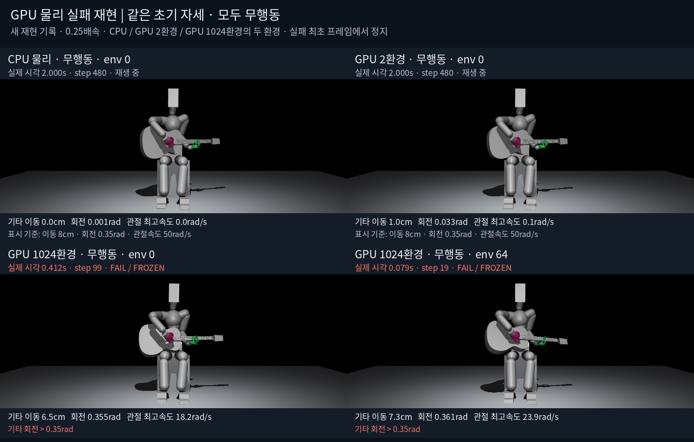

# GPU 전환 후 물리 실패와 비교 영상

2026-10-20. 기존 CPU 물리에서 실패가 거의 없었다는 지적이 맞다. 이전large·8환경 시험은8/8환경 모두32.8167초를 안전하게 완주했고, 기타 최대 이동6.38mm·회전0.0201rad였다. 새 GPU 실패를 단순히 초기 정책의 탐색 때문이라고 설명하거나128환경을 안정적인 학습 시작값으로 권할 근거는 부족했다.

이번 동일 조건 재현에서 **정책 행동이 정확히0이어도 대규모 GPU 배치 물리·지지 제어 경로의 안정성 회귀가 발생한다**는 것을 확인했다. 메모리 부족이나 새 압현 후보 판정만으로 설명되는 실패가 아니다. GPU 전환에서는 물리 backend와 하체 질량행렬·발 IK·가슴 근접 제어 계산을 함께 바꿨다. 현재 증거는 이 새 경로의 회귀까지 입증하며, PhysX 접촉 처리·좌표 정밀도·특정 제어 계산 중 어느 하나를 정확한 원인으로 확정하지는 못한다.

## 영상

- [CPU/GPU 무행동 비교 영상](render/comparison.mp4): CPU1환경, GPU2환경의env0, GPU1024환경의env0·64. 실제2초를0.25배속으로 재생한다.
- [GPU 실패 확대 영상](render/detail.mp4): GPU1024환경의env64를 정면·측면에서 확인한다. 최초0.5초의 실제240Hz 표본을0.125배속으로 재생하고 마지막2초는 정지한다.

과거 benchmark에 카메라/몸체 궤적 기록이 없어 **새로 재현한 실제 물리 상태**를 수집했다. 원본 메시를 저장된 native 몸체 자세에 배치한 영상이며, 표시 중 새 물리 계산·보간·자세 보정은 하지 않는다. 실패 최초 표본에서 정지하고 `FAIL/FROZEN`과 실제 시간을 표시한다. 실패 후 reset을 연속 움직임처럼 이어 붙이지 않는다.

## 이번 무행동 비교

모든 경우 초기035/v14, 왼손 유연 제어·자유 기타·중력ON·스트랩OFF, 정책60Hz/물리240Hz를 사용했다. CPU는 원래 유한 지지 제어, GPU는 새 배치 지지 제어를 사용하므로 제어 solver까지 같은 비교라고 주장하지 않는다. CPU는 매 정책 tick 기준 목표를 제출했고 GPU는39채널 행동0을 제출했다. 학습·PPO 갱신은 없다.

| 실행 | 물리 시간 | 실패 에피소드 | 한 번 이상 실패한 환경 |
| --- | ---: | ---: | ---: |
| CPU1환경 |2초|0|0/1|
| GPU2환경 |2초|0|0/2|
| GPU1024환경 |2초|1781|817/1024|

1781은 reset 후 반복 실패를 포함한 에피소드 수이며 서로 다른1781환경이라는 뜻이 아니다. 기타 회전1025·이동1016·관절 속도312회 등이 기록됐으며 한 에피소드에 사유가 중복될 수 있다. 원자료는 [비교 수치](comparison_metrics.json), 각 실행의 `events.jsonl`·`recording.npz`·`report.json`에 있다.

영상 속env64는 실제19물리단계, 약0.0792초에서 기타 회전0.35rad 기준을 넘었다. env0도99단계, 약0.4125초에서 넘었다. 종료는4물리단계 정책 경계에서 기록되므로 각각20/100단계의 terminal 사건과 구분한다. CPU 무행동의2초 최대 기타 이동은0.543mm, GPU2환경은10.87mm였다. 소수 GPU가 기존 CPU와 수치적으로 같은 상태 유지 성능을 보였다고도 주장하지 않는다.

추가한 초기 정책 재현은0.383초 후 CUDA device assertion으로 중단됐다. 해당 `gpu1024_policy/`의 보고서는 `completed:false`로 보존했고 **최종 영상 입력에서 제외했다**. 이를2초 성공 실행이나 학습 영상으로 표현하지 않는다. 초기 CPU 수집기의 출력 디렉토리 생성 실수와 최초 렌더 시도도 별도 failed/attempt 디렉토리에 보존했다.

## 확인한 원인 범위와 남은 일

- 기존CPU와 새GPU의 주요 물리 설정은 같다:240Hz, substeps1, TGS1, 위치/속도 반복4/2, contact offset2mm, rest0, max depenetration10.
- CPU 전곡8/8 안전 완주는 [이전 기록](/home/ajou/yigyu/3/docs/2026-10-20/guitar_learning_large_gpu_env_benchmark_v1/n8/episodes.jsonl)에서 확인된다. 새GPU1024의 첫 PPO 이전에도408개 물리 실패가 발생했다. PPO 갱신이나 학습 탐색만을 원인으로 볼 수 없다.
- 실패 대부분은 실제 기타 pose와 관절 속도의 기존 임계값 초과다. 새 압현 후보 측정이나 지지 방향 오류만으로 이 차이를 설명하지 않는다.
- asset 옵션·주요 질량/COM/관성·shape mask/friction/contact offset을 비교했지만 회귀를 설명할 확정적인 설정 차이는 아직 찾지 못했다. 나머지 shape 속성의 완전한 실제 readback과 GPU 물리/제어의 분리 시험은 남아 있다.
- 현재128은 코드 기본값일 뿐 안정 학습 권장값으로 검증된 수가 아니다. 기존128 권고를 철회한다. GPU 전환의 실행·저장·재개 성공과 물리 안정성 복구는 별개이며, 안정성 회귀를 해결하기 전 대규모 장기 학습을 권하지 않는다.

## 재현·검증

`run_capture.sh`·`capture_native.py`가 새 native 상태를 기록하고 `render_native_recordings.py`가 정적 메시 재생을 만든다. 전체 활성 Python421개·초기 준비 입력의 SHA를 수집 전후 확인했고 생산 코드는 바꾸지 않았다. `documents_before/`는 이번 주의 문구를 추가하기 전 안내 문서다. 이전 GPU 전환 결과와 봉인 원자료는 수정하지 않았다.

[렌더 검증](render/render_report.json)은240Hz 원본 프레임 출처, ffprobe의30fps·프레임 수·길이, 영상 SHA와 입력 무결성을 기록한다. 저장된 몸체 자세의 재현 위치 오차는0m, 회전 오차는최대약6.3×10⁻¹⁶rad, renderer 물리 시계는0이다. 비교 영상은8.067초, 확대 영상은6.034초다. 화면의 카메라·한글·모델·실패 표시를 직접 확인했다.
