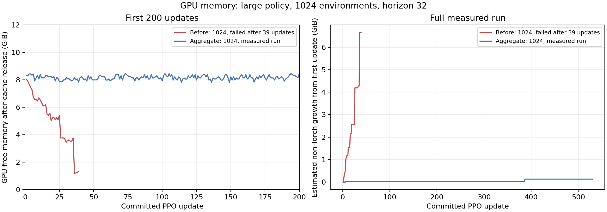
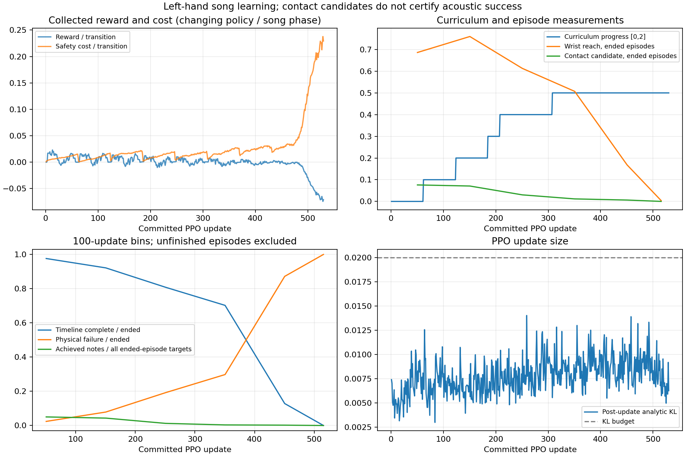

# Aggregate 시험과 조기 실패 증가 분석

**2,000회 계획 중530회에서 의도적으로 중단했다. 학습 완료나 음악적 수렴 결과가 아니다.** large·1024환경·왼손·67음·H32·seed7로17,367,040전이를 반영했다. 중단한 수집29,696전이는 폐기했고530회 유효 상태를 failure_last_valid.pt에 저장했다. 정리 오류는 없었다.

## 메모리 개선

환경별 인체·기타·의자를 self-collision=True aggregate로 묶었다. 실제68강체/145형상을 사용하며 기존 충돌 필터·접촉 속성·물리 종료·reset을 유지했다. 이전 실행의39회 PhysX 할당 실패와 달리530회까지 실행됐고, 비Torch 메모리 추정 증가량은 최대 약0.131GiB였다. 최초200회에서는 최대0.033GiB/뒤100회 추가0, 약386회에서100MiB가 추가된 뒤 유지됐다. 내부 allocator의 정확한 원인을 확정한 것은 아니다. [설계·검증 근거](engineering_notes.md), [200회 검사](memory_gate_200.json).

관련CPU42검사, 실제1024환경2회 학습, 개선 전후 접촉 하중·충돌 속성 일치와 선택reset, v3전체 저장 상태 복원·v2 strict 거부를 확인했다. 준비·분석 도구·초기200회 수치는 독립 검수도 통과했다.

## 학습 문제와 중단 이유

첫1,024종료 중1,009개는 곡 시간축을 완료했다. 이후 도달·접촉 후보 지표가 낮아지고 짧은 물리 실패가 급증했다. 최종 반영된41,756종료 중 곡 시간축 완료6,534개·물리 실패35,222개·단계 성공0개이며, 보상 진행도는0.5에 머물렀다. 자연스러운 이탈을 실행 오류로 분류한 것은 아니다.

400~499회 구간의 안전 완주928개는 평균32.82초/보상-0.86/비용41.65였고,1초 이내 실패2,095개는 평균0.49초/보상-2.00/비용6.35였다. 실패 후 남은 곡의 비용과 미래 미달음 감점이 사라져, **현재 고비용 궤적에서 일찍 끝내는 쪽이 손실을 줄이는 위험**과 실제 길이 감소가 일치한다. 이것만으로 실제 actor gradient의 원인을 증명하지는 않는다. 최초의 좋은 완주는 현재 조기 실패보다 좋았으므로, 실패가 항상 전역적으로 유리하다고 주장하지 않는다.

특정 보상·관측 경로의 부호·손가락 번호·측정 mask 오류는 발견하지 못했다. 후속 실험에서는 물리 기준을 유지하고 실패 후 남은 곡 시간에 비례하는 별도 비용을 검토한다. [조기 종료 분석·분포·한계](early_termination_analysis.md), [동일 환경·완주 비교](cohort_analysis.md), [전체 학습 분석](learning_analysis.md).

## 원자료와 재현 범위

실제 명령은 run_long.sh이며, 이름의2000은 요청 예산이다. report.json의 interrupted/530이 실제 결과다. intentional_stop.json은 실제SIGINT, stop_request_first_attempt.json은 신호를 보내지 않은 첫 시도다. 사용하지 않은2,000회 완료용 평가 초안은 unused_evaluate_checkpoints_2000.py.txt로 보존했고 실행하지 않았다.

verification.json은 중단·계수·저장·입력568개·동결 소스423개를 확인한다. source_training/은 실행 원문이다. 이후 활성 소스가 바뀌어도 이 시도의 입력 pin을 새 원문과 섞지 않는다. 기존 봉인 결과와 원본 native/자산은 변경하지 않았다.
