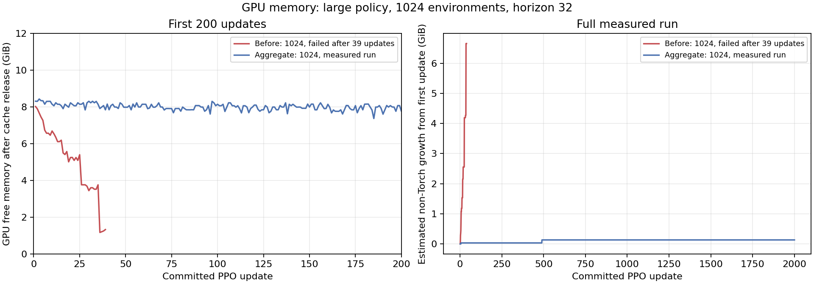
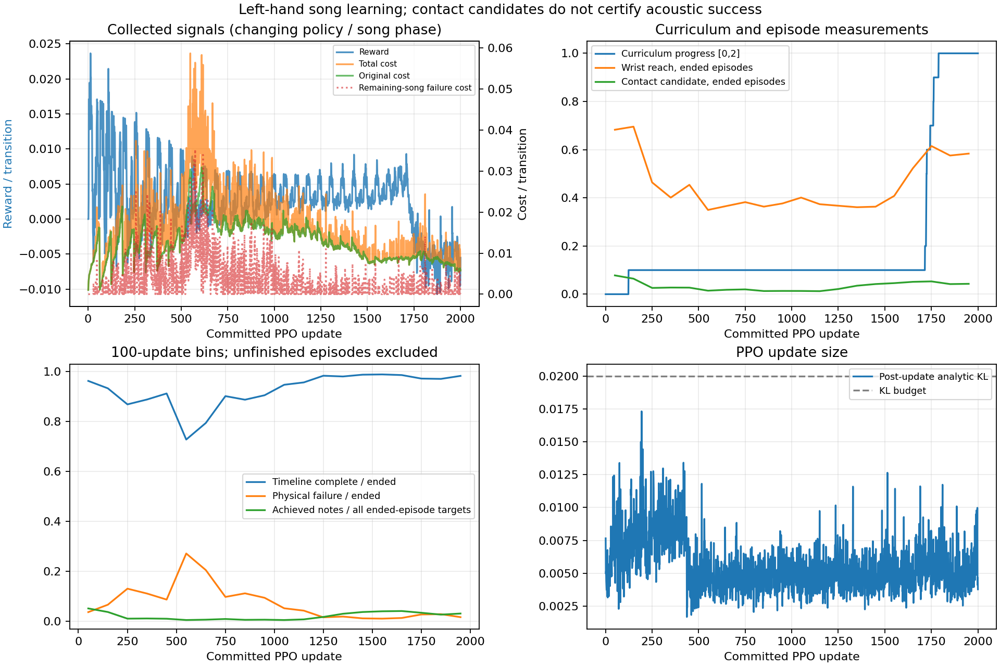

# large1024 GPU 장기 학습 결과

왼손·기본67음 곡·large·1024환경·H32·seed7로 **2,000업데이트,65,536,000전이**를 약 **5시간41분25초** 동안 정상 학습했다. GPU 메모리 부족이나 폐기 전이 없이 종료됐고, 최종 모델의 실제 **2,000→2,001회 GPU 재개**도 통과했다. 실행 안정성은 이 설정과 측정 시간에서 확인했다. 전곡67음 과제 성공은0건이며, 압현 학습의 수렴을 뜻하지 않는다.

초기·최종 모델의 별도1024환경 평가도 완료했다. 최종 모델은1023/1024곡을 안전하게 끝냈으며 평균4.232/67음을 달성했다. 초기3.969음보다 소폭 늘었지만 접촉 후보 비율은 거의 같고, 특정 목표의 향상과 저하가 공존한다. 충분한 연주 학습이 됐다고 판단하지 않는다.

## 발견한 문제와 수정

### GPU 메모리 증가

[이전 점검](../guitar_learning_gpu_long_run_check_v1/README.md)에서1024환경은39업데이트 후 PhysX 할당 실패로 중단됐고,512환경은 GPU 여유 감소를 확인해94업데이트에서 정상 중단했다.512의94회는OOM이 아니다.

환경마다 human·guitar·chair를 `begin_aggregate(68,145,True)`/`end_aggregate`로 묶었다. 실제68강체·145충돌형상을 사용하며 기존 actor 순서·충돌 필터·마찰·접촉 offset·자기 충돌·힘·reset·종료 기준을 유지한다. GPU 장면/물리 계약은v3이다. 이전 계약 모델의 strict resume는 거부한다.

4환경의 수정 전후 native 비교에서 형상 속성·접촉 하중·선택 reset을 확인했고, 이번1024환경2,000회에서는 추정 비Torch 메모리 증가가136MiB에서 멈췄다. SDK 내부 할당의 정확한 원인을 증명하거나 무한 실행의 메모리 상한을 보장한 결과는 아니다. 원문과 비교 근거는 [aggregate530회 시험](../guitar_learning_gpu_long_training_v2/README.md)에 보존했다.

### 조기 실패로 미래 비용이 사라지는 구조

aggregate 적용 뒤 첫 시험은530회에서 학습 악화를 확인해 의도적으로 중단했다. 폴더 이름의2000은 당시 목표 예산이며 실제 완료 수는530이다.400–499회에서 안전 완주928건의 평균 비용41.646에 비해1초 미만 실패2,073건의 평균 비용은6.335였다. 현재 고비용 궤적을 일찍 끝내는 유인과 일치하지만 실제 정책 gradient 원인을 증명한 것은 아니다. 최초 좋은 완주는 기존 조기 실패보다 좋았다.

이번에는 **왼손 GPU의 실제 물리 실패 tick에만 한 번** 다음 비용을 더했다.

`추가 비용 = 5 cost/초 × max(전체 곡 길이 − 실제 에피소드 시간, 0)`

기존 실패 보상−2·실패 비용+5·실패 tick의 양성 보상 억제·물리/제어/접촉/종료/reset·PPO·discount는 유지했다. CPU와 오른손에는 적용하지 않았다. 전체 곡 시계를 쓰며 PPO H32 경계의 남은 길이를 사용하지 않는다. 정상 tick·타임라인 완료의 추가 비용은0이다. 왼손 보상 계약은v2이며 보완 전 모델을 strict resume하지 않는다.

5는 이전 안전 완주의 비용률p99=4.5199를 올린 실험 계수다. 실제 미래 비용이나 상한의 측정값은 아니다. cost_gamma=1에서 남은 시간을 일정 비용률의 흡수 상태로 보는 모델이며, 모든 조기 종료 유인의 제거를 보장하지 않는다. [기존 고정 궤적의 검산](calibration_check.json)에서는1초 미만 실패 평균 비용이168.008로 늘지만 새 정책의 개선 증거는 아니다. 이전1초 이하2,095건과는 경계22건이 다르다.

400–499회 새 시험은1,927건 중169건 실패(8.77%),1초 미만 실패1건이었다. 이전7,225건 중6,297건 실패(87.16%),1초 미만2,073건보다 줄었다. 그러나 보상 단계도이전0.5/이번0.1로 달라 비용 보정만의 인과 효과로 확정하지 않는다.

## 실행과 저장 검증

| 항목 | 실제 결과 |
| --- | --- |
| 본 학습 | 2,000회·65,536,000반영전이·256,000 batched physics steps |
| 수집 기록 | sampled/logged/durable/committed 모두65,536,000; discarded0 |
| 원본 전이 | 64,000행·2,000 gzip member, CRC/EOF·episode/metrics 일치 |
| 종료 에피소드 | 34,069건=타임라인 완료31,524+물리 실패2,545 |
| 전곡67음 과제 성공 | 0/34,069; 음악·음향 성공과도 별도 |
| 입력 무결성 | 568입력SHA·423활성Python/보관 원문 모두 일치 |
| 최종 모델 | model56+actor optimizer54+value optimizer57=167 tensor 유한 |
| 실제 GPU 재개 | 2,000→2,001,32,768추가전이,569입력SHA 일치 |
| 재개 복원/변경 | source→initial 모든 nonmetadata 정확히 복원; 왼손 actor·두 optimizer 갱신, 비활성 오른손 actor 불변 |

[전체 실행 검증](long_run_verification.json)·[재개 검증](resume_verification.json)·[본 학습 보고서](train1024_large_2000/report.json)·[최종 모델](train1024_large_2000/final.pt)을 따른다. 재개는 모델·optimizer·RNG·커리큘럼을 복원하고 물리는 초기 자세의 새 에피소드를 시작한다. 곡 중간 native 상태를 저장/복원한 결과가 아니다.

수정 관련CPU44검사와 독립 환경15검사, 실제large1024 GPU2회 smoke, 첫 실제CUDA 실패5건의 비용 식, 보완 전 모델 거부도 확인했다. [비용/계약 검증](checkpoint_contract_verification.json)·[첫 실패 검산](first_cuda_failure_verification.json)·tests.log를 따른다.

## 메모리

캐시 반환 후 GPU free 최저7.374GiB, 마지막8.206GiB였다.2,000회 모두 정상 optimizer 경계 반환이며 긴급 low-free 반환은 없었다. 추정 비Torch 증가는 update6의34MiB와490의102MiB를 합친 최대0.1328125GiB이며 마지막100회 범위는0이다. 외부10초 샘플2,045개의 free 최저는6,799MiB, RAM 샘플 최저는16.723GiB였다. 외부 샘플과 optimizer 경계는 측정 시점이 다르다.

free+Torch reserved 잔차는 다른 GPU context·화면 사용도 포함할 수 있어 내부 PhysX 소유량으로 단정하지 않는다. 자연스러운 기타 이탈은 원래 기준대로 물리 실패로 종료·선택 reset하며 runtime/CUDA 오류와 구분한다. 알려진 빈 visual geom 경고를 제외한 새 native 오류는 확인되지 않았다.



## 학습 성과와 남은 한계

| 학습 수집 구간 | 안전 완주/종료 | 물리 실패율 | 완주 손목 도달 | 완주 접촉 후보 | 완주 달성 음/67 |
| --- | ---: | ---: | ---: | ---: | ---: |
| 처음0–99회 | 1,000/1,039 | 3.75% | 69.35% | 7.94% | 3.537 |
| 1400–1499회 | 1,730/1,752 | 1.26% | 36.40% | 4.22% | 2.547 |
| 1700–1799회 | 1,693/1,742 | 2.81% | 62.17% | 5.40% | 2.387 |
| 마지막1900–1999회 | 1,753/1,784 | 1.74% | 58.95% | 4.36% | 2.168 |

전체에서는 안전 완주92.53%, 물리 실패7.47%였다. 최근 실패가 낮아졌고 중반 이후 손목/접촉이 회복됐지만 처음 좋은 완주보다 최종 음 달성이 낮다. 실행 안정성만으로 압현 학습이 충분하다고 판단하지 않는다. 수치는 계속 변하는 정책의 수집 자료로, 고정 정책 평가와 구분한다. 종료되지 않은 곡은 분모에서 제외한다.

커리큘럼은 update123에서0→0.1,1715부터 다시 상승해1788에서1.0(`press`)에 도달했다. 최근 종료8건의 안전 평균≥75%·손목 도달 평균≥70%를 사용하는 승급이며1024환경 전체 평균 통과가 아니다.1.0→1.1부터는 접촉 평균≥60%도 필요하다. 진급 후 강등하지 않으며 최종1.0은 전곡/압현 성공을 뜻하지 않는다.

승급 update에는 수집 당시 reward와 갱신 후 다음 rollout의 단계가 함께 기록된다. 예를 들어1788회 reward는progress0.9,progress1.0 보상은1789회부터다.0.1→1.0에서 wrist/contact/timing/approach 비중은0.935/0.235/0.125/0.19→0.35/1.0/0.35/0.1로 바뀐다. raw reward의 전후 비교를 같은 목적 함수의 성능 비교로 해석하지 않는다. 기존KL 보호가 actor 학습률을 자동으로 낮췄으며 최종1.875e−6이다. 수동 변경은 하지 않았다.

정적 점검에서 손가락 접근 거리 보상은press_s 이전2초에만 작동하며, 진행도0.1에서 가중 최대0.038/초로 손목 최대0.935/초보다 작다. press_s 뒤에는 후보0인 작은 손가락 접근이 이 거리 보상을 늘리지 않는다. loaded는0.01N boolean이며 연속 압력/깊이 보상이 없다. 이는 남은 보상 밀도 문제의 후보이지 학습 실패의 인과 증명이 아니다. reward 항목별·손가락 거리 분포도 학습 로그에 없어 기여도를 확정할 수 없다. critic MSE/EV는 부트스트랩 목표에 대한 값이며 압현 능력을 인증하지 않는다.

학습 에피소드에는 음별 합계/평균만 기록되어 어느 음이 좋아졌는지 복원할 수 없다. 새 고정 정책 평가에서는 reset 전에 실제67음 원장을 별도로 저장한다. 표면 샘플·몸체 net force 기반 접촉 후보는 실제 개별 현 압력이나 음향 성공을 뜻하지 않는다. 같은 곡·초기 자세·seed7 한 번의 결과이며 다른 곡·시드·하드웨어/설정의 성능을 보장하지 않는다.

[전체 수집 분석](learning_analysis.md)·[동일 단계/에피소드 순서별 비교](cohort_analysis.md)에서 원래 비용과 추가 비용, 완주/실패·지표의 분모를 확인할 수 있다.



## 저장 모델의 별도 평가

탐색을 끈 정책으로 초기/최종 모델 각각1024환경의 첫 종료 곡만 비교했다. 학습 중 수집 자료와 분리하며, 이미 끝난 환경의 후속 곡은 점수에서 제외했다. 두 장면은 각각7876물리step 후 정상 정리됐고,571개 입력SHA·실제67음 운지/원장·보고서·음별 집계의 대조를 통과했다.

| 첫 곡 평가 | 초기 모델(0회) | 최종 모델(2000회) |
| --- | ---: | ---: |
| 평가 환경 | 1024 | 1024 |
| 안전 타임라인 완료 | 1024 | 1023 |
| 물리 실패 | 0 | 1(기타 위치 이탈) |
| 전체 첫 곡 평균 손목 도달 | 72.98% | 70.84% |
| 전체 첫 곡 평균 접촉 후보 | 6.743% | 6.731% |
| 전체 첫 곡 평균 달성 음/67 | 3.969 | 4.232 |
| 안전 완주만의 평균 달성 음/67 | 3.969(1024곡) | 4.237(1023곡) |
| 전곡67음 과제 성공 | 0 | 0 |
| 평가1024곡 중 한 번 이상 달성된 목표 이벤트 | 8/67 | 15/67 |
| 평가1024곡 모두에서 달성0인 목표 이벤트 | 59/67 | 52/67 |

특히3현(1=high-e)6프렛의 event51·41·61·62·63 성공률은 약+42~57%p 높아졌다. 반대로2현5프렛의 event1·7·8은 약−75~79%p 낮아졌다. 이는 특정 압현 위치로 치우친 부분 학습과 일치한다.52개 목표의 달성0은 이번 평가 집단의 관찰이며 학습 전체 이력에서 영원히 불가능하다는 뜻이 아니다. 목표 이벤트 수와 실제 음높이/운지 종류 수도 구분한다.

각 checkpoint의 curriculum(초기0/최종1)과 그에 따른 관측도 복원했으므로 전체 저장 상태의 비교다. 같은 관측에서 가중치만 바꾼 대조 실험이 아니며 raw reward를 같은 목적 함수로 비교하지 않는다. 같은 곡·준비 자세의1024개 복제 환경은 독립 seed나 일반화 검증도 아니다. 압현은 기하 후보의 필요 유지시간 달성 기준이며 실제 현 압력·음향 성공을 인증하지 않는다.

[별도 평가 분석](evaluation_analysis.md)·[전체67음 비교](evaluation_analysis.json)·[원 평가 보고서](checkpoint_evaluation.json)·각 evaluation_*_1024/first_episode_note_ledgers.json을 따른다. 현재 조건에서 실행은 오래 유지할 수 있지만, 같은 보상을 더 오래 반복하는 것만으로 폭넓은 압현 습득을 기대할 근거는 부족하다. 다음 개선 우선순위는 압현 시각의 손가락 접근 보상 밀도와 음별 균형을 확인하고, 학습 로그에도 음별 원장/보상 항목을 남기는 것이다.

### 첫 별도 평가의 native 실패와 재실행

첫 평가 시도는 초기1969tick/1024첫 종료 status 뒤SIGFPE(exit136)로 종료됐다. 음별 원장·보고서·scene_final은 생성되지 않았으며 최종 모델 평가는 시작하지 않았다. 따라서 그 시도를 완료 평가로 세지 않는다. 당시 도구·로그·4출력·571핀 검증은 evaluation_failure_attempt_001/에 원문과SHA로 보존했다. 정확한 native fault 위치나 내부 원인은 확정하지 못했다.

다음 step이 없을 때 불필요한 마지막 reset을 생략하고, 종료 전 CUDA 동기화·단계별 lifecycle·faulthandler·별도 원 Python 예외 보존을 추가했다. 학습 패키지와 점수·물리 궤적은 바꾸지 않았다. 수정 뒤 같은1024환경에서 초기/최종 두 평가가 모두 report_written/closed로 끝났고 프로세스exit0이었다. 여러 종료 보완을 함께 적용했으므로 단일 원인이나 모든 상황의 해결을 증명한 결과는 아니다. 본 학습2,000회와 실제 재개는 이 평가 실패와 별도로 이미 정상 종료했다.

## 재현

실제 실행의 환경 설정과 전체 명령은 run_long.sh, 재개는 run_resume.sh, 고정 정책 평가는 run_evaluation.sh에 보존했다. 실행할 때는 출력 경로를 아직 없는 새 경로로 바꾼다.

```bash
python -B -u -m guitar_learning.train \
  --hand left --physics gpu --device cuda:0 \
  --size large --num-envs 1024 --horizon 32 \
  --updates 2000 --checkpoint-every 50 --out /절대경로/새출력
```

기본medium/128 설정 자체는 바꾸지 않았다. 이번에 검증한large1024 조건에서 긴 실행이 가능했으며 학습 수렴은 별도 문제다. 활성 입력은 실행 내내 동결했고 source_training/·training_source_manifest.json에 원문을 보존했다. 이전 봉인 결과는 수정하지 않는다.

## 최종 보존

독립 change-reviewer가 본학습·재개·실제 평가 원장/목표·비용식·현재 입력SHA·장면 종료·최신 문서 수치/링크를 검산해PASS했다. final_postflight.json에 모든 프로세스 종료와 잔류GPU 연산 없음도 기록했다. 최종 문서 원문은 documentation_final/에 보관하고, 이 디렉토리 전체의 파일·바이트·SHA256을 artifact_sha256.json으로 봉인한다. 봉인 뒤에는 기존 결과를 수정하지 않는다.
