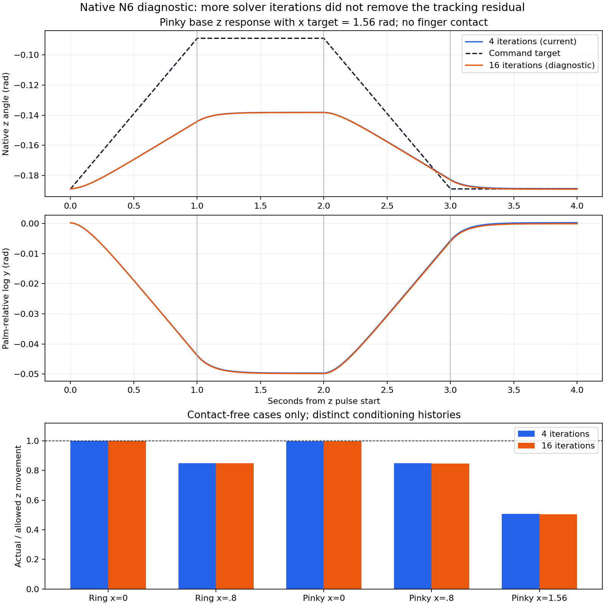

# 손가락 실제 자세 진단 보강 — 2026-10-22

추가 개선은 **학습 로그에 실제 손가락 회전 자세를 기록하는 것**이다. 기존 관절각 q−target만으로 전체 자세 추종을 설명할 수 없는 경우를 실제 GPU에서 확인했다. 현행 제어·힘·관절 범위·보상·관측512·PPO는 유지한다. 소지 기저의 벌림 추종 잔차를 해결했다거나 곡 달성이 개선됐다는 결과는 아니다.

## 구현

종료 에피소드의 `episodes.jsonl → left_finger_motion.base_rotation`에 검지·중지·약지·소지 기저 네 몸체의 다음 값을 저장한다. 기존21축 각도·행동 통계는 그대로 보존한다.

| 값 | 정의 |
|---|---|
| `palm_relative_rotvec_y_rms_rad`, `...max_abs_rad` | 실제 `palm⁻¹ × finger1` 회전 log의 y 성분 RMS/절댓값 최대 |
| `zero_y_command_rotation_error_rms_rad`, `...max_rad` | `Exp([target_x,0,target_z])` 참조와 실제 상대회전 간 전체 SO(3) 오차각 RMS/최대 |
| `zero_y_command_local_xz_error_rms_rad`, `...max_rad` | 실제 몸체 국소 좌표의 위 회전오차 x/z 성분 벡터 크기 RMS/최대 |

단위는 rad이며 각 배열의 네 손가락 순서는 index/middle/ring/pinky다. **완료된60Hz 제어 끝점만** 사용하고 reset t0는 제외한다.240Hz 극값이나 실제 drive torque·마찰·추가 자유도의 인증으로 해석하지 않는다. zero-y는 source finger1의 identity rest frame에서 정의한 진단 참조다. SDK 내부 target 변환을 완전히 알아냈다는 뜻이 아니다.

추가 저장 공간은 환경당6×4×8=192bytes다. 누적기는 고정 크기이며 H32 경계에서 유지하고 실제 에피소드 reset 때 선택한 환경만 지운다. CPU 물리·GPU 오른손에는 추가하지 않았다. 진단 계약은 `gpu_left_finger_motion.v2`/`gpu_left_finger_base_rotation.v1`이다. 정책 입력·보상은 같아도 전체 checkpoint 계약 비교가 달라져 기존435소스 checkpoint를 현행436소스에 strict resume하도록 완화하지 않았다.

활성 변경은 [환경](/home/ajou/yigyu/3/guitar_learning/gpu/environment.py), [기존 진단 검사](/home/ajou/yigyu/3/guitar_learning/tests/test_gpu_finger_motion_diagnostics.py), [실제 자세 검사](/home/ajou/yigyu/3/guitar_learning/tests/test_gpu_finger_base_rotation.py) 세 Python 파일뿐이다. 원래6개 관련 소스·검사·문서는 [변경 전 보관](/home/ajou/yigyu/3/guitar_learning/archive/20261022_before_finger_pose_diagnostics_v1/manifest.json)에 기록했다. 소스436개 SHA는 [현행 소스 manifest](source_manifest.json)에 있다.

실행한 새 원문은 [차이 원문 보관](source_overlay_manifest.json)에 저장했다. 기존 동결435 원문에 두 파일 교체·한 파일 추가를 적용하면436 Python 소스를 복원할 수 있어 전체 원문을 다시 중복 복사하지 않았다. 현행 문서4개도 함께 저장했다.

## 실제 GPU 대조

합의한035/v14에서 정책·PPO 없이 정상 누적 행동으로 ring/pinky의 x 목표0/.8/1.56rad를 만들었다.4초 이동+0.75초 유지 후 z를+0.1rad/s로1초 이동·1초 유지·1초 복귀·1초 유지했다. 전체6환경×525제어tick/2100물리tick이며 첫 native 종료가 발생하면 전체를 멈추도록 했다. 실제 두 실행은 모두 조기 종료0·정상 native 종료·입력/코드 pin 변동0이었다.

실제 post-prepare K/D12/1.5·effort20Nm·friction0을 읽어 확인했다. 기존 초기 자료의 K20/D5와 구분한다. 센서의 총 DOF 힘은 solver 전체 값이며 drive-only torque나 압력이 아니다.

| 무접촉 조건 | 허용 z 이동 | 실제 z 이동: 반복4 | 실제 z 이동: 반복16 |
|---|---:|---:|---:|
| 약지 x=0 | 0.10000 | 0.09994 | 0.09994 |
| 약지 x=.8 | 0.10000 | 0.08492 | 0.08486 |
| 소지 x=0 | 0.10000 | 0.09982 | 0.09984 |
| 소지 x=.8 | 0.10000 | 0.08482 | 0.08474 |
| 소지 x=1.56 | 0.10000 | 0.05070 | 0.05053 |

모두 rad다. x는 명령 목표이며 실제 시작 x와 시작 오차는 JSON에 별도로 있다. 서로 다른 conditioning 이력을 갖는 고정6행이므로 반복 seed 통계나 곡 성공률로 확대하지 않는다. 약지 x=1.56 행은 접촉 peak가 기본50.79N/반복16에서42.87N이어서 표의 무접촉 비교에서 제외하고 원자료에는 보존했다.

소지 x=1.56의 유지 끝 q−target은 −.049162→−.049318rad로 개선되지 않았다. y 성분도 −.049672→−.049827rad였다. 물리 반복4→16은 이 문제의 해결 근거가 없어 기본4를 유지했다. 두 실행 시간53.64/66.53초는 N6 진단 전체 시간으로,1024 학습 처리율 benchmark가 아니다.



[기본 원자료](native_baseline/report.json) · [반복16 별도 계약](native_solver16/runtime_override_contract.json) · [반복16 결과](native_solver16/report.json) · [기본 분석](baseline_analysis.json) · [반복16 분석](solver16_analysis.json).

## 원인에 관해 확인한 범위

기존 관측에는 q−reference·target−q·직전 행동이 실제로 들어 있다. 누적 목표 누락 때문에 발생했다는 설명은 [저장 입력 교차검산](policy_state_diagnosis.md)과 맞지 않았다.

실제 몸체 quaternion으로 계산한 palm 상대회전의 x/z는 native q와 맞지만 y가0으로 유지되지 않았다. 소지의 무접촉 유지 상태에서 zero-y 명령 참조 대비 국소 회전오차 x/z는 거의0이고 y가 남았다. 따라서 scalar q−target에 K를 곱한 값을 실제 모터 토크라고 설명할 수 없다. [원래 반전 자료의 회전 분석](body_rotation_diagnosis.json)과 [N6 명령 회전 분석](command_rotation_analysis.json)을 보존했다.

공식 PhysX 공개 소스에는2축 회전 관절의 생략 축 구속·회전 log 투영 설계가 있지만, 현재 Gym 바이너리·임포터가 정확히 같은 구현이라는 증거는 없다. 조회 API는 노출된 시험 축을 Revolute로 보고했다. 내부 원인과 정확한 교정식은 미확정이다. [공식 소스 조사·한계](target_semantics_diagnosis.md), [PD/마찰 진단](native_tracking_diagnosis.md)을 따른다. 단순 gain 증가·경험식 목표 증폭·축/몸체 추가는 현행에 적용하지 않았다.

## 검증과 재현 범위

- 관련 CPU 검사73개를 파일별 새 프로세스로 실행해 통과했다. 합성 자세의 누락 y 감지·세계 좌표 회전/Quaternion 부호 불변·RMS/최대·선택 reset·60Hz 표본 범위·H32 유지·기존 학습 출력 동일성과 관련 환경/학습 회귀를 확인했다. 전체865개 단일 프로세스 통과라는 뜻은 아니다.
- 새 누적기에 실제6×525개 저장 자세를 재생해6지표를 SciPy 독립 계산과 대조했다. [CPU 결과](pose_capture_cpu.json)의 최대 차이는2.77×10⁻¹⁶rad다. 이는 저장된 실제 자세의 진단 수식 검사이며 새 물리·PPO·곡 성능 검사가 아니다.
- 같은 저장 자세의 [CUDA 결과](pose_capture_cuda.json)도 통과했다. 최대 차이는3.37×10⁻¹⁶rad이고 두 재생 모두599개 입력 pin을 보존했다. 실제 GPU 물리 대조 두 건과 이 CUDA 수식 재생을 구분한다.
- 별도 change-reviewer가 원인 분석·N6 도구·solver 래퍼·활성 변경을 독립 검수했다. 도구의 반환 전 simulator 정리 누락은 실행 전에 수정하고 검사했다.

[검증 요약](validation_summary.json) · [독립 검수 기록](review_final.md) · [최종 입력 무결성](final_integrity.json).

기존435소스 실제 실행 입력은 [press-control v1](/home/ajou/yigyu/3/docs/2026-10-21/guitar_learning_press_control_v1/README.md)의 동결 원문과 함께 보존한다. 이 문서의 N6 native 도구는 그435소스를 pin했으므로 현행436소스에서 원래 SHA 검사를 우회해 다시 실행하면 안 된다. 현행 진단 재생 도구는 다음과 같다. 아래 실행은 저장 자세만 읽고 물리나 학습을 진행하지 않는다. 출력 파일은 새 경로를 사용한다.

```bash
python -B /home/ajou/yigyu/3/docs/2026-10-22/guitar_learning_finger_tracking_fix_v1/validate_pose_capture.py \
  --capture /home/ajou/yigyu/3/docs/2026-10-22/guitar_learning_finger_tracking_fix_v1/native_baseline \
  --manifest /home/ajou/yigyu/3/docs/2026-10-22/guitar_learning_finger_tracking_fix_v1/source_manifest.json \
  --out /tmp/finger_pose_audit_new.json --device cpu
```

기존 [소지 반전·접촉 해제 영상](/home/ajou/yigyu/3/docs/2026-10-22/guitar_learning_ring_pinky_probe_v1/learned10_closeup_video/ring_pinky_probe_60fps.mp4)은 원본 그대로다. 이번 구현은 동작을 바꾸지 않아 새 정책/전신 영상이나 장기 학습을 실행하지 않았다. 소지 추종과 한방향 정책 출력·0음 문제의 개선은 각각 후속 실제 검증이 필요하다.
