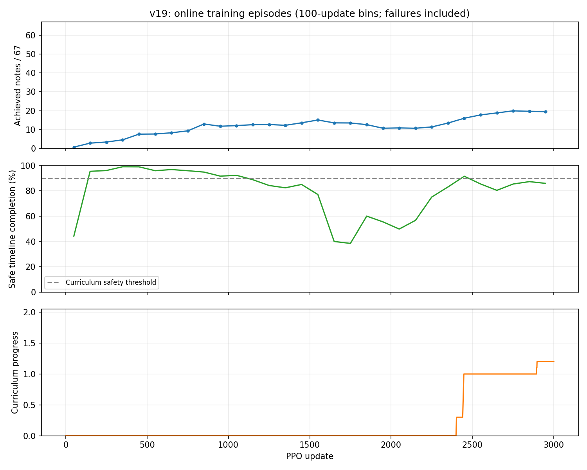

# v19 왼손 3,000회 학습 결과

2026-10-25 확인. large·GPU PhysX·1024환경·H32·seed7로 3,000 PPO 업데이트와 98,304,000전이를 정상 완료했다. 학습 약11시간26분, 전체 로그 검사까지 약11시간30분이 걸렸다. 감독 과정은 13:56 KST에 검사까지 마쳤다.

아래 학습 구간 성과는 **학습 중 종료된 에피소드 통계**다. 정책은 학습하며 바뀌고 행동에는 탐색이 포함된다. 최초 결과 확인에서는 고정 정책 평가를 실행하지 않았으며, 이후 사용자의 영상 요청으로 실행한 최종 정책 평가는 문서 끝에 따로 기록했다. 최고 단일 에피소드나 최고 학습 구간을 최고 체크포인트 성능으로 해석하지 않는다.

## 달성음과 안정성

달성음은 곡 전체67개 목표 중 기존 clean 유지·달성 판정을 통과한 음의 수다. 아래 평균에는 물리 실패 이전의 달성음도 포함한다. 안전 완주는 물리 실패 없이 곡 시간 끝까지 진행했다는 뜻이며, 모든 음을 연주했다는 뜻은 아니다.

| 학습 구간 | 종료 에피소드 | 평균 달성음 /67 | 안전 완주율 |
| --- | ---: | ---: | ---: |
| 최초250회 | 4,266 | 2.22 | 78.6% |
| 최근500회 | 8,641 | 19.15 | 84.9% |
| 최근250회 | 4,311 | 19.76 | 86.8% |
| 최근100회 | 1,726 | 19.52 | 85.9% |

최근100회 평균은 목표음의29.1%다. 중앙값21음, 최고30음이며, 안전 완주한1,483회만 보면 평균20.88음이다. 전체51,434회 중67음을 모두 달성한 사례는0회다. 전체 학습 평균11.96음은 초기 학습까지 섞인 값이다.

그림은100업데이트씩 묶은 종료 에피소드 통계이며 실패를 포함한다. 1,601~1,800회 구간에는 안전 완주율이 약40.0%,38.5%까지 하락했다. 이후 회복하면서 달성음이 늘었으나 마지막300회는 약19.5~19.9음으로, 이 구간에서 지속 상승했다고 보기는 어렵다. 최고 구간을 고정 정책 평가와 혼동하지 않는다.

## 손가락별 성과와 남은 문제

최근100업데이트에서 종료된1,726회 전체를 분모로 집계했다. 손가락별 담당 음수는25/18/12/12이며 평균 달성음의 합이19.52다.

| 손가락 | 담당 음수 | 평균 달성음 | 담당 음 달성률 | 최초 접촉 완료율 |
| --- | ---: | ---: | ---: | ---: |
| 검지 | 25 | 3.62 | 14.5% | 25.4% |
| 중지 | 18 | 5.82 | 32.3% | 39.7% |
| 약지 | 12 | 7.94 | 66.2% | 70.5% |
| 소지 | 12 | 2.14 | 17.8% | 26.0% |

검지·중지도 달성이 나오지만 손가락 간 편차가 크다. 최근250회와 비교하면 마지막100회에서 소지는1.16→2.14음으로 높고 중지는7.60→5.82음으로 낮다. 서로 중첩된 구간의 비교이므로 독립 실험의 개선 효과로 해석하지 않는다. 총점만 보면 이 교환을 놓칠 수 있다.

남은 문제는 다음과 같다.

1. **검지 목표 접근 부족.** 최근100회에서 검지의 목표 근접 판정률은48.6%다. 예를 들어 악보시간3.8707초의2번줄5프렛,5.4497초의3번줄4프렛은 달성0%, 최초 접촉 완료0%이며, 노출된 에피소드에서 목표까지의 최소 표면거리 평균이 각각 약4.0cm,3.0cm다. 단순히 접촉 유지 시간만 늘려 해결할 문제는 아니다.
2. **근접 이후 접촉·유지 전환 부족.** 소지는 근접84.2%지만 최초 접촉 완료26.0%, 달성17.8%다. 검지의 악보시간6.4017초2번줄5프렛은 최초 접촉 완료76.4%인데 달성12.6%다. 같은 검지라도 목표별로 접근과 유지 문제가 다르다. 접촉 완료·오압현·누락·연속clean을 나누어 볼 필요가 있다.
3. **기타 안정성.** 최근100회243/1,726회(14.1%)가 물리 실패다. 위치 이탈141회, 회전116회이며 두 원인이 겹칠 수 있다. 최근250회는569/4,311회(13.2%) 실패다. 이 수치는 환경 실행 오류와 구분되는 기존 안전 판정의 물리 종료다.

위 진단은 로그에 나타난 현상이다. 손가락 자세·실제 접촉 동작의 원인은 영상이나 관절별 진단 없이 단정하지 않는다.

## 보상 단계와 학습 상태

커리큘럼은0에서1.2까지 진행했고 최종 단계는`contact`다. 2,400회부터 근접 단계의 진행이 시작됐고2,447회에1.0,2,897회에1.2에 도달했다. 초기 단계에서도 압현 보상과 손가락 제어는 활성화된다.

종료 시 커리큘럼 최근256에피소드의 안전율은83.2%로 승급 기준90%보다 낮다. 이 창에서 모든 손가락의 최초 접촉 완료율은20% 기준을 넘었으므로, **마지막 상태의 추가 승급을 막는 조건은 안전율**이다. 이 커리큘럼 창은 실패 에피소드의 손가락 지표를0으로 넣으며, 위 표의 실제 달성 원장 통계와 분모·처리가 다르다.

PPO의 허용된 최대 KL은0.01780으로 제한0.02 이내였다. 582회에 KL 초과 재시도1회가 있었고 Actor 학습률은3e-5에서7.5e-6으로 낮아졌다. 최종 행동 포화율0%, 표준편차 평균0.04918이며 기록상 비유한값으로 중단되거나 메모리가 부족한 사건은 없다. 이것만으로 정책 수렴을 인증하지 않는다.

## 저장·무결성 확인

- 초기·250회 간격 중간·최종 총13개 체크포인트를 확인했다. 모델과 양쪽 Adam 등의 저장 텐서는 모두 유한값이며 최종 업데이트 수는3,000이다. 최종 파일은 [final.pt](train3000/final.pt)다.
- 자동 검사에서98,304,000전이와51,434종료 에피소드 회계가 일치했고, raw96,000행·gzip3,000멤버의CRC/EOF가 정상이다. 버려진 전이는0이다.
- 현행 학습 소스459개의SHA가 동결 원문과 일치하며 변경 입력·정리 오류는0이다. GPU 장면의 정상 종료도 확인했다. 체크포인트SHA는 자동 검사에서 확인했으며 모든 파일을 추가로 읽어 저장값의 유한성·계약을 확인했다.
- 이번에 학습 소스, 보상, 성공 기준, 원본 로그는 변경하지 않았다. 최초 로그 분석 이후 별도로 실행한 최종 정책 평가·영상은 아래에 기록했다.

근거: [자동 전체 로그 검사](log_inspection.json), [에피소드 집계](analysis/episodes.json), [업데이트·체크포인트 검사](analysis/updates.json), [학습 보고서](train3000/report.json), [곡 보고서](train3000/song_report.json). 분석 도구는 [support](support/)에 모았다.

분석 검증: 전용 검사3개 통과, 새 분석기 문법 검사 통과, 업데이트 요약과 원본 에피소드에서 별도로 집계한46구간의 종료 수·안전 완주 수·평균 달성음 일치, 결과 문서의 파일 링크 존재 확인, 추세 그림 시각 확인을 마쳤다.

[독립 검수](analysis/review.json)에서도 최근100회1,726에피소드의 원본을 재집계해 주요 수치·손가락 지표·실패 원인·목표별 예시가 일치함을 확인했다. 검수 범위에서 수정이 필요한 문제는 발견되지 않았다.

## 추가: 최종 정책 고정 평가와 결과 영상

사용자의 영상 요청으로 최종3,000회 체크포인트를 같은1024환경·seed7·전체67음·035/v14 초기 자세에서 결정론적으로 평가했다. PPO와 커리큘럼 갱신은 없고, 저장된1.2단계를 그대로 사용했다. 평균 달성음은 **21.0390625/67**, 물리 실패 없이 시간 끝까지 완주한 환경은 **887/1024(86.6%)**다. 학습 구간 평균19.52와는 정책·탐색·집계 방식이 다르다.

영상은 사전 지정env0..7 중 안전 완주한 최소ID인 **env0**의 첫곡이다. 달성음 기준으로 선택하지 않았고, **26/67음·timeline_complete·32.8167초**다. 최종 정책만 평가했으므로 최고 체크포인트를 선정한 결과가 아니다. 같은 곡·초기 자세·seed의 평가이며 독립seed 일반화·수렴을 의미하지 않는다.

- [전신 영상](final_fullbody_video/final_fullbody_60fps.mp4)
- [왼손 근접 영상](final_left_hand_video/final_left_hand_60fps.mp4)
- [고정 정책 평가 원문](evaluation_video1_final_1024/report.json), [실제 자세 기록 메타데이터](evaluation_video1_final_1024/capture_metadata.json)

GPU PhysX 실제 자세를60Hz로 기록하고 원래 자산을 해당 자세에 배치해1280×720·60fps로 재생한다. 렌더 중 새 물리 적분·정책 실행·보간·음 합성은 없다. 무음 영상의 표면접근·candidate 진단은 현 압력·음향 측정이 아니다.

두 영상 모두1,969프레임·32.816667초·60fps 검사를 통과했다. 저장 자세 대비 위치 최대오차0m·회전 최대오차 약6.3e-16rad, 추가 물리 스텝0, 입력SHA 불변을 확인했다. 첫·중간·끝 화면의 정방향·화면 범위도 확인했다. [영상 검수](analysis/video_review.json).

첫 평가 시도는 실행 도구 PATH에서ninja를 찾지 못해 장면 생성 전에 종료됐다. 해당 예외는 `evaluation_final_1024/python_exception.json`에 보존했고, 학습과 같은PATH로 재실행한 `evaluation_video1_final_1024`가 성공한 평가다. 원래 학습·첫 실패 결과를 덮어쓰지 않았다.
