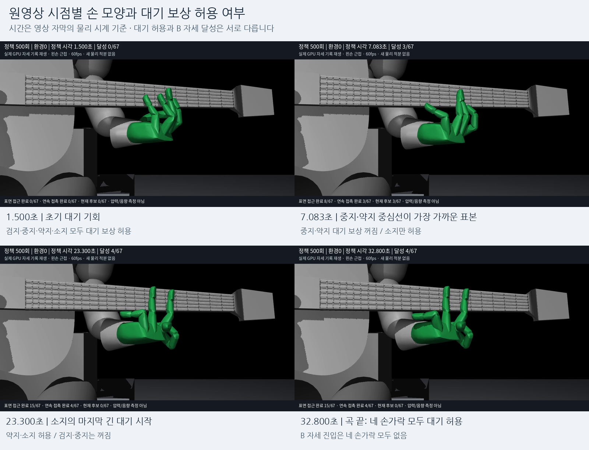
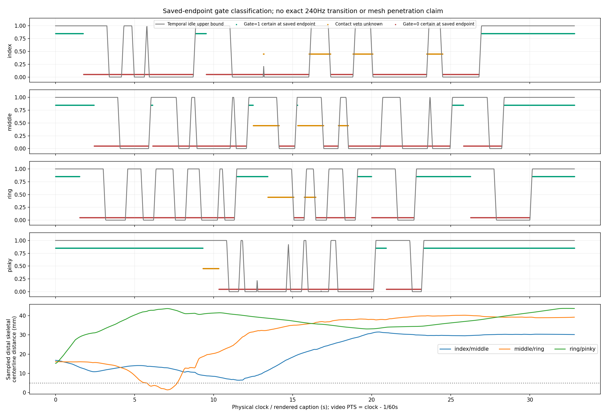
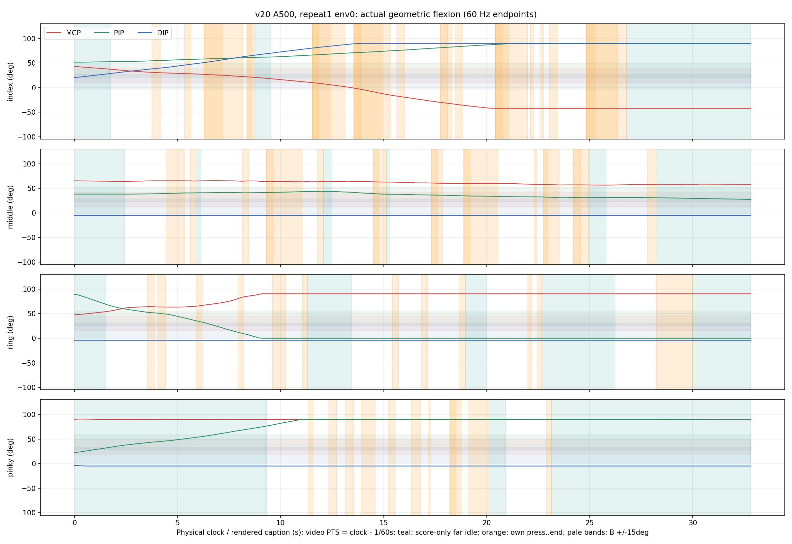
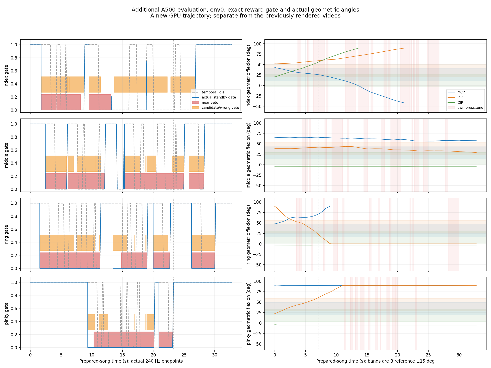

# v20 손가락 꼬임과 대기 구간 분석

분석 대상은 v20 500회 최종 모델의 기존 왼손 영상이다. 영상과 같은 `evaluation_repeat1/env0`의 저장 자세를 우선 확인하고, 두 정책 × 세 반복 × 여덟 환경의 저장 자세 48개를 보조 비교했다. 추가 학습과 보상·제어 변경은 하지 않았다.

## 확인된 결론

**대기 보상은 실제로 켜졌지만 B 자세로 돌아오지 않았다.** 원영상의 네 손가락 모두 대기 보상 허용 시간이 있었고, 실제 240Hz 에피소드 집계에서 대기 허용 중 B 대역에 있었던 시간은 모두 0초였다. 저장된 60Hz 전체 표본에서도 B 진입은 없었다. 따라서 선택한 B 자세를 수행해서 꼬였다기보다, 학습된 정책이 B와 다른 극단적인 관절 조합을 만들고 대기 중에도 이를 해소하지 못한 상황이다.

B 참고 자세 자체가 모든 손목 위치에서 충돌 없이 자연스럽다는 뜻은 아니다. 기존 B 시각화에도 고정된 손목 위치에서는 검지와 넥이 겹칠 수 있다는 주의가 있다. 다만 이번 영상은 B에 도달하지 않았으므로, 이 영상만으로 B 자세 자체의 적절성을 평가할 수는 없다.

## 원영상에서 언제 대기 보상이 켜졌나

여기서 **대기 허용**은 자세 보상 gate가 양수라는 뜻이다. 별도의 대기 애니메이션이나 자동 복귀 제어로 전환되는 상태가 아니다. 손가락마다 독립적으로 판정한다.

자신의 압현 예정 시각 0.35초 전부터 음 끝까지는 대기 보상을 끄고, 그 바깥 0.15초 구간에서 점진적으로 켠다. 별도로 자신의 관련 목표에 가까이 있거나, 현재·직전 접촉 후보 또는 오압현 후보가 있으면 끈다. 압현 준비와 손가락 추종은 별도의 2초 준비창을 유지한다.

| 손가락 | 원래 240Hz 기록의 대기 허용 총시간 | 원영상에서 완전히 켜진 것이 확인되는 마지막 구간 | 그 구간에서 B 자세 달성 |
|---|---:|---|---:|
| 검지 | 10.04초 | 26.950–32.817초 | 없음 |
| 중지 | 11.93초 | 28.383–32.817초 | 없음 |
| 약지 | 13.17초 | 30.167–32.817초 | 없음 |
| 소지 | 19.79초 | 23.300–32.817초 | 없음 |

표의 총시간은 원래 에피소드가 물리 240Hz로 집계한 값이다. 마지막 구간은 저장된 60Hz 끝점에서 gate=1을 확정할 수 있는 시각이며, 전환의 정확한 240Hz 첫 표본이라는 주장은 아니다. 이 구간에는 자신의 관련 목표가 없어 미저장 접촉 상태에 따른 차단도 발생할 수 없다. 곡 시작에도 각각 검지 약 1.75초, 중지 2.43초, 약지 1.52초, 소지 9.32초의 대기 기회가 있다.

원영상에는 개별 손가락의 매 물리 표본 접촉 후보가 저장되어 있지 않다. 따라서 그 외 시점은 확정 가능·꺼짐 확정·접촉 미상으로 나누었다. 전 구간 표는 [끝점별 대기 분류 CSV](raw/selected_gate_endpoint_intervals.csv), 악보만으로 정해지는 먼 대기창은 [고정 대기창 CSV](raw/score_far_idle_windows.csv)에 있다. 악보 대기창과 실제 gate 구간은 서로 다르다.

시간은 모두 물리 시계이자 영상 자막 기준이다. 원영상은 초기 0초 자세를 생략하므로 영상 파일 탐색 시각은 **자막 시각 − 1/60초**다.

## 어떤 관절 조합이 어색한가

아래는 실제 몸체 회전에서 구한 굽힘 투영각이다. native 관절 좌표와 구분하며, 인간 관절의 해부학적 각도를 인증하는 수치는 아니다. B 대역은 중심값의 ±15도다.

| 손가락 | B 중심 MCP / PIP / DIP | 영상 마지막 실제 MCP / PIP / DIP |
|---|---|---|
| 검지 | 25.5 / 35 / 12도 | **−42.1 / 90 / 90도** |
| 중지 | 28.0 / 38 / 14도 | 58.2 / 27.5 / −5도 |
| 약지 | 31.0 / 41 / 16도 | **90.4 / 0 / −5도** |
| 소지 | 34.3 / 44 / 18도 | **90.2 / 90 / −5도** |

검지는 뿌리 관절을 반대로 펴면서 가운데·끝 관절을 강하게 굽힌다. 약지는 뿌리만 크게 굽히고 나머지는 편다. 소지는 뿌리·가운데를 크게 굽힌 채 끝 관절을 편다. 네 손가락이 B의 적당한 굽힘을 수행하는 모습과 다르다.

아래 극단각 조건을 처음 만족하는 60Hz 표본도 대기 보상이 꺼진 구간에 있다. 검지 MCP가 음수로 넘어가는 첫 표본은 13.433초, DIP가 89도 이상인 첫 표본은 13.500초다. 약지 MCP가 89도 이상이면서 PIP가 1도 이하가 되는 첫 표본은 8.933초, 소지 PIP가 89도 이상이 되는 첫 표본은 10.900초다. 이는 실제 꼬임이 시작되는 순간의 인증이 아니라 관절각 임계조건이며, 대기 시간 부족만으로 설명하기 어렵다.

## 손가락이 실제로 끼었나

중지–약지의 원위 골격 중심선 표본 간 거리가 5mm 미만인 구간은 **5.750–7.683초**, 최솟값은 **7.083초의 1.38mm**다. 이 최소 거리 시점에는 두 손가락 모두 대기 보상이 꺼져 있다. 이는 가까워진 시점의 지표이며, 실제 충돌 메시 침투나 접촉한 몸체 쌍을 확정하는 측정은 아니다.

같은 지표는 이전 v19에도 있다. 포착한 각 24개 궤적에서 중지–약지 중심선 거리가 5mm 미만인 시간의 평균은 v19 8.28초, v20 1.96초다. 사전 지정된 낮은 환경 ID의 포착 자료이므로 전체 1024환경을 대표하는 표본으로 확대하지 않는다. 이 비교만으로 새 B 보상이 꼬임을 만들었다거나 개선했다고 판단하지 않는다.

## 보상과 제어에서 드러난 한계

1. **B 보상은 굽힘 투영각 세 개만 본다.** B를 만들 때 사용한 벌림 참고각은 보상 대상이 아니다. 동일한 굽힘 점수라도 손가락의 옆 방향·전체 회전·다른 손가락과의 간섭은 다를 수 있다.
2. **대기 허용은 복귀 명령이 아니다.** 기존 누적 목표 제어는 행동을 계속 누적한다. 행동 0은 현재 목표를 유지하며 B로 돌아가는 의미가 아니다. 실제 원영상 1969개 행동에서 검지 MCP 요청은 100% 음의 방향, PIP/DIP 요청은 100% 양의 방향이었다. 소지 MCP/PIP도 100% 양의 방향이었다. 확정 대기 끝점에서도 이 방향은 그대로다. 작은 행동도 계속 누적되므로 한계에 도달할 수 있다. 이는 목표를 움직이라는 요청이며 실제 속도나 힘을 뜻하지 않는다. [원래 명령·원장 대조](selected_native_commands.json)에서 저장 행동과 기존 진단의 부호 비율을 일치 검증했다.
3. **현재 B 보상은 약한 권고다.** 최대 합계 0.02/초를 네 손가락에 나누고, B에서 멀면 점수가 작아진다. 원영상의 대기 중 평균 품질은 검지 0.281, 중지 0.721, 약지 0.291, 소지 0.294다. 보상을 더 주면 해결된다는 인과 증거는 없으며, 압현을 방해하지 않는 조건도 유지해야 한다.
4. **굽힘과 벌림의 추종 문제를 나눠야 한다.** 영상 마지막 검지 PIP/DIP 목표와 실제는 둘 다 약 90도, 약지 PIP/DIP는 0/−5도다. 상당 부분 정책이 요청한 자세다. 반면 벌림의 목표–실제 RMS 차이는 중지 9.58도, 약지 9.09도, 소지 16.23도로 작지 않다. 소지의 마지막 벌림 목표 40도에 실제는 14.56도다. 이 부분까지 모두 보상 부족이나 정책 의도로 설명할 수 없다.
5. **이번 모델의 관절 모양 보정은 꺼져 있다.** A500 설정의 `shape_rate_per_s`는 0이고 실제 shape 보상도 0이다. 따라서 압현·추종 중 극단적인 관절 조합을 바로잡는 별도 모양 보상은 없고, B 권고는 대기가 허용될 때만 작동한다.

따라서 다음 개선은 대기 시간을 단순히 늘리는 것보다, **실제 3D 기저 회전·벌림 추종과 손가락 간 간섭을 먼저 분리 진단하고, 대기 중 B로 가까워지는 행동이 학습되는지 확인하는 것**이 적절하다. 고정 자세 강제·가동 범위 축소·손가락 움직임 비용 추가는 이번 분석에서 적용하지 않았다.

## 추가 240Hz 진단 재생

원영상에서 빠진 접촉 차단 전환을 확인하기 위해 같은 최종 모델을 추가 학습 없이 새 GPU 평가로 재생했다. 기존 평가의 1024환경·준비 상태·관측·보상·제어·물리를 그대로 사용하고 사전 지정된 0–7번 환경만 실제 240Hz로 관찰했다. 약 10분 13초에 1024개 최초 에피소드 평가를 마쳤고, 8개 관찰 환경은 모두 7876개 물리 끝점이 저장됐다.

**원영상과 다른 새 궤적**이다. 새 env0는 달성 3음으로, 원영상 env0의 4음과 다르다. 같은 시계라도 자세·행동은 같지 않으므로 원영상의 누락 자료를 복원했다고 취급하지 않는다.

| 손가락 | 새 env0의 실제 대기 허용 총시간 | 새 env0의 마지막 완전 허용 구간: 첫–마지막 물리 끝점 | 그 구간의 표본 시간 |
|---|---:|---|---:|
| 검지 | 8.758초 | 26.941667–32.816667초 | 5.879초 |
| 중지 | 10.367초 | 28.375000–32.816667초 | 4.446초 |
| 약지 | 11.033초 | 30.158333–32.816667초 | 2.663초 |
| 소지 | 19.792초 | 23.295833–32.816667초 | 9.525초 |

시간은 끝점 개수/240으로 계산한다. 따라서 마지막 시각−첫 시각과는 1/240초 차이가 있다. 전 구간 경계는 [실제 240Hz gate CSV](raw/exact_gate_intervals.csv)에 있다.

- 8개 환경 × 4개 손가락에서 B 대역에 들어간 표본은 **전 구간 0개**였다.
- 새 env0에서도 검지는 마지막 5.879초 동안 gate=1인데 MCP 약 −42도, PIP/DIP 약 90도를 유지한다. 약지는 22.829167–26.233333초의 3.408초 동안도 gate=1인 채 MCP 약 90도, PIP 0도, DIP −5도에 머문다.
- 새 7.083초의 중지·약지는 시간 조건상 대기 가능하지만, 근접·접촉 후보 차단으로 실제 gate는 0이다. “다음 음까지 시간이 남았다”와 “B 보상이 켜졌다”는 동일하지 않다.
- 새 재생의 벌림 목표–실제 RMS 차이는 중지 9.67도, 약지 9.06도, 소지 15.65도다. 소지는 손가락 몸체 중 하나라도 native 접촉 결과력 크기가 0.01N 이상인 표본이 2.50%에 그친다. 작은 결과력이 접촉 자체의 부재를 증명하지는 않지만, 결과력과 잔차의 관계만으로 끼임을 원인으로 확정할 수 없다. 중지에는 큰 잔차와 결과력 사이 양의 상관이 있으나, 약지·소지는 같은 양상이 아니다. 제어·실제 가동 한계·내부 관절 제약을 나누어 후속 점검해야 한다.

[새 재생 분석 JSON](exact_trace_analysis.json)과 [native 관찰·원장 검증](gpu_trace/trace_report.json)에 상세 수치와 한계를 보존했다. 원래 진단 함수를 같은 인자로 한 번 호출하며 상태를 복사했고, reset·행동·물리 단계는 추가하지 않았다. 617개 실행 입력 SHA가 유지되었고, 8개 trace의 실제 B 적분과 native 에피소드 보상 차이의 최댓값은 2.48×10⁻⁷이었다. 이 검증은 진단의 정확성을 확인하며 학습 성능 향상을 의미하지 않는다.

## 근거와 검증

- 원래 자료: [v20 A500 결과](../guitar_learning_v20_A500/RESULTS.md), `evaluation_repeat1/poses_env0000.npz`, 같은 에피소드의 240Hz 집계 및 기존 영상 프레임 대응표.
- [저장 자세 분석 JSON](frame_analysis.json): 48개 포착 궤적과 원영상 진단 집계, 입력 자세 파일 SHA.
- [재구성 검증](support/frame_validation.json): NumPy–Torch 굽힘 각도 최대 오차 2.84×10⁻¹⁴도, pad 거리 최대 오차 1.39×10⁻¹⁷m, 고정 대기창 17개와 기존 진단 일치. 원영상 1969프레임의 시계 대응도 검증했다.
- 새 관찰기의 CPU 검사 3개 통과. 원래 진단 호출 1회·입력 객체 보존·종료 후 고정·실패 tick 보상 억제·원장 불일치 거부를 확인했다. 독립 검수에서 실행을 막는 문제는 없었고, 영상 한 프레임 오프셋 문구는 수정했다.
