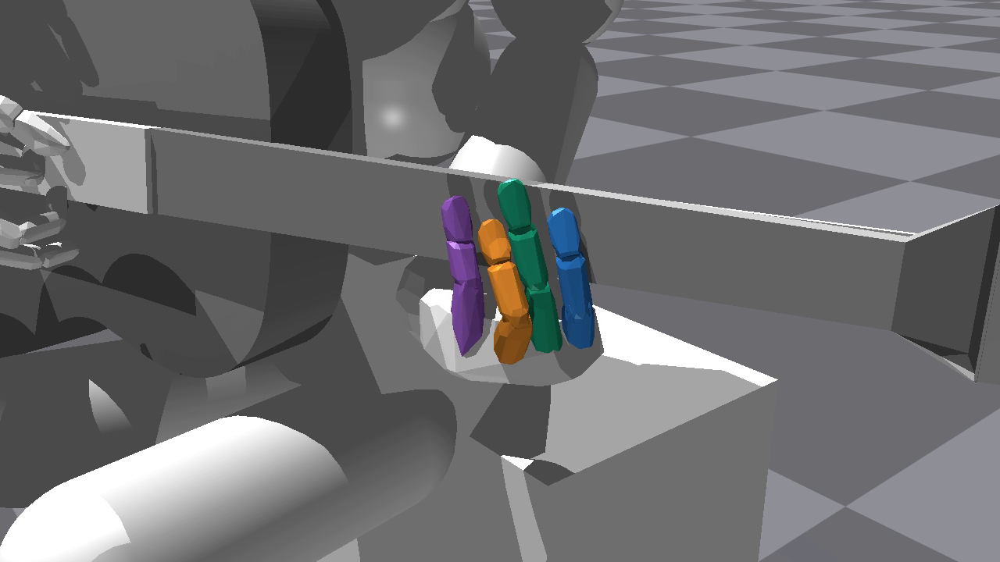

# v24 구현 검증 결과

현재 봉인한495개 Python 소스로 CPU 검사와 짧은 native GPU 실행·저장/재개·단계 이전·전곡 평가·영상 생성을 완료했다. 구현 연결은 통과했으며, 자연스러운 압현과 모든 손가락의 학습 성능 개선은 아직 입증하지 않았다. 장기 학습은 이번 작업에서 실행하지 않았다.

## 검사 범위

| 항목 | 결과 | 근거 |
| --- | --- | --- |
| CPU 회귀/수학/경계 검사 | 54개 모듈·525개 검사 실행, 실패0 | [CPU 결과](support/cpu_checks.json) |
| 코드 독립 검수 | Critical0·Warning0, 문제없음 | [검수](support/review.json) |
| large1024/H32/seed7 | F2회65,536전이·추가1회32,768전이, 저장/재개 통과 | [실행 목록](support/final_native_checks.json) |
| 엄격 재개 | 모델·두 Adam·모든 RNG·단계 상태 일치, sampler 복원 후 새 준비 에피소드 시작 | [재개 검사](support/final_resume_verification.json) |
| R/F/J 및 단계 이전 | R2회·F8회·J2회, R→F/F→J actor 이전과 새 critic/Adam 확인 | [단계 이전](support/final_phase_transfer_verification.json)·[준비 평가](support/final_readiness_transfer_verification.json) |
| 결정 단위 PPO 기록 | 32,768 원시 전이 ↔12,389결정, 누락·중복0 | [원장 검사](support/final_native_data_verification.json) |
| 독립 native 산출물 검수 | 모델·동결·재개·할인합·영상·평가를 별도 재계산, 문제없음 | [독립 보고서](support/final_independent_native_checks.json) |

1024환경 검사에서 관측한 최소 GPU 여유는 약6.087GiB다. 총3업데이트의 짧은 자원/연결 검사이므로 장시간 메모리 안정성이나 최대 환경 수를 보장하지 않는다. 검사는 RTX4070Ti12GB와 기존 Isaac Gym/rl38 환경에서 수행했다.

F의 상관 탐색·최대3tick 실행은128환경/H32/8회다. 실제 결정 길이는3tick9,633개·2tick1,113개·1tick1,643개이며, 모든 원시 전이가 정확히 한 결정에 포함된다. 원시 보상/비용에서 다시 계산한 할인합의 최대 오차는 각각3.105e-7·9.239e-7이다. 동결 support와 R의 동결 손가락은 학습 전후 동일하다. 최대6tick은 CPU 경계/계산 검사를 통과했으며 native 학습 비교는 아직 없다.

R2회 모델의 고정 평가에서 손목 영역 체류는약0.61367로 전환 기준0.8을 충족하지 않았다. 준비 통과로 바꾸지 않고 그대로 보존했다. R→F 연결 검사는 명시적인 진단용 단계 이전이며 자동 준비 기준 달성으로 보고하지 않는다.

## 짧은 모델의 전곡 평가와 영상

검사 모델은 [F8회 최종 저장본](correlated_F3_final/F/final.pt)이다. 직접 F로 시작해 support 사전학습을 거치지 않았다. 자동 R→F의 성능이나 동량 비교 결과로 해석하지 않는다.

| 지표 | 값 |
| --- | ---: |
| 고정 전곡 평가 | 16개 첫 에피소드·각67음 |
| 시간축 안전 완주 | 16/16 |
| 전체67음 성공 | 0/16 |
| 평균 달성 | 4.9375/67음 |
| 손가락별 총 달성（검지/중지/약지/소지） | 79/0/0/0 |

학습 중 종료한46개 구간 에피소드에서는 시간축 완주43건·물리 실패3건이었다. 이후16개 전곡 평가의 무실패를 학습 전체 무실패로 확대하지 않는다. 평가 원자료는 [평가 디렉토리](evaluate_F3_final/)에 있다.

사전에 지정한env0의 첫 전곡을 같은 결정론적 정책/제어 계약으로 촬영했다. 가장 높은 성과의 환경을 골라낸 영상이 아니다.

- [손 영상](render_F3_final/hand.mp4)·[전신 영상](render_F3_final/fullbody.mp4)
- 두 영상 모두1280×720·30fps·984프레임·32.8초이며 인코딩/소스 봉인/정책 불변/장면 종료 검사를 통과했다.
- [실측 자세](render_F3_final/poses_env0000.npz)는1969개 제어 끝점과7876개 연속 물리 tick을 담는다. 도중 reset이 없다.
- 12초 프레임을 직접 확인해 상하 방향과 손/몸의 화면 배치를 점검했다. 이 확인은 손가락 자연스러움의 합격 판정이 아니다.

## 소스 보존과 재검증

첫 영상 검증 도중 다른 창에서 모듈 설명문2개와 공백1곳이 변경되어 소스 봉인 검사가 실패했다. 변경은 보존했으며, 사용자에게 편집 종료를 확인한 뒤 현행495개 소스로 전체 CPU 검사와 새 checkpoint의 native 검증·평가·영상을 다시 실행했다. 기존 후보 산출물은 통과 결과로 덮어쓰지 않고 남겼다.

- [외부 편집 전 원문 보관](/home/ajou/yigyu/3/guitar_learning/archive/20261026_finger_skill_v24_before_external_header_edits/manifest.json)·[세 파일의 실행 AST 동일성](support/header_change_verification.json)
- [현재 소스 봉인](support/source_manifest.json)·[변경 목록](support/changes.json)·[종합 결과](verification.json)

원문 pin 대상3개 파일은 변경하지 않았다. 이전 보관본을 현행 코드에서 import하지 않는다. 성능 채택 전에는 같은 실제 전이 예산의 A~E 비교·유망 조건3seed·모든 손가락의 성과와 관절 움직임을 확인해야 한다.
