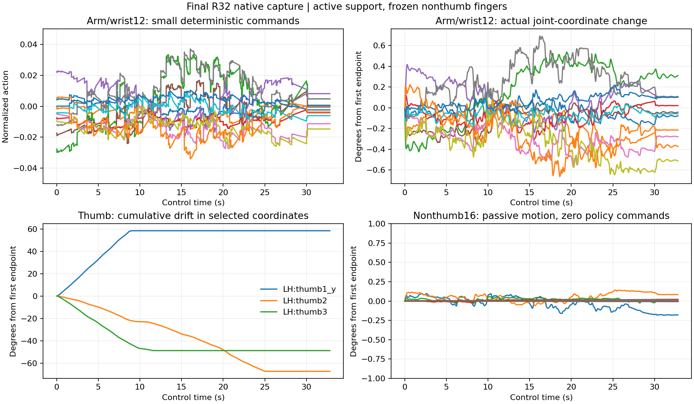

# 최종 영상에서 거의 움직이지 않는 이유

검사 범위는 최종 R32 모델의 사전 지정env0·원곡67음·32.8167초다. 저장된1969개 실제 관절각·목표각·행동·강체 자세와 현행 제어식을 대조했다. 추가 학습이나 제어 변경은 하지 않았다.

**네 손가락은 R 단계에서 명령이0으로 고정되고, 팔은 작은 위치 명령만 배웠으며, 엄지는 작은 명령이 누적돼 관절 범위 끝으로 이동했다.** 화면이 멈추거나 모든 관절이 물리에 막힌 상황을 보여 주는 것은 아니다.

## 실제 움직임

| 부위/지표 | 전곡 실측 |
| --- | ---: |
| 팔·손목12축 명령 절댓값 최대 | 0.03706（정규화 명령의 전체 범위는−1~1） |
| 팔·손목 각 축의 실제각 최대−최소 중 최대 | 0.959도 |
| 팔·손목 각 축의 목표각 최대−최소 중 최대 | 1.122도 |
| 팔·손목 요청각의 준비 참조각 대비 절댓값 최대 | 0.743도 |
| 손목의 기타 좌표계 첫 끝점 대비 최대 이동 거리 | 5.058mm |
| 검지·중지·약지·소지16축 명령 | 모든 시점0 |
| 위16축 목표각의 최대−최소 | 모든 축0도 |
| 위16축 실제각의 최대−최소 중 최대 | 약0.282도（물리에 따른 수동 변화） |
| 엄지 실제 native 좌표 변화 중 최대 | 약67.37도 |

팔 목표각 자체가 작다. 독립 검수에서 실제 행동을 제어식에 다시 넣었을 때 팔과 왼손의 저장 목표각1969개 전부와 정확히 일치했다. 따라서 이번 영상에서 큰 팔 요청이 제어기에 의해 사라졌다는 증거는 없다.



## 1. 네 손가락은 아직 학습 대상이 아니었다

자동 실행이 R32회 후 손목 기준 미달로 종료돼 F/J가 실행되지 않았다. [정책의 R 분기](/home/ajou/yigyu/3/guitar_learning/skills/finger_skill_policy.py:152)는 네 손가락16축 평균 출력을 명시적으로0으로 만든다. 해당 인코더·출력부·표준편차도 동결한다.

현재 손가락 제어의0은 “이전 목표각 유지”다. 따라서 준비 자세에서 목표각을 바꾸지 않고 물리적으로 유지한다. 대기 보상이 종료되면 자동으로 압현 동작이 재생되는 장치는 없다. R에서는 B와 압현·추종·달성 보상도 최적화에서 제외되므로 이번 정체를 B 보상의 과잉으로 설명할 수 없다.

## 2. 팔은 작은 출력을 오래 내도 멀리 이동하지 않는다

팔·손목12축은 [초기 참조각 기준 위치 요청](/home/ajou/yigyu/3/guitar_learning/gpu/control.py:399)이다. 일반적으로 참조각±0.35rad（약20도）를 쓰며 native 한계와 겹치는 방향은 더 좁다. 평활화α0.2와 기존 속도 제한을 거친다.

가용 범위가0.35rad인 방향의 예:

```text
행동0.03 → 참조각에서0.35×0.03rad ≈0.60도 떨어진 목표
같은0.03을 계속 출력 → 같은 작은 위치 목표를 유지
```

이번 팔 명령은 최대 약0.037이고 실제 요청은 참조각에서 최대0.743도였다. 팔을 크게 옮기도록 학습한 평균 출력이 아직 만들어지지 않았다. 실제 팔 각 축의 변화도1도 미만이어서 눈으로 거의 정적으로 보이는 것이 데이터와 맞는다.

초기 상태의 한계 비대칭도 있다. 일부 축의 가용 방향은 Thorax_x 양의 방향 약0.0001도·Thorax_y 양의 방향0.851도·Shoulder_z 양의 방향1.622도·Wrist_y 음의 방향0.0117도로 작다. 다른 축/방향의 조합으로 움직일 수 있으므로 이것만으로 특정 목표가 도달 불가능하다고 판정하지 않는다.

## 3. 엄지는 같은 작은 명령이 누적된다

[왼손21축 제어](/home/ajou/yigyu/3/guitar_learning/gpu/control.py:408)는 엄지까지 포함해 다음 식이다.

```text
다음 목표각 = 이전 목표각 + 행동×4rad/s÷60
```

예를 들어 행동0.03이 일정하게 유지되면 초당 약6.88도씩 목표가 바뀐다. 팔의 위치 요청과 의미가 다르다.

영상에서 엄지 목표 native 좌표는 다음처럼 이동했다.

| 좌표 | 첫 제어 끝점 → 마지막 |
| --- | ---: |
| thumb1_y | −58.29도 → 0도 |
| thumb2 | 67.33도 → 0도 |
| thumb3 | 43.74도 → −5도 |

마지막에는 엄지5개 좌표 모두 각각 native 범위의 한쪽 끝에 도달했다. thumb1_y 목표는 전곡 시간의약73%, thumb3는약66%를 범위 끝에서 보냈다. “손 전체가 계속 잘 움직이지 않는다”는 인상 안에 **작은 팔 이동·정지한 네 손가락·한쪽 방향으로 이동한 뒤 끝에 머무는 엄지**가 섞여 있다. 이 숫자는 native 관절 좌표이며 사람의 해부학적 관절각으로 인증한 값은 아니다.

## 4. 왜 팔 정책이 작은 출력에 머물렀는가

여기에는 확인된 사실과 아직 검증하지 않은 원인을 구분해야 한다.

- 새 정책 출력부는0으로 초기화한다. 최종 평균 명령도 여전히0에 가깝다.
- R은32회만 학습했다. support 텐서18개가 변했고 gradient도 유효했으므로 학습이 완전히 동결된 것은 아니다.
- 초기 탐색 표준편차는약0.0498이고 최종에도 거의 같다. 팔의 위치 요청으로 환산하면 충분한 범위가 있는 방향에서도 평활화 전 대략1도 수준의 변동이다. 독립60Hz 잡음이 큰 도달 동작을 탐색했는지는 별도 검증이 필요하다.
- [평가·렌더](/home/ajou/yigyu/3/guitar_learning/training/finger_skill_runner.py:297)는 탐색 잡음을 제거한 평균 명령만 사용한다. 학습 중의 무작위 흔들림이 영상에는 나오지 않는다.
- 영상의 행동 변화 감점은 정확히0이며 팔의 인접 명령 차이도 최대0.01551로 무감점 범위0.05 안이다. 움직임 비용이 주원인이라는 근거는 없다.
- KL 재시도0·학습률 유지이므로 KL 거부 때문에 학습이 멈춘 것도 아니다.

작은 초기 출력·팔 위치 제어에서의 작은 탐색·짧은 R 예산·구간별 공통 정책과 물리 비용의 절충이 후보 원인이다. 현재 한 실행만으로 각각의 인과 기여를 확정할 수 없다. 손가락 움직임 비용0이나 전체 가동범위만으로 이 문제는 해결되지 않는다. 이번에는 그 손가락 축에 움직임 명령이 전달되지 않았기 때문이다.

## 다음에 확인할 순서

1. R32회 종료와80% 준비 기준 때문에 F가 전혀 실행되지 않는 흐름을 점검한다. 준비 시간과 실제 음 구간의 체류율을 분리하고 R의 도달성과 학습 예산을 먼저 확인한다.
2. 팔은 목표에 필요한 실제 손목 이동 거리와 관절 방향별 가용 범위를 기준으로 탐색 크기·지속시간을 비교한다. 전체 팔 제어를 즉시 바꾸기보다 기존 위치 제어에서 지속된 목표를 충분히 탐색하는지 검증한다.
3. 엄지는 명령 편향이 계속 누적돼 범위 끝에 머무는 문제와 뒷면 접근 악화를 함께 다룬다. 현재 움직임 크기가 큰 것 자체는 바람직한 지지의 증거가 아니다.
4. 준비 후 실제 F 학습에서 담당 손가락의 명령·목표각·실제각·패드 이동·압현을 연결해 확인한다. 이번 R 영상만으로 새 손가락 탐색의 효과를 판단하지 않는다.

[수치 집계](motion_analysis.json)·[독립 검수](support/motion_review.json)·[전체 결과](RESULTS.md). 기존 보상/정책/제어는 이 분석에서 수정하지 않았다.
