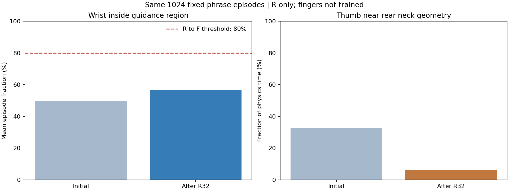
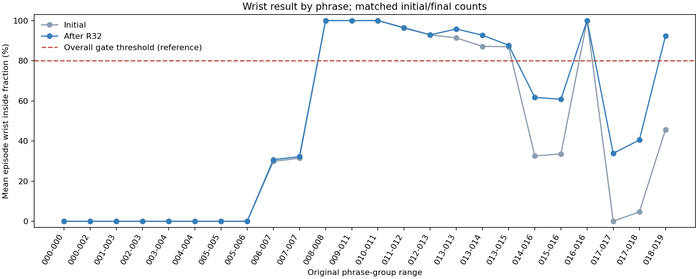
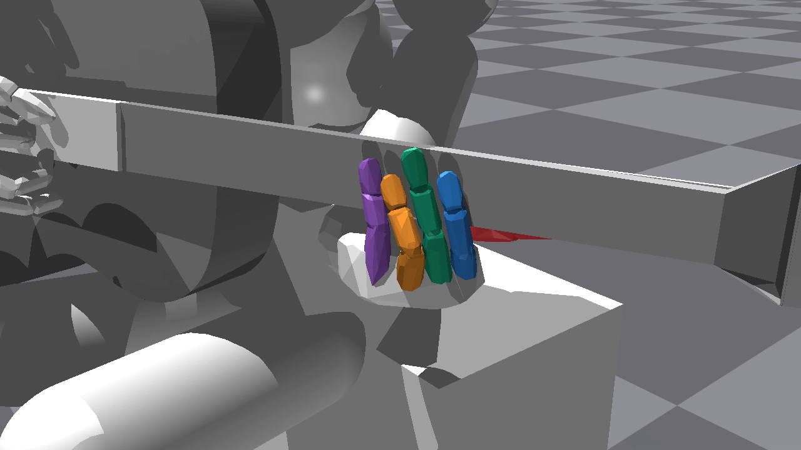

# v24 자동 실행 결과

이번 실행은 약1시간 학습이 아니라 **R 준비 단계32회·16분41초의 실행**으로 종료됐다. 총1,048,576개60Hz 학습 전이를 사용했다. 초기/최종 평가를 포함한 전체 pipeline은1000.30초, 학습 단계 자체는627.86초였다. 오류나 GPU 메모리 부족으로 중단된 것은 아니다.

종료 사유는 `R_stalled`다. 기본 R32회 예산을 쓴 뒤 손목 안내 영역 체류율이56.636%로 전환 기준80%에 못 미쳤다. **F 손가락 학습과 J 공동 학습의 전이는 모두0**이다. 한 시간은 실행 상한이었고, 앞서 안내한 약180회는 순수 학습 속도의 추정치와 J 최대 예산이었다. 이 실행의 실제 반복 수로 보고하지 않는다.

## 같은 구간에서의 전후 비교

두 평가는 같은1,024개 첫 구간 에피소드, 같은 구간별 개수와6,786개 목표 음 기회다. 원곡67음 전곡의 점수가 아니다.

| 지표 | 초기 | R32회 후 |
| --- | ---: | ---: |
| 손목 안내 영역 체류율（에피소드 평균） | 49.619% | 56.636% |
| 안전 완주 | 1024/1024 | 1024/1024 |
| 엄지 뒷면 근접 시간 비율 | 32.566% | 6.247% |
| 엄지 접촉 후보 시간 비율 | 0.01880% | 0.00396% |
| 엄지 선택점 평균 부호 간격 | 2.437mm | 15.804mm |
| 손목 영역 밖 거리·기타Y축（시간 가중） | 11.135mm | 9.578mm |
| 평균 물리 비용/에피소드 | 0.34335 | 0.44305 |

손목 체류율은7.018%p 개선됐지만 기준까지23.364%p 남았다. 반면 엄지는 넥 뒷면에서 멀어졌고 근접/접촉 후보가 감소했다. 같은 support 학습에서 관측된 동반 변화이며, 손목 이동이 엄지 악화의 유일한 원인이라고 단정하지 않는다. 엄지 수치는 지정 표면 기하·몸체합력 기반 후보이며 실제 접촉쌍·압력·음향의 인증은 아니다.

물리 비용 평균도 약29.0% 증가했다. 고정 평가에서 이미100%였던 안전 완주가 유지된 것이며 안전성이 향상됐다고 해석하지 않는다. 학습 중에는2,857개 완결 구간 중2,848개 시간축 완주와9개 기타 변위 실패가 있었다. 이후 평가 무실패와 학습 전체 무실패를 혼동하지 않는다.

실제 R 보상 합계도 이 변화를 보여 준다. 구간당 평균 손목 항은−0.17740→−0.15325로0.02415 개선됐지만 엄지 항은0.02974→0.01381로0.01592 감소했다. 합계 보상은−0.14766→−0.13943으로 소폭 개선됐다. 보상 총합 상승만 보고 엄지까지 좋아졌다고 판단할 수 없다. 이 합계 대조는 관측된 변화의 산술적 설명이며 개별 보상 계수의 인과 효과를 분리한 실험은 아니다.

## 손가락이 배우지 않은 이유

R은 팔·손목12축과 엄지5축만 학습하는 준비 단계다. 네 손가락 정책의32개 텐서는 초기와 정확히 같고, 학습 로그에서16개 손가락 명령과 목표각 변화 범위는 모두0이었다. 물리 접촉에 따른 수동적인 실제 관절 변화는 가능하다.

R에서는 접촉·음 달성·추종·B 대기 자세를 포함한 음악/손가락 보상도 최적화에서 제외된다. 따라서 이번 영상의 정적인 손 모양은 “대기 보상을 너무 오래 받아서 압현을 멈춘 결과”로 설명할 수 없다. 손가락을 학습하는 F 단계까지 실행되지 않은 결과다.

구간 평가에서 측정된 달성음은 검지63→164개이고 다른 세 손가락은0이다. 이는 고정된 손가락을 가진 support 동작의 부수적인 측정으로, 네 손가락이 압현을 학습했다는 근거가 아니다. 구간당 평균0.0615→0.1602를 `/67` 전곡 점수로 표시하지 않는다.

## 어느 구간이 막혔는가

초기 쪽8개 구간 view（`000-000`부터`005-006`까지）는 전후 모두 손목 영역 체류율이0이었다. 최종 평가의 해당 구간에서 기타Y축 평균 영역 밖 거리는약23~45mm였다. 반대로 일부 중후반 구간은 초기부터 영역 체류가 거의100%였고, 마지막 쪽 구간에서 개선이 컸다. 전체56.6%라는 평균에는 이 차이가 섞여 있다.

이 결과는 모든 목표가 조금씩 부족한 상황과 다르다. 해당 초기 구간의 안내 위치·준비 상태에서 요구되는 이동 거리·실제 도달 시간을 먼저 확인해야 한다. 영역 밖 거리는 곧바로 관절 가동범위로 도달 불가능하다는 증거는 아니다.

## 다음 개선의 우선순위

1. 초기8개 구간의 목표·손목·엄지 궤적을 함께 점검한다. 현재 로그만으로 준비3초와 실제 음 구간 중 어느 부분이 체류율을 낮추는지 완전히 분리할 수 없으므로 두 구간의 체류율도 따로 확인한다.
2. 손목을 옮기는 동안 엄지가 넥 뒷면을 따라가도록 support 목적과 보상 크기를 검토한다. 이번 고정 평가의 엄지 악화부터 해결하는 것이 필요하다.
3. R32회 예산과 준비 기준의 실제 도달성을 확인한 뒤, 요청한 시간 안에 F 손가락 학습을 충분히 수행하도록 실행 예산을 정한다. 이번 결과를 보고80% 기준만 임의로 낮추거나 강제 진급한 것은 아니다.

새 학습이나 보상/제어 변경은 이번 결과 분석 작업에서 수행하지 않았다.

## 최종 R 모델의 원곡67음 평가

구간 평가와 별도로 원래67음·1969tick·32.8167초 전곡을16개 환경의 첫 에피소드로 평가했다. 최종 R 모델을 그대로 사용했으며 손가락 학습이나 단계 이전을 추가하지 않았다.

| 지표 | 최종 R32 모델 |
| --- | ---: |
| 안전 시간축 완주 | 16/16 |
| 전체67음 성공 | 0/16 |
| 평균 달성음 | 1.375/67 |
| 손가락별 총 달성（검지/중지/약지/소지） | 22/0/0/0 |
| 손목 안내 영역 체류율 | 50.386% |
| 엄지 뒷면 근접 시간 비율 | 2.621% |

이 값은 처음으로 별도 측정한 최종 R 모델의 전곡 결과다. 같은 모델의 전곡 초기 평가를 추가하지 않았으므로 전곡 점수의 전후 개선을 주장하지 않는다. 다른 F8회 모델의4.9375/67과도 학습 대상·준비 조건이 달라 직접적인 개선/회귀 비교로 사용하지 않는다.

전곡 평가의 모델/소스/장면 종료 검사는 통과했다. [평가 보고서](full_song_evaluation/report.json)에서 원자료를 확인할 수 있다.

## 최종 모델 영상

- [손 영상](video/hand.mp4)·[전신 영상](video/fullbody.mp4)
- 같은 최종 R32 모델의 사전 지정env0 첫 전곡을 실제 Isaac Gym에서 촬영했다. 해당 env0의 달성은2/67음이다. 높은 성과의 환경을 선별하지 않았다.
- 두 영상은1280×720·30fps·984프레임·32.8초다.1969개 제어 끝점과7876개 연속 물리 tick을 기록했으며 도중 reset이 없다. 인코딩·모델 불변·소스 보존·장면 종료 검사를 통과했다.
- 원시 명령에서도 네 손가락16축은 전 구간0이다. 영상의 손 모양과 작은 수동 움직임을 학습된 압현 동작으로 보지 않는다.
- 색상은 엄지 빨강·검지 파랑·중지 초록·약지 주황·소지 보라다. 손12초/30초 및 전신12초 프레임의 방향과 화면 배치를 직접 확인했다.
- [실측 자세](video/poses_env0000.npz)·[촬영 메타데이터](video/capture_metadata.json)·[영상 검증](support/video_verification.json)

## 원자료와 검증

- [pipeline 보고서](training/report.json)·[R 학습 보고서](training/R/report.json)
- [초기 구간 평가](training/R_initial_evaluation/report.json)·[최종 구간 평가](training/R_evaluation/report.json)
- [최종 모델](training/R_evaluation/evaluated.pt)·[실행 당시 소스](support/source_manifest.json)
- [독립 결과 검수](support/result_review.json)·[수치 집계](analysis.json)

495개 현행 Python의 SHA는 실행 당시와 같다. 모델과 두 Adam 상태는 모두 유한하며 최종 학습 모델과 평가 후 저장본의 모델 가중치가 같다. 전곡 평가/영상은 같은 최종 R 모델에서 별도로 생성하며 구간 전후 비교와 분리한다.
