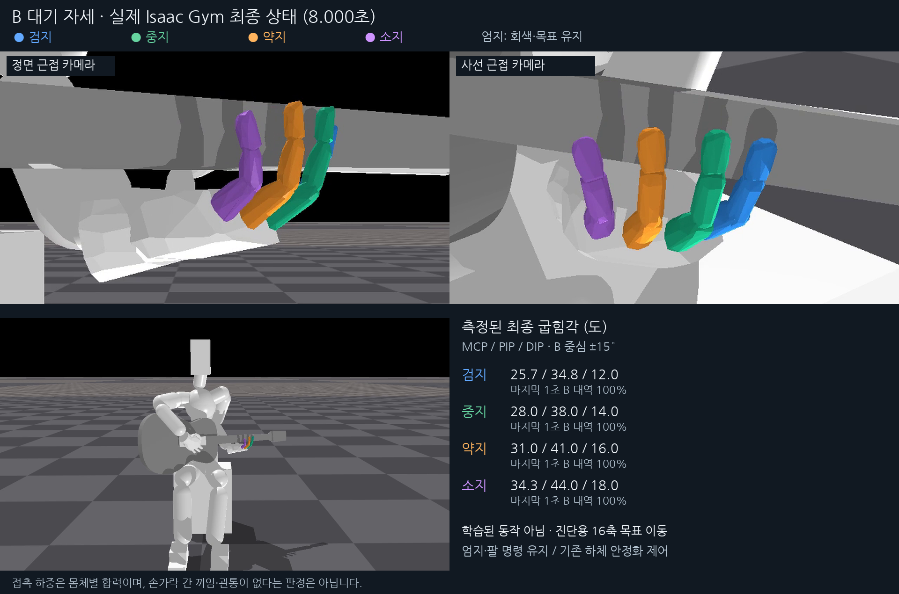

# B 대기 자세의 실제 Isaac Gym 도달 진단

새로 만든 단일 환경에서 준비된 초기 상태를 불러오고, 검지~소지의 16개 관절을 B 목표로 천천히 이동했다. 이는 학습된 정책의 동작이나 대기 보상만으로 얻은 복귀가 아니라, 선택한 B 자세 자체의 물리적 도달과 외형을 살펴보는 진단이다.

초기 1초 유지 → 4초 동안 B 목표로 이동 → 마지막 3초 목표 유지다. 엄지 목표와 팔의 정책 명령을 유지했고, 손가락 이외의 정책 행동은 0이다. 기존 하체 안정화 제어의 발목 목표 조정과 유한한 위치 제어, 자유 기타 물리를 사용했다. 자세를 매 프레임 덮어써서 연출하지 않았다.

[두 방향 근접 영상](standby_B_hand_views.mp4) · [전신 영상](standby_B_fullbody.mp4) · [최종 사진](snapshot.png)

## 측정 결과

| 손가락 | B 대역 최초 진입 | 마지막 1초 대역 내 비율 | 최종 MCP / PIP / DIP | 마지막 1초 최대 마디 합력 |
|---|---:|---:|---:|---:|
| 검지 | 1.942초 | 100.0% | 25.66 / 34.80 / 12.00 | 20.126 N |
| 중지 | 3.329초 | 100.0% | 28.01 / 38.00 / 14.00 | 0.000 N |
| 약지 | 3.637초 | 100.0% | 31.01 / 41.00 / 16.00 | 0.000 N |
| 소지 | 3.742초 | 100.0% | 34.32 / 44.00 / 18.00 | 0.000 N |

최종 16축 목표 대비 실제각 오차는 RMS **1.813도**, 최대 **6.290도**다. 마지막 1초 동안 네 손가락이 모두 B 대역에 머문 여부는 **예**다. B 판정은 보상에서 사용하는 실제 기하 굽힘각의 각 중심 ±15도이며, 각 관절의 native 목표각과는 구분한다.

네 손가락이 동시에 B 굽힘 대역에 처음 들어온 시점은 **3.741667초**다. 검지의 옆 벌림은 목표 **-14.00도**에 대해 실제 **-7.71도**였고, 마지막 순간 검지 가운데 마디에는 약 **20.11 N**의 합력이 남았다. 따라서 **B의 굽힘 형태에는 도달했지만, 16축의 정확한 목표 추종이나 편안하고 접촉 간섭 없는 자세까지 확인한 것은 아니다.** 접촉 상대는 현재 기록에서 특정할 수 없으며, B 벌림값과 손목 배치를 함께 추가 점검할 필요가 있다.

준비된 0초 상태 대비 기타 루트의 최종 이동은 **0.19 cm**, 회전은 **0.30도**이며, 실행 중 최대 이동은 **0.22 cm**, 최대 회전은 **0.34도**였다. 왼손 손바닥의 최종 이동은 **1.21 cm**, 회전은 **4.96도**였고, 실행 중 최대 이동은 **1.21 cm**였다. 이는 실제 native 월드 좌표계의 몸체 움직임이며, 팔의 정책 명령이 0이어도 실제 몸체가 완전히 고정된다는 뜻은 아니다.

직접 지정한 B native 목표는 검지 25/−14/35/12도, 중지 28/−3/38/14도, 약지 31/3/41/16도, 소지 34/10/44/18도다. 순서는 뿌리 굽힘 / 옆 벌림 / 가운데 굽힘 / 끝 굽힘이다. 옆 벌림은 이 진단에서 지정했지만 현행 B 보상에는 포함되지 않는다.

## 해석 범위

원본 영상은 Isaac Gym 카메라에서 물리 8회마다 직접 얻은 30fps 영상이다. 첫 영상 프레임은 0.0333초이며 마지막은 8.000초다. 보간한 손 자세나 새로 합성한 손 모양을 사용하지 않았다. 판정과 관절 오차는 영상의 30Hz가 아니라 전체 240Hz 물리 기록으로 계산했다.

손 근접 화면은 원본 1280×720 영상의 고정 영역을 잘라 같은 비율로 확대했다. 정면의 원본 좌표는 (360,120)–(1000,480), 사선은 (350,180)–(990,540)이며 영상 전체에 같은 영역을 사용했다. 전신 화면은 자르지 않았다. 원본 카메라 영상은 `native_run/raw_*.mp4`에 보존했다.

native 렌더러에서 시각용 지오메트리 로드 오류 6건이 기록되어 일부 기타 줄·프렛 모양이 표시되지 않았다. 해당 모양을 새로 합성하거나 그려 넣지 않았다. 이 자료의 목적은 손가락 대기 형태와 실제 도달을 확인하는 것이다.

마디별 하중은 rigid-body net force의 크기다. 접촉 상대를 식별하지 않으므로 특정 손가락끼리 끼었거나 관통하지 않았다고 확정하지 않는다. 한 번의 목표 제어 진단으로 B의 학습 복귀, 압현 영향, 모든 손목 위치에서의 자연스러움을 입증하지 않는다. 외형은 정면·사선·전신 영상을 함께 보고 판단한다.

[native 실행 기록](native_run/report.json) · [전체 측정](presentation_analysis.json) · [원시 240Hz 기록](native_run/physics.npz) · [실행 입력과 카메라](native_run/metadata.json)
    