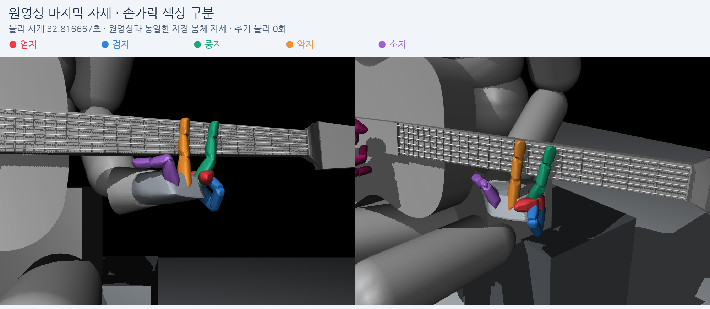

# 원영상 마지막 왼손 자세: 소지·검지·엄지

사용자가 지정한 A500 최종 왼손 영상의 마지막 저장 자세를 확인했다. 원영상과 같은 `evaluation_repeat1/env0`의 물리 시계32.816667초이며, 영상 파일 PTS는32.8초다. 추가 물리나 학습 없이 실제 저장된 몸체 자세를 손가락별 색으로 구분했다.

## 사용자 관찰과 기록의 대응

| 관찰 | 확인 결과 |
|---|---|
| 소지의 첫째·둘째 관절이90도, 마지막은 펴짐 | 실제 기하 굽힘은90.22 /90.00 /−5.00도다. native 목표도90 /90 /−5도다. 선택한 B의34.3 /44 /18도와 다르며, 정책이 이런 극단 조합을 요청한 상태다. |
| 검지가 중지 영역을 침범 | 검지의 기하 굽힘은−42.14 /90 /90도, 벌림 native 목표·실제는30도다. 원본 convex 형상 기준 검지 첫 마디와 중지 첫 마디가 교차한다. |
| 엄지가 넥 뒤 대신 중지와 겹침 | 원본 convex 형상 기준 엄지2·3과 중지1이 교차한다. 엄지의 기존 유한 표면 표본에서 넥 뒷면까지의 거리는 마지막에 약14.09mm다. |

엄지의 마지막 native 목표는 뿌리x/y/z=0/0/90도, 가운데0도, 끝90도다. 실제도 거의 같다. 따라서 이 모양 역시 명령과 무관한 갑작스러운 물리 이탈만으로 설명할 수 없다.

원본 convex 교차 LP의 교집합 내접구 반지름은 엄지2–중지1 약6.426mm, 엄지3–중지1 약3.470mm, 검지1–중지1 약0.497mm다. **이 수치는 관통 깊이가 아니다.** 원본 형상의 convex 외피에서의 교차이며, PhysX cooked 메시의 정확한 침투나 실제 접촉 쌍을 인증하지 않는다. 영상의 투영 겹침에 더해 원본3D convex 외피 교차도 있다는 근거로 해석한다.

엄지 거리 역시 기존 진단과 같은 유한 표본 기반이며, 연속 메시 전체의 정확한 최단거리나 접촉 판정이 아니다. 이 마지막 장면과 전곡을 구분해야 한다. 원래 에피소드 진단에서는 뒷면3mm 이내 표본이 전곡의8.74%,10mm 이내가18.38%였으므로 한 번도 넥 뒤에 접근하지 못했다고 하지는 않는다.

## 새로 확인된 핵심: 손가락끼리 충돌하지 않는 설정

원래 실행의 `visual_initial.json`에서 엄지·검지·중지·약지·소지의 실제1/2/3 마디15개 shape 필터는 모두 **128**이다. Isaac Gym은 두 shape의 `filterA & filterB == 0`일 때만 충돌을 허용한다. 따라서 **128 &128 =128**인 이 손가락 마디들은 서로 충돌하지 않는다. 서로 다른 손가락 마디 조합90개가 모두 이 조건에 걸린다.

이 값은 단순한 옛 문서의 설정값이 아니다. A500의 동결 `scene.py`와 현행 파일은 동일하고, 장면 생성 코드가 준비된 shape 필터를 native shape에 넣은 다음 readback이 같은지 검사한다. 환경 aggregate의 `self_collisions=True`도 이 개별 shape 필터를 해제하지 않는다.

즉, 정책이 손가락들을 교차시키는 목표를 내더라도 손가락끼리 접촉 반력이 생겨 막아 주는 설정이 아니다. **꼬임 문제를 보상만으로 설명하거나 대기 시간만 늘려 해결하려는 접근은 충분하지 않다.** 이 설정이 비정상 명령을 만들어 낸 원인까지 증명하는 것은 아니지만, 손가락 간 교차를 물리적으로 허용하는 경로는 확인됐다.

근거: [필터값·90개 조합·SHA](collision_filters.json), [설치된 SDK의 충돌 필터 설명](/home/ajou/yigyu/3/isaacgym/docs/_sources/programming/simsetup.rst.txt:176), [실제 shape 설정·readback 코드](/home/ajou/yigyu/3/guitar_learning/gpu/scene.py:183).

## 보상에서도 보완할 부분

- **소지·검지:** A500의 모양 보정 가중치는0이다. B는 대기 때의 약한 굽힘 권고이고, 누적 행동을 자동으로 되돌리는 제어가 아니다. 벌림과 손가락 사이 공간 배치를 평가하는 항도 없다.
- **엄지:** 넥 뒷면 거리의 진단은 있지만 **넥 뒤 유도 전용 보상은 실제18개 보상 원장에 없다.** B 보상도 엄지를 제외한다. 엄지 표면이 오압현에 기여할 때의 간접 감점이나 기타 안전에 미치는 영향까지 없다는 뜻은 아니다.
- **명령:** 원영상에서 소지 MCP/PIP는 계속 양의 방향, DIP는 계속 음의 방향이었다. 검지도 뿌리를 펴고 PIP/DIP를 굽히는 방향이었다. 앞선 [원영상 명령 분석](/home/ajou/yigyu/3/docs/2026-10-25/guitar_learning_v20_standby_diagnosis/selected_native_commands.json)과 일치한다.

## 다음 개선 순서

1. **선별적인 손가락 간 충돌부터 검증한다.** 서로 다른 손가락·엄지와 다른 손가락 사이를 우선 확인하되, 같은 손가락의 연속 마디와 손바닥 연결부의 기존 예외를 무작정 제거하지 않는다. 기존 초기 자세와 B에서 새 충돌이 폭발하거나 압현을 막지 않는지 별도 작은 환경에서 점검해야 한다.
2. **엄지 전용 넥 뒷면 유도를 실제 보상에 연결한다.** 손가락을 감싸 쥐도록 고정하지 않고, 뒤쪽의 넓은 영역과 가벼운 접근을 선호하도록 한다.
3. **극단적인 관절 조합과 대기 복귀를 구분해 개선한다.** 손가락 움직임 비용을 다시 부과하는 대신, 벌림·3D 공간 배치와 대기 중 돌아오는 행동을 평가한다.

이번에는 현상과 원인 경로만 확인했다. 충돌 필터·보상·제어·학습은 변경하지 않았다. 앞선 B 직접 목표 시험은 B 굽힘 자체의 도달 가능성을 보여 준 것이며, A500 정책의 마지막 자세가 정상이라는 의미는 아니다.

## 검증과 원자료

[분석 JSON](analysis.json)에 원영상 마지막 관절값·원본 convex 쌍·엄지 거리·입력SHA를 보존했다. 저장 몸체 자세의 렌더 readback 최대 위치 오차는0m, 회전 오차는약3.89×10⁻¹⁶rad다. 두 그림의 몸체 자세는 같고 카메라와 색상만 바뀐다. 렌더용 줄은 원래 저장된 논리 끝점을 사용했다. 손바닥을 중립색으로 정리하기 전의 초안과 소스는 `support/render_draft_v1/`에 보존했다.
