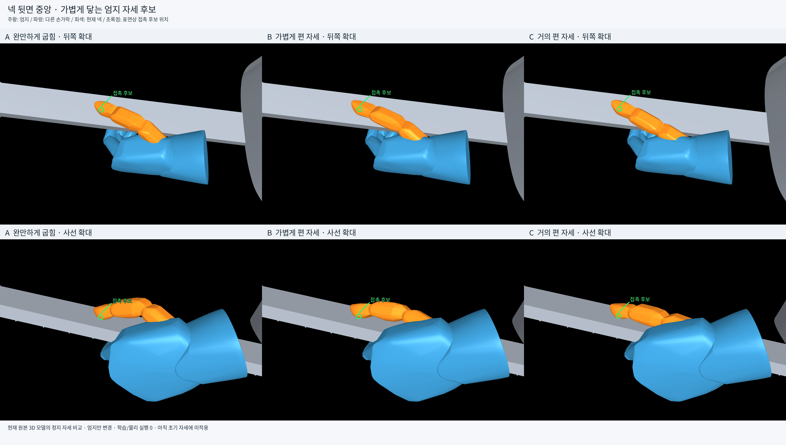

# 엄지–넥 뒷면 자세 선택용 미리보기

사용자 요청: 엄지가 넥 뒷면 중앙에 자연스럽게 가볍게 닿는 모습을 먼저 이미지로 비교하고 사용자가 선택한다. **학습하지 않고 기존 초기 자세에도 적용하지 않는다.** 작성일은2026-10-20이다.



| 후보 | 모습 | 엄지 중간 관절 굽힘 | 끝 관절 굽힘 | 원본 시각 메시의 넥 뒷면 간격 |
| --- | --- | ---: | ---: | ---: |
| A | 완만하게 굽힘 |44.71°|3.06°|0.200mm|
| B | 가볍게 편 자세 |22.74°|5.57°|0.200mm|
| C | 거의 편 자세 |5.92°|7.48°|0.211mm|

모든 후보의 접촉 후보점은 넥 폭의 중앙 `x≈0`이다. 손목·손바닥·다른 손가락·팔·기타는 같은 상태이며 엄지5관절만 다르다. 주황은 엄지, 파랑은 나머지 왼손, 회색은 실제 넥이다. 초록 원은 메시 표면의 후보점을 화면에 투영해 표시한 주석이다. 비교를 위해 다른 몸체는 숨겼다.

## 생성 범위

현재035/v14 준비 상태와 실제 프로젝트의 기타/손 원본 메시를 사용했다. saved native world body pose에서 엄지 체인의 관절 운동학만 계산해 MuJoCo의 정지 렌더러로 그렸다. Isaac Gym을 새로 실행하거나 물리를 적분하지 않았고 PPO·학습 업데이트는0회다. 그림을 생성형 이미지로 재구성하지 않았다.

넥 원본 메시의 해당 부분 실제 뒷면은 기타 좌표계 `z=-0.008m`다. 엄지3 원본 메시의 전체 꼭짓점 중 이 면에 가장 가까운 점을 확인하고, 다른 엄지 메시들도 면을 넘어가지 않도록 했다. 시각적 맞댐을 보기 위해 약0.2mm 간격을 둔 **정지 자세 후보**다. 실제 동적 접촉·압력·파지력이나 충돌 허용을 검증한 결과는 아니다. 원래 모델의 숨은 엄지 패드 캡슐과 시각 메시의 표면은 다르므로 이 간격은 원본 시각 메시 기준이다.

## 파일

- [뒤쪽 A](A_1.png), [뒤쪽 B](B_1.png), [뒤쪽 C](C_1.png)
- [사선 A](A_2.png), [사선 B](B_2.png), [사선 C](C_2.png)
- [A 관절·정지 상태](A_candidate.json), [B 관절·정지 상태](B_candidate.json), [C 관절·정지 상태](C_candidate.json)
- [생성·입력 해시·표면 검증](report.json), [학습 소스 불변 확인](source_unchanged.json)
- [재생성 스크립트](render_candidates.py), `probe_085.json`·`probe_090.json`·`probe_093.json`은 렌더에 사용한 자세 입력이다.

렌더 입력을 다시 읽어 해시 일치를 확인했고 기존 학습 Python404개도 이전 SHA와 일치한다. 후보는 이 디렉토리의 이미지·JSON에만 있으며 학습 설정·자산·기존 초기 상태는 변경하지 않았다.

```bash
MUJOCO_GL=osmesa PYOPENGL_PLATFORM=osmesa \
PYTHONDONTWRITEBYTECODE=1 PYTHONPATH=/home/ajou/yigyu/3 \
/home/ajou/miniconda3/envs/rl38/bin/python -B \
/home/ajou/yigyu/3/docs/2026-10-26/thumb_neck_preview_v1/render_candidates.py
```

이 명령은 이 미리보기 디렉토리의 출력 이미지를 재생성한다. 기존 실험 결과나 학습 모델을 수정하지 않는다.
