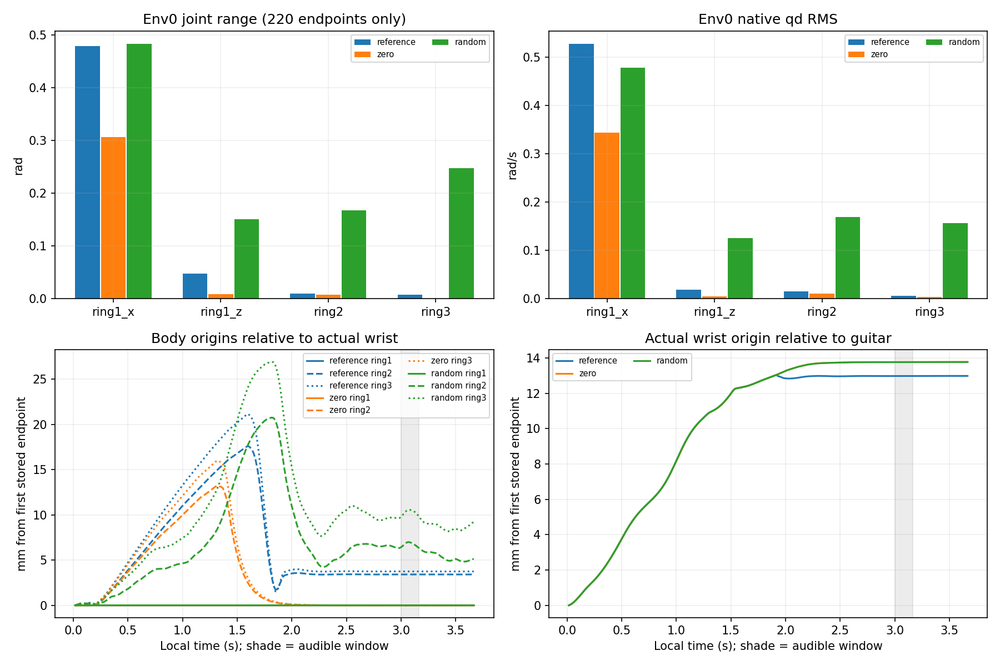

# 현재557 약지 scripted 대조: 실제12시도

| 조건 | 달성/4 | clean | wrong | missing | 물리/손목 실패 |
|---|---:|---:|---:|---:|---:|
| reference | 4 | 1.000 | 0.000 | 0.000 | 0/0 |
| zero | 0 | 0.000 | 0.000 | 1.000 | 0/0 |
| random | 0 | 0.000 | 0.000 | 1.000 | 0/0 |

현재 source54 약지 한 목표에서 reference는4/4·clean1, zero/random은0/4·clean0이다. 모든 조건의 wrong·물리 실패·손목 실패는0이다. 이 seed7/4환경의 한 평가에서 지원 제어만으로 성공했다고 볼 근거는 없으며, 약지 선택 행동을 추가한 조건에서 성공이 관찰됐다. 네 환경은 네 seed가 아니다.

전체12시도 원분모·원장 시간·9보상/비용 합·각4환경의 native PD105×10속성·16축 effort20→0.25와 다른89축 보존·90충돌쌍·scene close·실제종료0·542입력과 별도검수2문서 SHA를 확인했다. source54/row16·557/Jv3이며 과거561 결과를 상속하지 않았다. 교사의 세 CAS 경로 번역 외 모든 숫자는 원문과 같다.

## 실제 움직임 (env0)

| 조건 | 약지3 몸체의 손목 기준 최대 이동 mm | 손목의 기타 기준 최대 이동 mm |
|---|---|---:|
| reference | 0.000, 17.620, 21.167 | 13.042 |
| zero | 0.000, 13.227, 15.987 | 13.781 |
| random | 0.000, 20.767, 26.921 | 13.775 |

그림과 수치는 첫60Hz 저장 끝점부터 계산했다. 회색은 local3초부터 원음길이 0.1625초다. 실제 ring1/2/3 **몸체 원점**을 실제 손목 좌표로 회전·이동 변환했으며 패드 점이나 접촉 압력이 아니다. 손목의 기타 기준 이동은 별도다. 두 움직임의 비선형 경로 차이를 인과100% 분해나 성공 기여율로 해석하지 않는다. 그림의 선택4축 범위는220끝점만 포함하며 환경 요약은reset을 포함한221점이다. 원reset q/target을 더한 범위와 요약을 대조했다. 선택4축 q/target 범위·추종오차·native qd RMS와 전체4환경 motion summary는 analysis.json에 보존했다.

full67 raw 원장은 저장되지 않아 각4 compact에 남은 원누적 clean/wrong/missing 시간으로 재합산했다. q/target/qd/pose 상세는 env0 첫시도만 있다. 다른 환경은 저장된 motion summary다. 이번 재계산은 GPU/native/NN/모델load0이다.

원80%달성·70%clean·wrong10%이하·실패5%이하를 연속2평가하는 수용기준과 seed17/27·나머지 손가락·자유기타/J33·67음·RL·실제 해제 검증은 남아 있다. 이번 scripted 한 평가의4/4를 학습성과나 전체과제 성공으로 확대하지 않는다.
