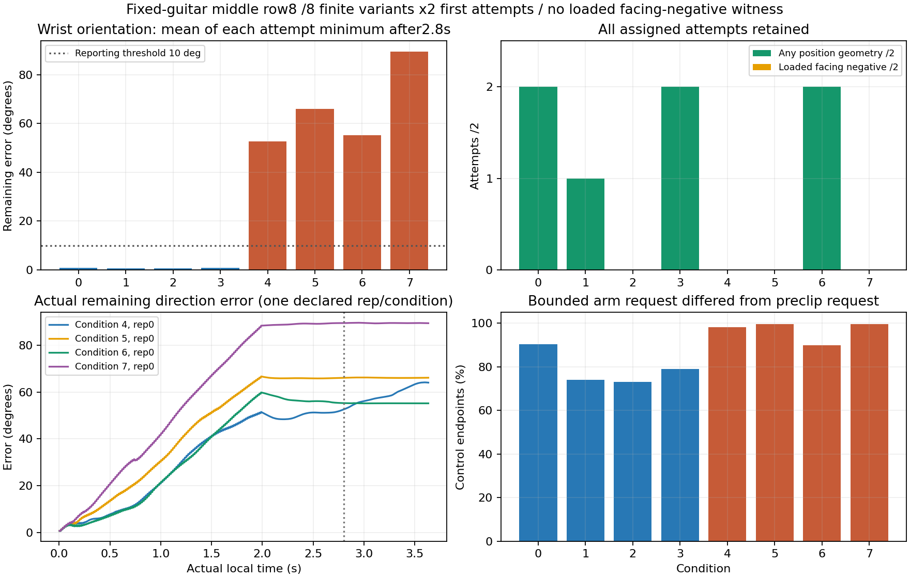

# 유한 방향 진단 실제 결과

사전 지정8조건×2개 첫 시도, **loaded back-facing witness0/16, 연속50ms witness0/16**이다. 물리·손목 실패는 각각0/16이고16개 모두 원래3.633333초를 끝냈다. 결과는 새 finite direction 조건의 관측이며, native 기하의 불가능 증명이나 학습·정책 성과가 아니다.

큰 방향 요청 조건4~7은 두 반복 모두2.8초 뒤에도 원래 선언한 방향오차10° 표시 범위에 도달하지 못했다. 최선의 잔여 오차가 약0.917/1.152/0.963/1.560rad(약53/66/55/89°)다. 조건6은 위치 기하가 있어도 같은 유효 표본의 facing이 남았고, 조건4·5·7은 위치 기하도 없었다. 따라서 ‘원하는 방향·위치·하중을 실제로 만들었는데 판정만 거부했다’는 사례를 확보한 것이 아니다.

## 실패 포함 고정 분모

| 조건 | 유한 목표 | loaded 음성 | ≥50ms | 방향≤10° | 반복별 최소 오차(rad) | 위치 노출 | 위치 endpoint 수 | facing endpoint 수 |
| --- | --- | --- | --- | --- | --- | --- | --- | --- |
| 0 | 원래 reference | 0/2 | 0/2 | 2/2 | 0.009/0.020 | 2/2 | 528 | 528 |
| 1 | clearance 대조 | 0/2 | 0/2 | 2/2 | 0.008/0.014 | 1/2 | 3 | 3 |
| 2 | x/PIP/DIP 하한 | 0/2 | 0/2 | 2/2 | 0.012/0.009 | 0/2 | 0 | 0 |
| 3 | DIP 상한 | 0/2 | 0/2 | 2/2 | 0.015/0.015 | 2/2 | 248 | 248 |
| 4 | u +90° | 0/2 | 0/2 | 0/2 | 0.917/0.918 | 0/2 | 0 | 0 |
| 5 | u −90° | 0/2 | 0/2 | 0/2 | 1.153/1.152 | 0/2 | 0 | 0 |
| 6 | v +90° | 0/2 | 0/2 | 0/2 | 0.963/0.963 | 2/2 | 1411 | 1411 |
| 7 | v −90° | 0/2 | 0/2 | 0/2 | 1.560/1.560 | 0/2 | 0 | 0 |

방향 오차는2.8초 이후 각 첫 시도의 최소값이고10°는 사전 선언한 설명용 표시 문턱이다. native contact·성공·실패 기준을 완화하지 않았다. 위치/facing endpoint 수는16개 첫 시도의240Hz 시점 수이며 준비 구간을 포함한다.128개 pad 표본 수나 episode 수와 혼동하지 않는다. 모든 조건의 배정 분모2를 유지했으며, 실패 뒤 표본은 같은 실패240Hz 시점부터 제외한다. 이번에는 실패가 없어 제외 표본도0개다.

## 원인 구분

- 방향: 원래 방향을 유지한 조건0~3은8개 모두10° 이내였으나 ±90° 요청 조건4~7은8개 모두 미도달이었다. 요청이 실제90° 회전으로 실행되었다고 간주하지 않는다.
- 위치: 조건2는 방향 추종과 별개로 위치 노출0/2였다. clearance 대조 조건1도 위치 노출이1/2에 그쳤다. 이 유한 접근/선택 관절 자세에서 목표 cell에 닿지 않은 사례가 있으며, 원래 cell/높이 문턱을 바꿔 보완하지 않았다.
- same-point facing: 위치 기하가 나온 모든 시점은 원래 facing도 남았다. 전체13,952개 실제 첫 시도 endpoint에서 `position=true & facing=false`가0개다. 따라서 geometric-negative-but-unloaded 역시0개이며, 이번 음성 미확보를 단순히0.01N 하중 부족 탓으로 분류하지 않는다.
- bounded control: 큰 방향 요청의 arm request는 preclip 요청과 약90~100%의 control endpoint에서 달랐다. 이는 원래 보정 누적·변화율·action 범위 제약을 적용한 흔적이며, PD/힘을 바꿔 회전을 강제하지 않았다. 이 clip 표시만으로 native 관절 한계 하나나 solver 오류를 원인으로 확정하지 않는다.

원래 대조 조건0의 음악 달성은1/2, 조건6은2/2였지만, 후자는 요청 방향을 달성하지 못한 상태에서 facing positive를 유지한 결과다. 이를 facing-negative 시험의 성공으로 재분류하지 않는다. 원래 note ledger·clean·9항 보상은 [cases.json](cases.json)에 모두 보존했다.

## 독립 검산·실행 종료

기존 driver의 summary/helper를 호출하지 않고 저장 point/normal과 원래 줄·프렛·press plane에서 same-sample 위치/facing을 다시 계산했다. 모든 point-level mask가 일치했다. 할당 distal force는 성분 부호가 아닌 벡터 norm으로 다시 계산했고, `first_attempt & ~failed & position & ~facing & norm≥0.01`을 적용했다. 별도 순차 알고리즘으로 clock+1·인접 표본을 요구하는 최대 연속 span을 계산해16개 원 보고서와 일치했다.13개 endpoint의 `(last−first)/240≥0.05초` 조건은 그대로다.

저장 distal/guitar pose와 봉인한 등록 palmar sample에서 point/normal도 독립 재구성했다. point 최대오차1.04e-07m, normal 최대오차5.75e-07, 실제 wrist pose의 quaternion geodesic 방향오차 차이는 최대4.07e-07rad다. 저장된 실패 mask는 원래 physical/wrist flag를 동일240Hz 시점부터 latch하는 연산과 일치했다. 다만 이번 실제 실패는0개여서 실제 실패 발생 시의 차단 사례가 추가로 확보된 것은 아니며, 그 경계 동작은 기존 CPU 검사로 확인한 범위다. 유효 witness 뒤의 늦은 episode 실패가 이전 witness를 없애지는 않으며 무실패 episode 부분집합은 별도다.

실제9항 보상은60Hz 증분·누적·episode 원장 합과 비교했고, contact/hold/achievement/wrong/performance의 원래 ledger 기반 예산식을 검산했다. 최대오차4.62e-07로5×10⁻⁶ 이내다. 물리872endpoint/제어218tick,4substeps/control·finite·연속 clock·16첫시도·원 실행14audit와 현재 입력 pin685개·raw SHA가 통과했다. 모델/버퍼 동일과 updates0은 원 실행 audit에 있으며 CPU 분석에서 GPU 모델을 다시 실행하지 않았다.

launcher exit **0**, wall **35.960초**가 [run_01_launcher.json](../run_01_launcher.json)에 보존되어 있다. 원래 GPU scene final은 closed=true,1simulator/16환경이다. raw·precommit·driver·활성 소스는 변경하지 않았고 GPU를 재실행하지 않았다. 검산 값과 파일 SHA는 [verification.json](verification.json), 조건별 기계 판독 표는 [conditions.csv](conditions.csv)에 있다.

## 해석 범위

이8개 유한 목표·2개 반복·원래 시간창에서 loaded 음성을 확보하지 못했다. 방향 요청 미도달과 위치 미도달을 분리할 근거가 생겼지만, 모든 native 가동범위·가능한 접근 궤적에서 그런 음성이 불가능하다는 뜻은 아니다. 회전이 더 가능한지, 반대편 mesh가 넥과 가까워지는지, 실제 접촉 상대가 기타인지도 별도의 문제다. 등록 palmar 표본의 facing 음성과 실제 피부 뒷면 접촉을 동일시하지 않는다.

할당 중지 distal의 관측 resultant 최대는50.882N이었다. 이는 이번16환경의 해당 몸체240Hz resultant에 한정되며 actuator force cap·접촉 pair·실제 현 압력을 뜻하지 않는다. 전체 몸체 force가 없으므로 이전212N 문제의 해결이나 전체 몸체 최대값을 주장하지 않는다. 문턱·PD·힘·원자료를 바꾸지 않고 미확보 상태를 유지한다.
