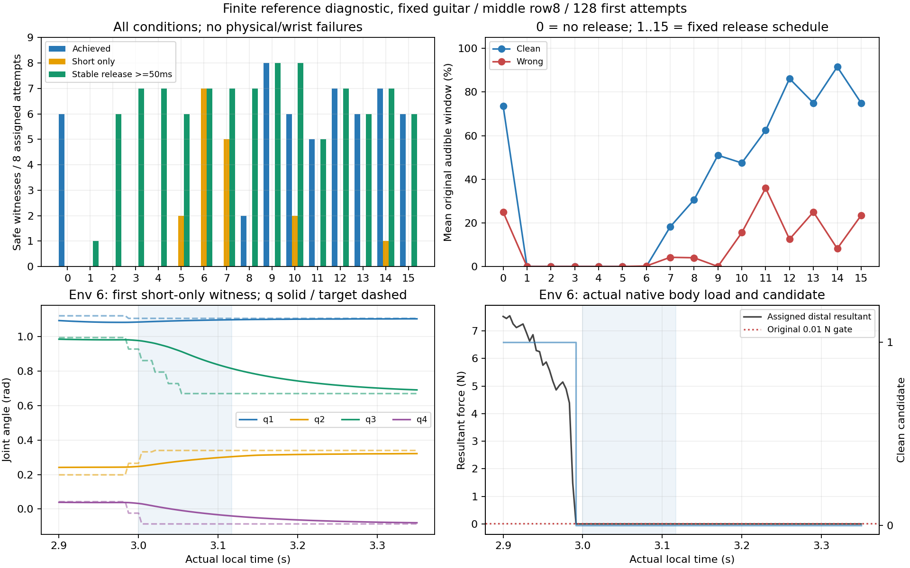

# 실제 시계 짧은 접촉·해제 진단 결과

고정 기타·중지 row8의 사전 지정128개 첫 시도에서 **짧은 접촉만17/128, 연속50ms 이상 해제 관측95/128, 음악 달성53/128**을 확보했다. 세 범주는 겹치므로 합산하지 않는다. 짧은 접촉만17개 중16개에는 연속50ms 이상 해제 관측도 있다. 물리 실패0/128, 손목 실패0/128이다. 이는 봉인한 reference를 유한 제어한 진단이며 정책 학습 성과·자유 기타 성능·실제 현 압력 인증이 아니다.

## 조건별 결과

조건0은 reference 유지, 조건1~15는 사전 지정 시간에 중지4축만035 목표로 회수한다. 아래 성공 분자는 물리·손목 실패를 제외하고 분모는 배정된8개를 그대로 쓴다. 이번에는 실패가 없어서 제외되는 사례가 없다. 기타·팔 안내·다른 손가락 B·범위·PD·보상·판정은 원래 계약을 유지했다. 회수 시점은 다음60Hz endpoint 기준이며 실제 회수 요청과 상태는240Hz 원자료에 기록했다.

| 조건 | 회수 요청(s) | 달성 | 짧은 접촉만 | 해제≥50ms | 평균 clean(%) | 평균 wrong(%) | 최대 해제 span의 중앙값(ms) |
| --- | --- | --- | --- | --- | --- | --- | --- |
| 0 | 유지 | 6/8 | 0/8 | 0/8 | 73.7 | 25.0 | 0.0 |
| 1 | 2.90 | 0/8 | 0/8 | 1/8 | 0.0 | 0.0 | 0.0 |
| 2 | 2.92 | 0/8 | 0/8 | 6/8 | 0.0 | 0.0 | 650.0 |
| 3 | 2.94 | 0/8 | 0/8 | 7/8 | 0.0 | 0.0 | 635.4 |
| 4 | 2.96 | 0/8 | 0/8 | 7/8 | 0.0 | 0.0 | 616.7 |
| 5 | 2.98 | 0/8 | 2/8 | 6/8 | 0.0 | 0.0 | 593.8 |
| 6 | 3.00 | 0/8 | 7/8 | 7/8 | 0.0 | 0.2 | 593.8 |
| 7 | 3.02 | 0/8 | 5/8 | 7/8 | 18.2 | 4.2 | 554.2 |
| 8 | 3.04 | 2/8 | 0/8 | 7/8 | 30.6 | 4.0 | 541.7 |
| 9 | 3.06 | 8/8 | 0/8 | 8/8 | 51.0 | 0.0 | 525.0 |
| 10 | 3.08 | 6/8 | 2/8 | 8/8 | 47.5 | 15.5 | 508.3 |
| 11 | 3.12 | 5/8 | 0/8 | 5/8 | 62.4 | 35.9 | 458.3 |
| 12 | 3.14 | 7/8 | 0/8 | 7/8 | 86.2 | 12.5 | 445.8 |
| 13 | 3.16 | 6/8 | 0/8 | 6/8 | 75.0 | 25.0 | 433.3 |
| 14 | 3.18 | 7/8 | 1/8 | 7/8 | 91.6 | 8.2 | 412.5 |
| 15 | 3.22 | 6/8 | 0/8 | 6/8 | 75.0 | 23.4 | 366.7 |

원음 press2.9787s, onset3.0s, end3.1174s, audible 길이117.4ms, 연속 달성 문턱50ms다. 짧은 접촉만은 최종 `0<contact_progress<1`, 원 press..end 창 안의 실제 중간 progress, 최종 미달성을 모두 요구했다. 준비 창에서만 짧게 접촉하면 clean·hold 보상은0일 수 있으며, 그 자체를 짧은 접촉의 정의로 사용하지 않았다. 조건7의 일부는 contact_progress=1이어도 연속 audible clean50ms에 못 미쳐 달성되지 않았다.

해제는 실제 회수 요청 후 candidate true→false를 관측한 다음, candidate 없음·원래 pad 위치 기하 없음·할당 말단 합력<0.01N이 연속되는 구간으로 계산했다. 보수적 span은 `(마지막clock−첫clock)/240`이며13개 연속 endpoint부터50ms다. 한 표본 동시 증거도95/128로 같은 수였지만, 그 사실만으로50ms를 가정하지 않고 NPZ에서 연속 구간을 별도 재계산했다. native note의 `released`는27/128이다. 이 flag는 원래 음 종료 뒤0.1초 안의 candidate 소실만 기록하므로, 음 종료 전에 실제로 회수된 사례에는 false가 남을 수 있다.

## 실제 구간·관절·부하 예

아래 사례는 사전 지정 전체 분모를 바꾸지 않는 설명용이다. env6은 결과에서 처음 확인된 짧은 접촉만 사례이며, env9는 달성과 해제가 함께 있는 예다. 전체128개 값과 q4/목표 변화 범위는 [cases.json](cases.json)에 모두 남겼다. 그래프는 env6의 실제 q4와 유한 목표를 함께 표시하며 상태를 덮어쓴 궤적이 아니다.

- env6 / 조건6: contact_progress=0.176000, clean=0.000ms, best clean streak=0.000ms, 달성=False. 실제 연속 해제 관측 clock729→872 (3.037500→3.633333s), span=595.833ms. 그 구간 말단 합력 최대0N, 표면거리3.491→16.614mm. contact/hold/achievement 보상=0.044000/0.000000/0.000000.
- env9 / 조건9: contact_progress=1.000000, clean=54.167ms, best clean streak=54.167ms, 달성=True. 실제 연속 해제 관측 clock746→872 (3.108333→3.633333s), span=525.000ms. 그 구간 말단 합력 최대0N, 표면거리3.735→16.420mm. contact/hold/achievement 보상=0.250000/0.461386/0.250000.

## 실제 보상 원장 검산

선택된 원음1개·존재 손가락1개이므로 균형계수b=1이다. 모든128개에서 원장과 실제9개 누적 보상·60Hz 증분 합을 대조했다. 접촉=`0.25×contact_progress`(상한0.25), 유지=`clean/D`(상한1), 달성=`0.25×left`(한 번), wrong=`−0.15×wrong/D`(하한−0.15), 부족=`−0.10×max(missing/D, 1−best_clean_streak/required)`(하한−0.10)를 확인했다. 최초접촉 보상을 반복 지급하거나 부족 정산을 중복 가산한 초과는 없었다. raw240Hz 인접 candidate와 원래 창 overlap으로 clean/wrong/missing·접촉 progress·streak도 독립 적분했다. 검산 최대오차는 [verification.json](verification.json)에 항목별로 기록했으며 모두5×10⁻⁶ 미만이다.

| 실제9항 | 최소 | 최대 |
| --- | --- | --- |
| `song_left_approach` | -0.320069 | -0.259549 |
| `song_left_contact` | 0.000000 | 0.250000 |
| `song_clean_hold` | 0.000000 | 1.000000 |
| `song_left_success` | 0.000000 | 0.250000 |
| `song_wrong_press` | -0.150000 | 0.000000 |
| `song_performance_deficit` | -0.100000 | 0.000000 |
| `song_finger_standby` | 0.049115 | 0.049284 |
| `song_thumb_support` | 0.020375 | 0.028250 |
| `action_change` | -0.000072 | -0.000058 |

standby·thumb는 원래0.02/s 상한, action_change는 비양수임을 확인했다. 접근 보상은9항 합과60Hz 증분/누적 원장 일치까지 확인했다. Φ0와 reset potential을 기록하지 않았으므로 별도의 PBRS telescoping 입증을 주장하지 않으며, 비할인 접근 보상 합을 기하 접근 품질 지표로 해석하지 않는다. 모든 음 성공/실패·정상 미달성·회수 실패를 [condition_summary.csv](condition_summary.csv)와 전체 원장에 포함했다.

## 무결성·실행 종료 및 남은 범위

독립 NumPy 재계산128개에서 짧은 접촉·한 표본 해제·최대 연속 span·50ms flag가 원 보고서와 모두 일치했다. 실제872개 물리 endpoint /218개 제어 tick, 정확히4 substeps/control, 유한 값, 연속 시계,12개 원 실행 audit를 확인했다. 현재 입력 pin679개와 원자료 SHA를 다시 확인했고 원파일은 수정하지 않았다. 체크포인트 모델/버퍼 동일·업데이트0·GPU 장면1개/128환경·장면 종료 true가 원 실행 보고서에 남아 있다.

원 실행 wall=33.414s. 도구 세션64709가 최종 poll 전에 만료되어 **launcher exit code는 수집하지 못했다**. `Unknown process id`를 호스트 재부팅으로 해석하지 않는다. 호스트 boot가 같다는 root 확인과 별개로, 원 report·실제 NPZ·GPU scene final의 완료/종료를 독립 확인했다. 이 도구 종료 수집 한계는 유지하며 재실행으로 덮지 않았다.

추가 CPU 조사로, 기존 negative audit에 미리 선언된 `할당 말단 합력≥0.01N & pad 위치 기하=true & 같은 유효 표본의 facing 기하=false` 조건을 이번 캡처 전체에 적용했다. 이는 release 결과를 사전에 지정한 조건이라고 소급하지 않는 **캡처 후 분석**이다. 전체111,616개 첫 시도 표본, 원 press..end 안4352개 endpoint, audible 창 안3712개 endpoint에서 일치0개였다. 원래 적분 창과 양의 overlap을 갖는 구간도 따로 검사했으며0개였다. 저장된 중지 말단·기타 pose와 봉인된 palmar pad 표본·원래 줄/프렛/평면에서 기하·facing을 독립 재구성했고, 전체 표본에서 두 flag 불일치0개·거리 최대오차4.20×10⁻⁸m였다. 따라서 `(clock,env_id)`순 첫 qualifying witness는 없다. 자세/힘/판정 문턱을 만들어 채우지 않았다. 자세한 분모와 입력 SHA는 [facing_negative_audit.json](facing_negative_audit.json)에 있다.

이번 결과로 실제 악보 시계의 짧은 접촉·후속 유한 해제 증거는 확보했다. 잘못된 패드 방향(facing-negative)을 별도 도달·통제한 사례는 아직 없다. 잘못된 줄/프렛·다른 손가락 간섭·모든 손가락 대표 음의 검증이나 전곡 전환이 완료됐다는 뜻도 아니다. GPU 말단 합력은 접촉 상대 pair를 특정하지 못하며, pad 기하·candidate·하중 소실을 실제 현 압력·진동·소리의 인증으로 확대하지 않는다.
