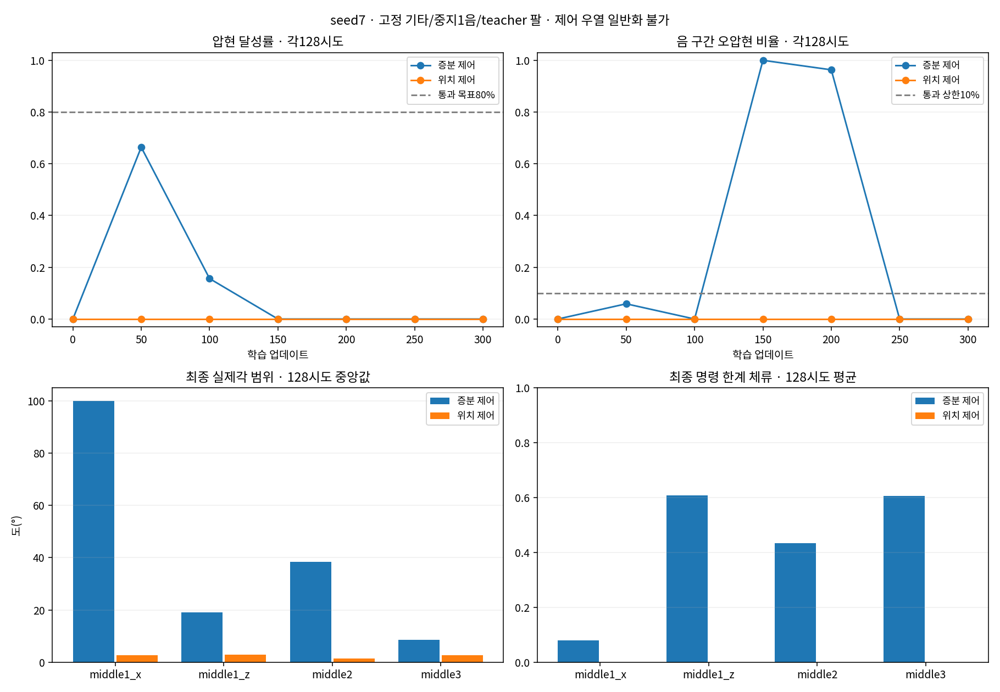

# seed7: 증분·위치 제어 300회 비교

두 방식 모두 계획한 통과 기준에 미달했다. 증분 제어는 50회 정책에서 압현을 학습했지만 이후 후퇴했고, 위치 제어는 이번 조건에서 압현이 발생하지 않았다.

같은 large·128환경·H32·K1·300회·seed7, 원곡 중지 한 음, 2초 유한 손목 teacher 및 다른 손가락 B를 사용했다. 시작부터 준비 구간도 학습했다. 설정 차이는 제어 방식과 사전 교정 std 두 항목뿐이며, 각 항목의 상위/하위 기록을 합쳐4개 키다. 기본 학습 소스와 입력은 바꾸지 않았다.

한 tick 목표각 변화의 RMS를 맞춘 std(.171171/.01)는 장기간 누적 탐색이나 실제 물리 응답을 같게 하지 않는다. 따라서 결과를 제어 방식의 일반적 우열로 해석하지 않는다.

| 정책 시점 | 증분 달성/128 | 위치 달성/128 | 증분 clean | 위치 clean | 증분 wrong | 위치 wrong |
|---:|---:|---:|---:|---:|---:|---:|
| 0 | 0 | 0 | 0.000 | 0.000 | 0.000 | 0.000 |
| 50 | 85 | 0 | 0.663 | 0.000 | 0.059 | 0.000 |
| 100 | 20 | 0 | 0.186 | 0.000 | 0.000 | 0.000 |
| 150 | 0 | 0 | 0.000 | 0.000 | 1.000 | 0.000 |
| 200 | 0 | 0 | 0.000 | 0.000 | 0.963 | 0.000 |
| 250 | 0 | 0 | 0.000 | 0.000 | 0.000 | 0.000 |
| 300 | 0 | 0 | 0.000 | 0.000 | 0.000 | 0.000 |

각 행은128환경의 첫 시도 전부다. 학습 각각5,632 완료 에피소드와 평가 각1,280시도에서 물리·손목 종료는0이었다. 최고 저장 정책인 증분50회도 달성66.41%·clean66.30%로 기준80%·70%에 못 미친다. 연속 두 평가 통과 조건도 충족하지 않는다.

| 대조 | 증분 달성/128 | 위치 달성/128 |
|---|---:|---:|
| 초기 policy | 0 | 0 |
| 초기 zero | 0 | 0 |
| 초기 random | 6 | 0 |
| 초기 reference | 108 | 76 |

Script reference는 손가락까지 정해진 동작으로 제어한 도달 대조이며 정책 학습 성과가 아니다. 증분 reference의 clean/wrong은85.12%/14.13%, 위치는58.76%/32.00%다. 둘 다 완벽하지 않다. 사전 지정env0의 선정4축 목표각 차이는 최대8.54e−7°이나 실제각은2.516°, 손목 feedback 팔 요청은9.33° 차이가 났다. 작은 초기 차이 이후 실제 물리가 분기한 관측이며 원인을 확정하지 않는다. 상세 비교는 comparison.json에 있다.

증분 std는 약.171, 위치는 약.01로 거의 유지됐다. 증분 최종은 준비 중 큰 누적 움직임과 명령 한계 체류, 위치 최종은 선정4축 실제 움직임 범위 중앙값 약1.5~2.95°와 한계 체류0을 보였다. 둘 다 단순한 제어 정지로 설명되지 않는다. 평균 출력과 std 전체는 두 실행의 analysis/policy_drift.json에 있다.

증분50회 에피소드 보상+.75780보다 최종−.03625가 낮고, 위치도 초기−.19323에서 최종−.20927로 개선되지 않았다. 보상 수식의 즉시 점수만으로 학습 후퇴의 원인을 확정하지 않는다. 저장된 checkpoint의 갱신 방향·가치 추정·시간축 보상 전달을 점검할 자료를 인계했다. 새seed17 학습은 하지 않았다.

이 결과는 고정 기타·한 목표·한 seed·teacher 조건에 한정된다. 자유 기타나 곡 단위 성공, 네 손가락 전체 성능을 의미하지 않는다. 이전 증분 retry1은 호스트 재부팅으로 중단돼 원자료를 보존했고, 동일 조건 fresh retry2에서 수행했다.

