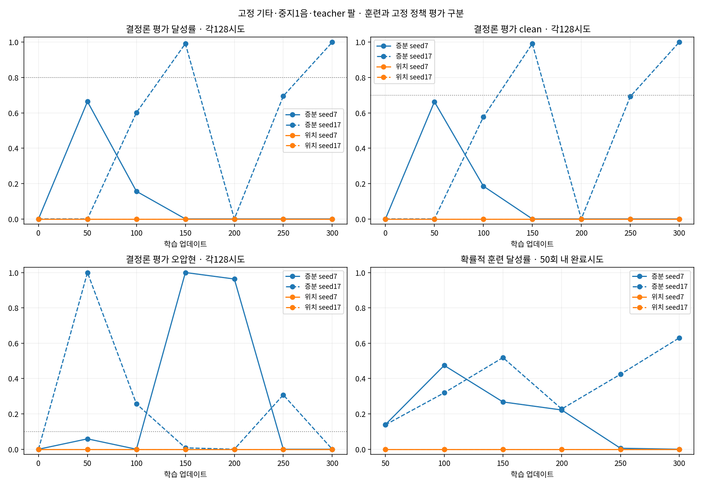

# seed7/17 고정 과제 반복 비교

각 실행은 large·128환경·H32·K1·300회, 동일 원곡 중지 한 음·고정 기타·2초 유한 손목 teacher·나머지 손가락 B 조건이다. 제어 방식별 사전 교정 std는 증분.1711710545, 위치.01이며 보상·물리·입력·학습 코드를 변경하지 않았다.

**훈련은 확률적 행동 수집, 평가는 결정론적 평균 정책이다.** 훈련 표는50회 동안 서로 다른 갱신 시점에 완료된 에피소드이므로, 저장된 단일 정책의128시도 평가와 같은 표본으로 취급하지 않는다.

| 조건 | 초기/50/100/150/200/250/300 달성(각128) | 단일 기준 충족 | 연속2회 통과 |
|---|---|---|---|
| incremental_seed7 | 0 / 85 / 20 / 0 / 0 / 0 / 0 | [] | False |
| incremental_seed17 | 0 / 0 / 77 / 127 / 0 / 89 / 128 | [150, 300] | False |
| position_seed7 | 0 / 0 / 0 / 0 / 0 / 0 / 0 | [] | False |
| position_seed17 | 0 / 0 / 0 / 0 / 0 / 0 / 0 | [] | False |

단일 기준은 달성≥80%, clean≥70%, wrong≤10%, 물리 실패≤5%이며 사전 지정한 연속 두 평가를 요구한다. 실패 시도를 분모에서 제외하지 않는다.

| 조건 | 훈련 달성/완료 | 최종 latent std 4축 | 최종 실제각 범위 중앙값4축(°) |
|---|---:|---|---|
| incremental_seed7 | 1028/5632 | 0.171077, 0.171235, 0.171238, 0.171261 | 99.863, 19.084, 38.353, 8.608 |
| incremental_seed17 | 2170/5632 | 0.171160, 0.171303, 0.171230, 0.171012 | 50.323, 24.940, 38.251, 29.716 |
| position_seed7 | 0/5632 | 0.009981, 0.009998, 0.010001, 0.010005 | 2.704, 2.949, 1.494, 2.623 |
| position_seed17 | 0/5632 | 0.009995, 0.010004, 0.009997, 0.010008 | 2.950, 3.246, 1.772, 1.344 |

4축 순서는 middle1_x, middle1_z, middle2, middle3이다. std는tanh 이전 Gaussian이며 각도 변화량이 아니다. 실제/명령 native 한계 체류는 comparison.json에 별도로 저장했다.

| 조건 | 초기policy / zero / random / reference 달성(각128) | reference clean / wrong |
|---|---|---|
| incremental_seed7 | 0 / 0 / 6 / 108 | 0.8512 / 0.1413 |
| incremental_seed17 | 0 / 0 / 6 / 108 | 0.8512 / 0.1413 |
| position_seed7 | 0 / 0 / 0 / 76 | 0.5876 / 0.3200 |
| position_seed17 | 0 / 0 / 0 / 76 | 0.5876 / 0.3200 |

Script reference는 손가락도 정해진 동작으로 제어하는 도달 대조다. 정책 성과가 아니며, 두 제어 방식의 실제 물리 반응은 완전히 같지 않았다. 한tick 목표각 RMS 교정도 장기간 탐색·접촉 반응의 동등성을 보장하지 않는다.

증분seed17은150회127/128과최종128/128에 도달해 고정 과제의 압현 학습 가능성을 보였다. 그러나200회0/128,250회 오압현 증가와seed7최종0/128이 있어 성능 유지와seed 안정성은 미해결이다. 이번 관측만으로 제어 방식의 일반적인 우열이나 학습 후퇴의 단일 원인을 확정하지 않는다.

최종 압현100%는 손가락 움직임의 자연스러움이나 관절 한계 체류 문제의 해결을 증명하지 않는다. 실제각 범위와 한계 체류 통계는 준비를 포함한 전체 에피소드의60Hz 표본이며, 특정 음 구간의 움직임만 측정한 값이 아니다. 실제각과 명령각 한계 체류는 구분해서 읽어야 한다.

전체 곡·자유 기타·네 손가락 전체의 성과가 아니다. 정해진300회와10개 평가 외의 GPU 평가를 추가하지 않았다. 원자료와 입력 봉인은 각 실행 폴더에 보존했다.

