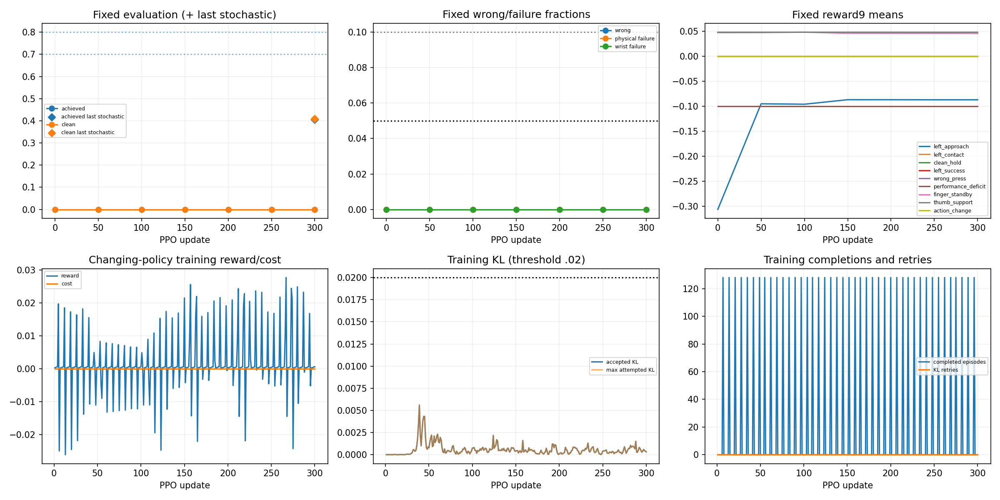
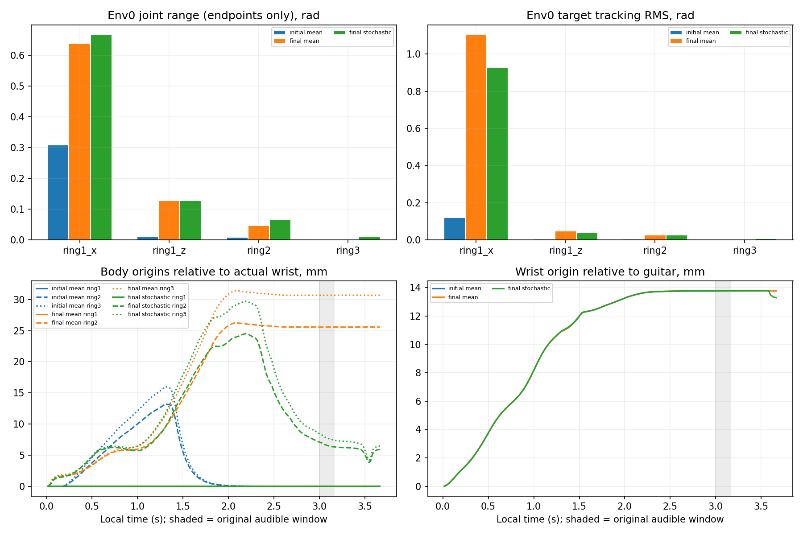

# 현행 약지 fresh300 실제 비교

| 평가 | 달성/128 | clean | wrong | 물리/손목 실패 |
|---|---:|---:|---:|---:|
| evaluation_000000 | 0 | 0.000 | 0.000 | 0/0 |
| evaluation_000050 | 0 | 0.000 | 0.000 | 0/0 |
| evaluation_000100 | 0 | 0.000 | 0.000 | 0/0 |
| evaluation_000150 | 0 | 0.000 | 0.000 | 0/0 |
| evaluation_000200 | 0 | 0.000 | 0.000 | 0/0 |
| evaluation_000250 | 0 | 0.000 | 0.000 | 0/0 |
| evaluation_000300 | 0 | 0.000 | 0.000 | 0/0 |
| evaluation_000300_stochastic | 52 | 0.410 | 0.000 | 0/0 |

선택4축의 전체128 첫시도 요약(시도별 동일 가중). RMS는 시도별 RMS의 평균·최대이며 전체끝점을 합친 RMS가 아니다. 한계 점유와 오차만으로 당시 형상이나 성공의 원인을 단정하지 않는다.

| 평가 | 실제 한계 mean/max | 목표 한계 mean/max | 추종 RMS mean/max rad | 추종 절대오차 max rad |
|---|---:|---:|---:|---:|
| evaluation_000000 | 0.0811612/0.331818 | 0/0 | 0.0314128/0.120284 | 0.311546 |
| evaluation_000050 | 0/0 | 0.626136/0.990909 | 0.328244/1.11416 | 1.44016 |
| evaluation_000100 | 0/0 | 0.676136/0.972727 | 0.374374/1.07174 | 1.3727 |
| evaluation_000150 | 0.245455/0.981818 | 0.893182/1 | 0.293695/1.10349 | 1.35107 |
| evaluation_000200 | 0.243271/0.977273 | 0.898864/1 | 0.293738/1.11208 | 1.35091 |
| evaluation_000250 | 0.24541/0.981818 | 0.923864/1 | 0.295716/1.10499 | 1.34842 |
| evaluation_000300 | 0.244318/0.977273 | 0.914773/1 | 0.293924/1.10477 | 1.34926 |
| evaluation_000300_stochastic | 0.114302/0.690909 | 0.524272/0.872727 | 0.249516/1.12596 | 1.34612 |

원80/70/10/5 기준의 연속2 고정평가: **미통과**. 해당 쌍: [].

학습은1,228,800전이·완료5504에피소드이며 진행 중 전이17920개를 별도로 남겼다. 학습 중 바뀌는 정책의 성과와 고정 저장본 평가를 합산하지 않는다. 평균 실제비용0, 최대 accepted KL0.00560427, 최대 attempted KL0.00560427, KL재시도0회다.

실제비용과 신경망의 비용예측/비용advantage는 별개다. 전체학습 raw cost advantage 범위는[-0.6076728701591492, 0.897710382938385], 업데이트 후 cost value 범위는[-0.6939424276351929, 0.672576367855072]다. 원fresh ShortPolicy의 비용head 기본초기화를 유지했으며 V7 비용head0 조건을 상속하지 않았다. V7과의 성과 우열이나 인과 비교를 하지 않는다.

선택 약지4축은 native64..67이다. 몸체 그림은 실제 ring1/2/3 원점을 실제 손목 frame으로 변환했으며 패드 접촉점이 아니다. 손목의 기타 기준 이동은 별도다. 첫60Hz 저장 끝점을 기준으로 하며 local3초부터 원음길이 0.1625초를 음영으로 표시했다. 그림의 q범위는 저장 끝점만 포함하므로 reset을 더한 환경 집계와 직접 동일시하지 않는다. 비선형 동역학의 경로 차이를 인과 기여율로 분해하지 않는다.

전체8평가×128첫시도·9보상/비용·원분모·실제11자식 종료0·입력불변·모든128환경의105×10 native readback과90충돌쌍을 확인했다. 분석은 CPU 수치처리이며 GPU/native/NN/모델load0이다. full67 raw 원장은 없고 compact의 원누적시간을 재합산했다. 상세 q/target/몸체는 env0뿐이다.

고정기타·유한 교사·source54 한 목표·학습seed7의 결과다. 마지막 확률 평가는 별도 정책잡음seed7이며 새 학습seed가 아니다. seed17/27·다른 손가락·실제 해제·loaded-facing negative·자유기타/J33·원67음과 영상 요건은 남아 있다. 생산 기본이나 보상을 이 분석에서 바꾸지 않았다.
