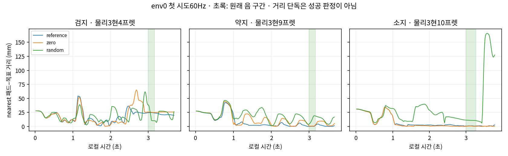

# 다른 세 손가락 실제 사전검사

**검지 reference는0/4로 현재 기준 도달을 먼저 해결해야 한다. 약지 reference는4/4이며 zero1/4다. 소지는 reference4/4·zero4/4로 선택 손가락 명령이 없어도 공통 팔 teacher 조건에서 이미 달성되므로 손가락 학습 증거가 아니다.**

원자료 선정·teacher/reference·성공 기준을 바꾸지 않고 root가 실행한12단계만 분석했다. bootstrap1업데이트는 초기값 생성용이며 모든 평가는 initial.pt만 사용했다. 아래36시도는 학습된 정책 평가가 아니라 reference/zero/초기 random 대조다.

| 손가락 | 조건 | 달성/4 | 음중 유지 | 음중 오압현 | 물리/손목 실패 |
|---|---|---:|---:|---:|---:|
| 검지 | reference | 0 | 0.00% | 0.00% | 0 / 0 |
| 검지 | zero | 0 | 0.00% | 0.00% | 0 / 0 |
| 검지 | random | 0 | 0.00% | 11.85% | 0 / 0 |
| 약지 | reference | 4 | 82.05% | 2.88% | 0 / 0 |
| 약지 | zero | 1 | 16.03% | 0.00% | 0 / 0 |
| 약지 | random | 0 | 9.62% | 18.91% | 0 / 0 |
| 소지 | reference | 4 | 82.37% | 0.00% | 0 / 0 |
| 소지 | zero | 4 | 87.09% | 0.00% | 0 / 0 |
| 소지 | random | 1 | 22.27% | 21.30% | 0 / 0 |

전체9평가의 배정4환경 첫 시도를 모두 포함했으며36시도는 모두 timeline_complete였다. 음악 유지/오압현/달성은 원래240Hz 음 원장이다. candidate의 전체4환경 시계열은 저장되지 않아 아래 candidate 수는 env0의60Hz 끝점으로 한정한다.

## env0 reference의 음 전·중·후

음 전은local t<3초, 음 중은3초≤t≤원래 end, 음 후는end 뒤다. 음 전에는 준비·접근 구간도 포함한다. 각 셀의 scalar는중앙값이며 JSON에는min/median/max와 zero/random의 같은 분해도 있다. 손목 오차는post-step 실제body pose와 해당 tick에 기록된 G목표의 차이다.

| 손가락 | 구간 | 끝점 | candidate / wrong | nearest거리 mm | distal합력 N | 손목위치 mm | 손목회전 도 |
|---|---|---:|---:|---:|---:|---:|---:|
| 검지 | 음 전 | 179 | 6 / 24 | 15.75 | 0.00 | 20.38 | 5.51 |
| 검지 | 음 중 | 11 | 0 / 0 | 24.64 | 30.99 | 47.60 | 12.11 |
| 검지 | 음 후 | 31 | 0 / 0 | 21.08 | 37.30 | 22.89 | 7.61 |
| 약지 | 음 전 | 179 | 74 / 3 | 3.70 | 11.45 | 10.39 | 3.88 |
| 약지 | 음 중 | 10 | 7 / 0 | 0.23 | 4.19 | 10.01 | 6.08 |
| 약지 | 음 후 | 31 | 19 / 0 | 0.84 | 8.38 | 9.22 | 5.19 |
| 소지 | 음 전 | 179 | 86 / 21 | 2.72 | 7.20 | 7.47 | 3.20 |
| 소지 | 음 중 | 17 | 11 / 0 | 0.99 | 5.27 | 4.84 | 3.78 |
| 소지 | 음 후 | 31 | 15 / 0 | 0.99 | 0.00 | 5.39 | 2.66 |

선택4축의 순서는1_x·1_z·2·3이며 다음은음 중 env0 중앙값(도)이다.

| 손가락 | actual q | target |
|---|---|---|
| 검지 | 30.09, 16.04, 53.74, 24.00 | 39.31, 27.76, 54.48, 24.07 |
| 약지 | 52.62, 15.16, 86.20, -4.99 | 56.65, 15.26, 89.62, -4.49 |
| 소지 | 86.28, -9.20, 24.64, -2.89 | 87.94, -10.37, 25.31, -2.65 |

검지 reference의 원래 음 길이는0.1703초다. 음 중 저장11끝점(3.000~3.1667초)에서 assigned distal loaded는11/11이지만 any-sample position gate는0/11, position+facing도0/11, positive-before-wrong와candidate도0/11, wrong도0/11이었다. 따라서 이 저장 끝점의 실패는 하중 gate 부재보다 목표의 유한 위치 gate 미충족으로 분리된다. 손목/선택관절 추종 오차가 함께 존재하지만 어느 제어·접촉이 이를 유발했는지는 확정하지 않는다.

nearest 패드거리·signed height·normal은 독립적으로 고른 가장 가까운 표본의 값이다. positive는 같은 한 표본이 lateral·프렛 내부·높이·facing을 모두 만족하고 assigned body가 loaded여야 한다. nearest 값을 any-sample witness로 사용하지 않았다. JSON의 any-sample gate는 원래 production helper의 반환값이다. facing0은 position을 포함한 gate이므로 방향 단독 실패라고 해석하지 않는다.

소지 zero의 선택4축 policy action과 전체 trace target 변동은 정확0이다. 그 조건에서4/4 달성되므로 선택 손가락 명령의 필요성이나 학습효과를 이 단음 과제로 입증하지 못한다. 공통 유한 팔/손목 teacher·엄지035·다른 손가락B·접촉 동역학이 함께 존재하므로 힘의 인과기여를 팔 하나로 확정하지 않는다. 약지4/4 대1/4 차이도4시도짜리 scripted 대조이며 RL 성과·일반 도달가능성으로 확대하지 않는다.

## 검증과 범위

root launcher 종료코드0·outer wall310.529007초, 12단계 완료와 scene 종료, 각 평가4분모·동일 initial checkpoint/설정·준비봉인·현재 입력 SHA를 확인했다. 판정 소스는 실제 실행의 SHA와 일치한다. 저장 q/body pose/force를 CPU ShortEnvironment._snapshot→_contacts→pad_target_geometry·wrong_press_sources에 넣어 9개 trace의 모든 저장 끝점 candidate/wrong/거리/높이를 재현했다. 함수 위치는 gpu/environment.py:501·547, gpu/simplified_finger_environment.py:117, gpu/fingertip_pad.py:177, gpu/wrong_press.py:21·46이다. joint qd는 미저장이라0으로 두었으며 이 기하·하중·wrong 판정에는 사용되지 않는다. body velocity는 보존했다. 새 물리 실행은 없다.

audit.json에는 9조건의 env0 음 전/중/후 실제·목표각·추종오차·거리·distal 합력·gate와 전체4시도의 원래 note 원장을 기록했다. pre-control wrist feedback 오차는 다음 목표에 대한 제어 전 값으로, 별도의 post-step 오차와 구분했다. validation.json은 모든 원자료/소스 SHA와 완료 검증, conditions.csv는 전체36시도 집계다. 전체4환경의240Hz 자세·힘 극값은 저장되지 않아 확대하지 않는다. body 합력은 접촉상대·현별힘·압력·음향·인과기여 인증이 아니다.

다음 분기는 검지의 현재 onset3초 조건에서 기준 도달/추종을 먼저 해결하고 같은 판정으로 재검증하는 것이다. 이 보고서는 target source 재선정·teacher 수정·새 성공 문턱을 채택하지 않는다. 기존 원자료의 static positive를 현재3초 조건 성공으로 상속하지 않으며, 소지의 팔 teacher 기준 단음 성공을 손가락 학습 성과로 옮기지 않는다. 기존 소스·봉인·원자료를 보존했고 분석 GPU 실행은0이다.
