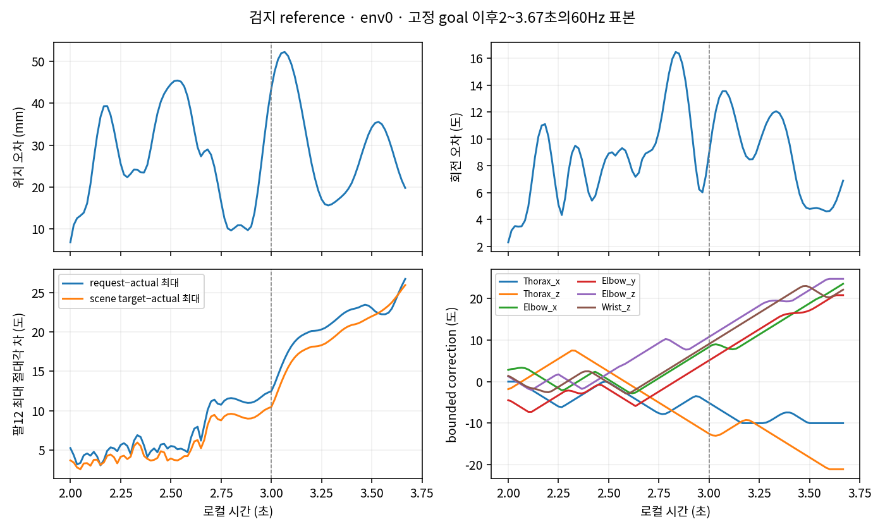

# 검지 reference: 고정 goal 뒤 추종 관찰

**단순히 오차가 계속 줄어드는 도착 지연은 아니다.** env0의2.0~3.6667초101개60Hz 끝점에서 위치·회전 오차가 반복 증감하고, 팔의 요청–실제각 차와 bounded correction이 커진다. 준비시간 연장만으로 해결된다고 말할 근거는 없다. 이 관찰로 제어 불안정성·도달 불가능성·접촉 원인 또는 특정 변경의 효과를 확정하지 않는다.

2초부터 기록된 손목 G목표는 source teacher의 고정 position/quaternion과 일치한다. 아래 오차는 같은 tick의 실제 native body pose와 그 고정 goal의 차다. pre-control feedback 오차와 섞지 않았다.

| 로컬 시각 | 위치오차 mm | 회전오차 도 | request−actual 최대 도 | scene target−actual 최대 도 |
|---:|---:|---:|---:|---:|
| 2.00 | 6.79 | 2.31 | 5.24 | 3.68 |
| 2.25 | 25.61 | 5.11 | 5.64 | 4.14 |
| 2.50 | 44.58 | 8.92 | 5.50 | 3.92 |
| 2.75 | 16.51 | 10.56 | 10.75 | 8.76 |
| 3.00 | 43.55 | 8.98 | 12.47 | 10.47 |
| 3.25 | 17.09 | 9.71 | 20.32 | 18.32 |
| 3.50 | 34.24 | 4.80 | 23.04 | 21.99 |
| 3.6667 | 19.76 | 6.90 | 26.74 | 25.95 |

위치오차 범위는6.79~52.26mm, 회전은2.31~16.48도다. 위치오차의 인접100쌍 중53회 증가·47회 감소한다. 이는 반복적인 추종 오차 반전을 보여주지만, norm만으로 목표를 어느 방향으로 넘었는지나 폐루프 안정성을 판정하지 않는다. 종료 뒤나 다른3환경의 같은 궤적은 저장되지 않았다.

팔 요청과 실제 scene 제출 target도 구분해야 한다. 전체 trace에서 `target[t] = target[t-1] + alpha*(request[t]-target[t-1])`가 최대잔차9.55e-8rad로 일치하며 alpha는 원래0.2다. 따라서 요청을 즉시 제출 target 또는 actual q로 취급하면 안 된다. 2초 이후 request−고정 arm feedforward는 저장 request에서 runtime의 desired-base 식으로 재구성한 bounded correction memory다. memory 자체를 독립 저장한 값은 아니다. 최대절댓값은2초6.05도→3초12.56도→3.6667초24.74도로 커졌다. 저장 delta는 DLS 결과를 먼저 ±0.5도/tick로 자른 뒤의 값이며, 이후 request rate/action bound clipping 전이다. 같은 구간에서 이전request+raw delta를 원래 action bounds로 clamp한 값과 다음request가 최대1.49e-8rad로 일치한다. 경계 바깥으로 correction이 무제한 누적됐다는 증거는 아니다.

| 팔 축 | request 하한/상한 체류 끝점 수 /101 | 최대 request−actual 도 |
|---|---:|---:|
| L_Thorax_x | 18 / 4 | 10.01 |
| L_Thorax_y | 0 / 3 | 19.20 |
| L_Thorax_z | 5 / 0 | 19.25 |
| L_Elbow_y | 0 / 3 | 14.98 |
| L_Elbow_z | 0 / 5 | 16.49 |
| L_Wrist_y | 41 / 0 | 3.97 |

이는 실제 계약의 finite action bounds와1e-6rad 이내 일치를 센 수치이며 새 gate가 아니다. scene target의 같은 경계 일치 수는 전 축0이다. actual q는 native bounds 기준으로 별도 집계했다. 예를 들어Thorax_x/y 상한 이상은21/20끝점, Wrist_y 하한 이하는25끝점이며 접촉·유한 native 제어의 읽기값이다. action bound 체류와 혼동하거나 새 실패로 재분류하지 않는다. 모든12축의 범위·gap·delta 부호·0.5도 raw cap 체류·native bounds는 observations.json에 있다. 토크·joint qd는 미저장이므로 gap의 원인을 확정할 수 없다.

source teacher는 row1의5.9166667초 actual q105로 만든 손목 pose다. 현재 nonarm q도 그 source와 동일하지 않다. 몸통9축의 현재−source 차이는 다음과 같다(2~3.6667초, 도).

| 축 | 차이 중앙값 | 차이 min~max |
|---|---:|---:|
| Torso_x/y/z | 0.11 / −0.01 / −0.52 | −0.82~0.26 / −0.35~1.73 / −1.31~−0.31 |
| Spine_x/y/z | −0.10 / −0.03 / 1.63 | −0.45~1.00 / −0.35~1.36 / −0.33~3.49 |
| Chest_x/y/z | 0.76 / 0.54 / 2.24 | −0.51~2.13 / −0.14~2.62 / −0.01~4.99 |

기존 prepared-calibrated full_fk에 **현재 전체 q105**를 넣어2초·3초의 실제 native 손목 pose와 대조했다. 위치오차는0.171/0.209µm, 회전오차는6.22e-7/6.58e-7rad로 일치했다. 따라서 이 두 표본에서는 현재 전체 자세와 손목 읽기값을 기존 FK로 비교할 수 있다. 다만 몸통 차이가 있는 상태에서 arm12만으로 같은 goal에 도달할 수 있는지, 몸통 차이와 feedback/접촉 중 무엇이 주원인인지는 IK·반사실 물리 검사를 하지 않았으므로 분리하지 못한다. 몸통 자세도 이후 진단에서 구분할 변수라는 근거만 남긴다.

원자료·함수·SHA는 observations.json, 계산은 analyze.py에 있다. runtime.py:134의 finite feedback과 wrist.py:44의 bounded target, control.py:399의 제출 경로를 읽었다. 원래 teacher/reference·메인6파일·소스·봉인·raw를 수정하지 않았고 GPU/새 IK를 실행하지 않았다. 다음 진단의 gain·시간·자세 조건을 이 문서에서 채택하거나 탐색하지 않는다.
