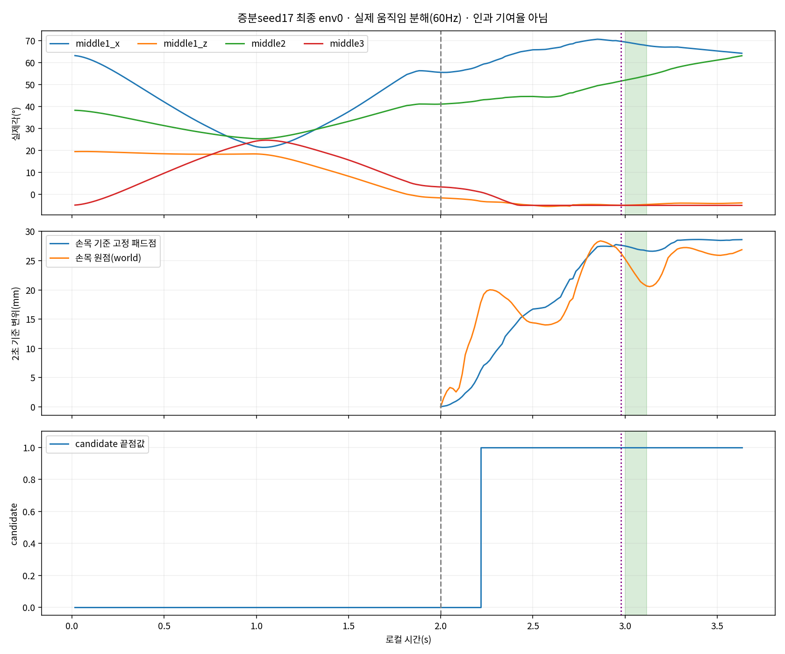

# 증분 seed17 최종 env0의 움직임 시점

기존218개60Hz 끝점만 분석했다. 새 물리 실행·warmup·상태 변경은 없다. q/target 범위와 패드 상대운동은 사전 지정env0 한 시도의 기하 기록이며 자연스러움이나 인과 기여율을 뜻하지 않는다.

선정축 순서: LH:middle1_x, LH:middle1_z, LH:middle2, LH:middle3.

| 구간 | 끝점 수 | 실제각 범위4축(°) | 명령각 범위4축(°) | candidate 끝점 수 |
|---|---:|---|---|---:|
| ramp_0_to_2 | 120 | 41.827, 21.124, 15.857, 29.572 | 44.835, 24.410, 18.869, 30.849 | 0 |
| settle_2_to_press | 58 | 15.141, 3.851, 10.258, 8.342 | 29.643, 16.132, 22.078, 8.370 | 46 |
| press_to_end | 9 | 1.809, 0.319, 2.357, 0.001 | 0.000, 0.000, 3.446, 0.000 | 9 |
| after_end | 31 | 3.352, 0.657, 8.771, 0.003 | 0.000, 0.000, 10.866, 0.000 | 31 |

구간은 (0,2], (2,press), [press,end], (end,마지막]이며 press=2.9787s/end=3.1174s다. 실제 첫 표본은1/60s이므로 reset t0의 움직임을 직접 포함하지 않는다.

2초부터 마지막 표본까지 고정 패드점의 wrist-local 최대 변위는28.624mm, 손목 원점 world 최대 변위는28.384mm, 손목 최대 회전은6.676°다. 기존128개 pad sample 전체의 상대변위 RMS 최댓값은28.895mm다.

고정 패드점은 기존 mesh sample 중 patch centroid와 가장 가까운 점으로 선택했다. 시점마다 최근접점을 바꾸지 않았으며, 결과에 유리한 점을 고른 것이 아니다. world 위치와 wrist-local 위치의 차이를 비율로 합산하거나 손가락/팔의 인과 기여율로 해석하지 않는다.

candidate 끝점 연속 구간: [{"first_endpoint_s": 2.216666666666667, "last_endpoint_s": 3.6333333333333333, "endpoints": 86, "adjacent_endpoint_span_s": 1.4166666666666665, "preceding_false_endpoint_s": 2.2, "following_false_endpoint_s": null}].

60Hz candidate의 첫 true 끝점은 실제240Hz 접촉 시작 시점이 아니다. 연속 true 끝점의 시간 범위 역시 원래 접촉 원장의 정밀 유지시간을 대체하지 않는다. 상세 입력 SHA·sample정의·구간별 손목/패드 이동은 analysis.json에 있다.

