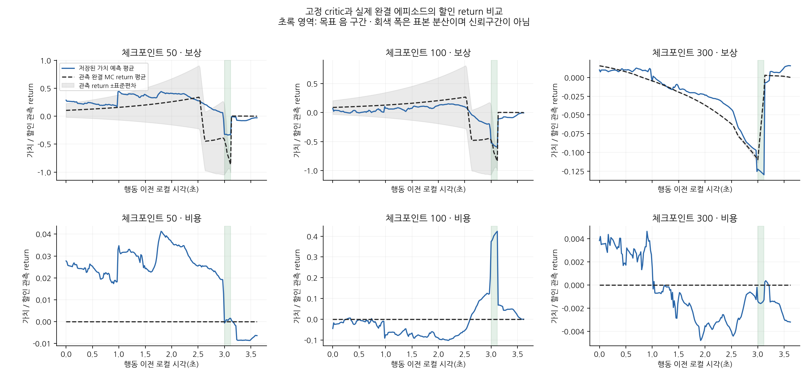
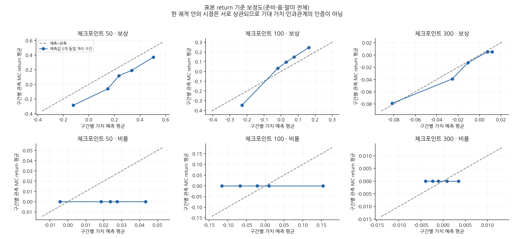

# 고정 critic의 완결 에피소드 return 점검

**reward-value GAE residual 자체는 예측오차가 아니다.** 정당한 baseline 효과를 포함할 수 있는 가법 분해 항이다. 여기서는 별도로 저장된 Vr/Vc를 실제 관측한 완결 에피소드의 할인 return과 비교했다.

세 모델 모두 첫 에피소드128개가218틱에 자연 종료했음을 확인했다. 다음 에피소드의6틱은 제외했다. true terminal에서 return을 끝내고 critic bootstrap 없이 rewardγ=.99·costγ=1로 계산했다. 역방향 recurrence와 직접 할인합이 일치했다. H32 단위 기울기의 GAE·정규화는 재계산하거나 변경하지 않았다.

| cp | critic | 구간 | 표본 수 | MSE | 예측−관측 bias | 상관 |
| --- | --- | --- | ---: | ---: | ---: | ---: |
| 50 | 보상 | 전체 | 27904 | 0.13537 | 0.15298 | 0.6197 |
| 50 | 보상 | 준비 | 23040 | 0.15366 | 0.17964 | 0.6341 |
| 50 | 보상 | 음 | 1024 | 0.20718 | 0.32596 | 0.6035 |
| 50 | 보상 | 말미 | 3840 | 0.0065186 | -0.053077 | -0.0951 |
| 50 | 비용 | 전체 | 27904 | 0.00074289 | 0.021705 | 정의 안 됨 |
| 50 | 비용 | 준비 | 23040 | 0.00087222 | 0.027344 | 정의 안 됨 |
| 50 | 비용 | 음 | 1024 | 0.00034269 | 0.00069834 | 정의 안 됨 |
| 50 | 비용 | 말미 | 3840 | 7.3668e-05 | -0.0065291 | 정의 안 됨 |
| 100 | 보상 | 전체 | 27904 | 0.1189 | -0.031089 | 0.5810 |
| 100 | 보상 | 준비 | 23040 | 0.13773 | -0.031398 | 0.5312 |
| 100 | 보상 | 음 | 1024 | 0.11126 | 0.11001 | 0.6765 |
| 100 | 보상 | 말미 | 3840 | 0.0079672 | -0.066864 | -0.4207 |
| 100 | 비용 | 전체 | 27904 | 0.012335 | -0.00811 | 정의 안 됨 |
| 100 | 비용 | 준비 | 23040 | 0.0071182 | -0.033924 | 정의 안 됨 |
| 100 | 비용 | 음 | 1024 | 0.16585 | 0.40102 | 정의 안 됨 |
| 100 | 비용 | 말미 | 3840 | 0.0026947 | 0.037673 | 정의 안 됨 |
| 300 | 보상 | 전체 | 27904 | 0.000272 | 0.0042712 | 0.8990 |
| 300 | 보상 | 준비 | 23040 | 0.00010409 | 0.0070249 | 0.9780 |
| 300 | 보상 | 음 | 1024 | 0.0047058 | -0.06071 | -0.5220 |
| 300 | 보상 | 말미 | 3840 | 9.7141e-05 | 0.0050775 | -0.7887 |
| 300 | 비용 | 전체 | 27904 | 7.4554e-06 | -0.00061137 | 정의 안 됨 |
| 300 | 비용 | 준비 | 23040 | 8.0909e-06 | -0.00038942 | 정의 안 됨 |
| 300 | 비용 | 음 | 1024 | 3.0798e-06 | -0.0014793 | 정의 안 됨 |
| 300 | 비용 | 말미 | 3840 | 4.809e-06 | -0.0017117 | 정의 안 됨 |

cp300의 전체 reward MSE는 약0.000272로 cp50의0.13537·cp100의0.11890보다 작았다. 실패해 return 변동이 작은 해당 모델의 새 상태분포에서 얻은 결과이며, 같은 상태분포에 대한 critic 능력 순위는 아니다. 특히 cp300의 큰 reward-value residual gradient를 “critic 예측오차가 크다”는 뜻으로 읽을 수 없다. gradient의 residual 항은 baseline 관련 항이며 배치 공통 정규화의 영향도 받는다.

위 MSE·bias·상관과5개 동일 개수 예측 구간은 **한 번의 관측 return**을 기준으로 한 기술 통계다. 단일 return은 진짜 기대 가치가 아니며, 시점들은 같은 궤적에 속해 독립 표본이 아니다. 이 값만으로 critic이 퇴행을 일으켰다고 결론 내리지 않는다. 비용 관측 return은 모두0이므로 그 상관은 정의하지 않는다.

Vr/Vc는 각 행동 이전 관측의 값이다. 구간은 저장된60Hz 끝점 시각에서1/60초를 뺀 시각으로 나눴다. 준비180틱·음8틱·말미30틱이며 각 구간에서128환경을 모두 포함한다. 전체 표는 준비 구간이 길어 그 가중치가 크므로 구간별 표를 함께 본다.

[기계 판독 결과](value_calibration.json) · [첫 기울기 결과](RESULTS.md)
