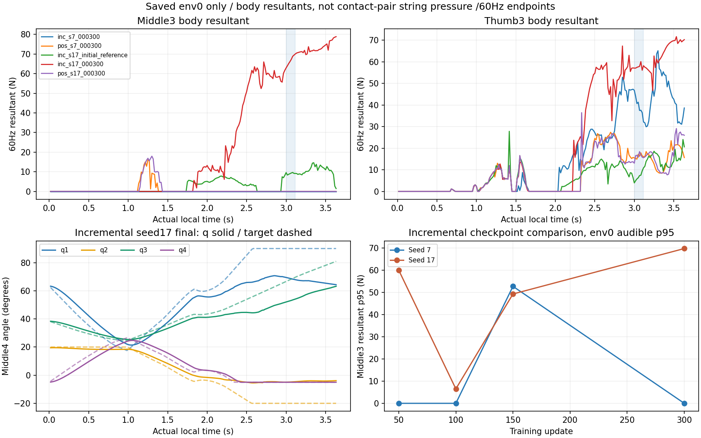

# 정책 성공 이후 하중·관절 명령 감사

저장된 env0 자료는 **달성률100%가 저부하 압현이나 제어 한계 해결을 뜻하지 않는다**는 점을 보여 준다. incremental seed17 최종 env0의 audible 중지3 resultant는62.92~70.04N, p95=69.83N이다. 같은 음을 달성했지만3초 시점 실제 중지4각과 목표각 사이에 큰 차이가 남았다. 생체학적 ‘자연스러움’이나 실제 줄 압력을 이 측정으로 판정하지 않는다.

## 선정과 공통 정의

seed7/17·incremental/position 최종 및 초기reference4쌍, incremental 두 seed의cp50/100/150과초기zero를 포함한 **저장 env0 첫 시도16개**를 선정했다. stage2 live reference와 direction-original 조건의 env0 두 개를 보조로 더했다. 결과에 따라 env를 고르지 않았고, 실패 사례도 생략하지 않았다. 전체 평가128환경의 하중 분포를 재구성한 것은 아니다. 원래 평가의 성공률과 이 한 환경의 하중 통계는 분모가 다르다.

공통 물리 기록은60Hz endpoint218개다. 원래 note press2.9787/onset3.0/end3.1174초를 유지했다. 준비는press 전, settled 준비는2초~press, press 창은press..end, audible은onset..end, 후반은end 뒤다. 준비/settled와press/audible은 겹치는 정의이므로 합산하지 않는다. p95·peak는 저장된 endpoint의 값이며240Hz 물리 최대나 실제 연속 접촉 시간을 뜻하지 않는다.

force는 thumb3/index3/middle3/ring3/pinky3 각각의 **net rigid-body contact force 벡터 norm**이다. 실제 guitar quaternion으로 원래 neck-plane 법선을 world로 회전한 뒤 signed `F·n`과그 절댓값을 따로 계산했다. normal projection도 몸체 모든 접촉의 순합이지 기타/줄 pair의 압력이 아니다.1/10/25/50N은 사후 분석용 고정 구간이며 안전·음악 성공 기준이 아니다.

## 조건별60Hz 하중

| 저장 trace | env0 달성 | 중지 audible peak(N) | 중지 p95(N) | 중지 abs(normal) p95(N) | 엄지 p95(N) | 중지 준비 peak(N) | 중지 후반 p95(N) |
| --- | --- | --- | --- | --- | --- | --- | --- |
| incremental_s7_initial_reference | False | 9.66 | 9.64 | 9.01 | 10.41 | 7.83 | 14.10 |
| incremental_s7_000300 | False | 0.00 | 0.00 | 0.00 | 45.85 | 0.00 | 0.00 |
| incremental_s7_initial_zero | False | 0.00 | 0.00 | 0.00 | 19.34 | 18.74 | 0.00 |
| incremental_s7_000050 | False | 0.00 | 0.00 | 0.00 | 21.03 | 14.86 | 14.42 |
| incremental_s7_000100 | False | 0.00 | 0.00 | 0.00 | 24.46 | 12.31 | 9.94 |
| incremental_s7_000150 | False | 52.81 | 52.77 | 52.77 | 48.42 | 45.07 | 60.46 |
| position_s7_initial_reference | True | 5.99 | 5.89 | 5.75 | 16.69 | 8.41 | 6.68 |
| position_s7_000300 | False | 0.00 | 0.00 | 0.00 | 17.61 | 16.06 | 0.00 |
| incremental_s17_initial_reference | False | 9.66 | 9.64 | 9.01 | 10.41 | 7.83 | 14.10 |
| incremental_s17_000300 | True | 70.04 | 69.83 | 69.83 | 59.43 | 66.00 | 78.40 |
| incremental_s17_initial_zero | False | 0.00 | 0.00 | 0.00 | 19.34 | 18.74 | 0.00 |
| incremental_s17_000050 | False | 60.11 | 60.06 | 60.06 | 41.51 | 61.50 | 61.70 |
| incremental_s17_000100 | False | 10.03 | 6.52 | 6.07 | 27.99 | 6.20 | 14.89 |
| incremental_s17_000150 | True | 50.62 | 49.33 | 49.32 | 48.60 | 40.66 | 61.52 |
| position_s17_initial_reference | True | 5.99 | 5.89 | 5.75 | 16.69 | 8.41 | 6.68 |
| position_s17_000300 | False | 0.00 | 0.00 | 0.00 | 17.90 | 17.95 | 0.00 |
| stage2_live_reference_env0 | False | 9.66 | 9.64 | 9.01 | 10.41 | 7.83 | 14.10 |
| stage2_direction_original_env0 | True | 9.05 | 8.92 | 8.92 | 미기록 | 29.96 | 12.93 |

stage2 보조 결과는 배치 크기/진단 제어가 다르다. `stage2_live_reference_env0`은128환경의 원래 finite reference/무회수 조건이고, `stage2_direction_original_env0`은16환경 direction 진단의 원래 reference 대조다. 후자는 중지 force벡터·q4·distal/guitar pose만 저장되어 있어 엄지/다른 손가락을 채워 만들지 않았다. 이 차이 때문에 두 실행의 차이를 정책 효과로 빼지 않는다. 기존 reference도 몸체 부하를 만들 수 있으므로 ‘모든 부하는 학습 정책이 만들었다’고 결론내릴 수 없다.

표의 준비 peak와audible p95는 서로 다른 시간 범위다. stage2의 준비 도중 큰 부하를 원음의 유지 부하로 바꾸어 인용하지 않았다. 반대로 audible에서 중지 부하가0인 실패 trace도 준비 peak나 엄지 부하가0이라는 뜻은 아니다.

## seed17 incremental 최종 관절과 노출

3초 실제 중지4각=[69.46, -4.93, 52.02, -5.01]°, 목표=[90.0, -20.0, 66.58, -5.0]°다. audible middle1_x의 target-upper 경계 점유는100.0%, 절대 추종 오차 p95는22.05°다. middle1_z target-lower 점유는100.0%, 추종 오차 p95는15.37°다. 목표가 native 끝에 있어도 실제각이 그 끝에 도달했다는 뜻은 아니다.

목표 경계는 원래 native/action bounds와1e−5rad 이내, 실제 near-bound는0.25° 이내로 별도 측정했다. 실제각은 물리 상태이며 target처럼 수학적으로 clamp됐다고 표현하지 않는다. 범위 밖의 작은 실제 readback도 크기를 그대로 남겼다. incremental에서는 경계 목표에서 같은 바깥 부호 action이 이어지는 비율/최대 endpoint span을 추가했다. position 행동의 절대목표 의미와 같은 부호 분석으로 섞지 않았다. 기존 incremental은 이미 clamp된 목표만 기억하므로 이 관측을 무한한 적분 windup의 증명으로 부르지 않는다.

audible 중지50N 이상 endpoint 수=8, 최대 연속 endpoint span=0.116667s다. 엄지도3초57.08N이며 audible p95=59.43N이다. 이 span은 **저장된 연속 endpoint의 마지막−첫 시각**이며, 사이16.7ms에도 계속 문턱 이상이었다는 보장은 없다. count/60을 실제 노출시간으로 환산하지 않았다. 정확한240Hz peak·지속/충격은 이 원자료로 새로 주장하지 않는다.

press..end 창까지 포함하면 중지 범위는61.67~70.04N이다. audible에서 중지의 signed neck-normal 성분은62.92~70.04N이고, 엄지는-34.85~-32.25N으로 부호가 반대다. 엄지 norm57N을 neck-normal 압력57N으로 바꾸어 부르지 않는다. 원음 뒤에는 중지 p95=78.40N, peak=78.86N이고50N 이상31개 endpoint의 span이0.5초다. 음 달성이 후반 부하 해소를 보장하지 않았다.

다른 말단도 별도로 계산했다. 선정 자료의 audible index3 최대23.62N은 incremental seed17 cp100에서 관측됐고, ring3/pinky3는 이 자료의 audible endpoint에서0N이었다.0이라는 결과도 접촉 상대나 표본 사이의 무접촉을 인증하지 않는다.

각 몸체의 signed normal 최소/최대, norm·|normal| peak/p95,1/10/25/50N endpoint 수/점유/span은 [body_phase_stats.csv](body_phase_stats.csv)와 [results.json](results.json)에 있다. 원래 선택 관절 q/target·기타와선택5개 말단 pose·선택5개 force벡터 및 geometry의 변경 없는 사본과 파생 배열은 [selected_samples.npz](selected_samples.npz)에 보관했다. 전체 몸체/학습 raw를 재생성하지 않았다. 보조 direction 자료는 중지4축과중지/기타 pose만 원자료에서 복사했으며 미기록 필드는 NaN으로 표시하고 관측 통계에는 넣지 않았다.

## 해석과 최소 후속 계획

관측은 ‘달성/clean’ 외에 부하와 추종·경계 체류를 함께 봐야 한다는 근거다. 엄지는035 목표를 유지하고 wrist는teacher가 안내하며 다른 손가락 B도 함께 제어된다. thumb3의 큰 resultant는 고정 목표·팔 안내·자기충돌/넥 지지 중 하나 이상과 관련될 수 있다. 접촉 상대가 분리되지 않아 정책 중지 명령만의 인과 효과로 귀속하지 않는다. 외부 contact resultant와 actuator effort cap도 같지 않다.

엄지5축의 기록된 target은 모든 기본 비교 trace에서035 reference와1e−6rad 안에서 같았다. 그럼에도 thumb3 부하는 서로 달랐다. 예를 들어 seed7 incremental 최종은 audible 중지 resultant0N인 미달성 사례인데도 엄지 p95가약45.85N이다. 이는 엄지 목표 고정만으로 낮은 하중이 보장되지 않음을 보여 주며, 중지·팔·기타·자기 접촉의 실제 분담은 아직 분리하지 못했다.

1. 먼저 같은 초기 상태/범위/PD에서 thumb035·teacher wrist를 유지한 reference/zero/학습중지 명령을 나란히 기록하고, 실제 native contact pair·finger/guitar/기타 몸체 반력과240Hz extreme을 확인하는 좁은 진단이 필요하다. 새 실행이 아직 수행되었다는 뜻은 아니다.
2. 실제로 finger의 목표−실제 lag와 loaded 구간의 계속 안쪽 명령이 함께 확인되면 **contact-aware 목표 누적 억제/anti-windup 가설**을 별도 조건으로 시험할 수 있다. 단순 native clamp는 이미 존재한다. 부하를 측정하는 pair/방향과 바깥으로 빠져나오는 명령 보존을 먼저 정의하고, 원래 제어를 고친 뒤 성공을 소급하지 않는다.
3. 별도의 물리 failure 기준이 필요한지는 원래 결과와독립적으로 검토할 수 있다. 현재50N 같은 분석 bin을 곧바로 종료 문턱으로 채택하거나 reward·force cap·범위·PD를 동시에 바꾸지 않는다. 먼저 실제 pair·힘 상한의 의미·수치 안정성과 연속 노출을 확인하고, 비용/종료 후보는 명시한 새 계약으로 비교해야 한다.

이번 감사는 새 GPU·원자료 재생성·기존 결과/활성 소스 수정 없이 CPU에서 수행했다. 실행 입력·원래 소스 SHA와선정 목록은 [selection.json](selection.json), 원자료/소스 불변 확인은 [verification.json](verification.json)에 남겼다. 과거212N 전체 몸체 문제나 실제 현 압력 인증을 해결했다고 주장하지 않는다.
