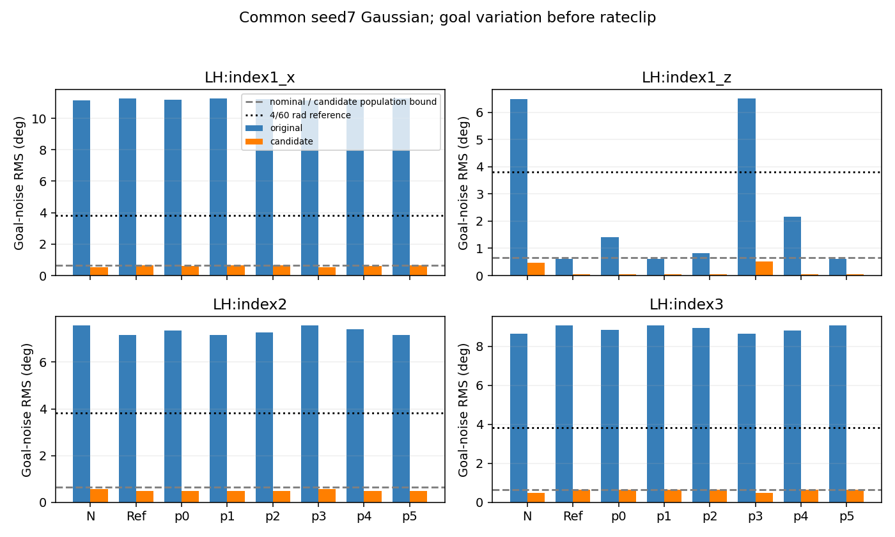

# 목표각 탐색 단위 CPU 검사

원saved log_std의 동일clamp[-5,2]/float32exp를 확인했다. effective std=0.17117105424404144, config와차이=2.33e-10이다. 이후 고정μ/σ와기존decode를float64로 평가했다. 원CUDA/float32정책잡음 bitexact 재현은 아니다.
공통 seed7/float64 표준정규100000×4를 N/Ref 및 사전지정env0 phase중간6행의 두sigma에 동일하게 사용했다. 원genuineGoalPolicy의6개μ만읽었고 후보sigma로정책을생성하거나원log_std/설정에쓰지않았다.

nominal=(4/60)·원effective std=0.0114114036163 rad=0.653825°. 이는 기존incremental neutral의 **1차 기준**이며 정확한 유한잡음RMS가 아니다.

| 축 | L(rad/raw) | 공식후보 sigma |
|---|---:|---:|
| MCP x | 1.405931830 | 0.00811661232 |
| MCP z | 0.957631826 | 0.01191627440 |
| PIP | 0.905777872 | 0.01259845705 |
| DIP | 1.208618194 | 0.00944169439 |

Δθ는 noisy goal−동일μ의 deterministic goal이다. 아래의초과비율은 |Δθ|>4/60의 **rateclip 전 목표노이즈** 비율이며 실제controller clip발생률이나관절변위가아니다. 전체64행의bias/1·5·50·95·99분위수/상한은 distribution.csv·comparison.json에 있다.

| 고정평균 | 축 | RMS 원→후보(도) | 평균편향 원→후보(도) | 초과비율 원→후보(%) |
|---|---|---:|---:|---:|
| N | MCP x | 11.126318 → 0.542330 | -2.136704 → -0.103250 | 71.55400 → 0.00000 |
| N | MCP z | 6.494382 → 0.464773 | -3.346224 → -0.237348 | 34.41300 → 0.00000 |
| N | PIP | 7.566846 → 0.572586 | -0.925373 → -0.069395 | 61.01700 → 0.00000 |
| N | DIP | 8.652496 → 0.490605 | 2.869806 → 0.161230 | 56.35800 → 0.00000 |
| Ref | MCP x | 11.250398 → 0.645786 | -1.876895 → -0.005845 | 73.63600 → 0.00000 |
| Ref | MCP z | 0.608369 → 0.041838 | -0.057012 → -0.000326 | 0.00500 → 0.00000 |
| Ref | PIP | 7.165282 → 0.476969 | -0.611046 → -0.000614 | 57.04600 → 0.00000 |
| Ref | DIP | 9.068225 → 0.651624 | 1.870237 → -0.003817 | 71.95400 → 0.00000 |

decode의기울기는035기준양/음span이며 L은양쪽최댓값이다. 따라서 g(z)=decode(tanh z)에 대해 |g(μ+σε)−g(μ)|≤Lσ|ε|다. Gaussian모집단 E[ε²]=1일때 RMS≤Lσ=nominal(후보)이고, 유한표본의검산상한은 **Lσ·sqrt(mean(ε²))**다. 모집단nominal에모든표본RMS를무조건assert하지않았다. 표본 ε_RMS4=[0.9980082511217322, 1.0009871657838603, 0.9983645185164443, 0.998999076361718]이며각행finite상한을별도로저장했다. 점별부등식의최대수치잔차 3.32e-17 rad는float64반올림범위다.
N의양/음span비대칭과tanh때문에 평균편향과실제RMS는μ/축마다달라진다. 후보는8case에서관측초과0건이지만 Gaussian의모집단꼬리확률0·모든목표증분rate이내를보장하지않는다. 원native가동범위/4rad/s/PD/cap/guard는수정하지않았고물리계산은하지않았다.
사전phase중간행(짝수면뒤쪽중앙)의 start_clock: phase0=236, phase1=616, phase2=772, phase3=836, phase4=900, phase5=1164. 저장phase라벨/행순서로선정했으며성공사례사후선별이나시간확장은없다.
원70e/73tensor·관측불변과원rawgoal CPU잔차 3.23e-08(선행허용 2.38e-07)을검증했다. 본검사는목표각확률산술/전역L후보공식검사이며실제움직임·힘·PPO효과/적절한탐색표준편차의최적성을증명하지않는다. 매개변수탐색/후보적용/새fit/GPU/native/모델저장0,직접입력SHA만확인했다.

