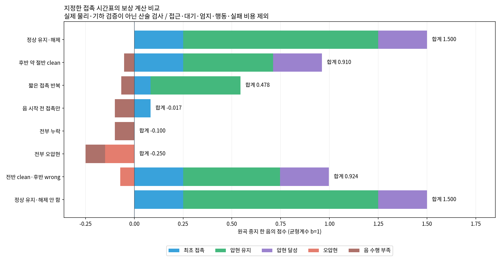

# 같은 접촉 시간표의 보상 순서

현재 보상식에 지정한 candidate/wrong 시간표를 넣어 계산했다. **정상 clean 유지가 비교한 나쁜 수행보다 높게 평가된다.** 이 검사만으로 보상 구조 전체가 적절하다거나 실제 압현 학습이 쉽다는 결론을 내리지는 않는다. 실행 중인300회 학습의 소스·설정은 수정하지 않았다.

원곡 중지 목표 `event-000052/string-3/note-53`의 음 길이는117.4ms, 연속 달성 문턱은50ms다. 원래 준비·음 시계와240Hz 적분/60Hz 정산을 사용했고 균형계수는 단일 선택 과제의 b=1이다. 실제 `substep`, `end_control`, `performance_settlement`가 계산했다.

| 지정한 수행 | 최초 접촉 | 압현 유지 | 압현 달성 | 오압현 | 음 수행 부족 | 다섯 항 합계 |
| --- | ---: | ---: | ---: | ---: | ---: | ---: |
| 전 구간 clean 후 해제 | .250 | 1.000 | .250 | 0 | 0 | **1.500** |
| 후반 약 절반 clean | .250 | .461 | .250 | 0 | −.052 | .910 |
| 짧은 접촉 반복 | .083 | .461 | 0 | 0 | −.067 | .478 |
| 음 시작 전 접촉만 | .083 | 0 | 0 | 0 | −.100 | −.017 |
| 전부 누락 | 0 | 0 | 0 | 0 | −.100 | −.100 |
| 전부 오압현 | 0 | 0 | 0 | −.150 | −.100 | −.250 |
| 전반 clean 후 후반 오압현 | .250 | .497 | .250 | −.072 | −.0003 | .924 |
| 전 구간 clean 후 해제 안 함 | .250 | 1.000 | .250 | 0 | 0 | **1.500** |

후반 절반 clean은 표본 경계 때문에 실제 적분된 clean이46.1%이고, 전반 clean은49.7%다. 두 행의 오압현 유무만 바꾼 동등한 clean 비교가 아니다. 적분 경계에서는 clean이 두 끝점 모두 candidate일 때만 적립되고 wrong/missing은 끝점 평균이므로 세 비율의 합이 항상1인 것도 아니다. 정상 해제는 음 끝을 가로지르는 마지막 물리 표본까지 접촉한 뒤 해제하도록 지정했다.

## 확인한 점과 다음 확인

- 최초 접촉 최대.25, 유지 최대1, 달성 최대.25, 오압현 최대−.15, 부족 최대−.10의 예산 안에서 지급됐다. 접촉을 반복해도 최장 연속 접촉 증가분만 지급하므로 최초 접촉 예산이 재충전되지 않았다.
- 짧은 접촉 반복은 달성0이어도 유지 진행 보상을 받는다. 이는 현재의 밀집 보상 설계다. 이번 시간표는 정상 압현보다 낮다. 실제 정책이 반복 접촉을 선호하는지는 별도 학습 로그로 판단해야 한다.
- **핵심 다섯 항은 정상 해제와 음 종료 뒤 계속 누르는 것을 구분하지 않는다.** `released` 진단은 각각 true/false로 구분된다. 전체 보상에는 손가락별 약한 대기 권고가 추가될 수 있고, 다음 음에서의 간섭/오압현도 별개다. 따라서 “해제 유인이 전혀 없다”는 결론은 아니다. 짧은 전환 과제에서는 실제 이격·candidate 종료를 별도 통과 기준으로 유지한다.
- 전곡의 균형계수는 검지.67/중지.93056/약지·소지1.39583이다. 양성 세 항의 완전 clean 예산만 비교하면 검지2음=2.01, 약지1음=2.09375다. 나머지 수행이 같더라도 **손가락 균형 점수와 무가중 달성 음 수의 순위가 달라질 수 있다.** 계산 오류가 아니라 목적의 차이이므로 전체/손가락별 달성 수와 균형 점수를 함께 보고한다. 이 결과만으로 균형계수를 제거하지 않는다.

접근 PBRS·대기·엄지·행동 변화·실패 비용·할인은 이 표의 합계에서 제외했다. 접근은 별도 [할인 시간척도 감사](../TIME_SCALE.md) 및 실제 악보 원장 검산에서 다룬다. 거리/접촉 부하/방향/손가락 배정 판정을 이 검사에서 증명한 것은 아니다. 이 도구는 합성 candidate/wrong을 주입하고 물리 안전 갱신을 비활성화한 **CPU 산술 검사**다. 실제로 이런 자세를 만들 수 있다는 결과로 쓰면 안 된다.

[수치·입력 SHA·통과 검사](results.json) · [원시 누적 시간표](timelines.npz) · [재현 도구](support/audit.py)
