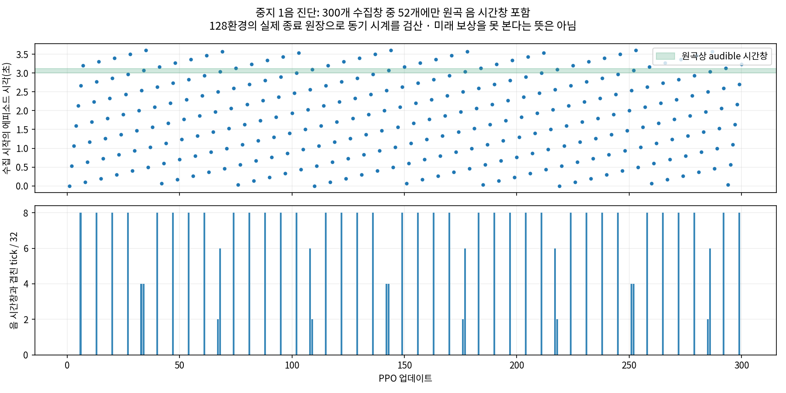

# 짧은 과제의 수집 시각 분포

중지 한 음 incremental/seed7의 완료된300회 실행에서 **음 시간창을 포함한 H32 수집 구간은52개, 포함하지 않은 구간은248개**였다. 이는 보상이 없는 구간이248개라는 뜻이 아니다. 준비·접근·대기·엄지 보상이 존재하며, 뒤의 압현 결과도 critic bootstrap으로 연결된다.

실제5,632개 종료 원장을 읽어 모든 시도가218tick 정상 완료이고, 환경별44회 종료 시점이 `ceil(episode_number×218/32)` 업데이트와 일치함을 확인했다.128환경 모두 같은 에피소드 시계로 진행했다. 상태·힘·확률 행동까지 같다는 의미는 아니다.

- 한 시도는3.6333초이며 원곡 음 시간창은 local3.0~3.1174초다.
- 첫300회는 환경별160초의 전이를 수집했고, 그중 원곡 음 시간창의 정확한 겹침은5.1656초(3.2285%)였다. 시계 겹침이며 clean·실제 발음 시간은 아니다.
- H32의 시작 시각 배치는109회마다 반복한다(`218/gcd(218,32)`). 각 업데이트는 모든 환경에서 비슷한 시간 구간을 함께 다룬다.
- 음 시간창이 포함된 비율17.33%와 물리시간에서 음 창의 비율3.23%는 서로 다른 분모다. 음 시간창과 겹친 tick을 받은 실제 양성 보상으로 해석하지 않는다.

이 구조는 긴 준비 동작의 credit assignment와 critic 오차를 점검할 근거다. 아직 학습 실패의 인과를 입증하지 않았으며, 동기화가 잘못된 코드라는 뜻도 아니다. 임의의 중간 상태에서 시작하거나 준비 전이를 버리는 변경은 하지 않았다. 기존 과제의 position 비교와 별도의 gradient 진단을 먼저 확인한다. 다른 악구 길이를 섞거나 시간척도를 조절하는 실험은 새로운 조건으로 분리해야 한다.

현재 [PPO 경로 감사](../PPO_PATH_AUDIT.md)에서는 H32를 진짜 종료로 처리하는 오류나 누락된 누적 목표각 관측을 찾지 못했다. [시간척도 감사](../TIME_SCALE.md)와 함께 해석한다.

[수치·원장 SHA](results.json) · [업데이트별 수집 시간표](update_coverage.csv) · [재현 도구](support/audit.py)
