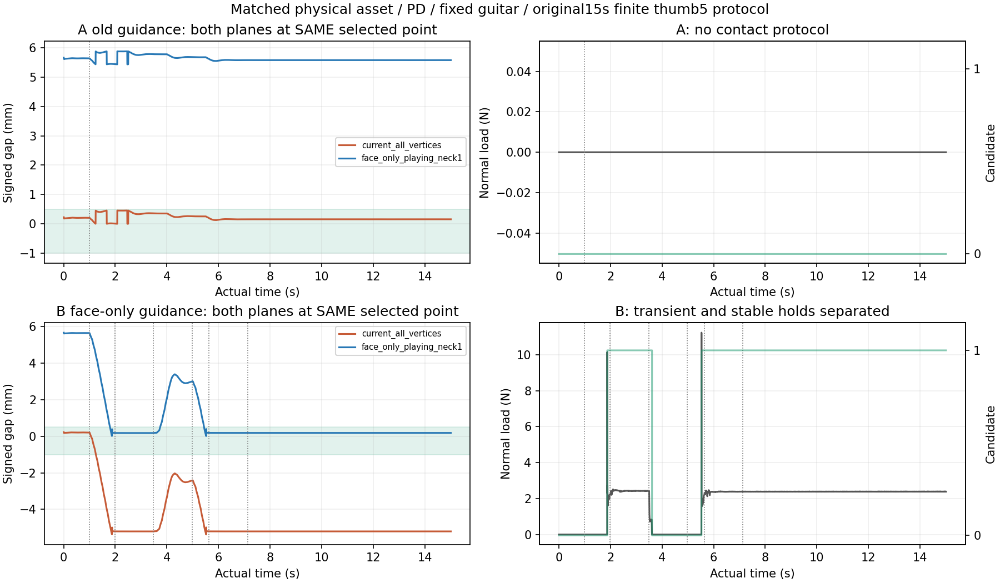

# 엄지 후면 안내면 native matched A/B 결과

같은 물리 자산·PD·fixed guitar에서 **기존 all-vertex 안내면 A는 접촉 프로토콜 미달, face-only playing-neck1 안내면 B는 접촉→유지→해제→재접촉→최종 유지 통과**였다. 두 실행 모두3600physics endpoint/900control·15초를 완료했다. 이는 새 안내면 입력/판정의 native 진단이며 정책 학습 성과나 contact-pair 압력 인증이 아니다.

## 같은 실제 점에서 안내면 차이

A가 선택한 실제 엄지 점은 A면 gap을 거의0으로 줄였지만 face-only 실제 neck1 후면에는 약5.4~5.9mm 떨어져 있었고 thumb3 rear-normal load는0N이었다. A면 자체 candidate도0/3600이었다. A는1초 initial hold 뒤14초 approach에서 머물러, hold/release/recontact에 진입하지 못했다.

B의 실제 궤적에서는 새 면 candidate가2690/3600endpoint였지만, 그 **동일 actual selected point·normal·force**를 A면으로 판독한 candidate는0개였다. B면에 닿은 점의 A면 gap은 최대 약−5.37mm로 원래−1mm penetration 창을 벗어났다. 별도의 가상 표본·접촉을 만들거나, 상대 면마다 더 유리한 점을 새로 선택하지 않았다.

두 실행에서 같은 point-selection 알고리즘을 사용해도 안내면이 달라 실제 selected point·제어 witness·궤적이 달라질 수 있다. 따라서 서로 다른 A/B native 궤적의 차이와, 한 궤적의 동일 점을 두 면으로 읽은 차이를 분리했다. 각각의 source sample ID와 fixed control-witness gap을 그대로 재계산했다.

## B 단계별 실제 하중

| 단계 | 적분 시간(s) | candidate(%) | normal load 평균(N) | 최대(N) | 끝 gap(mm) |
| --- | --- | --- | --- | --- | --- |
| initial_hold | 1.000 | 0.00 | 0.000 | 0.000 | 5.639 |
| approach | 0.983 | 11.02 | 0.265 | 10.150 | 0.178 |
| contact_hold | 1.500 | 100.00 | 2.422 | 2.511 | 0.176 |
| release | 1.500 | 8.33 | 0.089 | 2.427 | 2.997 |
| reapproach | 0.650 | 16.67 | 0.373 | 11.225 | 0.184 |
| final_hold | 1.500 | 100.00 | 2.373 | 2.460 | 0.181 |
| completed_hold | 7.867 | 100.00 | 2.385 | 2.392 | 0.181 |

재접근 transient 최대는약11.225N이고, 처음 접근도약10.150N까지 올랐다. **안정 유지의 약2.4N과 transient peak를 섞지 않는다.** 첫 hold 평균2.422/최대2.511N, 최종 hold 평균2.373/최대2.460N, 그 뒤 completed hold 평균2.385/최대2.392N이다.2N 접근 보호는 다음 유한 보정 요청을 제한하는 조건이지 실제 contact resultant를2N에 clamp하는 물리 cap이 아니다.

원래 contact 확인은24개 연속240Hz candidate endpoint다. 독립 상태기계가 원래 transition 시각과 일치했다. B는1.983333초 first hold,3.483333초 release,4.983333초 reapproach,5.633333초 final hold,7.133333초 completed hold로 넘어갔다. release1.5초의 candidate 비율8.33%는 원래<10% 기준을 통과했고, 끝 selected gap은약2.997mm였다. fixed witness의2mm 이격도 통과했다. release가 시작된 순간부터 전체1.5초 내내 candidate=false였다고 확대하지 않는다.

## 목표·native 제어·무결성

최대 엄지 target 변화는 A약0.446°, B약4.578°로±15° 요청 범위 안이었다. control당 최대변화는 A약0.146°, B약0.500001°로 원래0.5° 보정을 유지했다. 두 조건 모두 native target 초과0, 기존4rad/s incremental codec 재계산 오차2×10⁻⁶rad 이내였으며 다른 policy 채널은0이었다. 별도 solver·힘 보조·실행 중 상태 덮어쓰기는 없었다.

같은 point의 gap/finite-region excess/facing/load/candidate/quality를 독립 NumPy 삼각형/edge 투영으로 재계산했다. body/guitar pose와 동결한 원래128개 thumb patch에서 selected point·normal·force를 별도로 복원했고, phase 통계·상태 전이·원래 protocol flags가 일치했다. 정상 force는 thumb3 resultant만 사용하며 thumb1/2를 candidate 하중에 더하지 않았다. 원 source·README·원 raw를 수정하지 않았다.

양쪽 compound asset SHA는 `c8a5cd81733e3883600caed84d9359277b48e1375f8703fa5d054a11cc7de064`, shape readback SHA와native PD fields SHA도 같았다. fixed=true·gravity ON·원 collision/solver 옵션과1환경 scene closed를 확인했다. wrapper 내부 base report의 ‘free guitar’ 문구는 원래 helper의 일반 문구이며, 이번 실제 scene readback은 양쪽 fixed다. launcher exit0·전체 wall 154.940초가 보존되어 있고 영상 인코더도 양쪽0이다.

구체적인 phase 표·두 면별 candidate/gap은 [results.json](results.json), [phase_summary.csv](phase_summary.csv), 재계산 배열은 [recomputed.npz](recomputed.npz), 원자료/source SHA와오차는 [verification.json](verification.json)에 있다. 바뀌기 전 함수 원문과 원래 patch/native bounds fixture도 이 분석 폴더 안에 봉인해 두었다. 생산 안내면을 나중에 수정하더라도 이 old-source 결과를 새 소스에서 평가한 결과처럼 재분류하지 않는다.

## 남는 범위

이 한 쌍은 이번 고정 기타·엄지5축 유한 진단에서 source 안내면 선택이 실제 접촉 후보/프로토콜 도달에 영향을 준다는 근거다. force resultant와 same-point 기하는 실제 thumb-neck pair·분포 압력·줄 진동·음향을 인증하지 못한다. 자유 기타·양손 학습·thumb 목표035 고정 시의 큰 부하·전곡 성공을 해결했다는 결론도 아니다. 생산 변경은 별도 버전·계약·검증과 새 checkpoint 정체성을 따라야 한다.
