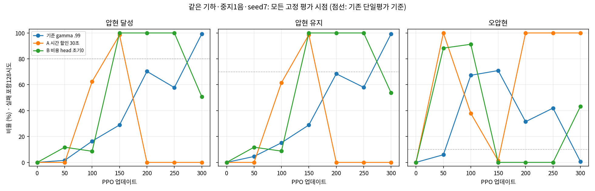

# 같은 기하에서 기준·A·B 비교

B는150~250회에서128/128을 유지해 기존 연속2평가 기준을 통과했지만, 최종300회에서65/128로 저하됐다. 기준과 A는 연속2평가 기준을 통과하지 못했다.

고정 기타·유한 팔 손목 안내·중지4축·원곡1음·large128/H32/300·seed7이다. 각 평가는 실패를 포함한 배정128환경 첫 시도이며128개 독립 seed가 아니다. 초기값0은 학습 전 정책이다.

| 반복 | 기준 달성/128 | A 달성/128 | B 달성/128 | 기준 유지/오압현 | A 유지/오압현 | B 유지/오압현 |
|---:|---:|---:|---:|---:|---:|---:|
| 0 | 0 | 0 | 0 | 0.00% / 0.00% | 0.00% / 0.00% | 0.00% / 0.00% |
| 50 | 2 | 0 | 15 | 4.56% / 5.90% | 0.00% / 100.00% | 11.72% / 88.28% |
| 100 | 21 | 80 | 11 | 15.16% / 67.29% | 61.58% / 37.94% | 8.71% / 91.26% |
| 150 | 37 | 126 | 128 | 28.90% / 70.95% | 98.61% / 1.34% | 100.00% / 0.00% |
| 200 | 90 | 0 | 128 | 68.45% / 31.43% | 0.00% / 100.00% | 100.00% / 0.00% |
| 250 | 74 | 0 | 128 | 57.98% / 41.94% | 0.00% / 100.00% | 100.00% / 0.00% |
| 300 | 127 | 0 | 65 | 99.26% / 0.69% | 0.00% / 100.00% | 53.76% / 43.19% |

기존 수용 기준은 달성≥80%, 유지≥70%, 오압현≤10%, 물리 실패≤5%를 인접한 정책 평가2회에서 연속 충족하는 것이다. 기준은300회 단일평가만, A는150회 단일평가만 충족했다. B의 통과쌍은150–200회와200–250회다. B 최종300회는 유지53.76%, 오압현43.19%로 기준 미달이다. 최종 시점의 안정성이나 기본 채택으로 확대하지 않는다.

모든30평가는 물리·손목·전체 실패율0이었고, 실패를 제외해 분모를 바꾸지 않았다. train3개+평가30개의 완료·현재 입력핀·scene 종료와 launcher3개의 실제 종료코드0을 확인했다. B outer wall은1786.634초다.

실제 초기 model73개 tensor를 CPU로 비교했다. 기준과 A는73개 모두 동일했고, B는비용 head2개만 정확0이며 나머지71개가 동일했다. A는reward/PBRS gamma를0.99→0.9994445987368581로 바꾸었고 비용 gamma는 유지했다. B의 설정 차이는 별도 실험 표기뿐이며 초기 비용 head만 바꿨다. 공통 입력핀은 모두 동일·현재 일치했고, 초기 policy/zero/random/reference 네 대조의 성과 요약도3조건에서 같았다.

B 전체300회에서 비용 advantage·critic value/target·손실이 정확0이고 final 비용 head도0이었다. 실제 비용 저장 평균과5,632종료episode의 비용도0이었다. 비용 계수는1, 원래 실패비용은 유지했다. 순간 비용min/max는 미저장이므로 직접 확인값으로 주장하지 않는다. [비용 감사](COST_AUDIT.md)에 범위를 구분했다.

이 seed에서는 B가A의150회 이후 붕괴와 다른 학습 경로를 보였지만, 비용 초기 신호가 모든 불안정의 단독 원인이라고 확정할 수 없다. B도300회에 저하됐다. 높은 접촉 합력·자유 기타·전곡·자연스러움은 이 성과 비교로 검증되지 않는다. A의env0 오압현 witness는 [별도 원인 기록](../comparison_gamma_seed7/WRONG_PRESS_CASES.md)에 있으며 전체128 원인분포와 구분한다.

수치·수용 판정은 comparison.json/performance.csv, 초기 검증은 initial_comparability.json, 완료·핀·원자료 SHA는 validation.json에 보존했다. 기존 결과와 활성 소스는 수정하지 않았다.
