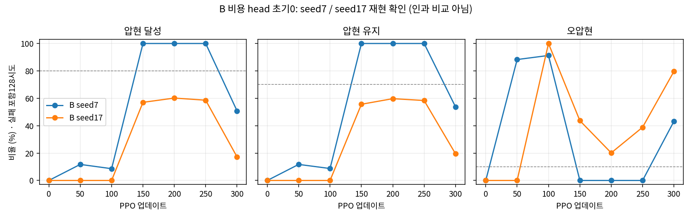

# B seed17 최종 재현 분석

**seed7의 연속 통과는 seed17에서 재현되지 않았다.** seed17은 단일 정책 평가 기준도 통과하지 못했고, 최종300회는22/128달성·유지19.50%·오압현79.62%였다.

같은 B 설정이며 seed만7→17이다. seed17 동seed 일반 초기화 기준선 학습은 없으므로 seed7 대비 차이를 B 효과의 인과 비교로 해석하지 않는다. 실제 native 초기값의 일반 seed17 초기화 대비71tensor 동일·cost head2개 정확0 검증은 기존 actual_initial_verification.json을 재사용하고 해시를 확인했다.

| 반복 | seed7 달성/128 | seed17 달성/128 | seed17 유지 | seed17 오압현 | seed17 단일 기준 |
|---:|---:|---:|---:|---:|---|
| 0 | 0 | 0 | 0.00% | 0.00% | 미달 |
| 50 | 15 | 0 | 0.00% | 0.00% | 미달 |
| 100 | 11 | 0 | 0.00% | 100.00% | 미달 |
| 150 | 128 | 73 | 55.63% | 43.67% | 미달 |
| 200 | 128 | 77 | 59.72% | 20.14% | 미달 |
| 250 | 128 | 75 | 58.38% | 38.84% | 미달 |
| 300 | 65 | 22 | 19.50% | 79.62% | 미달 |

기존 수용 기준은 달성≥80%·유지≥70%·오압현≤10%·물리 실패≤5%를 인접 정책 평가2회에서 연속 충족하는 것이다. seed7은150–200·200–250회 통과, seed17은통과쌍이 없다. seed17 최고 달성은200회77/128(60.16%)이며 유지59.72%·오압현20.14%다. 기존 runner acceptance.json의 모든 단일평가·연속 판정을 원자료로 재계산해 일치를 확인했다.

seed17의 초기 policy/zero는0/128, random6/128, reference108/128이다. reference 유지85.12%·오압현14.13%로 오압현 기준을 넘으며 정책 통과로 세지 않는다. 전체10평가×128=1,280시도는 실패를 포함한 배정환경 첫 시도다. 모두 물리·손목·전체 실패0이었다. 이는128개 독립 seed가 아니다.

전체300회·1,228,800전이·5,632종료episode를 감사했다. 종료는 timeline_complete5,631건과201회 env81 wrist_severe1건이며 물리실패는0이다. 해당 비용9.316666603=기본5+남은시간4.066666603+미정산음예산0.25다. 전체 raw비용평균×전이수 합과 episode비용합이 정확히 일치한다. 심각 손목 이탈은 로컬1.6초에 발생했으며 마지막 안내초과 Gz0.11343m·심각지속0.1125초는 종료 경계 표본이다. 원인 관절·접촉이나 궤적 최대를 확정하지 않는다.

1~200회 비용 advantage/value/손실은 정확0이다. 201회 실제 실패 비용 이후201~300회100개 업데이트에서 모두 nonzero다. 실제 비용 평균은201회만 nonzero이며 이후99회는0이다. cost_raw는 GAE advantage이므로 이후 nonzero를 새 실패로 세지 않는다. initial/200회 저장 cost head는0,250회와final은nonzero다. 초기·200회 저장본의 head0과 실제 비용 발생 이후 출력 변화,250회·최종 저장본의 nonzero 파라미터를 구분해 확인했다. 비용계수1·원래 실패비용은 유지했으며, seed7의 전기간 비용0과 구분한다. 순간 raw비용 min/max는 미저장이고201회 head 파라미터는 직접 저장되지 않았다.

root의 실제 outer 종료코드0·wall1799.933957초, train완료/scene종료와10평가 전체완료/scene종료를 확인했다. seed7의11장면도 함께 다시 확인했다. 설정·원자료SHA·현재 입력핀·준비봉인·최종head 수치는 validation.json/final_audit.json, 전체 정책 평가 수치는 performance.csv에 있다. 원래 runner의 analysis/acceptance.json 및 모든 raw는 보존했다.

결론의 범위는 고정 기타·유한 팔손목 teacher·중지4축·원곡1음·large128/H32/300의 B 두 seed다. 연속통과의 재현성은 확보되지 않았고 비용초기값만으로 성과·안정성·힘 문제의 원인을 확정할 수 없다. 자유 기타·전곡·압력·자연스러움·기본 채택의 근거로 확대하지 않는다. 활성 소스·기존 결과·봉인 입력을 수정하지 않았고 분석에 GPU를 사용하지 않았다.
