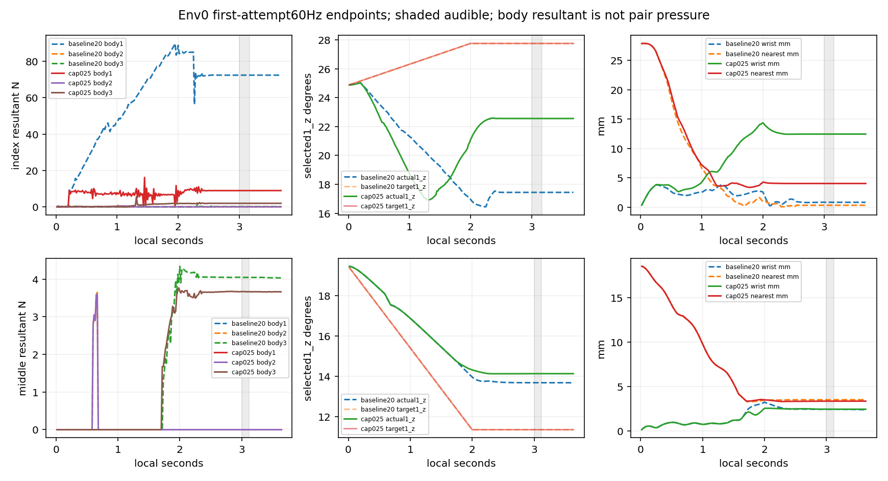

# 손가락16 native effort 20→0.25Nm 실제 비교

**하중은 줄었지만 검지는3/4→0/4·wrong100%로 후퇴했다. 중지는4/4·clean100%를 유지했다. 이0.25Nm 조건을 일괄 기본 채택할 근거는 없다.** 원래90개 손가락간 충돌쌍, 목표·범위·K/D·제어속도·판정·보상을 유지하고 검지~소지16축 native POSITION effort만 변경한 고정 기타/noNN 진단이다. 0.25Nm는 인체 적정값이 아닌 사전 공학값이다.

| 손가락 | 조건 | 달성/전체 첫시도 | 평균clean/wrong | 물리/손목실패 | 원 acceptance |
|---|---|---:|---:|---:|---|
| index | 20Nm | 3/4 | 75.0%/0.0% | 0/0 | 미달 |
| index | 0.25Nm | 0/4 | 0.0%/100.0% | 0/0 | 미달 |
| middle | 20Nm | 4/4 | 100.0%/0.0% | 0/0 | 통과 |
| middle | 0.25Nm | 4/4 | 100.0%/0.0% | 0/0 | 통과 |

새 cap8첫시도와 검수된 baseline8첫시도, 총16개를 모두 포함했다. baseline 검지3/4는 원 acceptance(4/4달성·평균clean≥70%·평균wrong≤10%·물리/손목실패0)에 미달한 상태 그대로다. 같은seed7의4환경이며4seed가 아니다. 모든 실제 launcher exit0, 두 새 장면 close/원loader 복원/입력 전후 불변을 검증했다. 원 source prepared JSON/state는 변경하지 않았다. 저장된 original-profile105 배열도 원 strict prepared loader와 현재 동일 LH K/D profile로 독립 재구성해 모든 필드를 exact 대조했다.

105축 native 속성 모든 필드의 전후 배열을 독립 비교했다. 56..71의16effort만20→0.25Nm이며 thumb5/기타89축 및 K/D/driveMode/범위/마찰/armature/velocity는 동일하다. 원90pairs 계약·shape readback4환경, dt/solver/material/asset/고정장면 등 scene 기록도 동일하다. 저장된 전체105속성 배열은 마지막환경 readback이고 기존 scene constructor가 각4환경 전체속성을 exact 검증한다. 새계약의 diagnostic_native_effort를 제외하면 baseline task/control 계약과 exact다. **native cap readback은 실측 motor torque나 body force 상한 인증이 아니다.**

## 실제 명령·각도·손목

두 조건의 env0 시계와 선택4 scripted/executed action 및 target 전체 tape는 byte exact였다. 원범위 및4rad/s target rate도 확인했다. 아래는 env0 음중 끝점 평균이며 관절순서는1_x/1_z/2/3이다.

| 손가락/조건 | actual4 ° | target4 ° | target−actual4 ° | wrist 위치mm/회전° | nearest 거리/height mm |
|---|---|---|---|---|---|
| index/baseline20 | 36.5290, 17.4437, 59.4678, 24.0607 | 39.3069, 27.7555, 59.4847, 24.0676 | 2.7779, 10.3118, 0.0169, 0.0069 | 0.8427, 0.1973 | 0.3357, -0.1173 |
| index/cap025 | 39.6714, 22.5589, 59.4375, 24.0011 | 39.3069, 27.7555, 59.4847, 24.0676 | -0.3645, 5.1966, 0.0472, 0.0665 | 12.4403, 2.3374 | 4.0378, 2.4119 |
| middle/baseline20 | 62.1252, 13.6942, 60.8877, -3.0187 | 64.1750, 11.3672, 61.9539, -2.5326 | 2.0498, -2.3270, 1.0662, 0.4861 | 2.4461, 1.9985 | 3.5232, 2.8723 |
| middle/cap025 | 61.3598, 14.1425, 61.1616, -2.8989 | 64.1750, 11.3672, 61.9539, -2.5326 | 2.8152, -2.7753, 0.7923, 0.3663 | 2.4602, 1.0464 | 3.3633, 2.6683 |

검지1_z 실제각은17.4437→22.5589°로 동일 target27.7555°에 더 가까워졌지만, 손목 위치오차는0.8427→12.4403mm이고 할당 목표 position gate는11/11→0/11이다. 따라서 단순한 목표 추종 개선을 올바른 압현 개선으로 바꿔 해석할 수 없다. native effort는 선택4뿐 아니라 비선택12도 바뀌었다.

손목 teacher의 피드백 입력은 실제 궤적에 따라 달라진다. 팔12 target의 전체 tape 최대 차이는 검지 8.364481°, 중지 3.410483°였다. 선택4 actual의 전체 최대 차이는 각각 6.677162°, 0.769455°였다. 같은 고정 명령의 물리 응답 비교이며, 힘 차이를 특정 관절·접촉쌍의 단독 인과로 분해하지 않는다.

음중 arm12 action-bound 진단을 추가했다(`arm_bounds.csv/json`, 축순서 Thorax/Shoulder/Elbow/Wrist의x/y/z). 원 실행 계약의 실제 action_lower/upper를 사용하고 경계 목록에만1µrad를 적용했다. cap 검지는L_Wrist_y 요청/native target이 하한−45°에11/11, 중지는8/8 체류하며 나머지11축은0이다. baseline 두조건은12축 모두0이다. 실제 q는 cap 검지 평균−45.00116°, 중지−45.00079°로 action 하한을 미세하게 넘어가지만 이를 별도 native 실패로 재분류하지 않는다. 해당축 target−actual 평균은 검지0.00117°·중지0.00080°로 작다.

| env0 음중 | arm12 최대 abs(target−actual) ° | 해당축 | 경계체류 요청/target/actual |
|---|---:|---|---|
| index20 | 0.068681 | L_Thorax_y | 0/0/0 |
| index0.25 | 1.066348 | L_Wrist_z | Wrist_y 11/11/11 |
| middle20 | 0.933037 | L_Wrist_z | 0/0/0 |
| middle0.25 | 0.674013 | L_Wrist_z | Wrist_y 8/8/8 |

모든144행(4조건×12축×3종류)에는 경계값·실제 range·경계/범위밖 표본수·target−actual·requested−actual 오차가 있다. teacher request는 그tick 물리제출 전, native target/actual은 같은tick 끝점이며 기존 arm smoothing alpha0.2와 물리추종을 거친다. **Wrist_y의 경계 체류와 Wrist_z 등의 추종 오차를 구분하며, 검지 wrong을 MCP각에만 귀속하지 않는다.** 이 감사는 위치 범위 체류를 보여주며 개별축이 손목오차를 일으켰다는 인과나 물리적으로 불가능한 목표를 증명하지 않는다.

## 하중과 gate

| 손가락/조건 | env0 음중 표본 | body1/2/3 평균 N | body1/2/3 최대 N | loaded/position/facing/positive/candidate/wrong 끝점 |
|---|---:|---|---|---|
| index/baseline20 | 11 | 72.4104, 0.0000, 0.1333 | 72.4131, 0.0000, 0.1364 | 11/11/11/11/11/0 |
| index/cap025 | 11 | 8.9298, 0.0000, 1.9277 | 8.9355, 0.0000, 1.9320 | 11/0/0/0/0/11 |
| middle/baseline20 | 8 | 0.0000, 0.0000, 4.0446 | 0.0000, 0.0000, 4.0456 | 8/8/8/8/8/0 |
| middle/cap025 | 8 | 0.0000, 0.0000, 3.6659 | 0.0000, 0.0000, 3.6688 | 8/8/8/8/8/0 |

검지 proximal1 평균합력은72.4104→8.9298N으로 줄었지만 distal3는0.1333→1.9277N이고 thumb3는0→1.6464N으로 증가했다. 하중 감소를 모든 부위의 동시 감소로 표현하지 않는다. 중지는 선택 distal3 4.0446→3.6659N과 함께 비선택 index3 14.8616→2.9542N, thumb3 13.6932→7.5062N이었다. 엄지 effort5는 변경하지 않았다.

새 검지 env0은 음중11끝점 모두 저장 wrong=true다. 원geometry helper로 같은 q/body/force를 CPU 재구성했을 때 own_wrong_fret와 own_wrong_string이 각각11끝점이고 other_higher는0이었다. 여러 pad sample이 서로 다른 잘못된 셀에 있을 수 있으므로 두 원인을 한 점의 동시 사건으로 인증하지 않는다. 다른3환경도 경량통계 loaded11·position/facing/positive/candidate0·wrong11, 원장 wrong100%다. 상세 wrong provenance는 env0 CPU 재구성 범위이고 다른환경 매끝점 source는 저장되지 않았다. 원 source·정책 실패 원인이나 실제 접촉 상대를 확정하지 않는다.

| 손가락/조건/env | 음중 gate counts | body1/2/3 평균 N |
|---|---|---|
| index/baseline/0 | 11/11/11/11/11/0 | 72.4104, 0.0000, 0.1333 |
| index/baseline/1 | 11/11/11/11/11/0 | 73.6473, 0.0000, 0.1488 |
| index/baseline/2 | 0/11/11/0/0/0 | 90.0567, 0.0000, 0.0000 |
| index/baseline/3 | 11/11/11/11/11/0 | 73.5126, 0.0000, 0.1269 |
| index/cap/0 | 11/0/0/0/0/11 | 8.9298, 0.0000, 1.9277 |
| index/cap/1 | 11/0/0/0/0/11 | 8.8641, 0.0000, 1.9291 |
| index/cap/2 | 11/0/0/0/0/11 | 8.6664, 0.0000, 1.9057 |
| index/cap/3 | 11/0/0/0/0/11 | 8.8407, 0.0000, 1.9285 |
| middle/baseline/0 | 8/8/8/8/8/0 | 0.0000, 0.0000, 4.0446 |
| middle/baseline/1 | 8/8/8/8/8/0 | 0.0000, 0.0000, 4.0216 |
| middle/baseline/2 | 8/8/8/8/8/0 | 0.0000, 0.0000, 4.0169 |
| middle/baseline/3 | 8/8/8/8/8/0 | 0.0000, 0.0000, 4.0148 |
| middle/cap/0 | 8/8/8/8/8/0 | 0.0000, 0.0000, 3.6659 |
| middle/cap/1 | 8/8/8/8/8/0 | 0.0000, 0.0000, 3.6674 |
| middle/cap/2 | 8/8/8/8/8/0 | 0.0000, 0.0000, 3.6702 |
| middle/cap/3 | 8/8/8/8/8/0 | 0.0000, 0.0000, 3.6556 |

모든 왼손 논리 body의 env0 음중 합력 mean/max(N)를 누락 없이 아래에 기록했다. `LH_body_forces.csv`에는22body×3phase×2조건×2손가락=264행의 mean/p50/p95/max, 세계좌표/실제 guitar quaternion 기준 평균 벡터가 있다. `mean(norm(F))`와 `norm(mean(F))`는 다르다. 논리 marker/proxy에는 독립 native body 센서가 없을 수 있어 전체 body 합을 총 접촉력으로 쓰지 않는다.

| LH body | index20 mean/max | index0.25 mean/max | middle20 mean/max | middle0.25 mean/max |
|---|---:|---:|---:|---:|
| palm | 0.0000/0.0000 | 0.0000/0.0000 | 0.0000/0.0000 | 0.0000/0.0000 |
| thumb1 | 0.0000/0.0000 | 0.0000/0.0000 | 0.0000/0.0000 | 0.0000/0.0000 |
| thumb2 | 0.0000/0.0000 | 0.0000/0.0000 | 0.0000/0.0000 | 0.0000/0.0000 |
| thumb3 | 0.0000/0.0000 | 1.6464/1.6499 | 13.6932/13.6967 | 7.5062/7.5085 |
| thumb_pad | 0.0000/0.0000 | 0.0000/0.0000 | 0.0000/0.0000 | 0.0000/0.0000 |
| thumb_top | 0.0000/0.0000 | 0.0000/0.0000 | 0.0000/0.0000 | 0.0000/0.0000 |
| index1 | 72.4104/72.4131 | 8.9298/8.9355 | 0.0000/0.0000 | 0.0000/0.0000 |
| index2 | 0.0000/0.0000 | 0.0000/0.0000 | 0.0000/0.0000 | 0.0000/0.0000 |
| index3 | 0.1333/0.1364 | 1.9277/1.9320 | 14.8616/14.8629 | 2.9542/2.9565 |
| index_top | 0.0000/0.0000 | 0.0000/0.0000 | 0.0000/0.0000 | 0.0000/0.0000 |
| middle1 | 72.4104/72.4131 | 8.9298/8.9355 | 0.0000/0.0000 | 0.0000/0.0000 |
| middle2 | 0.0000/0.0000 | 0.0000/0.0000 | 0.0000/0.0000 | 0.0000/0.0000 |
| middle3 | 0.0000/0.0000 | 0.0000/0.0000 | 4.0446/4.0456 | 3.6659/3.6688 |
| middle_top | 0.0000/0.0000 | 0.0000/0.0000 | 0.0000/0.0000 | 0.0000/0.0000 |
| ring1 | 0.0000/0.0000 | 0.0000/0.0000 | 0.0000/0.0000 | 0.0000/0.0000 |
| ring2 | 0.0000/0.0000 | 0.0000/0.0000 | 0.0000/0.0000 | 0.0000/0.0000 |
| ring3 | 0.0000/0.0000 | 0.0000/0.0000 | 0.0000/0.0000 | 0.0000/0.0000 |
| ring_top | 0.0000/0.0000 | 0.0000/0.0000 | 0.0000/0.0000 | 0.0000/0.0000 |
| pinky1 | 0.0000/0.0000 | 0.0000/0.0000 | 0.0000/0.0000 | 0.0000/0.0000 |
| pinky2 | 0.0000/0.0000 | 0.0000/0.0000 | 0.0000/0.0000 | 0.0000/0.0000 |
| pinky3 | 0.0000/0.0000 | 0.0000/0.0000 | 0.0000/0.0000 | 0.0000/0.0000 |
| pinky_top | 0.0000/0.0000 | 0.0000/0.0000 | 0.0000/0.0000 | 0.0000/0.0000 |

before/audible/after는 기존 source score 시계의 <onset / [onset,end) / ≥end 정의다. before179끝점은2초 ramp와 이후3초 onset 전 준비를 함께 포함한다. index221끝점(음중11), middle218끝점(음중8)이며 모두60Hz다. 실패 endpoint는 원 collector 규칙대로 포함하나 이번 비교16시도 모두 물리/손목 실패0이다. 경량통계4환경과 상세 env0을 구분하며240Hz 극값·노출 지속·실제 현 압력으로 확대하지 않는다.

## native 속도 및 보상

새 cap trace의 selected_native_qd는 scene의 같은 post-control clock에서 관찰한 native velocity-coordinate4축이다. baseline에는 이 필드가 없어 비교불가다. MCP2축 qpos의 시간미분이나 누락된 전체105qd를 복원하지 않는다. cap env0 음중 signed native qd 평균(rad/s)은 검지 [-0.0104, -0.0756, 0.0024, 0.0031], 중지 [-0.0232, -0.0128, 0.0189, 0.0087]이다. 전체 signed mean/p50/p95/max는 comparison.json에 있다.

| 9 reward term | index20 | index0.25 | middle20 | middle0.25 |
|---|---:|---:|---:|---:|
| song_left_approach | -0.4060529 | -0.3525265 | -0.2888821 | -0.2903514 |
| song_left_contact | 0.1875000 | 0.0000000 | 0.2500000 | 0.2500000 |
| song_clean_hold | 0.7500001 | 0.0000000 | 1.0000000 | 1.0000000 |
| song_left_success | 0.1875000 | 0.0000000 | 0.2500000 | 0.2500000 |
| song_wrong_press | 0.0000000 | -0.1500000 | 0.0000000 | 0.0000000 |
| song_performance_deficit | -0.0250000 | -0.1000000 | 0.0000000 | 0.0000000 |
| song_finger_standby | 0.0550230 | 0.0551673 | 0.0490150 | 0.0490411 |
| song_thumb_support | 0.0341909 | 0.0295857 | 0.0309124 | 0.0305141 |
| action_change | -0.0000000 | -0.0000003 | 0.0000000 | -0.0000005 |

모든16원장의9보상 지급값을 보존했다. 누적 총reward와9항 합의 최대 절대잔차는 6.18e-07(부동소수 누적)다. 검지 cap은 clean_hold/success/contact 지급0, wrong−0.15·performance deficit−0.10이고 중지는 clean_hold1·contact/success각0.25를 유지한다. 원 보상계수 변경이나 새 하중 한계 제안은 없다.

## 재검산과 해석 한계

새 cap env0의439끝점에서 saved candidate/wrong를 원 CPU helper로 각각 재현했고6 gate의 phase count 및20통계 중cos를 제외한19통계를 rtol5e−6/atol5e−5로 재계산했다. q/body/force는 원float32다. saved scalar height의float64 저장을 추가 native 정밀도로 취급하지 않았다. 새 cap은 nearest-height >1µm 잔차0건이고 cosine 통계 최대잔차는 검지4.7684e−7/중지2.3842e−7이다.

기준선 검수의 index5끝점 nearest-height tie와 원 normalcos 집계 잔차는 verification.json에 그대로 참조·보존했다. native sample index/normalcos perendpoint가 없어 실제 argmin이나 candidate의 same-point native witness를 인증하지 않는다. CPU 재구성 nearest와 anycandidate를 동일점으로 취급하지 않으며 허용오차를 확대하거나 과거 결과를 고치지 않았다.

실제16effort 변경은 하중·자세·teacher 피드백과 함께 결과를 바꿨다. body resultant는 접촉쌍 압력/센서 motor torque가 아니며 특정 pair·끼임·생리 적정성·자유 기타 개선을 증명하지 않는다. 검지 성과가 악화된 조건을 하중 감소만으로 채택하지 않는다. 이번 단일 공학값을 넘는 gain/cap 탐색이나 생산 제어 수정은 수행하지 않았다.

`verification.json`: 직접 입력 SHA 815개, 준비·실행 검증 입력 합집합 SHA 794개. 원본은 읽기만 했고 분석은 CPU에서 수행했다. launcher 총60.342374초와 각30.497286/29.844598초를 사용했다. baseline actual review PASS는 자료 정확성 검수이며 미달 성과를 통과로 바꾸는 승인이 아니다.
