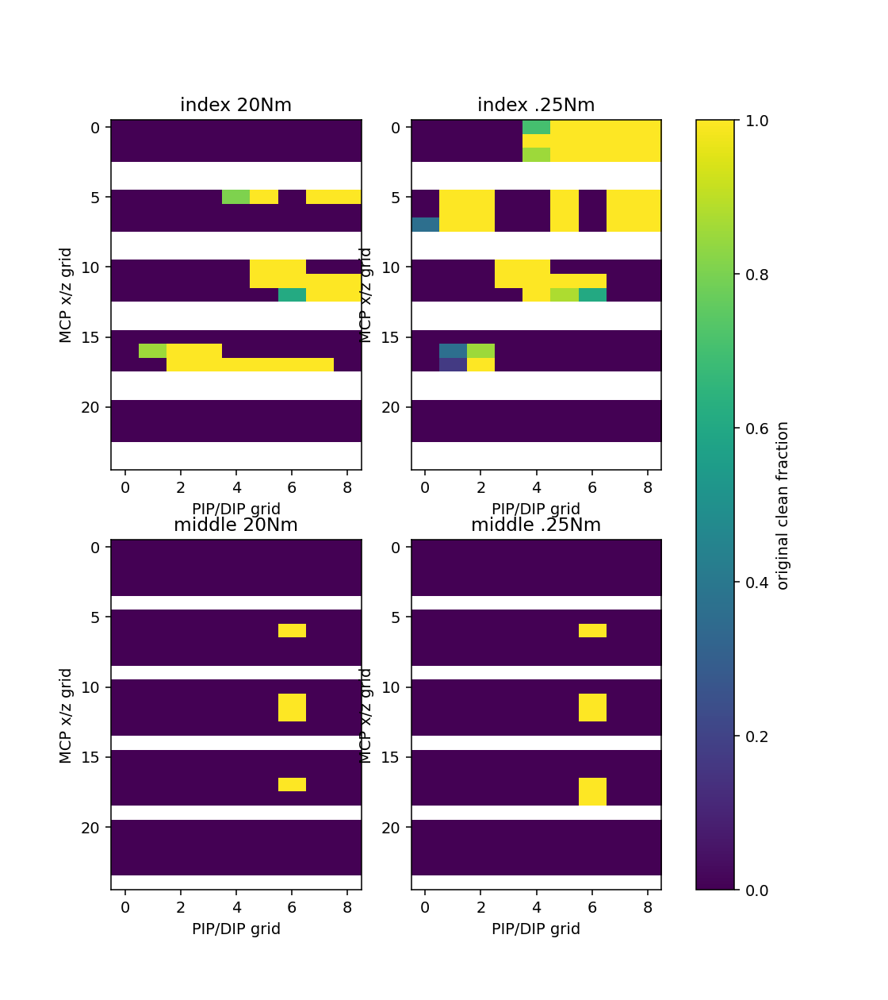

# 동일 유한목표 effort 비교

**검지는 유효135개 중 달성21→38개, 중지는180개 중4→5개다. 검지 새선정은0offset112, 중지는114유지다. 전체 wrong 평균은 두 손가락 모두 늘었으므로 이를 전반적 압현 개선으로 채택하지 않는다.** 전체 유효315개 첫시도씩을 원기준으로 비교했다. 제외135개를 성과분모에 끼워 넣거나 실패시도를 빼지 않았다. 정책성과·접촉쌍 압력·자유손 개선 인증이 아니다.

| 손가락/조건 | 달성/시도 | 평균clean/wrong | 물리/손목실패 |
|---|---:|---:|---:|
| index/baseline20 | 21/135 | 0.1576/0.3185 | 0/0 |
| index/cap025 | 38/135 | 0.3022/0.4074 | 0/0 |
| middle/baseline20 | 4/180 | 0.0222/0.6556 | 0/0 |
| middle/cap025 | 5/180 | 0.0278/0.6778 | 0/0 |

index 원랭킹 선정:20Nm 115 → .25Nm 112. 전체450행의 원장·음중세마디힘/각/손목/gate는 full_grid.csv에 보존했다.
middle 원랭킹 선정:20Nm 114 → .25Nm 114. 전체450행의 원장·음중세마디힘/각/손목/gate는 full_grid.csv에 보존했다.

| 손가락/조건/집단 | 시도/음중노출 | body1/2/3 평균 N | actual4 평균 ° | wrist mm/° |
|---|---:|---|---|---|
| index/baseline20/all | 135/135 | 58.0877, 2.7137, 6.7935 | 35.5786, 16.6206, 53.5036, 23.6426 | 7.2115, 1.4383 |
| index/baseline20/achieved | 21/21 | 61.0833, 0.0009, 3.1251 | 38.2911, 16.8855, 55.6555, 24.7946 | 5.0901, 1.1659 |
| index/baseline20/unachieved | 114/114 | 57.5358, 3.2134, 7.4692 | 35.0790, 16.5718, 53.1073, 23.4304 | 7.6023, 1.4884 |
| index/cap025/all | 135/135 | 9.6820, 0.0457, 1.9742 | 38.6798, 16.6269, 53.2955, 23.9183 | 7.9113, 1.5059 |
| index/cap025/achieved | 38/38 | 6.7499, 0.0113, 0.2508 | 33.7114, 12.9847, 55.5271, 25.7732 | 1.7999, 0.4406 |
| index/cap025/unachieved | 97/97 | 10.8307, 0.0591, 2.6493 | 40.6262, 18.0538, 52.4212, 23.1916 | 10.3054, 1.9232 |
| middle/baseline20/all | 180/180 | 0.2349, 0.0000, 7.4191 | 61.1365, 12.0345, 55.2816, 1.7180 | 4.3291, 2.1258 |
| middle/baseline20/achieved | 4/4 | 0.0000, 0.0000, 5.9445 | 61.4271, 11.9410, 60.4621, -3.2101 | 3.0065, 1.8244 |
| middle/baseline20/unachieved | 176/176 | 0.2402, 0.0000, 7.4526 | 61.1299, 12.0366, 55.1639, 1.8300 | 4.3592, 2.1327 |
| middle/cap025/all | 180/180 | 0.3240, 0.0000, 2.6004 | 59.6012, 12.7353, 56.4177, 2.2166 | 3.3637, 1.3369 |
| middle/cap025/achieved | 5/5 | 0.0000, 0.0000, 3.6945 | 60.8374, 13.5416, 61.1494, -2.9096 | 3.2009, 1.1270 |
| middle/cap025/unachieved | 175/175 | 0.3332, 0.0000, 2.5691 | 59.5659, 12.7123, 56.2825, 2.3631 | 3.3683, 1.3429 |

힘·각도·손목 집계는 각시도 audible 평균의 동일가중 평균이다. 미노출시도는 전체분모에 유지하되 힘0을 대입하지 않는다. 비교 JSON은 전체20지표의 시도평균 p95와 저장60Hz 최고값도 구분한다.

상세16 trace는60Hz이며 nearest height/cosine 잔차는 verification에 그대로 남겼다. native nearest sample이 저장되지 않아 CPU argmin을 native witness로 인증하지 않는다. 선택 target은 공통clock에서 exact 대조했고 actual state 동일성은 가정하지 않았다. effort16 변경은 비선택손가락과 wrist teacher feedback도 바꾸므로 개별접촉·원인을 단정하거나 기본채택하지 않는다.

각 유효목표당 고정 스크립트 첫시도1개이며 조건마다315시도(비교총630시도)다. 450선언 중 제외135개는 원 native 범위를 벗어난 동일행/원사유를 유지했다. 이 탐색의 선정은 반복 성공률이나 fresh4 검증이 아니다. 새112/114를 같은0.25Nm 조건에서 각각 새4첫시도로 재현하는 검사가 아직 필요하다.

| 손가락/조회 | 달성 | clean/wrong | body1/2/3 음중평균 N | actual4 ° | target4 ° | wrist mm/° | gate counts | 상세raw |
|---|---:|---:|---|---|---|---|---|---|
| index/20Nm/grid115 | True | 1.0000/0.0000 | 73.5966, 0.0000, 0.1500 | 36.7956, 17.5038, 59.4608, 24.0572 | 39.3069, 27.7555, 59.4847, 24.0676 | 1.1073, 0.2309 | 11/11/11/11/11/0 | 있음 |
| index/20Nm/grid112 | False | 0.0000/0.0000 | 72.2717, 0.0000, 0.0000 | 36.5831, 17.5032, 54.4852, 24.0680 | 39.3069, 27.7555, 54.4847, 24.0676 | 0.1471, 0.0292 | 0/11/11/0/0/0 | 있음 |
| index/.25Nm/grid115 | False | 0.0000/1.0000 | 9.3884, 0.0000, 1.9166 | 39.6200, 22.4552, 59.4378, 24.0080 | 39.3069, 27.7555, 59.4847, 24.0676 | 12.7505, 2.3206 | 11/0/0/0/0/11 | 있음 |
| index/.25Nm/grid112 | True | 1.0000/0.0000 | 7.9858, 0.0000, 0.1309 | 39.2379, 16.9356, 54.4715, 24.0627 | 39.3069, 27.7555, 54.4847, 24.0676 | 0.8258, 0.2339 | 11/11/11/11/11/0 | 있음 |
| middle/20Nm/grid114 | True | 1.0000/0.0000 | 0.0000, 0.0000, 4.7757 | 62.1231, 13.7047, 60.8895, -3.0224 | 64.1750, 11.3672, 61.9539, -2.5326 | 2.4079, 1.9913 | 8/8/8/8/8/0 | 없음 |
| middle/.25Nm/grid114 | True | 1.0000/0.0000 | 0.0000, 0.0000, 3.6245 | 61.3280, 14.1279, 61.1726, -2.8940 | 64.1750, 11.3672, 61.9539, -2.5326 | 2.2770, 1.0106 | 8/8/8/8/8/0 | 없음 |

선정112/114의 효과도 실제손가락·손목·teacher 피드백이 결합된 조건이다. 성공집단은 조건마다 구성행이 달라지므로 집단평균 차이를 같은자세의 단독 인과로 해석하지 않는다. 원20Nm 선택115를 .25Nm로만 실행해 검지0/4였던 별도4환경 재현과, 이 새grid112의1회성공을 섞지 않는다.

새 상세16trace의3512끝점에서 저장 candidate/wrong·6개phasegate·비cos19개통계를 재계산했다. 새height잔차>1µm0건, normalcos 집계 최대잔차7.2658e−7이다. 원 baseline grid actual 검수와 별도 baseline4재현의 nearest-height tie/원normalcos 한계는 원문 그대로이며 새grid에서 미저장 native sample을 보충했다고 주장하지 않는다. 동등 input/settings/target선언,105native속성16effort만·원90pairs,장면닫기/loader·pool복원/launcher0·핀불변을 확인했다. 저장끝점은60Hz로240Hz 최고힘/실제 현 압력·음향이 아니다.
