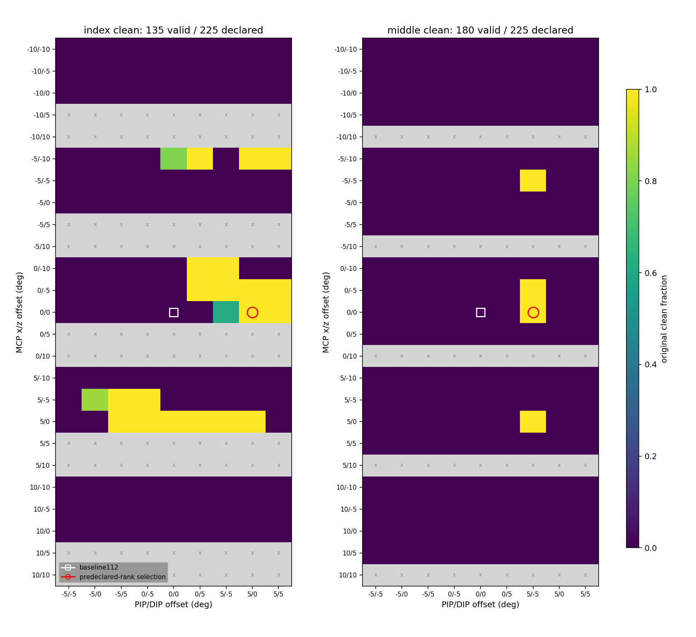
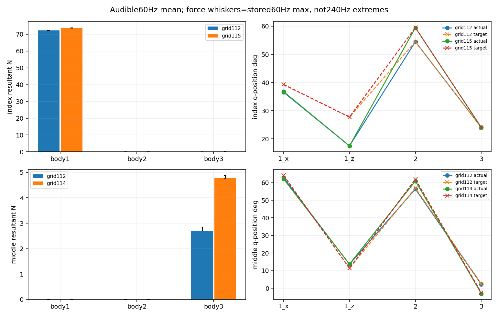

# 손가락4축 oracle grid 실제 결과

**검지135개 중21개, 중지180개 중4개가 사전 기준을 통과했다. 고정 순위로 검지115·중지114가 선정됐다. 각 행은 한 번의 scripted 시도이며 새4시도 재현·힘/자세 검토는 아직 미완료다. 정책 학습 성과가 아니다.**

| 손가락 | 선언/범위외/실행 | 달성/eligible | 선정 | offset 1x/1z/2/3 (도) | clean/wrong | 물리/손목 실패 |
|---|---:|---:|---:|---|---:|---:|
| index | 225/90/135 | 21/21 | 115 | 0, 0, 5, 0 | 100.00%/0.00% | 0/0 |
| middle | 225/45/180 | 4/4 | 114 | 0, 0, 5, -5 | 100.00%/0.00% | 0/0 |

전체450선언행과 제외사유는 full_grid.csv에 있으며 모든315유효행 첫 시도와 baseline112를 포함했다. 범위외는 검지90·중지45행으로 사전 명시했고 조용히 clamp하지 않았다. 새 성공 문턱이나 힘 eligibility를 추가하지 않았으며 순위는 perturbation 제곱합→최대 절대 변화→grid index다.

회색x는 범위외, 흰 사각형은 baseline112, 붉은 원은 사전 순위의 선정 행이다. 열9개와 행25개를 모두 유지했다. 각 셀은 같은 seed7의 서로 다른 scripted 목표 한 시도로, 반복성이나 전체 도달성을 인증하지 않는다.

아래 힘과 각도는 원 source onset≤source time<end의60Hz 요약이다. mean/max를 median이나240Hz 최대·현별압력으로 읽지 않는다.

| 손가락/grid | body1 mean/max N | body2 mean/max N | body3 mean/max N | actual q mean 도 | native target mean 도 |
|---|---:|---:|---:|---|---|
| index/112 | 72.2717/72.4143 | 0.0000/0.0000 | 0.0000/0.0000 | 36.583, 17.503, 54.485, 24.068 | 39.307, 27.756, 54.485, 24.068 |
| index/115 | 73.5966/73.7401 | 0.0000/0.0000 | 0.1500/0.2553 | 36.796, 17.504, 59.461, 24.057 | 39.307, 27.756, 59.485, 24.068 |
| middle/112 | 0.0000/0.0000 | 0.0000/0.0000 | 2.6981/2.8473 | 62.841, 13.578, 56.370, 2.197 | 64.175, 11.367, 56.954, 2.467 |
| middle/114 | 0.0000/0.0000 | 0.0000/0.0000 | 4.7757/4.8748 | 62.123, 13.705, 60.889, -3.022 | 64.175, 11.367, 61.954, -2.533 |

같은 음 중60Hz 구간의 손목/패드 평균과 gate 끝점 수다. gate 순서는 loaded/위치/위치+facing/positive/candidate/wrong다.

| 손가락/grid | 손목 mm/도 | nearest 거리/높이 mm | gate 끝점 수 |
|---|---:|---:|---|
| index/112 | 0.1471/0.0292 | 1.4833/1.4570 | 0/11/11/0/0/0 |
| index/115 | 1.1073/0.2309 | 0.3352/-0.2713 | 11/11/11/11/11/0 |
| middle/112 | 2.8407/2.2778 | 4.7568/3.2703 | 8/0/0/0/0/8 |
| middle/114 | 2.4079/1.9913 | 3.5428/2.8777 | 8/8/8/8/8/0 |

검지115는 사전 상세trace에 있어 baseline과 함께 원 helper 재생이 가능하다. 중지114는 사전 상세8행 밖이므로 새 원시trace가 없으며 위의 native 경량통계·원 ledger만 보고한다. 성공 뒤 그 행의 원시값을 추가 저장한 것처럼 다루지 않았다.

선정 후보의 음악 기준 통과와 하중/자연스러움은 분리된다. 검지의 proximal body1 합력이 큰 채 남고, body3의 작은 순힘도 기존 loaded 기준으로 판정된 접촉 후보일 뿐이다. 몸체 순힘은 특정 충돌쌍·끼임·현별힘·실제압력·음향을 인증하지 않는다. 후보는 정해진 perturbation 순위를 그대로 따른다.

상세16trace의 저장60Hz 끝점 candidate/wrong/거리/높이 및 phase gate/20metric 통계를 현재 원 helper와 독립 NumPy 계산으로 검산했다. 원 float32 streaming 통계와 재계산의 허용 오차는 verification.json에 명시했다. 전체315행의240Hz 음악 ledger 집계와16개 상세trace 재생을 구분하며, 미저장 모든 행의240Hz 자세/힘을 재구성하지 않았다.

검지·중지 두 scene 완료/닫힘·outer exit0·현재690준비핀·각 실제 입력·설정·native 범위·기준행·원 순위를 확인했다. no-NN/no-checkpoint scripted 실행이며 CPU 분석에서 새 GPU/native는 실행하지 않았다. 이 결과는 같은 후보의 새4시도 재현과 별도 힘/자세 확인을 거친 뒤 후속 학습 여부를 판단할 근거다. 해제·전환·자유 기타·전곡 성능은 미완료다.
