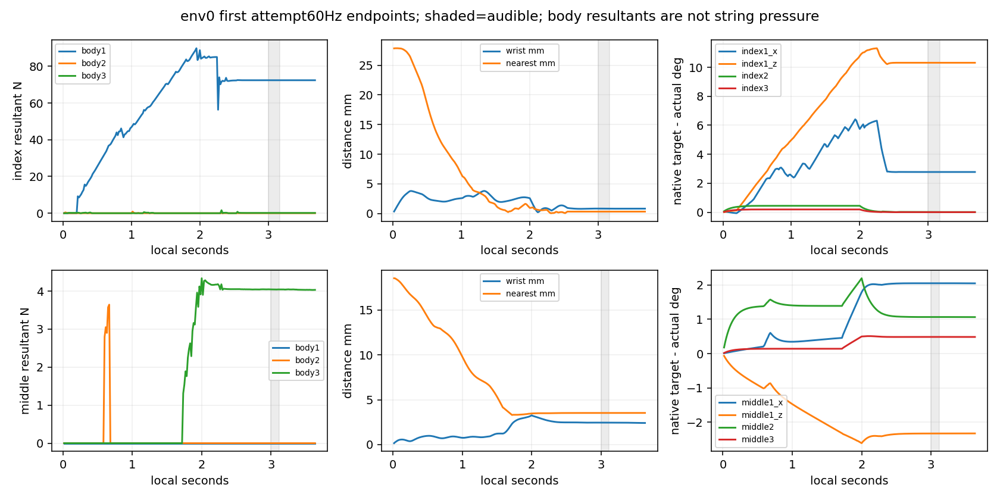

# 선정 목표4환경 재현 실제 결과

**검지115는 3/4 달성으로 사전 재현 기준 미달, 중지114는 4/4 달성으로 통과했다. 원각도+사전 offset의 동일 목표를 각4환경에서 새로 실행했다. NN/정책 학습이 아니며, 음악 판정 재현과 고proximal하중·자연스러움은 별개다.**

| 손가락/grid | 달성/첫시도 | 평균clean/wrong | 물리/손목실패 | 사전재현기준 |
|---|---:|---:|---:|---|
| index/115 | 3/4 | 75.000%/0.000% | 0/0 | 미통과 |
| middle/114 | 4/4 | 100.000%/0.000% | 0/0 | 통과 |

분모는 서로 다른env_id의첫시도각1개·총8개이며 조기실패도 제외하지 않는다. 4/4달성·평균clean≥70%·평균wrong≤10%·물리/손목실패0을 재계산했다. 같은seed7의4환경이며4seed가 아니다. 실패 뒤 후보 교체나 기준 완화는 하지 않았다.

| 손가락 | 원reference각도 | 사전offset도 | 선정최종각도 |
|---|---|---|---|
| index | 39.3069, 27.7555, 54.4847, 24.0676 | [0, 0, 5, 0] | 39.3069, 27.7555, 59.4847, 24.0676 |
| middle | 64.1750, 11.3672, 56.9539, 2.4674 | [0, 0, 5, -5] | 64.1750, 11.3672, 61.9539, -2.5326 |

index env2는 timeline_complete로 첫 시도를 끝냈으나 달성하지 못했다. missing 100.0%, wrong 0.0%이며 물리/손목 실패는 없었다. 음중 11개의60Hz 끝점 gate는0/11/11/0/0/0다. body1/2/3 합력평균90.0567, 0.0000, 0.0000N은 마디별로 구분하며, 높은 body1 합력을 distal loaded로 대체하지 않는다. 이 환경은 원장과 경량통계만 있고 상세 raw는 없으므로 매끝점 witness나 접촉쌍·인과를 확정하지 않는다.

각도순서는1_x/1_z/2/3이다. source teacher/reference는 원본 그대로이며 새선정각도를 원source목표라고 바꾸어 쓰지 않았다.

| 손가락/구분 | audible body1/2/3 평균N | 60Hz 최대N | actual4평균도 | native target4평균도 | 손목mm/도 | nearest mm | gate 끝점 |
|---|---|---|---|---|---|---:|---|
| index/parent grid env79 | 73.5966, 0.0000, 0.1500 | 73.7401, 0.0000, 0.2553 | 36.796, 17.504, 59.461, 24.057 | 39.307, 27.756, 59.485, 24.068 | 1.1073/0.2309 | 0.3352 | 11/11/11/11/11/0 |
| index/fresh env0 | 72.4104, 0.0000, 0.1333 | 72.4131, 0.0000, 0.1364 | 36.529, 17.444, 59.468, 24.061 | 39.307, 27.756, 59.485, 24.068 | 0.8426/0.1973 | 0.3357 | 11/11/11/11/11/0 |
| index/fresh env1 | 73.6473, 0.0000, 0.1488 | 73.6513, 0.0000, 0.1555 | 36.927, 17.500, 59.460, 24.055 | 39.307, 27.756, 59.485, 24.068 | 1.1238/0.2472 | 0.3336 | 11/11/11/11/11/0 |
| index/fresh env2 | 90.0567, 0.0000, 0.0000 | 90.0777, 0.0000, 0.0000 | 32.072, 16.427, 59.485, 24.068 | 39.307, 27.756, 59.485, 24.068 | 0.2305/0.0511 | 1.7601 | 0/11/11/0/0/0 |
| index/fresh env3 | 73.5126, 0.0000, 0.1269 | 73.5400, 0.0000, 0.1399 | 36.649, 17.493, 59.463, 24.058 | 39.307, 27.756, 59.485, 24.068 | 1.0566/0.2172 | 0.3127 | 11/11/11/11/11/0 |
| middle/parent grid env96 | 0.0000, 0.0000, 4.7757 | 0.0000, 0.0000, 4.8748 | 62.123, 13.705, 60.889, -3.022 | 64.175, 11.367, 61.954, -2.533 | 2.4079/1.9913 | 3.5428 | 8/8/8/8/8/0 |
| middle/fresh env0 | 0.0000, 0.0000, 4.0446 | 0.0000, 0.0000, 4.0456 | 62.125, 13.694, 60.888, -3.019 | 64.175, 11.367, 61.954, -2.533 | 2.4461/1.9985 | 3.5232 | 8/8/8/8/8/0 |
| middle/fresh env1 | 0.0000, 0.0000, 4.0216 | 0.0000, 0.0000, 4.0246 | 62.113, 13.673, 60.885, -3.020 | 64.175, 11.367, 61.954, -2.533 | 2.4607/1.9910 | 3.5172 | 8/8/8/8/8/0 |
| middle/fresh env2 | 0.0000, 0.0000, 4.0169 | 0.0000, 0.0000, 4.0218 | 62.113, 13.672, 60.885, -3.020 | 64.175, 11.367, 61.954, -2.533 | 2.4611/1.9910 | 3.5192 | 8/8/8/8/8/0 |
| middle/fresh env3 | 0.0000, 0.0000, 4.0148 | 0.0000, 0.0000, 4.0224 | 62.106, 13.663, 60.881, -3.021 | 64.175, 11.367, 61.954, -2.533 | 2.4583/1.9880 | 3.5178 | 8/8/8/8/8/0 |

gate순서는loaded/위치/위치+facing/positive/candidate/wrong다. `attempts.csv`는전체8행의음전/음중/음후24구간을포함한다. 부모grid의선정행과동일목표·제어계약이나 pool환경수와env_id가다르며 env-origin 부동소수점수치변이가능성을포함한다. 차이를정책학습이나단일원인효과로해석하지않는다.

두env0의새60Hz raw로현재원helper의candidate/wrong·거리·phase별6gate와선택각/힘/추종통계를재계산했다. 저장nearest높이의집계와CPUnearest선택의동일성은분리했다. middle114는이번에env0상세를새로확보했으며부모grid때없던raw를소급작성한것이아니다. 나머지6환경은원ledger와경량통계만있다. nearest 패드값은any-sample positive/candidate witness와동일점을보장하지않는다.240Hz음악원장과60Hz힘/각도끝점의범위를구분하며240Hz최대힘을주장하지않는다.

몸체1/2/3순힘은현별압력·특정충돌쌍·끼임·음향·자연스러운자세를인증하지않는다. 검지의높은proximal하중은별도문제로남고4/4음악판정통과와분리한다. 원PD/effort·충돌90쌍·범위·속도·손목v3·2초ramp/3초onset·원음길이/말미를그대로유지했다. 해제/전환·자유기타·전곡이나학습성과로확대하지않는다.

두실제launcher exit0·scene종료와750준비핀/실제전후입력·설정·contract·할당분모·clock을검증했다. CPU분석에서GPU/native/NN/checkpoint를실행하거나생성하지않았다. 입력SHA와helper재생허용오차는verification.json에남겼다.

CPU nearest 선택의 별도 검증한계:
- index: 높이차이>1µm는5끝점이며 전체끝점 최대0.164397061mm, 1µm초과 시각은2.833333초, 2.850000초, 3.033333초, 3.083333초, 3.683333초다. candidate/wrong는매끝점일치,positive포함6gate는저장phase count와일치했다(positive의별도끝점bool은미저장). nearest normal cosine 통계 최대잔차는 0.00515955다.
- middle: 높이차이>1µm는0끝점이며 전체끝점 최대0.000013039mm, 1µm초과 시각은없음다. candidate/wrong는매끝점일치,positive포함6gate는저장phase count와일치했다(positive의별도끝점bool은미저장). nearest normal cosine 통계 최대잔차는 0.00000040다.

검지의일부끝점에서는CPU계산상거의같은거리의패드샘플들이있으며, CPU/GPU 산술에따른 argmin분기차이가능성과정합한다. 실제native선택샘플은미확인으로남기며 높이/normal cosine의완전일치를인증하지않는다. 원native sample index가저장되지않아실제선택샘플을확정할수없다. float32/64 CPU최소3점거리·gap과원자료dtype(몸체/각/힘float32,저장scalar는Python float→float64이며추가native정밀도아님),nearest normal통계의잔차는verification.json에전부보존했다. 저장높이값을다른샘플로대체하거나허용오차를확대해통과시키지않았으며판정기준을변경하지않았다. 이차이는달성한env0의CPU재생에서발견됐으며, 상세raw가없는실패env2의압현실패원인으로연결하지않는다.
