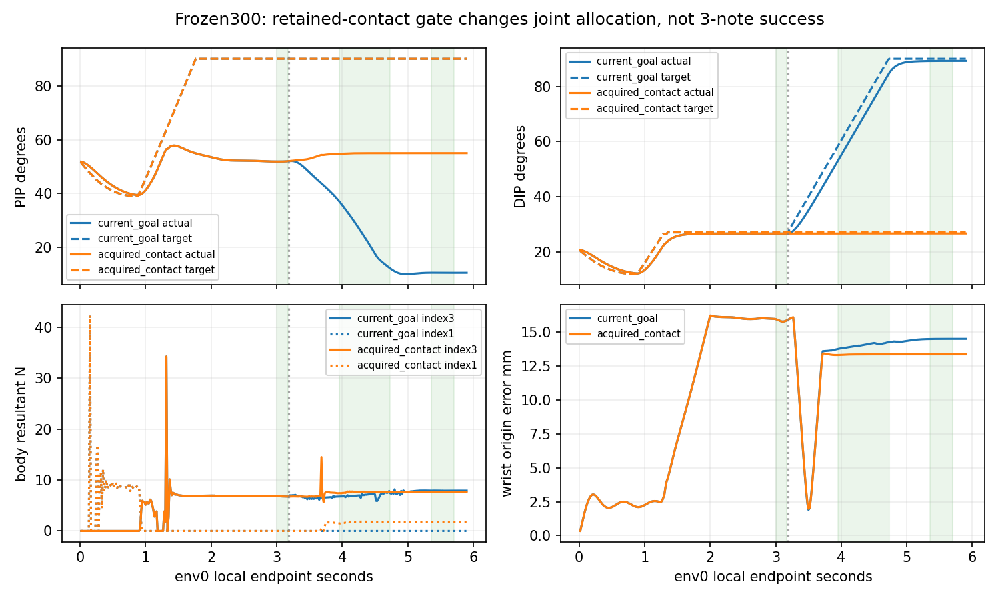

# 실제 결론: 마디 분담은 바뀌었지만 해제·전환은 미개선

두 조건 모두 A4는128/128·clean1/wrong0, B7/B8은각0/128·clean0/wrong1이다. 전체3음0/128·A native release0·물리/손목실패0으로 음악·해제·AND 모두 미달이다. 이번에는 A를 정상 달성했으므로 release0을 **성공한 A의 원 end..end+.10s 해제 창 미달**로 구분할 수 있다. 원256시도·768음/9보상을 모두 보존했다.

원 current-goal baseline은 frozen300의128 episode 전체와9보상, whole128 guard, env0 policy/executed action·q/target·candidate/wrong·손목 로그가 정확히 같다. 유일한 trace 차이는 순힘 **벡터 성분** 최대7.62939453125e-6N이다. 새 조건의 추가개입 전 whole128 scalar 및 env0 NN행동·q/target/기하 로그도 exact이고, 힘 성분 차이만 최대3.814697265625e-6N이다. 이 차이는 기록했으며 새 힘 허용문턱을 만들지 않았다.

128환경 모두 최초 추가억제는 precontrol clock764, local3.183333s(control index191)였다. 이후 추가 양의DIP 억제20,864 controls이며 총억제는 원14,564→35,428이다. A 기억의 획득156/소실28은 반복 사건 수이며156환경을 뜻하지 않는다. 원·새 조건 모두 B7/B8 획득0이고 none에서 유효한 A 기억이 남은1408 controls를 별도로 기록했다. 이 기억은60Hz cache이고240Hz 연속접촉 인증이 아니다.

| env0 음중 평균 | 원 current-goal | acquired-contact |
|---|---:|---:|
| B7 PIP 실제/목표 ° | 24.01 / 90.00 | 54.97 / 90.00 |
| B7 DIP 실제/목표 ° | 69.01 / 74.44 | 26.72 / 27.13 |
| B8 PIP 실제/목표 ° | 10.68 / 90.00 | 55.02 / 90.00 |
| B8 DIP 실제/목표 ° | 89.22 / 90.00 | 26.73 / 27.13 |
| B7 proximal/distal 합력N | 0 / 6.999 | 1.776 / 7.663 |
| B8 proximal/distal 합력N | 0 / 7.914 | 1.807 / 7.681 |
| B7/B8 손목 오차mm | 14.03 / 14.49 | 13.35 / 13.36 |

현재목표가 A에서 B로 넘어갈 때 기존 접촉을 기억하면 말미 DIP 추가굴곡과 PIP 붕괴는 억제됐다. 그러나 새 조건에서도 해제 창6/이동26 saved env0끝점에 A candidate가 남고, B7/B8 loaded46/21에도 position/facing/positive/candidate0·wrong46/21이다. CPU wrong 원인은 index3의 own-wrong-fret와 own-wrong-string이각46/21로 재구성됐으며 특정 접촉쌍의 인증은 아니다.

기존 정책의 MCP z는 하한−30도로 향하는 음수 명령을 계속 내지만 하한에서 목표 음수증분은0이다. PIP 목표90도와 MCP x의 다른 목표 누적은 남으며, 해제/이동 구간 PIP·DIP 음수명령도0이었다. 이번 개입은 열기 명령을 생성하거나 기존 목표오차를 풀지 않는다. 따라서 추가 양의DIP 증분을 막는 것만으로 실제 해제와 새 위치 압현을 얻지는 못했다. distal 하중도 일관되게 낮아지지 않았고 proximal 하중이 늘어 전체저하중을 주장하지 않는다.

모델/RNG/updates는 평가 전후 동일하고 원 strict identity와 별도 execution_override를 유지했다. 개입 뒤에는 target_error와 실제 상태가 달라져 actor/팔 feedback도 달라질 수 있다. 결과는 해당 닫힌 루프 실행개입의 관찰이며 고정명령 tape나 다른3축·보상·일반제어의 단일 원인 해결로 확대하지 않는다. 다른127환경 상세힘/nativeqd·native nearestpoint·240Hz재접촉은 미저장이며 body resultant는 pair 압력·토크·피부전체분리 인증이 아니다. 추가 진단·학습·기준 변경은 하지 않았다.

